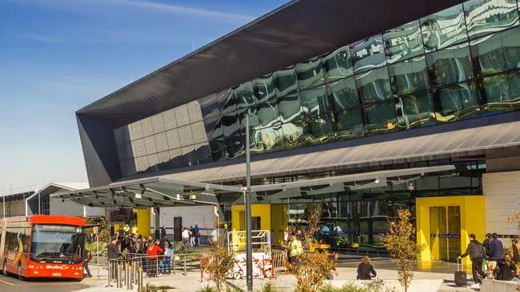

১৮ মার্চ লন্ডনে স্কাইট্র্যাক্স ওয়ার্ল্ড এয়ারপোর্ট অ্যাওয়ার্ডস ২০২৬ ঘোষণা করা হয়, এবং মেলবোর্ন বিমানবন্দর (MEL) আবারও অস্ট্রেলিয়া-প্যাসিফিকের সেরা বিমানবন্দরের স্বীকৃতি পেয়েছে — গত সাত বছরে এটি ষষ্ঠবার আঞ্চলিক শিরোপা জিতল। দীর্ঘ-দূরত্বের রুটের ওপর নির্ভরশীল একটি দক্ষিণ গোলার্ধের হাবের জন্য এই ফলাফল বলছে, যাত্রীরা এখনও সামগ্রিক অভিজ্ঞতাকে উঁচু রেটিংই দিচ্ছেন।

একই তালিকা গল্পের বাকি অর্ধেকটাও বলে। বৈশ্বিক তালিকায় মেলবোর্নের অবস্থান ২১তম — গত বছরের ১৬তম থেকে পাঁচ ধাপ নিচে। আঞ্চলিক চ্যাম্পিয়ন আর বৈশ্বিক মধ্যম সারির মধ্যে এই ব্যবধান সহজেই মিলে যায় বিমানবন্দর কর্তৃপক্ষ নিজেই স্বীকার করা দুটি বিষয়ের সঙ্গে: যাত্রীসংখ্যা বাড়ছে, আর অবকাঠামো পিছিয়ে পড়তে শুরু করেছে। এই নিবন্ধে দেখা হয়েছে পুরস্কারটি কী মাপে, মেলবোর্নের রুট নেটওয়ার্কে কী বদলেছে এবং ৪.৫ বিলিয়ন অস্ট্রেলীয় ডলারের আন্তর্জাতিক টার্মিনাল সম্প্রসারণ কীভাবে যাত্রীদের কাছে পৌঁছাবে।

## ১. সাত বছরে ষষ্ঠবার: অঞ্চলে প্রথম, বিশ্বে ২১তম

স্কাইট্র্যাক্স র‌্যাঙ্কিং তৈরি হয় বিশ্বের ৫৭৫টি বিমানবন্দর নিয়ে করা যাত্রী-সন্তুষ্টি জরিপের ভিত্তিতে। এখানে কোনো বিশেষজ্ঞ জুরি নেই; স্কোর আসে যাত্রীদের দেওয়া রেটিং থেকে — চেক-ইন, নিরাপত্তা, খাবার, কেনাকাটা ও কর্মীদের আচরণ। তাই তালিকায় ওঠানামা প্রায়ই ট্রফির চেয়ে বেশি কিছু বলে।

এই শিরোপার সঙ্গে মেলবোর্নের চেনাশোনা পুরোনো। সাত বছরে এটি ছয়বার জিতেছে; একমাত্র ব্যতিক্রম ২০২২ সালে, যখন ব্রিসবেন বিমানবন্দর সংক্ষিপ্তভাবে আঞ্চলিক মুকুটটি নিয়েছিল। এ বছর তা ফিরে পাওয়া বোঝায়, অস্ট্রেলিয়ার প্রধান হাবগুলোর মধ্যে যাত্রীরা এখনও মেলবোর্নকেই সবচেয়ে উঁচু রেটিং দেন।

তবে বৈশ্বিকভাবে বিমানবন্দরটি পিছিয়েছে: এক বছর আগের ১৬তম থেকে এখন ২১তম। একই তালিকায় সিঙ্গাপুর চাঙ্গি টানা দ্বিতীয়বার এবং সব মিলিয়ে চতুর্দশবার বিশ্বের সেরা বিমানবন্দর হয়েছে; সিউল ইনছন দ্বিতীয় ও টোকিও হানেদা তৃতীয়। হংকং ইন্টারন্যাশনাল চতুর্থ, লন্ডন হিথ্রো ১৬তম এবং লন্ডন গ্যাটউইক ৩০তম।

শীর্ষের নিচে অস্ট্রেলীয় ফলাফলগুলো ছড়িয়ে গেছে: ব্রিসবেন ৪০তম, সিডনি ৫২তম, আর পার্থ, অ্যাডিলেড ও গোল্ড কোস্ট সবাই বৈশ্বিক শীর্ষ ১০০-এর মধ্যে। অঞ্চলের ভেতরের ব্যবধান বাড়েনি, কিন্তু এশিয়ার শীর্ষ হাবগুলোর সঙ্গে দূরত্ব এখনও আছে — কোনো অস্ট্রেলীয় বিমানবন্দর শীর্ষ দশে জায়গা পায়নি।

## ২. তালিকার অন্য প্রান্ত: চাঙ্গির চতুর্দশ শিরোপা, আর হামাদের অনুপস্থিতি

এ বছরের তালিকার শীর্ষে একটি পরিবর্তন সহজে চোখে পড়ে না। অস্ট্রেলীয় গণমাধ্যমের খবর অনুযায়ী, গত বছরের রানার-আপ দোহা'র হামাদ ইন্টারন্যাশনাল এয়ারপোর্ট শেষ মুহূর্তে পুরস্কার থেকে সরে দাঁড়ায়, কারণ চলমান সংঘাতের কারণে কাতারের আশপাশের মধ্যপ্রাচ্যের আকাশসীমা বন্ধ রয়েছে। খবরে এটিকে শীর্ষ পুরস্কারের জন্য শক্ত দাবিদার বলা হয়েছিল।

এতে তালিকার শীর্ষে একটি পরিচিত নাম থাকল না। চাঙ্গির চতুর্দশ বিশ্ব শিরোপাও এসেছে একই যাত্রী-জরিপ থেকেই, আর একটি বিমানবন্দর বাদ পড়লেই আঞ্চলিক মুকুট বদলায় না — মেলবোর্নের প্রতিযোগী ব্রিসবেন ও সিডনি, সঙ্গে এমন যাত্রীরা যাদের প্রত্যাশা প্রতি বছর বদলায়।

এসব তালিকা যারা অনুসরণ করেন, তাদের জন্য বেশি কাজে লাগে দলভিত্তিক পড়াটা: বৈশ্বিক শীর্ষ চারে আছে সিঙ্গাপুর, দক্ষিণ কোরিয়া, জাপান ও হংকং; যুক্তরাজ্যের সর্বোচ্চ র‌্যাঙ্কিংয়ের বিমানবন্দর হিথ্রো ১৬তম; অস্ট্রেলিয়া-প্যাসিফিকের শীর্ষে মেলবোর্ন ২১তম। প্রতিটি দল ভালো-মন্দের সরল রায় নয়, বরং ভিন্ন ভিন্ন ট্রান্সফার প্রবাহ ও রুট নেটওয়ার্কের প্রতিফলন।

## ৩. রেকর্ড যাত্রীসংখ্যা ও নতুন এয়ারলাইন্স: আন্তর্জাতিক নেটওয়ার্ক পুনর্গঠন

পুরস্কারটি এসেছে মেলবোর্নের জন্য এক উঁচু মুহূর্তে। জানুয়ারিতে বিমানবন্দরটি আন্তর্জাতিক যাত্রীসংখ্যায় রেকর্ড গড়ে, যা প্রমাণ করে বিদেশ ভ্রমণে মহামারি-পরবর্তী পুনরুদ্ধার অনেকটাই সম্পূর্ণ।

গত ছয় মাসে বিমানবন্দরটি কয়েকটি আন্তর্জাতিক এয়ারলাইন্স যোগ করেছে: ডেল্টা এয়ার লাইন্স লস অ্যাঞ্জেলেস, হংকং এয়ারলাইন্স হংকং এবং শেনচেন এয়ারলাইন্স শেনচেন রুট চালু করেছে। ইন্দোনেশিয়া এয়ারএশিয়া, মালদিভিয়ান, ফিনএয়ার ও ব্রিটিশ এয়ারওয়েজ নতুন রুট নিয়ে আসছে।

যাত্রীদের জন্য তাৎক্ষণিক ফল হলো বেশি বিকল্প: প্রশান্ত মহাসাগর পেরিয়ে সরাসরি লস অ্যাঞ্জেলেসের সুযোগ, আর দক্ষিণ চীনের জন্য হংকং ও শেনচেনে সরাসরি সংযোগ। বেশি রুট মানে ব্যস্ততর টার্মিনালও — আন্তর্জাতিক ভবনটির ধারণক্ষমতা আগেই টানটান ছিল, আর নতুন যাত্রীপ্রবাহ আসে ঠিক সেই সকাল ও সন্ধ্যার ঢেউয়ে, যা লাঘব করার জন্যই সম্প্রসারণ প্রকল্প।

## ৪. আর্গাস: গর্ব, সঙ্গে ঘাটতির সৎ তালিকা

প্রধান নির্বাহী লরি আর্গাস পুরস্কারকে স্বাগত জানিয়ে বলেন, এটি এমন এক গুরুত্বপূর্ণ মুহূর্তে এল যখন বিমানবন্দর একটি বড় রূপান্তরের দিকে এগোচ্ছে। এক বিবৃতিতে তিনি বলেন, “যাত্রীরা আমাদের অঞ্চলের সেরা বিমানবন্দর হিসেবে ধরে রেখেছেন — এতে আমরা খুব গর্বিত, তবে আমরা আরও ভালো করতে চাই।”

অবকাঠামো ও সীমান্ত প্রযুক্তির ঘাটতি নিয়েও তিনি ছিলেন স্পষ্টভাষী: যাত্রীদের এখনও কাগজের আগমন কার্ড পূরণ করতে হয়, আর অভিবাসন প্রক্রিয়ার যন্ত্রপাতির পরিমাণ এক দশক আগের প্রায় অপরিবর্তিত। এসব খুঁটিনাটি তুচ্ছ শোনায়, কিন্তু আন্তর্জাতিক যাত্রী প্রথমেই এগুলোর মুখোমুখি হন — কাগজের কার্ড মানে নামার পরে তা পূরণের জায়গা খোঁজা, আর বাড়তে থাকা যাত্রীপ্রবাহের বিপরীতে স্থির অভিবাসন ক্ষমতা মানে ব্যস্ত সময়ে দীর্ঘতর সারি।

“অঞ্চলের সেরা”র পাশে বসিয়ে পড়লে দুটি বক্তব্য পরস্পরবিরোধী নয়। যাত্রীরা সামগ্রিক অভিজ্ঞতাকে স্কোর দেন; পরিচালক জানেন সেই অভিজ্ঞতার সীমা ঠিক করে দেয় এমন হার্ডওয়্যার, যার ছবি কেউ তোলে না। সম্প্রসারণ ও যন্ত্রপাতি নবায়ন সেই নির্ণয়েরই জবাব।

## ৫. ৪.৫ বিলিয়ন অস্ট্রেলীয় ডলার: সেপ্টেম্বর থেকে নতুন কার্বসাইড এলাকা, পাঁচটি নতুন স্ট্যান্ড

ভবিষ্যতের চাহিদা মেটাতে বিমানবন্দরটি আন্তর্জাতিক টার্মিনালের ৪.৫ বিলিয়ন অস্ট্রেলীয় ডলারের সম্প্রসারণ প্রকল্প শুরু করেছে। সেপ্টেম্বর থেকে টার্মিনাল ১, ২ ও ৩-এ খুলবে নতুন পিক-আপ ও ড্রপ-অফ এলাকা, যার জায়গা বর্তমানের দ্বিগুণেরও বেশি — এতে টার্মিনাল নির্মাণের জন্য জমি খালি হবে। সম্পূর্ণ হলে সম্প্রসারণে যোগ হবে আরও বড় চেক-ইন হল ও পাঁচটি নতুন বিমান স্ট্যান্ড।

ধারাবাহিকতাটি লক্ষণীয়: আগে সরে কার্বসাইড ও সড়ক ব্যবস্থা, টার্মিনাল নিজে নয়। যাত্রীদের কাছে ড্রপ-অফ, পিক-আপ আর হাঁটার দূরত্ব সাধারণত ভেতরের মেঝের পালিশের চেয়ে বিমানবন্দরের স্মৃতি বেশি গড়ে দেয়; ওই জায়গা দ্বিগুণ হওয়াই প্রকল্পের সেই অংশ, যা যাত্রীরা সবার আগে টের পাবেন।

২০৩২ ব্রিসবেন অলিম্পিকের প্রেক্ষাপটে সময়টা বেশি যুক্তিসঙ্গত মনে হয়। অস্ট্রেলিয়ার বিমানবন্দর ব্যবস্থা সময়সীমার চাপে উন্নীত হচ্ছে, আর মেলবোর্ন আয়োজক শহর না হলেও আন্তঃরাজ্য ও আন্তর্জাতিক যাত্রীপ্রবাহের একটি অংশ বহন করবে। আঞ্চলিক শিরোপা এক একটি পর্যায়ের ফল; আসল পরীক্ষা হলো, যাত্রীদের পরবর্তী ঢেউ আসার আগে নির্মাণকাজ শেষ হয় কি না।

## ৬. যাত্রীদের জন্য এর অর্থ

নিকট মেয়াদে নজর রাখার বিষয় হলো স্থলপথে প্রবেশ। সেপ্টেম্বর থেকে টার্মিনাল ১, ২ ও ৩-এর কার্বসাইড এলাকা ধাপে ধাপে বদলাবে, তাই যাত্রার আগে বিমানবন্দরের সাইটে দেখে নিন কোন প্রবেশপথ ও পিক-আপ পয়েন্ট প্রযোজ্য — বিশেষত যদি গাড়িতে নামানো হয় বা রাইডশেয়ার ব্যবহার করেন।

তারপর সময়। জানুয়ারিতে আন্তর্জাতিক যাত্রীপ্রবাহ রেকর্ড ছুঁয়েছে, আর পিক সিজনের সকালে আন্তর্জাতিক প্রস্থান হল আরও ধীর হবে। ট্যাক্স রিফান্ড নিচ্ছেন, অতিরিক্ত বড় ব্যাগ চেক-ইন করছেন বা ঘোষণার মতো পণ্য বহন করছেন — স্বাভাবিকের চেয়ে বেশি সময় রাখুন।

শেষে, প্রত্যাশা মিলিয়ে নিন। অঞ্চলের সেরা মানে যাত্রী-সন্তুষ্টির স্কোর, প্রতিটি যাত্রা মসৃণ হবে এমন প্রতিশ্রুতি নয়। কাগজের আগমন কার্ড আর অভিবাসনের সারি এখনও আছে, আর বিমানে ওঠার আগের এক ঘণ্টার চেয়ে নামার পরের আধা ঘণ্টা আপনার ধৈর্যের বেশি পরীক্ষা নিতে পারে। বিমানবন্দর বাছাইয়ের সময় পুরস্কারটিকে একটি ইনপুট হিসেবেই ধরুন, আর সময়ের বাফার ঠিক রেখে দিন।

## সম্পর্কিত লিংক

- **এই সাইটে**: [সিডনি বিমানবন্দর (SYD)](/airport/SYD), [অ্যাডিলেড বিমানবন্দর (ADL)](/airport/ADL), [অস্ট্রেলিয়া (AU)](/country/AU)
- **উইকিপিডিয়া**: [মেলবোর্ন বিমানবন্দর](https://en.wikipedia.org/wiki/Melbourne_Airport)
- **বাইদু বাইকে**: [মেলবোর্ন বিমানবন্দর](https://baike.baidu.com/item/%E5%A2%A8%E5%B0%94%E6%9C%AC%E6%9C%BA%E5%9C%BA)

ছবির সূত্র: News.com.au ও WeMelbourne। পুরস্কারের নাম ও র‌্যাঙ্কিং স্কাইট্র্যাক্স প্রকাশিত হিসেবেই; কার্বসাইডের চলমান ব্যবস্থা ও নির্মাণের সময়সূচির জন্য মেলবোর্ন বিমানবন্দরের নিজস্ব সাইট দেখুন।
