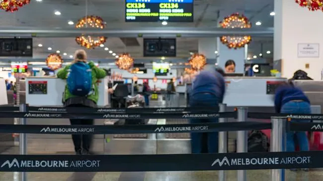
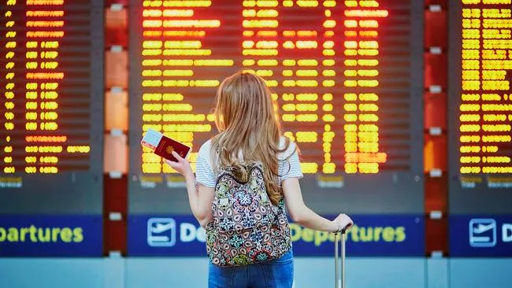

2026年スカイトラックス世界空港賞は3月18日にロンドンで発表され、メルボルン空港（MEL）が再びオーストラリア・太平洋地域の最優秀空港に選ばれました。過去7年間で6度目の地域タイトル獲得です。国際ネットワークを長距離路線に依存する南半球のハブにとって、この結果は旅行者が総合体験を依然として高く評価していることを示しています。

同じリストは物語のもう半分も語っています。メルボルンの世界順位は21位で、昨年の16位から5つ下がりました。地域王者と世界の中位という差は、空港自身も認める二つの点にきれいに対応します。旅客数は増えており、インフラは遅れ始めているのです。この記事では、この賞が何を測っているのか、メルボルンの路線網に何が起きたのか、総額45億豪ドルの国際ターミナル拡張がどう旅客に届くのかを見ていきます。

## 1. 7年で6度目：地域1位、世界21位

スカイトラックスのランキングは、世界575空港を対象とした旅客満足度調査に基づいています。専門家の審査員はおらず、スコアはチェックイン、保安検査、食事、買い物、スタッフを旅行者が評価したものです。だからこそ、順位の動きはトロフィー以上に多くを語ることがあります。

メルボルンはこのタイトルをよく知っています。7年間で6度受賞し、唯一中断したのは2022年、ブリスベン空港が一時的に地域の王座を奪ったときでした。今年それを取り戻したことは、オーストラリアの主要ハブの中で旅行者が依然としてメルボルンを最も高く評価していることを示唆します。

しかし世界全体では後退しています。21位で、一年前の16位から下がりました。同じリストで、シンガポール・チャンギ空港は2年連続、通算14度目の世界最優秀空港に選ばれ、ソウル・仁川が2位、東京・羽田が3位でした。香港国際空港は4位、ロンドン・ヒースローは16位、ロンドン・ガトウィックは30位です。

オーストラリアの結果は上位以下で分かれました。ブリスベン40位、シドニー52位で、パース、アデレード、ゴールドコーストも世界トップ100に入っています。地域内の差は広がっていませんが、アジアの主要ハブとの距離は残っています。オーストラリアの空港でトップ10に入ったところはありません。

## 2. 順位表のもう一端：チャンギの14度目とハマドの不在

今年のリストの頂点にある変化は見落としやすいものです。オーストラリアのメディア報道によると、昨年の2位だったドーハのハマド国際空港は、カタール周辺の中東空域が現在の紛争で閉鎖されたため、直前で賞から撤退しました。報道は同空港を最高賞の有力候補と評していました。

そのため順位表の頂点にはいつもの名前がありません。チャンギの14度目の世界一は同じ旅客調査によるものであり、一つの空港が欠けたからといって地域の王座が変わるわけではありません。メルボルンの競争相手はブリスベンとシドニー、そして年ごとに期待値を変える旅行者たちです。

こうしたリストを追う人にとって、より有用な読み方はグループ別です。世界トップ4はシンガポール、韓国、日本、香港が占め、英国の最高位はヒースロー16位、オーストラリア・太平洋地域の首位はメルボルン21位です。各グループは善し悪しの単純な判定ではなく、異なる乗り継ぎの流れと路線網を反映しています。

## 3. 過去最多の旅客数と新航空会社：国際ネットワークの再構築

この賞はメルボルンにとって最高のタイミングで届きました。1月、空港は国際旅客数で過去最高を記録し、海外旅行のパンデミック後の回復がほぼ完了した証拠となりました。

過去半年で、空港は複数の国際航空会社を迎えました。デルタ航空がロサンゼルス、香港航空が香港、深圳航空が深圳に就航しました。インドネシア・エアアジア、モルディビアン、フィンエアー、ブリティッシュ・エアウェイズも新路線で続く予定です。

旅行者にとっての直接の効果は選択肢の増加です。太平洋を越えてロサンゼルスへ直行でき、中国南部へは香港と深圳への直行便があります。路線が増えればターミナルも混雑します。国際線ターミナルはすでに容量が厳しく、新しい旅客は拡張が緩和しようとしているのと同じ朝と夕方の波でやってきます。

## 4. アーガス：誇りと、正直な課題のリスト

ロリー・アーガス最高経営責任者は受賞を歓迎し、空港が大きな変革期に入る重要な瞬間に届いたと述べました。「旅行者が私たちを地域最高の空港と評価し続けていることを非常に誇りに思いますが、もっと良くしたいとも考えています」と声明で語りました。

彼女はインフラと国境管理技術の課題についても率直でした。旅客は依然として紙の入国カードに記入しなければならず、入国審査機器の数は10年前とほとんど変わっていません。こうした細部は小さく聞こえますが、国際線到着客が最初に出会うものです。紙のカードは着陸後に記入場所を探すことを意味し、増える旅客に対して固定された入国審査能力はピーク時の列を長くします。

「地域最高」と並べて読むと、二つの発言は矛盾していません。旅客は総合体験を評価し、運営側はその体験の上限が誰も写真に撮らないハードウェアで決まると知っています。拡張と機器の更新は、その診断への対応です。

## 5. 45億豪ドル：9月から新しい乗降エリア、5つの新しい駐機スポット

将来の需要に応えるため、空港は国際ターミナルの45億豪ドル規模の拡張に着手しました。9月から、第1、第2、第3ターミナルは現在の2倍以上の広さを持つ新しい乗降エリアを開設し、ターミナル建設のための用地を確保します。完成すれば、拡張によりより広いチェックインホールと5つの新しい駐機スポットが加わります。

順序は注目に値します。最初に動くのはターミナル自体ではなく、乗降場と道路システムです。旅客にとって、送迎、乗車、歩く距離は、内部の床の光沢よりも空港の記憶を形作ることが多いのです。その空間を2倍にすることが、旅行者が最初に実感する部分です。

2032年ブリスベン・オリンピックと照らし合わせると、タイミングはより納得できます。オーストラリアの空港システムは締め切りのプレッシャーの下で改良されており、メルボルンは開催都市ではありませんが、州間および国際旅客の一部を吸収します。地域タイトルは途中経過の結果です。本当の試練は、次の旅客の波が来る前に建設が終わるかどうかです。

## 6. 旅行者にとっての意味

当面注目すべきは地上アクセスです。9月から第1、第2、第3ターミナルの乗降エリアが段階的に変わります。旅行前に空港のサイトで、どの入口と乗車地点が該当するか確認してください。特に車で送ってもらう場合や配車サービスを使う場合は重要です。

次に時間です。1月に国際旅客数は過去最高を記録し、繁忙期の朝の国際線出発ホールはより遅くなるでしょう。免税還付を受ける場合、大型荷物を預ける場合、申告する商品を持つ場合は、いつもより余裕を持ってください。

最後に期待値を調整しましょう。地域最高は旅客満足度のスコアであり、すべての旅がスムーズになるという約束ではありません。紙の入国カードと入国審査の列は依然としてあり、着陸後の30分は搭乗前の1時間以上に忍耐を試されるかもしれません。この賞は空港選びの一つの材料として扱い、時間の余裕は確保しておきましょう。

## 関連リンク

- **このサイト内**：[シドニー空港 (SYD)](/airport/SYD)、[アデレード空港 (ADL)](/airport/ADL)、[オーストラリア (AU)](/country/AU)
- **Wikipedia**：[メルボルン空港](https://en.wikipedia.org/wiki/Melbourne_Airport)
- **百度百科**：[メルボルン空港](https://baike.baidu.com/item/%E5%A2%A8%E5%B0%94%E6%9C%AC%E6%9C%BA%E5%9C%BA)

画像出典：News.com.au、WeMelbourne。賞の名称と順位はスカイトラックスの公表によるものです。現在の乗降場の配置と建設スケジュールは、メルボルン空港の公式サイトで確認してください。
