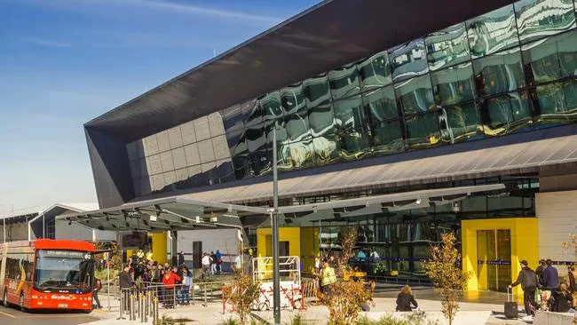
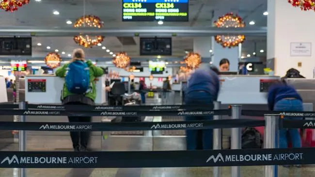
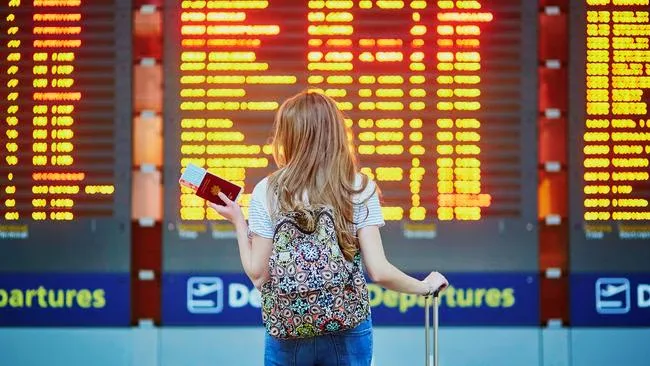

3月18日，Skytrax 2026 世界机场奖在伦敦揭晓。墨尔本机场（MEL）再次被评为“澳洲及太平洋地区最佳机场”，这是它在过去七年里第六次拿到这个区域头衔。对一座国际航线需要靠长航线撑起来的南半球枢纽来说，这个结果说明旅客对它的整体体验仍然认可。

但同一份榜单也给出了另一面：墨尔本此次全球排名第21位，比去年的第16位下滑五位。区域冠军与全球名次之间的落差，恰好对应机场自己承认的两件事——客流在涨，基础设施却开始跟不上。本文梳理这份榜单的含义、墨尔本眼下的航线变化，以及那座45亿澳元的国际航站楼扩建会怎样落到旅客身上。

## 一、七年里的第六次：区域第一，全球第21

Skytrax 的这项评选基于旅客满意度调查，覆盖全球575座机场。它不依赖专家评审团，分数来自旅客对值机、安检、餐饮、购物、工作人员态度等环节的评价，因此名次的变化往往比奖杯本身更能说明问题。

墨尔本对“澳洲及太平洋地区最佳”这个头衔并不陌生。过去七年里它六次登顶，唯一一次旁落是2022年，布里斯班机场短暂接过了这个位置。今年它重新把区域第一拿回来，说明在澳洲几座主要枢纽之间，旅客对墨尔本的满意度仍然领先。

但放到全球范围内，墨尔本的位置在后退：第21位，去年是第16位。同一份榜单上，新加坡樟宜机场连续第二年排名全球第一，这也是它第14次夺得世界最佳机场；首尔仁川第二，东京羽田第三。香港国际机场排在第四，伦敦希思罗第16位，伦敦盖特威克第30位。

澳洲其他机场的表现则出现分化：布里斯班第40位，悉尼第52位，珀斯、阿德莱德和黄金海岸也进入了全球前100。区域内部的差距没有拉开，但与亚洲头部枢纽之间的距离依然存在——前十里没有一座澳洲机场。

## 二、榜单的另一头：樟宜第14次，哈马德缺席

今年榜单顶部还有一个容易被忽略的变动。据澳大利亚媒体报道，去年亚军、卡塔尔哈马德国际机场在最后时刻宣布退出评选，原因是中东冲突导致卡塔尔周边空域关闭；报道称，它原本是这个奖项的有力竞争者。

这让今年榜单顶部少了一个常客。樟宜的第14个“世界最佳机场”头衔，仍然是在同一套旅客调查口径下产生的；而区域冠军的归属，也不因某一座机场的缺席而改变——墨尔本要面对的是布里斯班、悉尼这些同区域对手，以及旅客逐年变化的期待。

对常看榜单的旅客来说，这份名单更实用的读法是看“分组”：全球前四被新加坡、韩国、日本和中国香港的四座枢纽占据，欧洲排名最高的英国机场是希思罗（第16），澳洲与太平洋地区的第一是墨尔本（第21）。每一组对应的是不同的中转需求和航线结构，而不是一个简单的“好”与“不好”。

## 三、客流纪录与新航司：国际网络在补课

这份荣誉发布的时间点，正好赶上墨尔本机场的一个高点。今年1月，机场创下国际旅客量最高纪录，显示疫情后国际出行需求的恢复已经走完大半程。

过去半年，机场吸引了几家新的国际航司入驻：Delta Air Lines 开通洛杉矶航线，香港航空开通香港航线，深圳航空开通深圳航线。接下来，印尼亚洲航空、马尔代夫航空、芬兰航空和英国航空也计划陆续开通新航线。

对旅客来说，最直接的变化是选择变多：北美方向多了一条洛杉矶直飞，香港与深圳则补上了华南方向的直连。但航线增加也意味着航站楼更挤——国际航站楼的设计容量本就吃紧，新航司带来的客流会集中在早晚的航班波次里，这也是扩建计划被反复提及的背景。

## 四、Argus 的两句话：自豪，以及短板

墨尔本机场首席执行官 Lorie Argus 对这次获奖表示欢迎，并指出这项荣誉正值机场迈向未来、进行重大转型的关键阶段。她在声明中说：“我们非常自豪旅客持续将我们评为本地区最佳机场，但我们也希望做得更好。”

她同时直言，机场的基础设施和边境技术仍有短板：旅客至今仍需填写纸质入境卡，移民通关设备的数量与十年前几乎无异。这两件事听起来琐碎，却是国际到达旅客最先接触到的环节——纸质入境卡意味着落地后还要找地方填表，边检通道数量不变而客流在涨，高峰时段的排队时间就会被拉长。

把这句话和“区域最佳”放在一起看，会发现并不矛盾：旅客打分评价的是整体体验，而机场管理者清楚，体验的天花板正被这些看不见的硬件卡住。扩建与设备更新，正是对这个判断的回应。

## 五、45亿澳元扩建：9月起的新接送区与五个新机位

为应对未来的需求，机场已启动总额45亿澳元的国际航站楼扩建计划。从今年9月起，T1、T2、T3 航站楼将启用新的接送区域，空间增加到原来的两倍以上，同时为国际航站楼扩建腾出施工空间。扩建完成后，机场还会新增更大的值机区域和5个新的飞机停机位。

这个顺序值得注意：先动的是接送区和道路系统，而不是航站楼本身。对旅客而言，落客、上客和步行距离往往比候机楼里的大理石地面更容易影响心情；把这块空间翻倍，是扩建工程里最先能被感知到的部分。

把时间线放到2032年布里斯班奥运会，就更容易理解这笔钱为什么现在花。随着奥运会临近，澳洲机场体系的整体升级已迫在眉睫，墨尔本虽然不在主办城市之列，却要承接一部分跨州与国际客流。在全球航空竞争日益激烈的背景下，区域冠军只是阶段成绩，真正的压力来自扩建能否在客流继续增长之前完成。

## 六、对旅客意味着什么

短期内最值得留意的是地面交通。9月起，T1、T2、T3 的接送区将陆续调整，出发前值得在机场官网确认航站楼入口和接送点是否变化，尤其是自驾接送和网约车。新区域面积更大，但从停车楼到值机柜台的步行路线也可能随之改变。

其次是时间。国际客流在1月创下纪录，旺季早晨的国际出发大厅排队会更长；如果你要办理退税、托运超规行李或携带需要申报的物品，最好比平时再提前一些。

最后是期待值。区域最佳是旅客满意度评分，不等于每一次通行都顺畅。纸质入境卡、边检通道这些老问题仍在，落地后的半小时可能比登机前更考验耐心。把奖项当作选机场的参考，把时间留足，才是它真正的用法。

## 相关链接

- **本站页面**：[悉尼机场（SYD）](/zh/airport/SYD)、[阿德莱德机场（ADL）](/zh/airport/ADL)、[澳大利亚（AU）](/zh/country/AU)
- **维基百科**：[墨尔本机场](https://zh.wikipedia.org/wiki/%E5%A2%A8%E7%88%BE%E6%9C%AC%E6%A9%9F%E5%A0%B4)
- **百度百科**：[墨尔本机场](https://baike.baidu.com/item/%E5%A2%A8%E5%B0%94%E6%9C%AC%E6%9C%BA%E5%9C%BA)

图片来源：News.com.au、微墨尔本。奖项名称、排名与评选口径以 Skytrax 公布为准；接送区调整与航站楼工程进度请以墨尔本机场官网公告为准。
