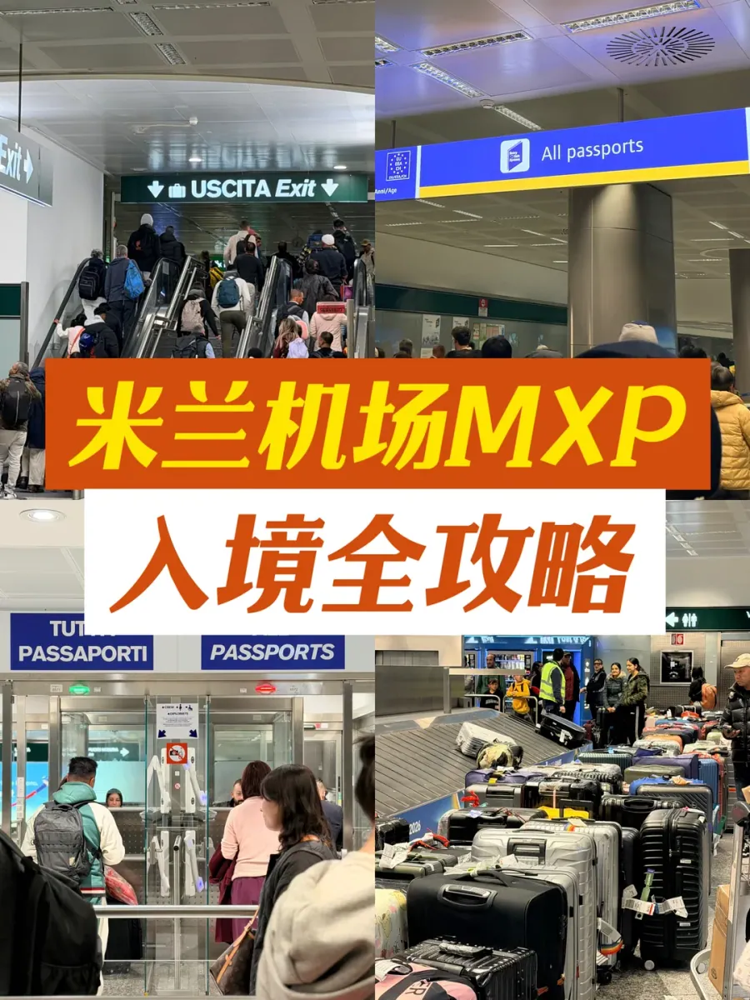

মিলান মালপেনসা (MXP) উত্তর ইতালির আন্তর্জাতিক প্রবেশদ্বার, এবং চীন থেকে মিলানে সরাসরি ফ্লাইটগুলো যে বিমানবন্দরে নামে সেটি এটি। প্রথমবার আসলে দুশ্চিন্তা সাধারণত ভাষা নিয়ে নয় — দুশ্চিন্তা সারি নিয়ে, আর অনলাইনে যে সংখ্যাটা ঘুরছে তা হলো পার হতে তিন-চার ঘণ্টা।

২০২৬ সালের ফেব্রুয়ারিতে একটি আগমন অবশ্য অন্য কথা বলে। এয়ার চায়না CA949 প্রায় ২০ মিনিট আগে, **০৬:১০**-এ অবতরণ করে, আর বিমানের দরজা থেকে সুটকেস হাতে নেওয়া পর্যন্ত সময় লেগেছিল **৬৫ মিনিট**। এর কিছুটা ভাগ্য, সবটা নয়। সামনের দিকে বসা, দ্রুত বিমান থেকে নামা আর কোন লেন আপনার জানা — এসব আগেই নেওয়া সিদ্ধান্ত।

## ১. MXP-এর সারি আসলে কীভাবে কাজ করে

মালপেনসার অভিবাসন হল বড় নয়, আর কাউন্টারগুলো আগমনের সময়সূচি অনুযায়ী খোলে-বন্ধ হয়। **০৭:০০ থেকে ০৯:০০ হলো শীর্ষ সময়**, যখন এশিয়া ও ইউরোপজুড়ে আসা ওয়াইড-বডি বিমানগুলো একই সময়ে নামে এবং অ-ইইউ যাত্রীরা কয়েক মিনিটেই সর্পিল ব্যারিয়ার ভরিয়ে তোলে।

দীর্ঘ-দূরত্বের ফ্লাইট ঢেউয়ে ঢেউয়ে আসে। ০৬:০০ থেকে ০৭:০০-এর মধ্যে নামা বিমানগুলো তাদের যাত্রীদের জেট ব্রিজ, শাটল বাস ও এসকেলেটর দিয়ে পাঠায়, তাই বেশিরভাগ ০৬:৩০ থেকে ০৭:৩০-এর মধ্যে হলে পৌঁছান। **ওই ঢেউয়ের সামনের অংশ ধরতে পারলে সারি বলতে গেলে থাকে না**; আধা ঘণ্টা পরে আপনি পড়বেন নিজের ফ্লাইটের পাশাপাশি আরও দুটি ওয়াইড-বডির পেছনে — এজন্যই একই বিমানের যাত্রীরা বিশ মিনিটের ব্যবধানে সীমান্ত পার হতে পারেন।

এই অবতরণ সময়ের দিক থেকে ভাগ্যবান ছিল: দরজা খোলে **০৬:১০**-এ, শীর্ষ সময়ের আগে। চারটি কাউন্টার খোলা ছিল, লাইন এগোচ্ছিল, আর প্রবেশ সিল মিলেছিল **প্রায় ৩০ মিনিট** পর। এক ঘণ্টা পরে, একই চার কাউন্টারে কয়েক গুণ মানুষ নিয়ে, একই অপেক্ষা দেখতে অনেক আলাদা লাগত।

আরেকটি পরিবর্তনশীল বিষয় সহজে চোখ এড়ায়: **২০২৬ সালের ফেব্রুয়ারি পড়েছিল মিলান–কর্টিনা শীতকালীন অলিম্পিকের সময়**, এবং বিমানবন্দর স্পষ্টতই অতিরিক্ত কর্মী নিয়োগ করেছিল, যারা গেট থেকে হল পর্যন্ত যাত্রীদের পথ দেখাচ্ছিল। যাত্রী অনলাইনে বর্ণিত তিন-চার ঘণ্টার সারি ভয় পাচ্ছিলেন; বাস্তবতা তার ধারেকাছে ছিল না।

ওই প্রতিবেদনগুলোও বানানো নয় — সেগুলো আসে পিক সিজন থেকে, যখন একসঙ্গে কয়েকটি ফ্লাইট নামে। কোনো সংখ্যাই নিয়ম নয়: **সময়ভেদে একই বিমানবন্দর কয়েক গুণ ধীর লাগতে পারে**, তাই নিজের অবতরণের সময় ধরে হিসাব করুন।

## ২. বিমানের দরজা থেকে সীমান্ত নিয়ন্ত্রণ

মূলত একটাই পথ: সবুজ **USCITA EXIT** সাইন অনুসরণ করে এসকেলেটরে উঠে অভিবাসন হলে যান। Transfer তিরের পেছনে ঘুরে যাবেন না — সেগুলো সংযোগকারী যাত্রীদের জন্য — আর ওয়াই-ফাই খুঁজতে থামবেন না। সেখানে কাটানো প্রতিটি মিনিট সারিতে কয়েকটি জায়গা করে খেয়ে নেয়।

কতটা সময় বাঁচবে তা নির্ভর করে আপনি কোথায় বসেছেন তার ওপর। ওয়াইড-বডি বিমান থেকে নামাই এক ধরনের সারি: সামনের কেবিন আগে যায়, পেছনের অংশ অপেক্ষা করে — মোটে প্রায়ই পনেরো-বিশ মিনিট। **সামনের সিট সেই অপেক্ষা অর্ধেক করে**; তা না হলে জেট ব্রিজে থেমে না গিয়ে দ্রুত হাঁটুন। এই ফ্লাইটটি রিমোট স্ট্যান্ডে দাঁড়িয়েছিল এবং শাটল বাস দরকার হয়, তাই যাত্রীরা নামেন **০৬:৩০**-এ — আর তাদের প্রথম কয়েকজন বাকিরা পৌঁছানোর আগেই লাইনে দাঁড়িয়ে গিয়েছিলেন।

দুটি খুঁটিনাটি: অভিবাসন হল এক তলা ওপরে আর এসকেলেটর একমুখী, তাই USCITA EXIT অনুসরণ করে ওপরে উঠুন; আর টয়লেট বা পানির জন্য থামবেন না, কারণ প্রবাহ পেরিয়ে গেলে নিজের জায়গায় ফেরা যায় না।

## ৩. All Passports লেন

হলে ঢুকে কোনো লাইনে যোগ দেওয়ার আগে সাইনগুলো পড়ুন। দুটি ব্যবস্থা পাশাপাশি চলে: ইইউ যাত্রীদের জন্য **Self service passport control** গেট, আর হাতে করা কাউন্টার যেগুলোতে লেখা **All passports**, ইতালীয় ভাষায় **TUTTI I PASSAPORTI**। চীনা পাসপোর্টের জায়গা দ্বিতীয়টিতে।

সাইনগুলোতে অনেক তথ্য থাকে। একই নীল প্যানেলে বাঁ দিকের অংশে লেখা “Self service passport control”, সঙ্গে ইইউ পতাকা এবং পরিচয়পত্র ও ১৪ বছরের কম বয়সী শিশুদের নিয়ে ছোট হরফের নোট; ডান অংশে “All passports”, তার পরে ক্রু ও কূটনৈতিক লেন।

পরিবারগুলোর জন্য লক্ষণীয়, “Minori di 14 anni / Children under 14” লেনটি ইইউ যাত্রীদের শিশুদের জন্য, চীনা পাসপোর্টে প্রযোজ্য নয়। এতে যোগ দিলে সারির শেষ প্রান্তে ফিরে হাঁটতে হবে — পিক আওয়ারে মানে আরও আধা ঘণ্টা হারানো।

একটি দাবি সংশোধন করা দরকার। কয়েক বছর আগের গাইডে বলা হয়েছিল, চীনা পাসপোর্ট স্বয়ংক্রিয় গেট ব্যবহার করে **১৫ মিনিটে** পার হওয়া যায়। এই সকালে **কর্মীরা প্রত্যেক অ-ইইউ যাত্রীকে হাতে করা লেনে পাঠিয়েছেন** আর গেটগুলো প্রায় খালি পড়ে ছিল। কোনো মেশিন নির্দিষ্ট পাসপোর্ট গ্রহণ করে কি না, আর সেদিন সেটি চালু আছে কি না — এসব প্রশ্ন আলাদা, কর্মীরা আপনাকে কোথায় পাঠাচ্ছেন তার থেকে। মোড়ে ইউনিফর্ম পরা কর্মীকে অনুসরণ করুন, পুরোনো ব্লগ পোস্টকে নয়।

ভুল লেনে পড়ে গেলে শান্ত থাকুন: সর্পিল ব্যারিয়ারে ঢোকার আগে পাশ বদলানো যায়, কিন্তু ভেতরে ঢুকে গেলে বেরোনোর একমাত্র পথ সারির পেছন।

## ৪. মাপা ৬৫ মিনিটের সময়রেখা

সময়ের চিহ্নগুলো দেখায় ৬৫ মিনিট কোথায় গেল। এর ৩৫ মিনিট গেছে সীমান্ত নিয়ন্ত্রণে; বাকিটা শাটল বাস, হাঁটা আর ব্যাগের অপেক্ষায়।

| সময় | যা ঘটল |
| --- | --- |
| **০৬:১০** | বিমান অবতরণ, প্রায় ২০ মিনিট আগে |
| **০৬:৩০** | শাটল বাস থেকে নেমে টার্মিনালে |
| **০৬:৩৫** | All Passports সারিতে যোগ |
| **০৭:১০** | পাসপোর্টে সিল, সীমান্ত নিয়ন্ত্রণ শেষ |
| **০৭:১৫** | বেল্ট থেকে ব্যাগ নেওয়া |

সারিতে করার মতো কাজ কম, তবে একটি কাজ লাভজনক: পাসপোর্টের ছবির পাতা খুলে হাতে প্রস্তুত রাখুন, যাতে আপনার পালা হয় শুধু হস্তান্তর, এক নজর আর একটি সিল। যাচাইটা নিজেই প্রত্যাশার চেয়ে সহজ ছিল। **শুধু পাসপোর্ট দেখানো হয়েছে**; কোনো ভ্রমণসূচি, বুকিং বা বীমা চাওয়া হয়নি, প্রশ্ন করা হয়নি আর আঙুলের ছাপ নেওয়া হয়নি।

আঙুলের ছাপ নিয়ে একটি কথা বলা দরকার। ইউরোপীয় ইউনিয়নের Entry/Exit System (EES) ২০২৬ সালে পুরোপুরি চালু, এবং অ-ইইউ দর্শনার্থীরা সাধারণত প্রথম প্রবেশে কিয়স্কে আঙুলের ছাপ ও মুখের ছবি নিবন্ধন করেন। এই আগমনে তা হয়নি, যা নিয়মে পরিবর্তনের চেয়ে সময় ও স্থানীয় ব্যবস্থাপনার ব্যাপার হওয়ার সম্ভাবনা বেশি; তাই প্রথমবার আসা যাত্রীদের বাড়তি ধাপটি এখনও ধরে রাখা উচিত।

সঙ্গে রাখার মতো কাগজপত্র অপরিবর্তিত: ফেরার ভ্রমণসূচি, হোটেল বুকিং, ভ্রমণ বীমা। এবার না চাওয়ার মানে এই নয়, পরেরবার চাওয়া হবে না।

সারি কেন জমে থাকা মনে হয় অথচ এগোতে থাকে? বাধা সাধারণত বুথ নয়, তার সামনের মানুষগুলো — কেউ ডেস্কে দাঁড়িয়ে ব্যাগ খুঁজতে শুরু করে, একটি পরিবার একসঙ্গে এগোয়, আরেকজন মোড়ে দ্বিধা করে।

## ৫. ব্যাগেজ দাবি ও বেরোনো

সীমান্ত নিয়ন্ত্রণ পেরোলেই ব্যাগেজ হল। স্ক্রিনে নিজের ফ্লাইট ও তার বেল্ট খুঁজে নিয়ে সেখানে যান। এখানে **কর্মীরা বলেছিলেন ব্যাগগুলো ইতিমধ্যে উল্টো দিকে নামানো হয়েছে**, তাই বেল্ট চালু হওয়ার অপেক্ষা বাঁচে; অনেক ব্যাগ থাকলে ট্রলি খোঁজার আগে নিজের সুটকেসগুলো চিহ্নিত করে নিন।

ব্যাগ না এলে বেল্টের পাশে দাঁড়িয়ে থাকবেন না: ব্যাগেজ জিজ্ঞাসা ডেস্কে যান (সাইনে INFORMAZIONI BAGAGLI / Lost & found), নিবন্ধন করুন এবং এয়ারলাইন্সের সঙ্গে যোগাযোগের আগে রেফারেন্স নম্বরটি নিয়ে নিন।

ব্যাগের পরে শেষ চেকপয়েন্ট: ঘোষণা করার কিছু না থাকলে সবুজ চ্যানেল, নগদ অর্থের সীমা ছাড়ালে বা ঘোষণাযোগ্য কিছু বহন করলে লাল চ্যানেল। আগমন কক্ষের বাইরে **মালপেনসা এক্সপ্রেস** টার্মিনাল ১-এর নিচের স্টেশন থেকে মিলানের কাদোর্না ও সেন্ত্রালে স্টেশনের দিকে ছাড়ে, আর বাস ও ট্যাক্সি ঠিক বাইরেই যাত্রী নেয়, সবই সাইনবোর্ডে দেখানো; রাতের বেলা ট্যাক্সি বা আগে বুক করা ট্রান্সফারই সহজতর।

পেছনে তাকিয়ে দেখলে তিনটি বিষয় কাজ করেছে: **০৭:০০-এর শীর্ষ সময়ের আগে অবতরণ, আগে নামার জন্য সামনে বসা, এবং All Passports লেন নেওয়া**। কোনোটিই বাড়তি খরচ নয়; শুধু বুকিংয়ের সময় ও দরজা খোলার সময় সঠিক সিদ্ধান্ত দরকার।

সময়ও একইভাবে ধরে রাখুন। আগে নামলে ও সারি ছোট হলে দরজা থেকে বেল্ট পর্যন্ত ৩০ থেকে ৪০ মিনিট ধরুন; **০৭:০০-এর পরে নামলে দেড় ঘণ্টা ধরুন**। এরপর ট্রেন বা সংযোগ থাকলে দুই ঘণ্টা বা বেশি বাফার রাখুন — অভিবাসনে কত সময় লাগবে তা আপনার হাতে নেই, কিন্তু তার আশপাশের অবকাশ আপনার হাতে।

একটি সতর্কতা: কাউন্টারের সংখ্যা, অপেক্ষার সময় ও EES নিবন্ধন দিনের সময়সূচি ও কর্মীব্যবস্থার সঙ্গে বদলায়। এখানকার সময়রেখা এসেছে একটি মাত্র মাপা আগমন থেকে; আপনি যে দিন যাবেন সে দিনের তথ্য বিমানবন্দর ও ইতালীয় সীমান্ত পুলিশের কাছ থেকে দেখে নিন।

## সম্পর্কিত লিংক

- **এই সাইটে**: [মিলান মালপেনসা বিমানবন্দর (MXP)](/airport/MXP), [ইতালি (IT)](/country/IT)
- **উইকিপিডিয়া**: [মিলান মালপেনসা বিমানবন্দর](https://en.wikipedia.org/wiki/Milan_Malpensa_Airport)
- **বাইদু বাইকে**: [মিলান মালপেনসা বিমানবন্দর](https://baike.baidu.com/item/%E7%B1%B3%E5%85%B0-%E9%A9%AC%E5%B0%94%E5%BD%AD%E8%90%A8%E6%9C%BA%E5%9C%BA)
