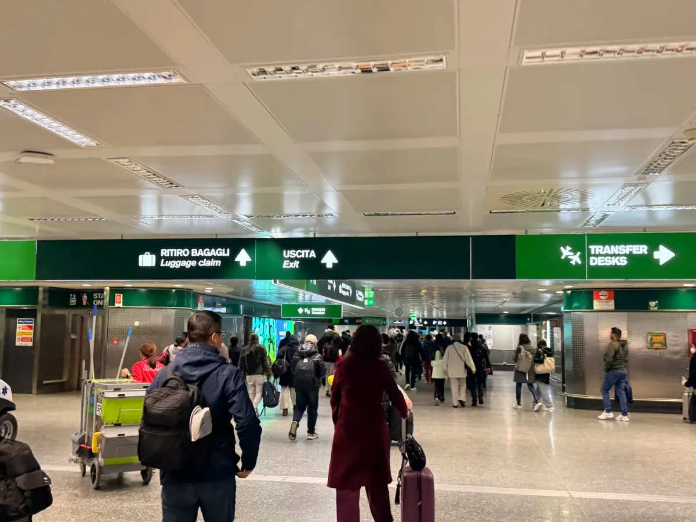
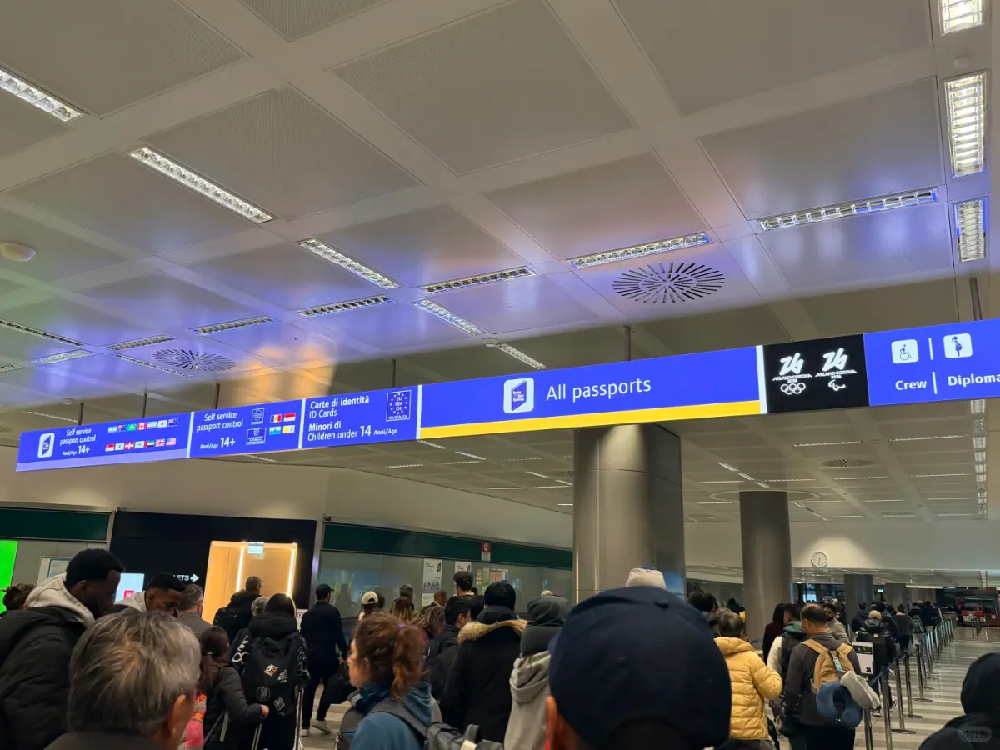

Milan Malpensa (MXP) je mezinárodní branou severní Itálie a letištěm, na kterém přistávají čínské přímé lety do Milána. Při prvním příletu bývá zdrojem úzkosti málokdy jazyk – je to fronta, a číslo, které koluje na internetu, jsou tři až čtyři hodiny na projití.

Jeden přílet z února 2026 naznačuje něco jiného. Let Air China CA949 přistál zhruba o 20 minut dříve, v **06:10**, a cesta od dveří letadla ke kufru v ruce trvala **65 minut**. Část toho bylo štěstí; ne všechno. Sedět vpředu, rychle opustit letadlo a vědět, který pruh je váš, jsou rozhodnutí učiněná předem.

## 1. Jak fronta na MXP skutečně funguje

Imigrační hala Malpensy není velká a přepážky se otevírají a zavírají podle příletového letového řádu. **Špička je mezi 07:00 a 09:00**, kdy ve stejném okně přistávají širokotrupá letadla z Asie i z celé Evropy a cestující mimo EU během několika minut zaplní hadí zábrany.

Dálkové lety přijíždějí ve vlnách. Letadla přistávající mezi 06:00 a 07:00 vypravují cestující přes nástupní most, kyvadlový autobus a eskalátor, takže většina dorazí do haly mezi 06:30 a 07:30. **Chytíte-li začátek této vlny, fronta téměř není**; o půl hodiny později stojíte za svým letem a dvěma dalšími širokotrupými letadly – proto cestující z jednoho letadla mohou projít s odstupem dvaceti minut.

Tento přílet měl se svým načasováním štěstí: dveře se otevřely v **06:10**, před špičkou. Byly otevřené čtyři přepážky, fronta se hýbala a vstupní razítko přišlo po **zhruba 30 minutách**. O hodinu později, se stejnými čtyřmi přepážkami a několikanásobkem lidí, by stejné čekání vypadalo velmi jinak.

Je snadné přehlédnout ještě jednu proměnnou: **únor 2026 spadal do období zimních olympijských her Milano–Cortina** a letiště zjevně posílilo personál, který navigoval cestující od gaty do haly. Cestovatel se obával tří- a čtyřhodinových front popisovaných na internetu; realita byla daleko jinde.

Ani ty zprávy nejsou vymyšlené – pocházejí z hlavní sezóny, kdy přistává několik letů najednou. Ani jedno číslo není pravidlem: **stejné letiště může působit několikanásobně pomaleji podle hodiny**, takže své odhady posuzujte podle času svého přistání.

## 2. Od dveří letadla k pasové kontrole

V podstatě existuje jedna trasa: následujte zelené cedule **USCITA EXIT** a vyjeďte eskalátorem nahoru do imigrační haly. Nenechte se odklonit za šipkami Transfer – ty jsou pro přestupující cestující – a nezastavujte se kvůli hledání Wi-Fi. Každá minuta tam stojí několik míst ve frontě.

Kolik ušetříte, závisí na tom, kde sedíte. Vystupování ze širokotrupého letadla je samo o sobě fronta: přední kabina jde první a zadní čeká, často celkem patnáct nebo dvacet minut. **Místo vpředu toto čekání zkrátí na polovinu**; pokud to nejde, jděte svižně a nezastavujte se u nástupního mostu. Tento let parkoval na vzdáleném stání a potřeboval kyvadlový autobus, takže cestující vystoupili až v **06:30** – a první z nich už stáli ve frontě, když dorazili ostatní.

Dva detaily: imigrační hala je o jedno patro výš a eskalátor je jednosměrný, takže se držte USCITA EXIT a jeďte nahoru; a nezastavujte se na toaletu ani pro vodu, protože jakmile vás proud předběhne, zpět na své místo se nedostanete.

## 3. Pruh All Passports

V hale si nejdřív přečtěte cedule, než se někam zařadíte. Vedle sebe fungují dva systémy: brány **Self service passport control** pro cestující z EU a ruční přepážky označené **All passports**, italsky **TUTTI I PASSAPORTI**. Čínský pas patří do druhého.

Cedule nesou hodně informací. Na stejném modrém panelu je vlevo nápis „Self service passport control“ s vlajkami EU a drobným písmem o občanských průkazech a dětech do 14 let; vpravo je „All passports“ a za ním pruhy pro posádky a diplomaty.

Rodiny by měly vědět, že pruh „Minori di 14 anni / Children under 14“ je pro děti cestujících z EU a na čínské pasy se nevztahuje. Zařadit se do něj znamená jít zpět na konec fronty – ve špičce další ztracená půlhodina.

Jedno tvrzení je třeba opravit. Průvodci z před pár let uváděli, že s čínským pasem lze použít samoobslužné brány a projít za **15 minut**. Toho rána **personál posílal všechny cestující mimo EU do ručních pruhů** a brány zely prázdnotou. Zda stroj daný pas přijímá a zda je ten den zapnutý, jsou jiné otázky než to, kam vás personál pošle – na rozcestí následujte uniformu, ne starý blogový příspěvek.

Pokud se přesto ocitnete ve špatném pruhu, zachovejte klid: dokud nevstoupíte do hadích zábran, můžete přejít, ale jakmile jste uvnitř, jediná cesta ven vede na konec fronty.

## 4. Změřená časová osa 65 minut

Časové údaje ukazují, kam se 65 minut podělo. Pasová kontrola zabrala 35 z nich; zbytek byl kyvadlový autobus, chůze a čekání na zavazadlo.

| Čas | Co se stalo |
| --- | --- |
| **06:10** | Letadlo přistálo, zhruba o 20 minut dříve |
| **06:30** | Vystoupení z kyvadlového autobusu, vstup do terminálu |
| **06:35** | Zařazení do fronty All Passports |
| **07:10** | Razítko v pase, pasová kontrola hotova |
| **07:15** | Vyzvednutí zavazadla z pásu |

Ve frontě toho moc neuděláte, ale jedna věc se vyplatí: otevřete pas na stránce s fotografií a mějte ho připravený, aby váš obrat byl předání, pohled a razítko. Samotná kontrola byla jednodušší, než se čekalo. **Předložen byl pouze pas**; žádný itinerář, rezervace ani pojištění se nevyžadovaly, žádné otázky nezazněly a žádné otisky prstů se neodebíraly.

Otisky prstů si zaslouží poznámku. Vstupní/výstupní systém EU (EES) je v roce 2026 plně v provozu a návštěvníci mimo EU při prvním vstupu obvykle registrují otisky prstů a snímek obličeje u kiosku. Tento přílet ho nezahrnoval, což je spíš otázka načasování a místních opatření než změny pravidel, takže nováčci by měli tento krok stále očekávat.

Papírování, které se vyplatí mít u sebe, se nemění: zpáteční itinerář, rezervace hotelu, cestovní pojištění. To, že se tentokrát neptali, neznamená, že se příště nebudou.

Proč fronta vypadá zamrzle, a přesto se hýbe? Úzkým hrdlem obvykle není přepážka, ale lidé před ní – někdo začne u pultu hledat v tašce, rodina přistoupí společně, další váhá na rozcestí.

## 5. Výdej zavazadel a odchod

Za pasovou kontrolou je zavazadlová hala. Najděte na obrazovkách svůj let a jeho pás a přejděte tam. Tady **personál řekl, že zavazadla už byla vyložena na opačné straně**, což ušetřilo čekání na spuštění pásu; s hodně zavazadly si nejdřív kufry najděte a teprve pak shánějte vozík.

Pokud se zavazadlo neobjeví, nestůjte u pásu: jděte k přepážce pro dotazy na zavazadla (označené INFORMAZIONI BAGAGLI / Lost & found), zaregistrujte ho a vezměte si číslo případu, než budete kontaktovat aerolinky.

Po zavazadlech přichází poslední kontrola: zelený koridor, pokud nemáte co proclít, červený koridor, pokud překračujete limit hotovosti nebo vezete něco k proclení. Před příletovou halou odjíždí **Malpensa Express** z nádraží pod terminálem 1 na milánská nádraží Cadorna a Centrale a hned venku staví autobusy a taxíky, vše je označené; pozdě v noci je jednodušší taxi nebo předem objednaný transfer.

Při zpětném pohledu rozhodly tři věci: **přistání před sedmou ranní špičkou, místo vpředu pro první výstup a volba pruhu All Passports**. Nic z toho nestojí navíc; vyžaduje to jen správnou volbu při rezervaci a ve chvíli, kdy se otevřou dveře.

Stejně plánujte i čas. Při brzkém přistání a krátké frontě počítejte 30 až 40 minut od dveří k pásu; **při přistání po 07:00 počítejte hodinu a půl**. Pokud navazuje vlak nebo přestup, nechte si rezervu dvě hodiny a více – délku imigrace neovlivníte, ale volný čas kolem ní ano.

Jedna výhrada: počet přepážek, doby čekání a registrace v EES se liší podle denního letového řádu a obsazení. Zdejší časová osa vychází z jednoho změřeného příletu; pro den své cesty si informace ověřte u letiště a italské pohraniční policie.

## Související odkazy

- **Na tomto webu**: [Letiště Milan Malpensa (MXP)](/airport/MXP), [Itálie (IT)](/country/IT)
- **Wikipedie**: [Letiště Milan Malpensa](https://en.wikipedia.org/wiki/Milan_Malpensa_Airport)
- **Baidu Baike**: [Letiště Milan Malpensa](https://baike.baidu.com/item/%E7%B1%B3%E5%85%B0-%E9%A9%AC%E5%B0%94%E5%BD%AD%E8%90%A8%E6%9C%BA%E5%9C%BA)
