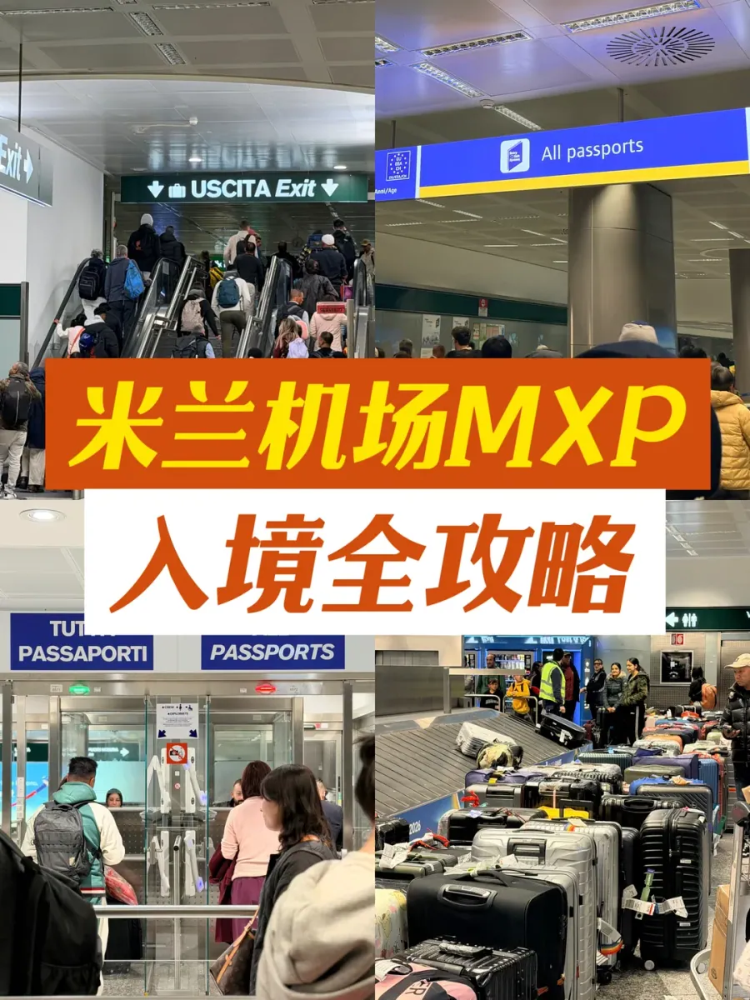
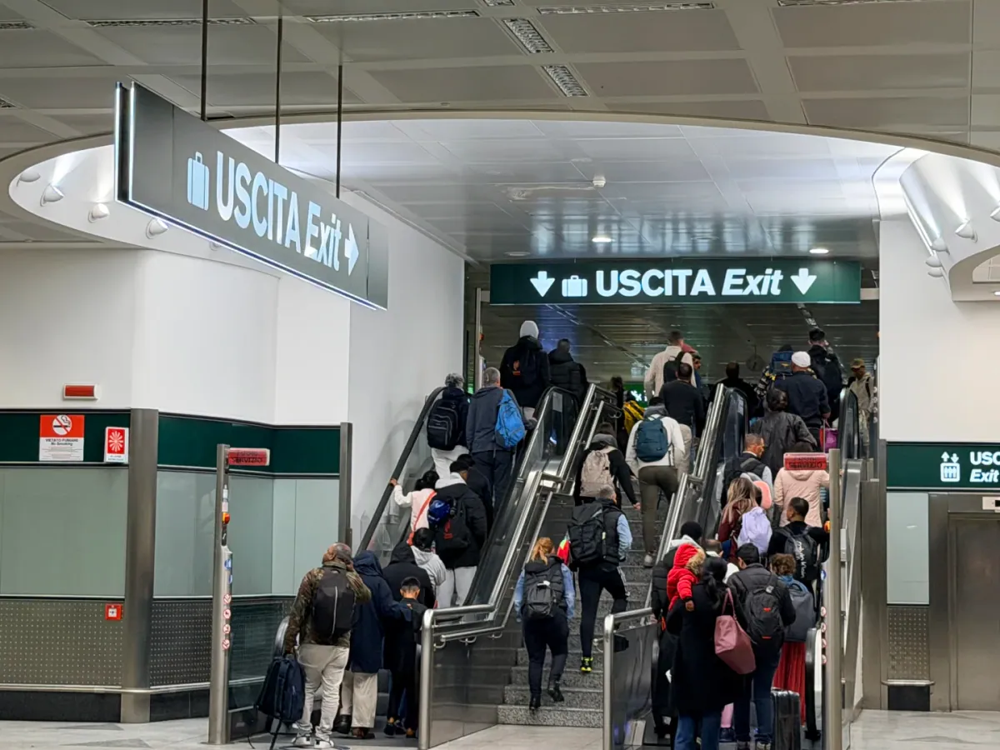
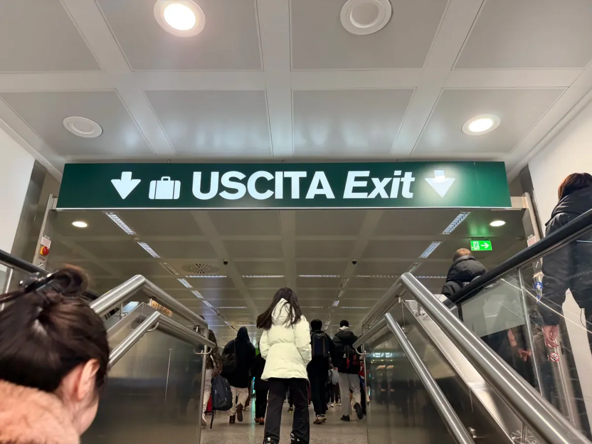
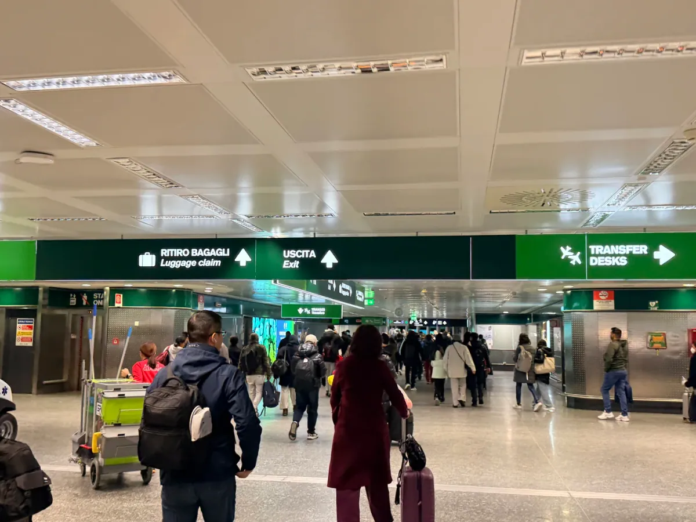
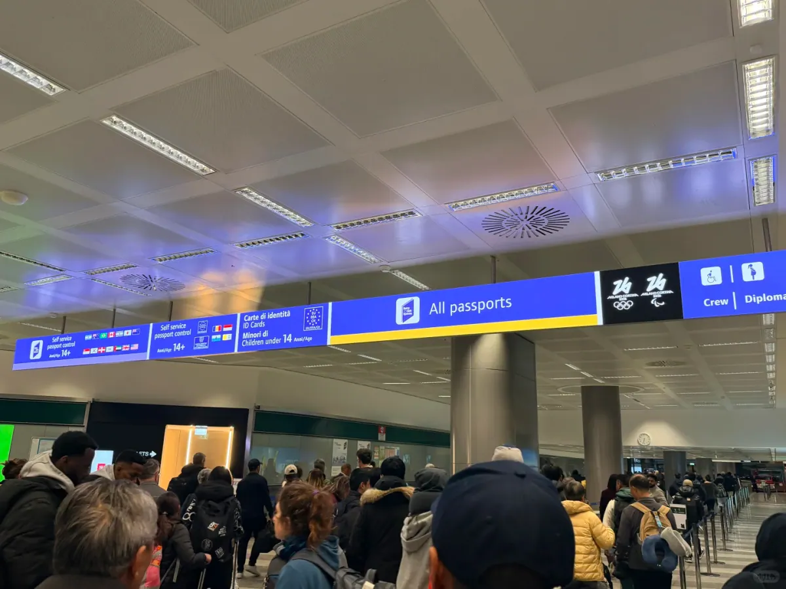
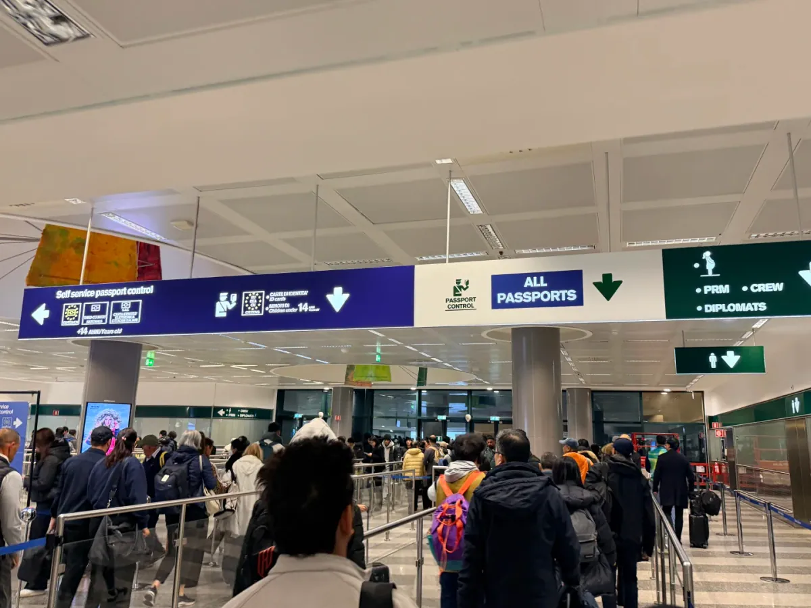
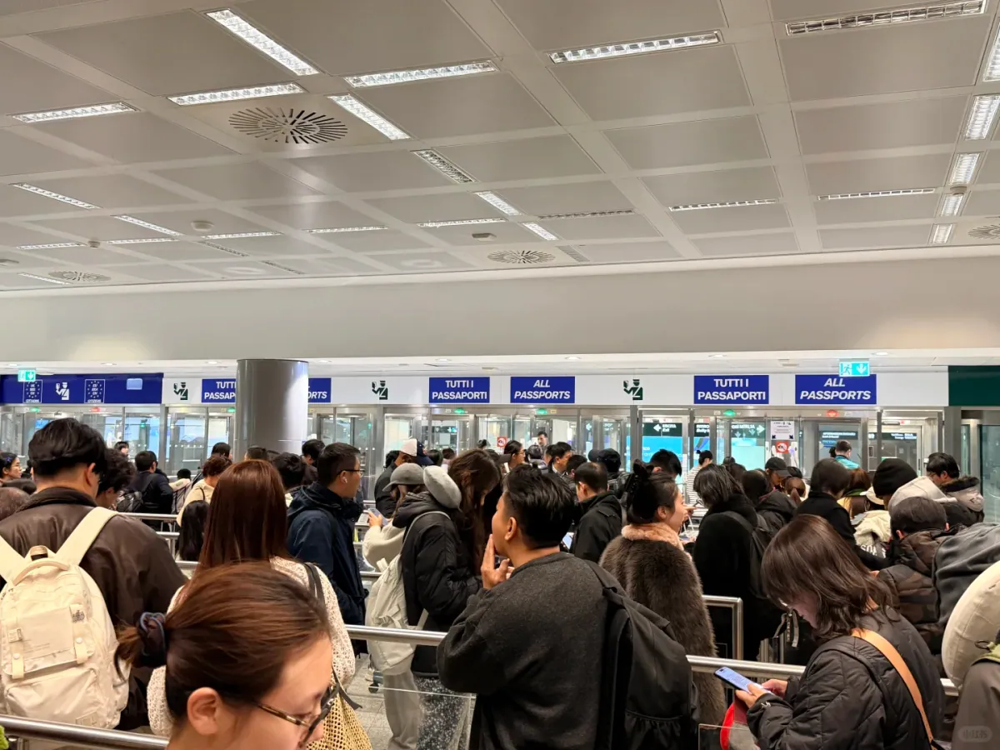
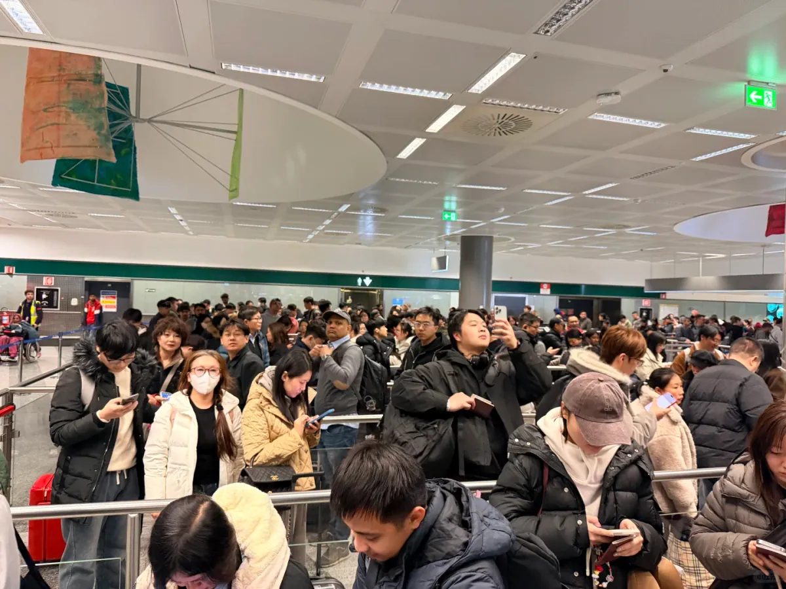
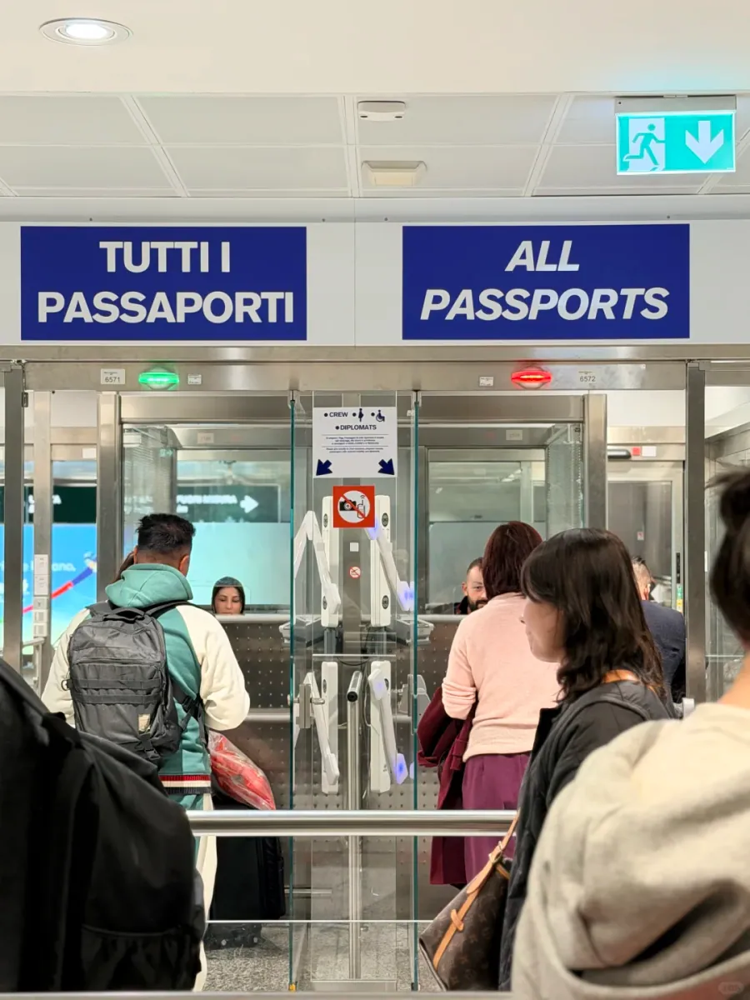
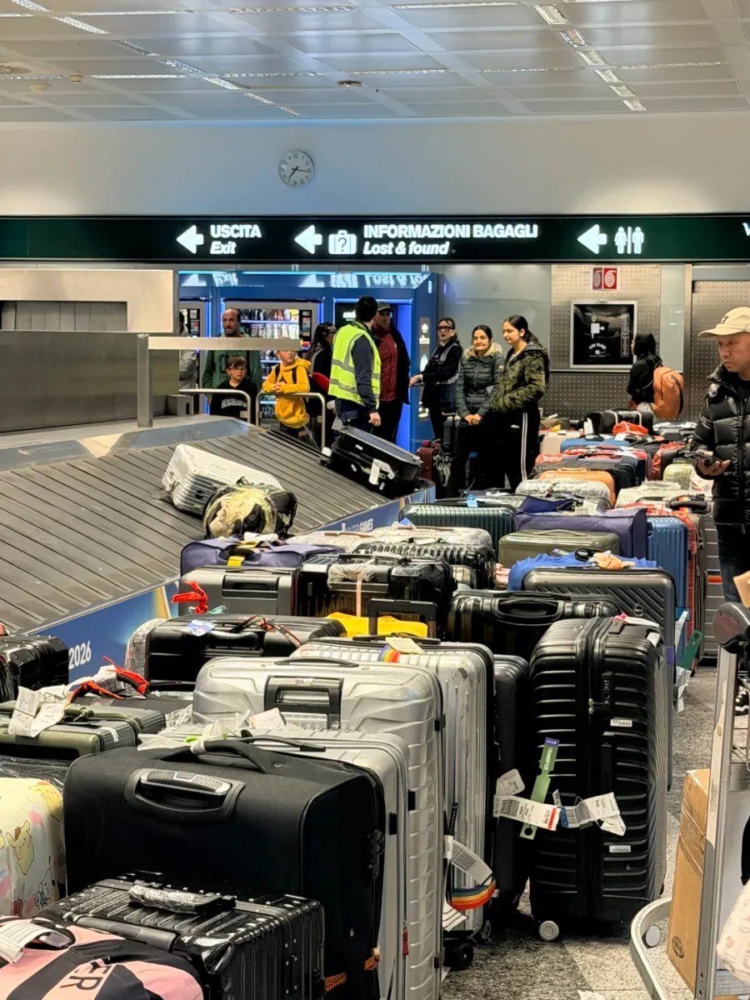

Mailand Malpensa (MXP) ist das internationale Tor Norditaliens und der Flughafen, auf dem die Nonstop-Verbindungen aus China nach Mailand landen. Bei der ersten Ankunft ist die Sorge selten die Sprache — es ist die Schlange, und die Zahlen, die im Netz kursieren, sprechen von drei oder vier Stunden bis zum Ausgang.

Eine Ankunft im Februar 2026 erzählt etwas anderes. Air China CA949 landete etwa 20 Minuten früher, um **06:10**, und vom Öffnen der Flugzeugtür bis zum Koffer in der Hand vergingen **65 Minuten**. Ein Teil davon war Glück, nicht alles. Weiter vorne sitzen, zügig aussteigen und wissen, welche Spur die eigene ist — das sind Entscheidungen, die man vorher trifft.

## 1. Wie die Schlange in MXP wirklich funktioniert

Die Grenzhalle in Malpensa ist nicht groß, und die Schalter öffnen und schließen mit dem Ankunftsplan. **07:00 bis 09:00 ist die Spitzenzeit**, wenn Großraumflugzeuge aus Asien und aus ganz Europa im selben Fenster landen und Nicht-EU-Passagiere die Schlangenabsperrungen innerhalb von Minuten füllen.

Langstreckenflüge kommen in Wellen. Flugzeuge, die zwischen 06:00 und 07:00 landen, schicken ihre Passagiere über Fluggastbrücke, Shuttlebus und Rolltreppe, sodass die meisten zwischen 06:30 und 07:30 in der Halle ankommen. **Wer den Anfang dieser Welle erwischt, steht praktisch nicht an**; eine halbe Stunde später stehen Sie hinter Ihrem eigenen Flug plus zwei weiteren Großraumflugzeugen — deshalb können Passagiere eines Flugs mit zwanzig Minuten Abstand durch die Kontrolle kommen.

Diese Landung hatte Glück mit dem Zeitpunkt: Die Tür öffnete um **06:10**, vor der Spitzenzeit. Vier Schalter waren besetzt, die Schlange bewegte sich, und der Einreisestempel kam nach **etwa 30 Minuten**. Eine Stunde später, mit denselben vier Schaltern und mehrfach so vielen Menschen, hätte dieselbe Wartezeit ganz anders ausgesehen.

Eine weitere Variable wird leicht übersehen: **Der Februar 2026 fiel in die Olympischen Winterspiele Mailand–Cortina**, und der Flughafen hatte erkennbar Personal aufgestockt und leitete die Passagiere vom Gate bis in die Halle. Der Reisende hatte die drei- und vierstündigen Schlangen aus dem Netz gefürchtet; die Wirklichkeit lag weit davon entfernt.

Auch diese Berichte sind nicht erfunden — sie stammen aus der Hochsaison, wenn mehrere Flüge gleichzeitig landen. Keine der beiden Zahlen ist eine Regel: **Derselbe Flughafen kann je nach Stunde um ein Mehrfaches langsamer wirken**, beurteilen Sie Ihre Zeitplanung also nach Ihrer eigenen Landezeit.

## 2. Von der Flugzeugtür zur Grenzkontrolle

Es gibt im Wesentlichen einen Weg: Folgen Sie den grünen Schildern **USCITA EXIT** und nehmen Sie die Rolltreppe hinauf in die Grenzhalle. Lassen Sie sich nicht von den Transfer-Pfeilen mitziehen — die gelten für umsteigende Passagiere — und bleiben Sie nicht stehen, um nach WLAN zu suchen. Jede dort verbrachte Minute kostet Sie ein paar Plätze in der Schlange.

Wie viel Sie sparen, hängt von Ihrem Sitzplatz ab. Das Aussteigen aus einem Großraumflugzeug ist selbst eine Schlange: Die vordere Kabine geht zuerst, die hintere wartet, insgesamt oft fünfzehn oder zwanzig Minuten. **Ein Sitz weiter vorne halbiert diese Wartezeit**; falls das nicht geht, gehen Sie zügig, statt an der Fluggastbrücke stehen zu bleiben. Dieser Flug parkte auf einer Außenposition und brauchte einen Shuttlebus, sodass die Passagiere erst um **06:30** ausstiegen — und die ersten von ihnen standen bereits in der Schlange, als der Rest ankam.

Zwei Details: Die Grenzhalle liegt eine Ebene höher, und die Rolltreppe läuft nur in eine Richtung — folgen Sie USCITA EXIT also nach oben; und halten Sie nicht für Toilette oder Wasser an, denn wenn der Strom vorbei ist, kommen Sie nicht an Ihren Platz zurück.

## 3. Die Spur All Passports

In der Halle lesen Sie erst die Schilder, bevor Sie sich irgendwo anstellen. Zwei Systeme laufen nebeneinander: **Self service passport control** für Reisende aus der EU und manuelle Schalter mit der Aufschrift **All passports**, auf Italienisch **TUTTI I PASSAPORTI**. Ein chinesischer Pass gehört an den zweiten Schalter.

Die Schilder tragen viel Information. Auf derselben blauen Tafel steht links „Self service passport control“ mit EU-Flaggen und Kleingedrucktem zu Ausweisen und Kindern unter 14; rechts steht „All passports“, und dahinter folgen die Spuren für Crew und Diplomaten.

Familien sollten beachten: Die Spur „Minori di 14 anni / Children under 14“ gilt für die Kinder von EU-Reisenden und nicht für chinesische Pässe. Wer sich dort anstellt, läuft zurück ans Ende der Schlange — zur Spitzenzeit eine weitere halbe Stunde.

Eine Behauptung muss korrigiert werden. Leitfäden von vor einigen Jahren behaupteten, chinesische Pässe könnten die Selbstbedienungs-Gates nutzen und in **15 Minuten** durchkommen. An diesem Morgen **wies das Personal jeden Nicht-EU-Passagier zu den manuellen Spuren**, und die Gates blieben fast leer. Ob ein Automat einen bestimmten Pass akzeptiert und ob er an diesem Tag eingeschaltet ist, sind andere Fragen als die, wohin das Personal Sie schickt — an der Gabelung folgen Sie der Uniform, nicht dem alten Blogbeitrag.

Wenn Sie doch in der falschen Spur landen, bleiben Sie ruhig: Vor der Schlangenabsperrung können Sie noch hinüberwechseln, aber einmal darin führt der einzige Weg zurück ans Ende der Schlange.

## 4. Eine gemessene Zeitlinie: 65 Minuten

Die Zeitstempel zeigen, wohin die 65 Minuten gingen. Die Grenzkontrolle machte 35 Minuten davon aus; der Rest war Shuttlebus, Wege und Warten auf einen Koffer.

| Zeit | Was geschah |
| --- | --- |
| **06:10** | Flugzeug gelandet, etwa 20 Minuten früher als geplant |
| **06:30** | Aus dem Shuttlebus ausgestiegen, im Terminal |
| **06:35** | In der Schlange All Passports angestellt |
| **07:10** | Pass gestempelt, Grenzkontrolle passiert |
| **07:15** | Koffer vom Band geholt |

In der Schlange gibt es wenig zu tun, aber eines zahlt sich aus: Schlagen Sie den Pass auf der Fotoseite auf und halten Sie ihn bereit, damit an Ihrem Schalter nur noch Übergeben, ein Blick und ein Stempel nötig sind. Die Prüfung selbst war einfacher als erwartet. **Nur der Pass wurde vorgelegt**; kein Reiseverlauf, keine Buchung, keine Versicherung wurde verlangt, keine Fragen gestellt und keine Fingerabdrücke genommen.

Fingerabdrücke verdienen einen eigenen Hinweis. Das Entry/Exit System (EES) der EU ist 2026 vollständig in Betrieb, und Nicht-EU-Besucher erfassen bei der ersten Einreise normalerweise Fingerabdrücke und ein Gesichtsbild an einem Automaten. Bei dieser Ankunft gab es keinen, was eher an Zeitpunkt und örtlicher Organisation liegen dürfte als an einer Regeländerung — Erstankömmlinge sollten den zusätzlichen Schritt also weiterhin einplanen.

Die Papiere, die man mitführen sollte, ändern sich nicht: Rückreiseverlauf, Hotelbuchung, Reiseversicherung. Dass diesmal nichts verlangt wurde, heißt nicht, dass es beim nächsten Mal so bleibt.

Warum sieht eine Schlange wie eingefroren aus und bewegt sich trotzdem weiter? Der Engpass ist meist nicht der Schalter, sondern die Menschen davor — jemand beginnt am Counter eine Tasche zu durchsuchen, eine Familie tritt gemeinsam vor, ein anderer zögert an der Gabelung.

## 5. Gepäckausgabe und Weiterreise

Hinter der Grenzkontrolle folgt die Gepäckhalle. Suchen Sie auf den Monitoren Ihren Flug und dessen Band und gehen Sie hin. Hier **sagte das Personal, die Koffer seien bereits auf die gegenüberliegende Seite ausgeladen** — das sparte das Warten, bis das Band anläuft; bei viel Gepäck erkennen Sie Ihre Koffer, bevor Sie einen Wagen suchen.

Erscheint ein Koffer nicht, stellen Sie sich nicht ans Band: Gehen Sie zum Gepäckauskunftsschalter (beschildert INFORMAZIONI BAGAGLI / Lost & found), lassen Sie den Fall registrieren und nehmen Sie die Referenznummer mit, bevor Sie die Airline kontaktieren.

Nach dem Gepäck kommt die letzte Kontrolle: der grüne Kanal, wenn Sie nichts anzumelden haben, der rote Kanal, wenn Sie über der Bargeldfreimenge liegen oder anmeldepflichtige Waren mitführen. Draußen vor der Ankunftshalle fährt der **Malpensa Express** vom Bahnhof unter Terminal 1 zu den Mailänder Bahnhöfen Cadorna und Centrale, und Busse und Taxis halten direkt davor, alles ist beschildert; spät abends sind ein Taxi oder ein vorgebuchter Transfer einfacher.

Rückblickend haben drei Dinge den Unterschied gemacht: **vor dem Ansturm um 07:00 landen, vorne sitzen und als Erster aussteigen und die manuelle Spur All Passports nehmen**. Nichts davon kostet extra; es braucht nur die richtige Entscheidung beim Buchen und in dem Moment, in dem die Tür aufgeht.

Planen Sie Ihre Zeit genauso. Früh landen mit kurzer Schlange: rechnen Sie mit 30 bis 40 Minuten von der Tür bis zum Band; **landen Sie nach 07:00, planen Sie eineinhalb Stunden ein**. Wenn danach ein Zug oder Anschluss wartet, lassen Sie zwei Stunden oder mehr Puffer — wie lange die Einreise dauert, können Sie nicht steuern, den Spielraum darum schon.

Eine Einschränkung: Schalterzahlen, Wartezeiten und die EES-Registrierung hängen vom Tagesplan und der Personalplanung ab. Die Zeitlinie hier stammt aus einer einzelnen gemessenen Ankunft; prüfen Sie für Ihren Reisetag die Angaben des Flughafens und der italienischen Grenzpolizei.

## Weiterführende Links

- **Auf dieser Website**: [Flughafen Mailand-Malpensa (MXP)](/airport/MXP), [Italien (IT)](/country/IT)
- **Wikipedia**: [Flughafen Mailand-Malpensa](https://en.wikipedia.org/wiki/Milan_Malpensa_Airport)
- **Baidu Baike**: [Flughafen Mailand-Malpensa](https://baike.baidu.com/item/%E7%B1%B3%E5%85%B0-%E9%A9%AC%E5%B0%94%E5%BD%AD%E8%90%A8%E6%9C%BA%E5%9C%BA)
