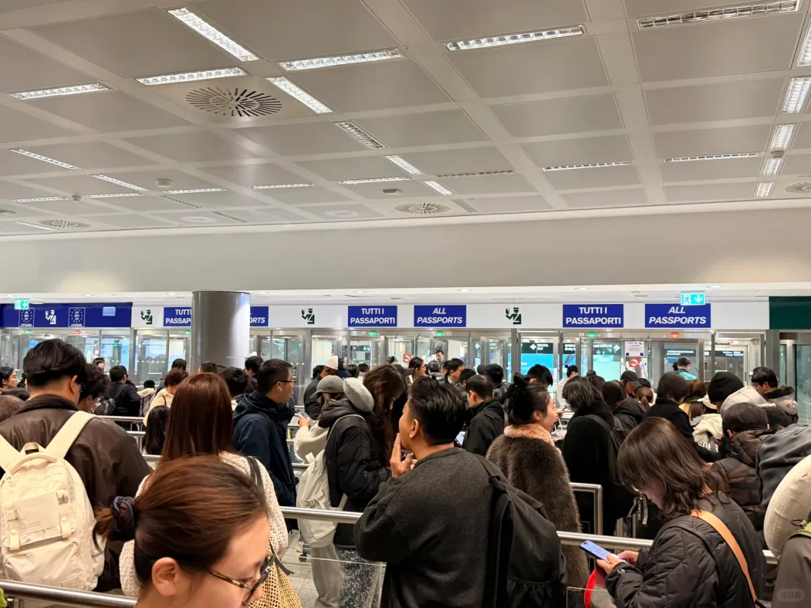

Milán Malpensa (MXP) es la puerta internacional del norte de Italia y el aeropuerto donde aterrizan los vuelos directos chinos a Milán. En una primera llegada, la ansiedad rara vez es el idioma: es la cola, y la cifra que circula en internet es de tres o cuatro horas para pasar.

Una llegada en febrero de 2026 sugiere otra cosa. El vuelo CA949 de Air China aterrizó con unos 20 minutos de adelanto, a las **06:10**, y el trayecto desde la puerta del avión hasta una maleta en la mano llevó **65 minutos**. Parte fue suerte; no todo. Sentarse delante, salir del avión con paso rápido y saber qué carril te corresponde son decisiones que se toman por adelantado.

## 1. Cómo funciona de verdad la cola en MXP

La sala de inmigración de Malpensa no es grande, y los mostradores abren y cierran según el horario de llegadas. **De 07:00 a 09:00 está la punta**, cuando aviones de fuselaje ancho procedentes de Asia y de toda Europa aterrizan en la misma ventana y los pasajeros no comunitarios llenan las barreras en serpentina en cuestión de minutos.

Los vuelos de largo radio llegan en oleadas. Los aviones que aterrizan entre las 06:00 y las 07:00 envían a sus pasajeros por pasarela, autobús y escalera mecánica, así que la mayoría llega a la sala entre las 06:30 y las 07:30. **Si pillas la cabeza de esa oleada, apenas hay cola**; media hora después estás detrás de tu propio vuelo y de otros dos de fuselaje ancho, y por eso los pasajeros de un mismo avión pueden pasar con veinte minutos de diferencia.

Este aterrizaje tuvo suerte con el horario: las puertas se abrieron a las **06:10**, antes de la punta. Había cuatro mostradores abiertos, la fila avanzaba y el sello de entrada llegó tras **unos 30 minutos**. Una hora más tarde, con los mismos cuatro mostradores y varias veces más gente, la misma espera habría sido muy distinta.

Hay otra variable fácil de pasar por alto: **febrero de 2026 cayó durante los Juegos Olímpicos de Invierno de Milán–Cortina**, y el aeropuerto había reforzado claramente el personal, guiando a los pasajeros de la puerta a la sala. El viajero temía las colas de tres y cuatro horas que se describen en internet; la realidad no se acercó ni de lejos.

Esos informes tampoco son inventados: vienen de temporada alta, cuando aterrizan varios vuelos a la vez. Ninguna de las dos cifras es una regla: **el mismo aeropuerto puede sentirse varias veces más lento según la hora**, así que calcula tus tiempos a partir de tu propia hora de aterrizaje.

## 2. De la puerta del avión al control de fronteras

En esencia hay una sola ruta: sigue los carteles verdes de **USCITA EXIT** y sube la escalera mecánica hasta la sala de inmigración. No te desvíes tras las flechas de Transfer, que son para pasajeros en conexión, y no te pares a buscar wifi. Cada minuto allí cuesta unos cuantos puestos en la cola.

Cuánto ahorras depende de dónde te sientas. Salir de un fuselaje ancho es en sí una cola: la cabina delantera va primero y la trasera espera, a menudo quince o veinte minutos en total. **Un asiento delantero reduce esa espera a la mitad**; si no, camina rápido en lugar de pararte en la pasarela. Este vuelo aparcó en plataforma remota y necesitó autobús, así que los pasajeros solo bajaron a las **06:30**, y los primeros ya estaban en la fila cuando llegó el resto.

Dos detalles: la sala de inmigración está un piso más arriba y la escalera mecánica va en un solo sentido, así que sube siguiendo USCITA EXIT; y no te pares en el baño o a por agua, porque una vez que el flujo te ha pasado no puedes recuperar tu sitio.

## 3. El carril de All Passports

En la sala, lee los carteles antes de ponerte en cualquier fila. Funcionan dos sistemas en paralelo: las puertas de **Self service passport control** para viajeros de la UE y mostradores manuales marcados **All passports**, o **TUTTI I PASSAPORTI** en italiano. Un pasaporte chino va en el segundo.

Los carteles llevan mucha información. En el mismo panel azul, la sección izquierda dice “Self service passport control” con banderas de la UE y letra pequeña sobre documentos de identidad y niños menores de 14 años; la sección derecha es “All passports”, y más allá los carriles de tripulación y diplomáticos.

Las familias deben tener en cuenta que el carril “Minori di 14 anni / Children under 14” es para los hijos de viajeros de la UE y no se aplica a los pasaportes chinos. Ponerse en él significa volver al final de la cola: en hora punta, otra media hora perdida.

Hay una afirmación que conviene corregir. Guías de hace unos años decían que los pasaportes chinos podían usar las puertas de autoservicio y pasar en **15 minutos**. Esa mañana, **el personal dirigió a todos los pasajeros no comunitarios a los carriles manuales** y las puertas estaban casi vacías. Que una máquina acepte un pasaporte concreto, y que esté encendida ese día, son cuestiones distintas de adónde te manda el personal: en el cruce, sigue al uniforme, no a la entrada de blog antigua.

Si acabas en el carril equivocado, mantén la calma: antes de entrar en la barrera en serpentina puedes cruzar, pero una vez dentro, la única salida es el final de la cola.

## 4. Una cronología de 65 minutos, medida

Las marcas de tiempo muestran adónde fueron los 65 minutos. El control de fronteras se llevó 35; el resto fue el autobús, los paseos y la espera de una maleta.

| Hora | Qué pasó |
| --- | --- |
| **06:10** | El avión aterrizó, unos 20 minutos antes |
| **06:30** | Bajada del autobús, entrada en la terminal |
| **06:35** | En la cola de All Passports |
| **07:10** | Pasaporte sellado, control de fronteras superado |
| **07:15** | Maleta recogida de la cinta |

Hay poco que hacer en la cola, pero una cosa compensa: abre el pasaporte por la página de la foto y tenlo preparado, para que tu turno sea una entrega, un vistazo y un sello. El control en sí fue más sencillo de lo esperado. **Solo se presentó el pasaporte**; no se pidió itinerario, reserva ni seguro, no se hicieron preguntas y no se tomaron huellas.

Las huellas merecen una nota. El Sistema de Entrada/Salida (EES) de la UE está plenamente en funcionamiento en 2026, y los visitantes no comunitarios normalmente registran huellas y una imagen facial en un kiosco en la primera entrada. Esta llegada no lo hizo, lo que es más probable que sea cuestión de horario y de arreglos locales que un cambio de las reglas, así que quien llegue por primera vez debe seguir contando con el paso extra.

El papeleo que conviene llevar no ha cambiado: itinerario de vuelta, reserva de hotel, seguro de viaje. Que no te lo pidan esta vez no significa que no te lo pidan la próxima.

¿Por qué una cola parece congelada y aun así avanza? El cuello de botella normalmente no es la caseta sino la gente que tiene delante: alguien empieza a buscar algo en una bolsa en el mostrador, una familia se acerca junta, otro duda en el cruce.

## 5. Recogida de equipajes y salida

Pasado el control de fronteras está la sala de equipajes. Busca tu vuelo en las pantallas y su cinta, y luego acércate. Aquí **el personal dijo que las maletas ya se habían descargado al lado opuesto**, lo que ahorró esperar a que arrancara la cinta; con mucho equipaje, localiza tus maletas antes de buscar un carrito.

Si una maleta no aparece, no te quedes en la cinta: ve al mostrador de información de equipajes (señalizado INFORMAZIONI BAGAGLI / Lost & found), regístrala y llévate la referencia antes de contactar con la aerolínea.

Después de las maletas llega el último control: el canal verde si no tienes nada que declarar, el canal rojo si superas el límite de efectivo o llevas algo declarable. A la salida de llegadas, el **Malpensa Express** sale de la estación bajo la Terminal 1 hacia las estaciones Cadorna y Centrale de Milán, y los autobuses y taxis recogen justo fuera, todo señalizado; de noche, un taxi o un traslado reservado es más sencillo.

Visto en perspectiva, tres cosas hicieron el trabajo: **aterrizar antes de la punta de las 07:00, sentarse delante para salir primero y tomar el carril de All Passports**. Ninguna cuesta más; solo exigen la elección correcta al reservar y al abrirse las puertas.

Calcula el tiempo de la misma forma. Aterrizando pronto y con cola corta, cuenta de 30 a 40 minutos de la puerta a la cinta; **aterrizando después de las 07:00, cuenta hora y media**. Si después hay un tren o una conexión, deja dos horas o más de margen: no puedes controlar cuánto tarda la inmigración, pero sí la holgura alrededor.

Una advertencia: el número de mostradores, los tiempos de espera y el registro en el EES varían con el horario y el personal del día. La cronología de aquí viene de una sola llegada medida; consulta el aeropuerto y la policía de fronteras italiana para el día en que viajes.

## Enlaces relacionados

- **En este sitio**: [Aeropuerto de Milán Malpensa (MXP)](/airport/MXP), [Italia (IT)](/country/IT)
- **Wikipedia**: [Aeropuerto de Milán Malpensa](https://en.wikipedia.org/wiki/Milan_Malpensa_Airport)
- **Baidu Baike**: [Aeropuerto de Milán Malpensa](https://baike.baidu.com/item/%E7%B1%B3%E5%85%B0-%E9%A9%AC%E5%B0%94%E5%BD%AD%E8%90%A8%E6%9C%BA%E5%9C%BA)
