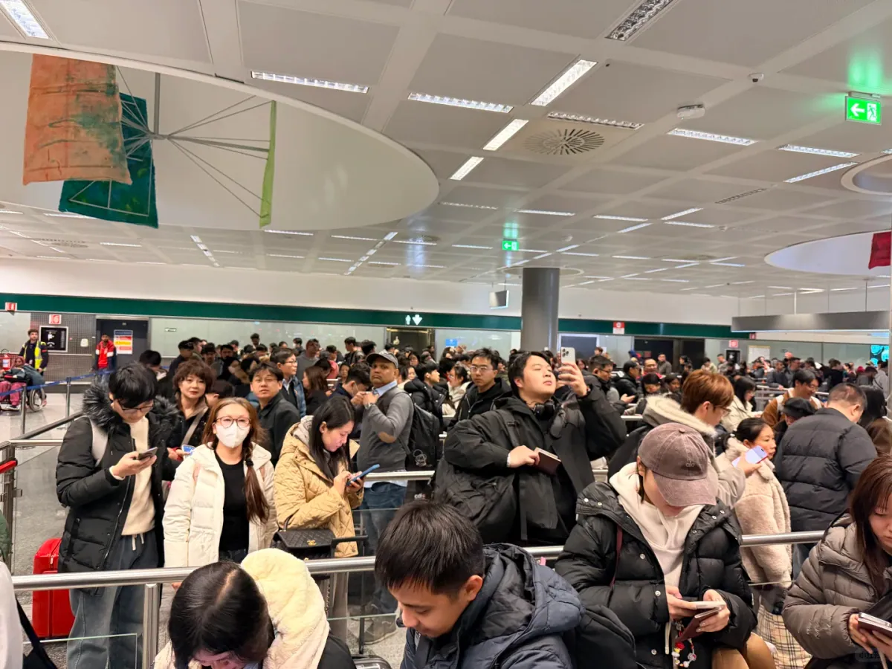

मिलान मालपेंसा (MXP) उत्तरी इटली का अंतरराष्ट्रीय प्रवेश द्वार है और चीन से मिलान आने वाली सीधी उड़ानें यहीं उतरती हैं। पहली बार आने वाले को भाषा की चिंता कम ही होती है — चिंता कतार की होती है, और ऑनलाइन घूमती संख्या है निकलने में तीन-चार घंटे।

फरवरी 2026 में एक आगमन कुछ और बताता है। Air China की CA949 लगभग 20 मिनट पहले, **06:10** पर उतरी, और विमान के दरवाज़े से सूटकेस हाथ में आने तक **65 मिनट** लगे। इसमें कुछ हिस्सा किस्मत का था; सारा नहीं। आगे की सीट, विमान से तेज़ी से उतरना और यह जानना कि आपकी लेन कौन-सी है — ये सब पहले से लिए गए फैसले हैं।

## 1. MXP पर कतार असल में कैसे चलती है

मालपेंसा का इमिग्रेशन हॉल बड़ा नहीं है, और काउंटर आगमन समय-सारिणी के साथ खुलते-बंद होते हैं। **07:00 से 09:00 शिखर का समय है**, जब एशिया और पूरे यूरोप से चौड़े धड़ वाले विमान एक ही अवधि में उतरते हैं और गैर-यूरोपीय संघ के यात्री कुछ ही मिनटों में घुमावदार बैरिकेड्स भर देते हैं।

लंबी दूरी की उड़ानें लहरों में आती हैं। 06:00 से 07:00 के बीच उतरने वाले विमान अपने यात्रियों को जेट ब्रिज, शटल बस और एस्केलेटर से भेजते हैं, इसलिए ज़्यादातर यात्री 06:30 से 07:30 के बीच हॉल पहुँचते हैं। **उस लहर के सबसे आगे रहें तो कतार लगभग नहीं होती**; आधे घंटे बाद आप अपनी उड़ान के साथ दो और चौड़े धड़ वाले विमानों के पीछे होते हैं — इसीलिए एक ही विमान के यात्री बीस मिनट के अंतर से निकल सकते हैं।

इस बार उतरना समय के हिसाब से भाग्यशाली था: दरवाज़े **06:10** पर खुले, शिखर से पहले। चार काउंटर खुले थे, कतार चलती रही, और प्रवेश की मोहर **करीब 30 मिनट** बाद लगी। एक घंटे बाद, उन्हीं चार काउंटरों और कई गुना लोगों के साथ, यही इंतज़ार बहुत अलग दिखता।

एक और कारक आसानी से छूट सकता है: **फरवरी 2026 मिलान–कोर्टिना शीतकालीन ओलंपिक के दौरान पड़ा**, और हवाई अड्डे ने स्पष्ट रूप से अतिरिक्त कर्मचारी जोड़े थे, जो यात्रियों को गेट से हॉल तक मार्गदर्शन दे रहे थे। यात्री को ऑनलाइन बताई गई तीन-चार घंटे की कतारों का डर था; असलियत उससे बहुत दूर थी।

वे रिपोर्टें भी बनाई-बनाई नहीं हैं — वे व्यस्त मौसम से आती हैं, जब कई उड़ानें एक साथ उतरती हैं। दोनों में से कोई भी आँकड़ा नियम नहीं है: **समय के हिसाब से वही हवाई अड्डा कई गुना धीमा लग सकता है**, इसलिए अपने समय का अंदाज़ा अपने उतरने के समय से लगाएँ।

## 2. विमान के दरवाज़े से सीमा नियंत्रण तक

मूल रूप से एक ही रास्ता है: हरे **USCITA EXIT** संकेतों का पीछा करें और एस्केलेटर से ऊपर इमिग्रेशन हॉल तक जाएँ। Transfer के तीरों के पीछे न भटकें — वे कनेक्टिंग यात्रियों के लिए हैं — और Wi-Fi ढूँढ़ने के लिए रुकें नहीं। वहाँ बिताया हर मिनट कतार में कुछ स्थान गँवाता है।

आप कितना बचाते हैं यह इस पर निर्भर है कि आप कहाँ बैठे हैं। चौड़े धड़ वाले विमान से उतरना खुद एक कतार है: आगे का केबिन पहले जाता है और पीछे वाला इंतज़ार करता है, अक्सर कुल मिलाकर पंद्रह-बीस मिनट। **आगे की सीट उस इंतज़ार को आधा कर देती है**; अगर वह न हो, तो जेट ब्रिज पर रुकने के बजाय तेज़ कदमों से चलें। यह उड़ान दूर के स्टैंड पर खड़ी थी और शटल बस की ज़रूरत थी, इसलिए यात्री **06:30** पर ही उतरे — और बाकी पहुँचे तब तक उनमें से पहले लोग कतार में लग चुके थे।

दो बातें: इमिग्रेशन हॉल एक मंज़िल ऊपर है और एस्केलेटर एक ही दिशा में चलता है, इसलिए USCITA EXIT के साथ ऊपर जाएँ; और शौचालय या पानी के लिए न रुकें, क्योंकि एक बार भीड़ आगे निकल गई तो आप अपनी जगह पर वापस नहीं पा सकते।

## 3. All Passports लेन

हॉल में किसी भी कतार में लगने से पहले संकेत पढ़ें। दो व्यवस्थाएँ साथ-साथ चलती हैं: यूरोपीय संघ के यात्रियों के लिए **Self service passport control** गेट, और **All passports**, या इतालवी में **TUTTI I PASSAPORTI** लिखे मैनुअल काउंटर। चीनी पासपोर्ट दूसरे में आता है।

संकेतों पर बहुत सी जानकारी है। उसी नीले पैनल पर बाईं ओर “Self service passport control” लिखा है, यूरोपीय संघ के झंडों और आईडी कार्ड तथा 14 वर्ष से कम उम्र के बच्चों के बारे में छोटे अक्षरों के साथ; दाईं ओर “All passports” है, और उससे आगे क्रू तथा राजनयिक लेन हैं।

परिवारों को ध्यान देना चाहिए कि “Minori di 14 anni / Children under 14” लेन यूरोपीय संघ के यात्रियों के बच्चों के लिए है और चीनी पासपोर्ट पर लागू नहीं होती। उसमें लगने का मतलब है कतार के आखिर में लौटकर जाना — व्यस्त समय में यानी एक और आधा घंटा गया।

एक दावा सुधारना ज़रूरी है। कुछ साल पुरानी गाइडों में कहा गया था कि चीनी पासपोर्ट वाले सेल्फ-सर्विस गेट इस्तेमाल कर सकते हैं और **15 मिनट** में निकल सकते हैं। इस सुबह **कर्मचारियों ने हर गैर-यूरोपीय संघ यात्री को मैनुअल लेन की ओर भेजा** और गेट लगभग खाली पड़े थे। कोई मशीन किसी पासपोर्ट को स्वीकार करती है या नहीं, और उस दिन वह चालू है या नहीं — ये उस बात से अलग सवाल हैं कि कर्मचारी आपको कहाँ भेजते हैं — जंक्शन पर यूनिफ़ॉर्म का पालन करें, पुराने ब्लॉग पोस्ट का नहीं।

अगर आप गलत लेन में पहुँच ही जाएँ, तो शांत रहें: घुमावदार बैरिकेड में लगने से पहले आप पार जा सकते हैं, लेकिन एक बार उसमें लग गए तो निकलने का एक ही रास्ता है — कतार के आखिर में।

## 4. 65 मिनट की समय-रेखा, नापी हुई

समय-मोहरें दिखाती हैं कि 65 मिनट कहाँ गए। सीमा नियंत्रण ने उनमें से 35 लिए; बाकी शटल बस, पैदल चलना और बैग का इंतज़ार था।

| समय | क्या हुआ |
| --- | --- |
| **06:10** | विमान उतरा, लगभग 20 मिनट पहले |
| **06:30** | शटल बस से उतरकर टर्मिनल में |
| **06:35** | All Passports कतार में लगे |
| **07:10** | पासपोर्ट पर मोहर, सीमा नियंत्रण पार |
| **07:15** | बेल्ट से बैग लिया |

कतार में करने को कुछ खास नहीं है, लेकिन एक काम फ़ायदेमंद है: अपना पासपोर्ट फ़ोटो वाले पन्ने पर खोलकर तैयार रखें, ताकि आपकी बारी में सिर्फ़ पासपोर्ट सौंपना, एक नज़र और मोहर हो। जाँच खुद उम्मीद से आसान थी। **सिर्फ़ पासपोर्ट दिया गया**; कोई यात्रा कार्यक्रम, बुकिंग या बीमा नहीं माँगा गया, कोई सवाल नहीं पूछा गया और कोई फिंगरप्रिंट नहीं लिए गए।

फिंगरप्रिंट पर एक बात ज़रूरी है। यूरोपीय संघ की Entry/Exit System (EES) 2026 में पूरी तरह लागू है, और गैर-यूरोपीय संघ के आगंतुक आम तौर पर पहली बार प्रवेश पर एक कियोस्क पर फिंगरप्रिंट और चेहरे की छवि दर्ज कराते हैं। इस आगमन में ऐसा कुछ नहीं हुआ, जो नियमों में बदलाव से ज़्यादा समय और स्थानीय व्यवस्था की बात लगती है, इसलिए पहली बार आने वालों को अब भी यह अतिरिक्त कदम अपेक्षित रखना चाहिए।

साथ रखने लायक कागज़ात वही हैं: वापसी का यात्रा कार्यक्रम, होटल की बुकिंग, यात्रा बीमा। इस बार न पूछा जाना यह नहीं कि अगली बार भी नहीं पूछा जाएगा।

कतार जमी हुई क्यों दिखती है और फिर भी चलती क्यों रहती है? अड़चन आम तौर पर बूथ नहीं, बल्कि उसके आगे खड़े लोग होते हैं — कोई डेस्क पर ही बैग टटोलने लगता है, कोई परिवार साथ-साथ आगे बढ़ता है, कोई जंक्शन पर झिझकता है।

## 5. बैगेज क्लेम और बाहर निकलना

सीमा नियंत्रण के आगे बैगेज हॉल है। स्क्रीन पर अपनी उड़ान और उसकी बेल्ट ढूँढ़ें, फिर वहाँ जाएँ। यहाँ **कर्मचारियों ने बताया कि बैग पहले ही सामने वाली दूसरी तरफ उतार दिए गए थे**, जिससे बेल्ट चालू होने का इंतज़ार बच गया; ज़्यादा सामान हो तो ट्रॉली ढूँढ़ने से पहले अपने केस पहचान लें।

अगर कोई बैग न दिखे, तो बेल्ट पर खड़े न रहें: बैगेज पूछताछ डेस्क (INFORMAZIONI BAGAGLI / Lost & found लिखा) पर जाएँ, उसे दर्ज कराएँ और एयरलाइन से संपर्क करने से पहले संदर्भ संख्या ले लें।

बैग के बाद आखिरी चौकी है: कुछ घोषित करने को न हो तो हरा चैनल, और नकद भत्ते से ज़्यादा पैसा या घोषणा योग्य सामान हो तो लाल चैनल। आगमन से बाहर, **Malpensa Express** टर्मिनल 1 के नीचे स्टेशन से मिलान के Cadorna और Centrale स्टेशनों के लिए चलती है, और बसें तथा टैक्सियाँ ठीक बाहर से मिलती हैं, सब पर संकेत लगे हैं; देर रात टैक्सी या पहले से बुक किया ट्रांसफ़र आसान रहता है।

पीछे मुड़कर देखें तो तीन बातों ने काम किया: **07:00 के शिखर से पहले उतरना, पहले निकलने के लिए आगे बैठना, और All Passports लेन लेना**। इनमें से किसी पर अतिरिक्त खर्च नहीं; बस बुकिंग के समय और दरवाज़े खुलने के समय सही चुनाव चाहिए।

समय का बजट भी इसी तरह बनाएँ। जल्दी उतरकर छोटी कतार हो तो दरवाज़े से बेल्ट तक 30 से 40 मिनट रखें; **07:00 के बाद उतरें तो डेढ़ घंटा रखें**। अगर आगे ट्रेन या कनेक्शन है, तो दो घंटे या ज़्यादा का बफ़र छोड़ें — इमिग्रेशन में कितना समय लगेगा यह आपके हाथ में नहीं, लेकिन उसके आसपास की ढील आपके हाथ में है।

एक चेतावनी: काउंटरों की संख्या, इंतज़ार का समय और EES पंजीकरण दिन के शेड्यूल और कर्मचारियों के हिसाब से बदलते हैं। यहाँ दी समय-रेखा एक ही नापे गए आगमन से है; जिस दिन आप यात्रा करें उसके लिए हवाई अड्डे और इतालवी सीमा पुलिस से जाँच लें।

## संबंधित लिंक

- **इस साइट पर**: [Milan Malpensa Airport (MXP)](/airport/MXP), [Italy (IT)](/country/IT)
- **विकिपीडिया**: [Milan Malpensa Airport](https://en.wikipedia.org/wiki/Milan_Malpensa_Airport)
- **Baidu Baike**: [Milan Malpensa Airport](https://baike.baidu.com/item/%E7%B1%B3%E5%85%B0-%E9%A9%AC%E5%B0%94%E5%BD%AD%E8%90%A8%E6%9C%BA%E5%9C%BA)
