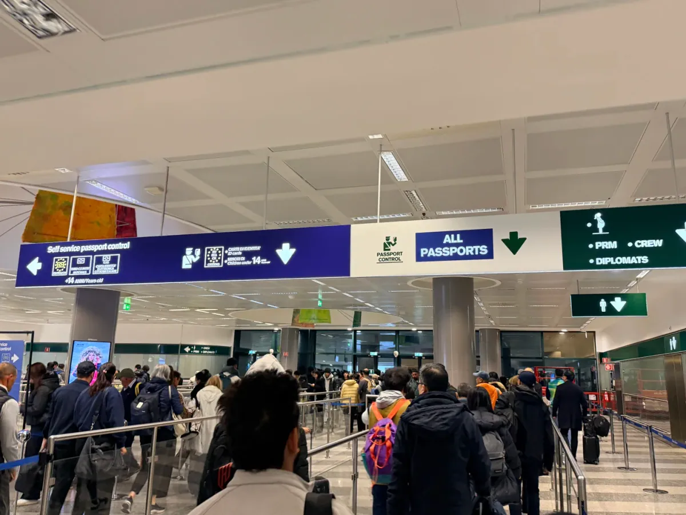

ミラノ・マルペンサ（MXP）は北イタリアの国際玄関口であり、中国からの直行便が到着する空港です。初めての到着で不安なのは言語よりも列のほうで、ネット上には通過に3〜4時間かかるとの情報が流れています。

2026年2月のある到着はそうではないことを示しました。中国国際航空CA949便は約20分早く**06:10**に着陸し、機内扉からスーツケースを手にするまで**65分**でした。運もありましたが、すべてではありません。前方に座る、機内を速やかに出る、自分のレーンを知っておくことは、事前にできる選択です。

## 1. MXPの列は実際どう動くのか

マルペンサの入国審査ホールは広くなく、カウンターは到着時刻表に合わせて開閉します。**07:00〜09:00がピーク**で、アジアやヨーロッパ各地からの大型機が同じ時間帯に着陸し、非EU旅客が数分で蛇行バリアを埋めます。

長距離便は波のように到着します。06:00〜07:00に着陸した機は、ボーディングブリッジ、シャトルバス、エスカレーターを経て、大半が06:30〜07:30にホールへ到達します。**その波の先頭に立てば列はほとんどありません**。30分遅れれば、自分の便に加えてさらに2機の大型機の後ろに並ぶことになります。同じ機の旅客でも20分差がつくのはそのためです。

この到着はタイミングに恵まれました。ドアが開いたのは**06:10**で、ピーク前でした。カウンターは4つ開き、列は動き続け、入国スタンプは**約30分**後に押されました。1時間後なら、同じ4カウンターに数倍の人がいて、同じ待ち時間でもまったく違って見えたはずです。

もう一つ見落としやすい変数があります。**2026年2月はミラノ・コルティナ冬季オリンピックの期間中**で、空港は明らかに人員を増やし、ゲートからホールまで旅客を誘導していました。旅行者はネットに書かれた3〜4時間の列を恐れていましたが、現実はまったく遠いものでした。

そうした報告も捏造ではありません。繁忙期に複数の便が一度に着くときのものです。どちらの数字も規則ではありません。**同じ空港でも時間帯によって数倍遅く感じられる**ので、所要時間は自分の着陸時刻から判断してください。

## 2. 機内扉から入国審査まで

ルートは実質一つです。緑の**USCITA EXIT**の案内に従い、エスカレーターで入国審査ホールへ上がります。Transferの矢印につられないこと。あれは乗り継ぎ客用です。Wi-Fiを探して立ち止まらないこと。そこでの1分は列で数順位の損失になります。

どれだけ節約できるかは座席次第です。大型機を降りること自体が列です。前方キャビンが先に出て、後方は待ち、しばしば合計15〜20分かかります。**前方の席ならその待ちは半分**になります。それが無理なら、ボーディングブリッジで止まらず速やかに歩きましょう。この便は沖止めでシャトルバスが必要だったため、旅客が降りたのは**06:30**で、最初の数人は残りが着く前にすでに列に並んでいました。

細部を二つ。入国審査ホールは1階上でエスカレーターは一方通行なので、USCITA EXITに従って上へ。そしてトイレや水のために立ち止まらないこと。流れを離れると元の位置には戻れません。

## 3. All Passportsレーン

ホールでは、どこに並ぶ前に案内を読みましょう。二つのシステムが並行しています。EU旅客用の**Self service passport control**ゲートと、**All passports**、イタリア語で**TUTTI I PASSAPORTI**と書かれた有人カウンターです。中国のパスポートは後者です。

案内には多くの情報があります。同じ青いパネルの左側はEUの旗と身分証、14歳未満の子どもに関する小さな注記付きで「Self service passport control」、右側は「All passports」、その先に乗務員と外交官のレーンがあります。

家族は注意が必要です。「Minori di 14 anni / Children under 14」のレーンはEU旅客の子どものためのもので、中国のパスポートには適用されません。そこに並ぶと列の最後まで戻ることになり、ピーク時ならさらに30分を失います。

一つの説は訂正が必要です。数年前のガイドには、中国のパスポートでもセルフサービスゲートを使え、**15分**で通過できるとありました。この朝、**係員はすべての非EU旅客を有人レーンへ誘導**し、ゲートはほぼ空でした。あるパスポートを機械が受け付けるかどうか、その日に電源が入っているかどうかは、係員がどこへ誘導するかとは別の問題です。分岐点では、古いブログ記事ではなく制服に従ってください。

間違ったレーンに入ってしまったら、落ち着いてください。蛇行バリアに入る前なら横に移れますが、一度入ると出口は列の最後尾だけです。

## 4. 実測65分のタイムライン

タイムスタンプを見れば65分がどこへ消えたかわかります。入国審査が35分を占め、残りはシャトルバス、徒歩、荷物待ちでした。

| 時刻 | 出来事 |
| --- | --- |
| **06:10** | 着陸、約20分早着 |
| **06:30** | シャトルバスを降り、ターミナルへ |
| **06:35** | All Passportsの列に並ぶ |
| **07:10** | パスポートにスタンプ、入国審査完了 |
| **07:15** | ベルトから荷物を回収 |

列でできることはほとんどありませんが、一つだけ得なことがあります。パスポートを写真ページまで開いて手に持っておくことです。順番が来たら手渡し、一瞥、スタンプで終わります。確認自体は予想より簡単でした。**提示したのはパスポートだけ**で、旅程、予約、保険は求められず、質問も指紋採取もありませんでした。

指紋には注意が必要です。EUの入退場システム（EES）は2026年に完全運用されており、非EUの訪問者は初入国時に端末で指紋と顔写真を登録するのが通常です。この到着ではそれがありませんでしたが、これは規則の変更というより時間帯と現地の運用の問題でしょう。初めての人は追加の手順を想定しておくべきです。

携帯しておくべき書類は変わりません。帰りの旅程、ホテル予約、旅行保険です。今回求められなかったからといって、次回も求められないとは限りません。

列が止まって見えるのに進み続けるのはなぜでしょうか。ボトルネックは通常ブースではなく、その前の人です。カウンターで荷物を探し始める人、家族でまとめて進む人、分岐点でためらう人です。

## 5. 手荷物受取と出口

入国審査を抜けると手荷物ホールです。画面で自分の便とベルトを探し、そこへ歩きます。ここでは**係員が荷物はすでに反対側へ降ろされたと告げ**、ベルトが動き出すのを待たずに済みました。荷物が多いときは、カートを探す前に自分のスーツケースを確認しておきましょう。

荷物が出てこない場合は、ベルトの前に立たず、手荷物問い合わせカウンター（INFORMAZIONI BAGAGLI / Lost & found）へ行き、登録して参照番号を受け取ってから航空会社に連絡してください。

荷物の後は最後の関門です。申告するものがなければ緑の通路、現金の許容額を超える場合や申告対象の物を持っている場合は赤の通路へ。到着口の外では、**マルペンサ・エクスプレス**が第1ターミナル下の駅からミラノのカドルナ駅と中央駅へ出ており、バスとタクシーはすぐ外で乗れ、すべて案内があります。深夜はタクシーか事前予約の送迎が簡単です。

振り返ると、三つのことが効きました。**07:00のピーク前に着陸すること、前方に座って先に降りること、All Passportsレーンを使うこと**。どれも追加費用はなく、予約時とドアが開くときに正しい選択をするだけです。

時間も同じように見積もりましょう。早着で列が短ければ、ドアからベルトまで30〜40分を見ます。**07:00以降の着陸なら1時間半**を見てください。その後に列車や乗り継ぎがあるなら、2時間以上の余裕を。入国審査にかかる時間は制御できませんが、その周りの余白は制御できます。

注意点が一つ。カウンター数、待ち時間、EES登録はその日のダイヤと人員によって変わります。ここのタイムラインは一回の実測到着によるものです。旅行日については空港とイタリア国境警察で確認してください。

## 関連リンク

- **このサイト内**：[ミラノ・マルペンサ空港 (MXP)](/airport/MXP)、[イタリア (IT)](/country/IT)
- **Wikipedia**：[ミラノ・マルペンサ空港](https://en.wikipedia.org/wiki/Milan_Malpensa_Airport)
- **百度百科**：[ミラノ・マルペンサ空港](https://baike.baidu.com/item/%E7%B1%B3%E5%85%B0-%E9%A9%AC%E5%B0%94%E5%BD%AD%E8%90%A8%E6%9C%BA%E5%9C%BA)
