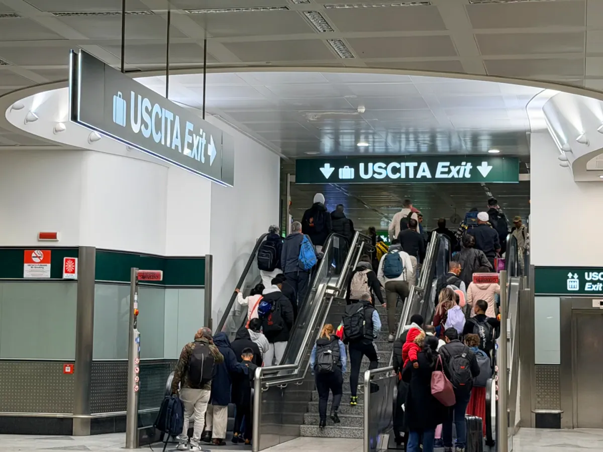

Mediolan Malpensa (MXP) to międzynarodowa brama północnych Włoch i lotnisko, na którym lądują bezpośrednie loty z Chin do Mediolanu. Przy pierwszym przylocie lęk rzadko dotyczy języka — chodzi o kolejkę, a krążąca w internecie liczba to trzy lub cztery godziny na przejście kontroli.

Jeden z przylotów w lutym 2026 roku sugeruje coś innego. Air China CA949 wylądował około 20 minut przed czasem, o **06:10**, a droga od drzwi samolotu do walizki w ręku zajęła **65 minut**. Część z tego była szczęściem; nie całość. Miejsce z przodu, żwawe wyjście z samolotu i wiedza, który pas jest twój, to wybory podjęte wcześniej.

## 1. Jak naprawdę działa kolejka na MXP

Hala kontroli granicznej na Malpensie nie jest duża, a stanowiska otwierają się i zamykają wraz z rozkładem przylotów. **Szczyt przypada między 07:00 a 09:00**, gdy szerokokadłubowe samoloty z Azji i z całej Europy lądują w tym samym oknie, a pasażerowie spoza UE wypełniają barierki w ciągu kilku minut.

Loty długodystansowe przychodzą falami. Samoloty lądujące między 06:00 a 07:00 przepuszczają pasażerów przez rękaw, autobus i schody ruchome, więc większość dociera do hali między 06:30 a 07:30. **Złap początek tej fali, a kolejki prawie nie ma**; pół godziny później stoisz za swoim lotem plus dwoma kolejnymi szerokokadłubowcami — dlatego pasażerowie z jednego samolotu mogą przejść kontrolę w odstępie dwudziestu minut.

Ten przylot miał szczęście do godziny: drzwi otwarto o **06:10**, przed szczytem. Otwarte były cztery stanowiska, kolejka posuwała się, a pieczątka wjazdowa pojawiła się po **około 30 minutach**. Godzinę później, przy tych samych czterech stanowiskach i kilkakrotnie większej liczbie osób, ten sam czas oczekiwania wyglądałby zupełnie inaczej.

Jeszcze jedna zmienna łatwo umyka: **luty 2026 wypadł w trakcie zimowych igrzysk olimpijskich Mediolan–Cortina**, a lotnisko najwyraźniej wzmocniło personel, kierujący pasażerów od bramki do hali. Podróżny obawiał się opisywanych w internecie trzy- i czterogodzinnych kolejek; rzeczywistość była od nich bardzo daleka.

Te relacje też nie są wymyślone — pochodzą z sezonu szczytowego, gdy kilka lotów ląduje naraz. Żadna z tych liczb nie jest regułą: **to samo lotnisko może wydawać się kilkakrotnie wolniejsze w zależności od godziny**, więc swoje szacunki opieraj na własnym czasie lądowania.

## 2. Od drzwi samolotu do kontroli granicznej

Trasa jest właściwie jedna: idź za zielonymi znakami **USCITA EXIT** i wjedź schodami ruchomymi na górę, do hali kontroli granicznej. Nie idź za strzałkami Transfer — są przeznaczone dla pasażerów przesiadających się — i nie zatrzymuj się w poszukiwaniu Wi-Fi. Każda minuta tam kosztuje kilka miejsc w kolejce.

Ile zyskasz, zależy od miejsca, w którym siedzisz. Wyjście z szerokokadłubowca samo w sobie jest kolejką: przód idzie pierwszy, tył czeka — często w sumie piętnaście lub dwadzieścia minut. **Miejsce z przodu skraca to oczekiwanie o połowę**; jeśli to niemożliwe, idź żwawo, zamiast zatrzymywać się przy rękawie. Ten lot stał na oddalonym stanowisku i wymagał autobusu, więc pasażerowie opuścili go dopiero o **06:30** — a pierwsi z nich stali już w kolejce, gdy reszta dopiero nadchodziła.

Dwa szczegóły: hala kontroli granicznej jest poziom wyżej, a schody ruchome jadą tylko w jedną stronę, więc kieruj się za USCITA EXIT w górę; nie zatrzymuj się też przy toalecie ani po wodę, bo gdy tłum cię minie, nie wrócisz na swoje miejsce.

## 3. Pas All Passports

W hali najpierw czytaj znaki, zanim do czegokolwiek wstaniesz w kolejce. Działają tu równolegle dwa systemy: bramki **Self service passport control** dla podróżnych z UE oraz stanowiska obsługiwane ręcznie oznaczone **All passports**, po włosku **TUTTI I PASSAPORTI**. Paszport chiński należy do drugiej kategorii.

Znaki niosą dużo informacji. Na tej samej niebieskiej tablicy lewa część głosi „Self service passport control”, z flagami UE i drobnym drukiem o dowodach osobistych i dzieciach do 14 lat; prawa część to „All passports”, a dalej pasy dla załóg i personelu dyplomatycznego.

Rodziny powinny wiedzieć, że pas „Minori di 14 anni / Children under 14” jest dla dzieci podróżnych z UE i nie dotyczy paszportów chińskich. Ustawienie się w nim oznacza powrót na koniec kolejki — w godzinach szczytu kolejne pół godziny stracone.

Jedna teza wymaga sprostowania. Przewodniki sprzed kilku lat twierdziły, że z paszportem chińskim można korzystać z bramek samoobsługowych i przejść kontrolę w **15 minut**. Tego ranka **personel kierował każdego pasażera spoza UE do pasów obsługiwanych ręcznie**, a bramki stały prawie puste. To, czy maszyna akceptuje dany paszport i czy jest tego dnia włączona, to kwestie odrębne od tego, gdzie kieruje cię personel — na rozgałęzieniu ufaj mundurowi, a nie staremu wpisowi na blogu.

Jeśli trafisz jednak do niewłaściwego pasa, zachowaj spokój: zanim wejdziesz w barierki, możesz przejść na drugą stronę, ale gdy już w nich jesteś, jedyne wyjście prowadzi na koniec kolejki.

## 4. Zmierzona oś czasu: 65 minut

Godziny w tabeli pokazują, na co poszło 65 minut. Kontrola graniczna zajęła 35 z nich; resztę stanowiły autobus, chodzenie i czekanie na bagaż.

| Czas | Co się działo |
| --- | --- |
| **06:10** | Samolot wylądował, około 20 minut przed czasem |
| **06:30** | Wyjście z autobusu, wejście do terminala |
| **06:35** | Ustawienie się w kolejce All Passports |
| **07:10** | Pieczątka w paszporcie, kontrola graniczna zaliczona |
| **07:15** | Bagaż odebrany z taśmy |

W kolejce niewiele da się zrobić, ale jedna rzecz się opłaca: otwórz paszport na stronie ze zdjęciem i trzymaj go w gotowości, aby twoja kolej była tylko podaniem, spojrzeniem i pieczątką. Sama kontrola okazała się prostsza, niż można było oczekiwać. **Przedstawiono wyłącznie paszport**; nikt nie prosił o plan podróży, rezerwację ani ubezpieczenie, nie zadano żadnych pytań i nie pobrano odcisków palców.

O odciskach palców warto wspomnieć. Unijny system wjazdu i wyjazdu (Entry/Exit System, EES) działa w pełni w 2026 roku, a odwiedzający spoza UE przy pierwszym wjeździe zwykle rejestrują odciski palców i obraz twarzy w kiosku. Ten przylot obył się bez tego kroku, co jest raczej kwestią terminu i lokalnych ustaleń niż zmiany przepisów, więc osoby przylatujące pierwszy raz nadal powinny liczyć się z tym dodatkowym etapem.

Dokumenty, które warto mieć przy sobie, się nie zmieniły: plan podróży powrotnej, rezerwacja hotelu, ubezpieczenie podróżne. To, że tym razem nikt o nie nie spytał, nie znaczy, że następnym razem nie spyta.

Dlaczego kolejka wygląda, jakby stała, a mimo to posuwa się naprzód? Wąskie gardło to zwykle nie budka, lecz ludzie przed nią — ktoś zaczyna szukać czegoś w torbie przy okienku, rodzina podchodzi razem, ktoś inny waha się na rozgałęzieniu.

## 5. Odbiór bagażu i wyjście

Za kontrolą graniczną znajduje się hala odbioru bagażu. Znajdź swój lot na ekranach i jego taśmę, a potem podejdź. Tutaj **personel powiedział, że bagaże zostały już wyładowane po przeciwnej stronie**, co oszczędziło czekania na start taśmy; przy dużej liczbie bagaży najpierw wypatrz swoje walizki, a dopiero potem szukaj wózka.

Jeśli walizka się nie pojawi, nie stój przy taśmie: idź do okienka informacji bagażowej (oznaczonego INFORMAZIONI BAGAGLI / Lost & found), zgłoś sprawę i odbierz numer zgłoszenia, zanim skontaktujesz się z linią lotniczą.

Po bagażach zostaje ostatnia bramka: zielona, jeśli nie masz nic do zgłoszenia, czerwona, jeśli przekraczasz limit gotówki albo wieziesz cokolwiek do zgłoszenia. Na zewnątrz hali przylotów **Malpensa Express** odjeżdża ze stacji pod terminalem 1 do mediolańskich dworców Cadorna i Centrale, a autobusy i taksówki odbierają pasażerów tuż przed wyjściem, wszystko jest oznakowane; późną nocą prostsza będzie taksówka lub wcześniej zamówiony transfer.

Z perspektywy czasu zadziałały trzy rzeczy: **lądowanie przed szczytem o 07:00, miejsce z przodu, żeby wysiąść pierwszym, i wybór pasa All Passports**. Żadna z nich nie kosztuje ekstra; wymagają tylko właściwej decyzji przy rezerwacji i przy otwarciu drzwi.

Czas planuj w ten sam sposób. Przy wczesnym lądowaniu i krótkiej kolejce załóż 30–40 minut od drzwi do taśmy; **przy lądowaniu po 07:00 załóż półtorej godziny**. Jeśli potem czeka cię pociąg lub przesiadka, zostaw co najmniej dwie godziny zapasu — nie kontrolujesz, ile potrwa kontrola graniczna, ale kontrolujesz luz wokół niej.

Jedno zastrzeżenie: liczba stanowisk, czas oczekiwania i rejestracja w EES zależą od rozkładu i obsady danego dnia. Przedstawiony tu przebieg pochodzi z jednego zmierzonego przylotu; sprawdź informacje lotniska i włoskiej policji granicznej na dzień swojej podróży.

## Powiązane linki

- **Na tej stronie**: [Lotnisko Mediolan Malpensa (MXP)](/airport/MXP), [Włochy (IT)](/country/IT)
- **Wikipedia**: [Lotnisko Mediolan Malpensa](https://en.wikipedia.org/wiki/Milan_Malpensa_Airport)
- **Baidu Baike**: [Lotnisko Mediolan Malpensa](https://baike.baidu.com/item/%E7%B1%B3%E5%85%B0-%E9%A9%AC%E5%B0%94%E5%BD%AD%E8%90%A8%E6%9C%BA%E5%9C%BA)
