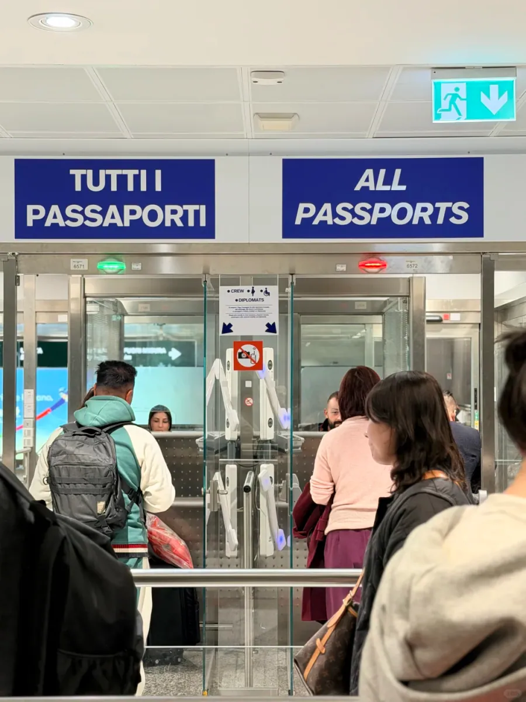

Milano Malpensa (MXP), kuzey İtalya'nın uluslararası giriş kapısı ve Çin'den Milano'ya aktarmasız uçuşların indiği havalimanı. İlk varışta endişe nadiren dil — kuyruk ve internette dolaşan üç dört saat rakamı.

Şubat 2026'daki bir varış aksini gösteriyor. Air China CA949 yaklaşık 20 dakika erken, **06.10**'da indi ve uçak kapısından valizin ele geçmesine **65 dakika** sürdü. Bunun bir kısmı şanstı; tamamı değil. Önde oturmak, uçaktan hızlı inmek ve hangi şeridin sizin olduğunu bilmek önceden verilen kararlar.

## 1. MXP'de kuyruk gerçekte nasıl işliyor

Malpensa'nın pasaport salonu büyük değil ve gişeler varış tarifesine göre açılıp kapanıyor. **07.00–09.00 zirve**, Asya'dan ve Avrupa'nın dört bir yanından geniş gövdeli uçaklar aynı pencerede iniyor ve AB dışı yolcular yılan bariyerleri dakikalar içinde dolduruyor.

Uzun mesafeli uçuşlar dalgalar halinde geliyor. 06.00–07.00 arasında inen uçaklar yolcularını körükle, servis otobüsüyle ve yürüyen merdivenle gönderiyor, yani çoğu salona 06.30–07.30 arasında ulaşıyor. **O dalganın önüne yakalanırsanız neredeyse kuyruk olmuyor**; yarım saat sonra kendi uçağınızın artı iki geniş gövdenin arkasındasınız — bu yüzden aynı uçaktaki yolcular yirmi dakika arayla geçebiliyor.

Bu iniş zamanlamasıyla şanslıydı: kapılar **06.10**'da açıldı, zirveden önce. Dört gişe açıktı, sıra ilerlemeye devam etti ve giriş kaşesi **yaklaşık 30 dakika** sonra geldi. Bir saat sonra, aynı dört gişe ve birkaç kat insanla aynı bekleme çok farklı görünürdü.

Gözden kaçması kolay bir değişken daha: **Şubat 2026, Milano–Cortina Kış Olimpiyatları'na denk geldi** ve havalimanı açıkça personel eklemiş, yolcuları kapıdan salona yönlendiriyordu. Yolcu internette anlatılan üç dört saatlik kuyruklardan korkmuştu; gerçek onlara yakın bile değildi.

Bu haberler de uydurma değil — yoğun sezonda, aynı anda birkaç uçuş indiğinde ortaya çıkıyor. İki rakam da kural değil: **aynı havalimanı saate göre birkaç kat yavaş hissedilebilir**, o yüzden zamanlamanızı kendi iniş saatinize göre değerlendirin.

## 2. Uçak kapısından pasaport kontrolüne

Esasen tek bir güzergâh var: yeşil **USCITA EXIT** tabelalarını izleyin ve yürüyen merdivenle pasaport salonuna çıkın. Transfer oklarından sonra sapmayın — onlar aktarma yolcuları için — ve Wi-Fi aramak için durmayın. Orada geçirilen her dakika kuyrukta birkaç sıra kaybettirir.

Ne kadar kazandığınız nerede oturduğunuza bağlı. Geniş gövdeden inmek başlı başına bir kuyruk: ön kabin önce gider, arka bekler, genellikle toplamda on beş yirmi dakika. **Öndeki koltuk bu beklemeyi yarıya indirir**; olmadıysa körükte durmak yerine hızlı yürüyün. Bu uçuş uzak bir park pozisyonuna park etti ve servis otobüsü gerekti, yani yolcular ancak **06.30**'da indi — ve geri kalanlar geldiğinde ilk inenler çoktan sıradaydı.

İki ayrıntı: pasaport salonu bir kat yukarıda ve yürüyen merdiven tek yönlü, o yüzden USCITA EXIT ile yukarı çıkın; tuvalet veya su için durmayın, çünkü akış geçtikten sonra yerinize geri dönemezsiniz.

## 3. All Passports şeridi

Salonda herhangi bir sıraya girmeden önce tabelaları okuyun. Yan yana iki sistem işliyor: AB yolcuları için **Self service passport control** kapıları ve **All passports**, İtalyancada **TUTTI I PASSAPORTI** yazan manuel gişeler. Çin pasaportu ikincisine ait.

Tabelalar çok bilgi taşıyor. Aynı mavi panelde sol bölümde “Self service passport control”, AB bayrakları ve kimlik kartları ile 14 yaş altı çocuklar hakkında küçük yazılar var; sağ bölüm “All passports” ve ötesinde mürettebat ile diplomatik şeritler.

Aileler şunu bilmeli: “Minori di 14 anni / Children under 14” şeridi AB yolcularının çocukları için ve Çin pasaportlarına uygulanmıyor. Oraya girmek sıranın sonuna geri yürümek demek — yoğun saatte bir yarım saat daha gider.

Bir iddiayı düzeltmek gerekiyor. Birkaç yıl önceki rehberler Çin pasaportlarının self-servis kapıları kullanıp **15 dakikada** geçebileceğini söylüyordu. Bu sabah **personel her AB dışı yolcuyu manuel gişelere yönlendirdi** ve kapılar neredeyse boş durdu. Bir makinenin belirli bir pasaportu kabul edip etmemesi ve o gün açık olup olmaması, personelin sizi nereye gönderdiğinden ayrı sorular — kavşakta eski blog yazısını değil üniformayı izleyin.

Yanlış şeride girerseniz sakin olun: yılan bariyere girmeden önce karşıya geçebilirsiniz, ama içine girdikten sonra tek çıkış sıranın sonu.

## 4. Ölçülmüş 65 dakikalık zaman çizelgesi

Zaman damgaları 65 dakikanın nereye gittiğini gösteriyor. Pasaport kontrolü bunun 35 dakikasını aldı; geri kalan servis otobüsü, yürüyüş ve bagaj beklemesiydi.

| Saat | Ne oldu |
| --- | --- |
| **06.10** | Uçak indi, yaklaşık 20 dakika erken |
| **06.30** | Servis otobüsünden inildi, terminale girildi |
| **06.35** | All Passports kuyruğuna girildi |
| **07.10** | Pasaport kaşelendi, pasaport kontrolü bitti |
| **07.15** | Valiz banttan alındı |

Kuyrukta yapacak az şey var, ama bir şey karşılığını veriyor: pasaportunuzu fotoğraflı sayfada açıp hazır tutun, böylece sıra size geldiğinde iş bir teslim, bir bakış ve bir kaşe olsun. Kontrolün kendisi beklenenden basitti. **Yalnızca pasaport sunuldu**; ne güzergâh, ne rezervasyon ne de sigorta istendi, soru sorulmadı ve parmak izi alınmadı.

Parmak izi bir notu hak ediyor. AB'nin Giriş/Çıkış Sistemi (EES) 2026'da tam olarak yürürlükte ve AB dışı ziyaretçiler ilk girişte normalde bir kioskta parmak izi ve yüz görüntüsü kaydediyor. Bu varışta böyle bir işlem olmadı; bu, kurallarda bir değişiklikten çok zamanlama ve yerel düzenlemelerle ilgili olabilir, o yüzden ilk kez gelenler yine de ek adımı beklemeli.

Taşımaya değer belgeler değişmedi: dönüş güzergâhı, otel rezervasyonu, seyahat sigortası. Bu sefer sorulmaması bir dahaki sefer sorulmayacağı anlamına gelmiyor.

Bir kuyruk neden donmuş görünür ama yine de ilerler? Darboğaz genellikle gişe değil, önündeki insanlar — biri gişede çantasını aramaya başlar, bir aile birlikte yaklaşır, bir başkası kavşakta tereddüt eder.

## 5. Bagaj alımı ve çıkış

Pasaport kontrolünün ötesinde bagaj salonu var. Uçuşunuzu ekranlarda ve bandını bulun, sonra oraya yürüyün. Burada **personel valizlerin çoktan karşı tarafa boşaltıldığını söyledi**, bu da bandın çalışmasını beklemekten kurtardı; çok bagajınız varsa arabayı aramadan önce valizlerinizi belirleyin.

Bir valiz çıkmazsa bantta durmayın: bagaj sorgu gişesine (INFORMAZIONI BAGAGLI / Lost & found tabelalı) gidin, kaydettirin ve havayoluna başvurmadan önce referans numarasını alın.

Valizlerden sonra son kontrol noktası: beyan edecek bir şeyiniz yoksa yeşil kanal, nakit sınırını aştıysanız veya beyan edilecek bir şey taşıyorsanız kırmızı kanal. Varışların dışında **Malpensa Express**, Terminal 1'in altındaki istasyondan Milano'nun Cadorna ve Centrale istasyonlarına kalkıyor; otobüsler ve taksiler hemen dışarıda yolcu alıyor, hepsi tabelalı; gece geç saatte taksi veya önceden ayarlanmış transfer daha basit.

Geriye bakınca üç şey işi yaptı: **07.00 zirvesinden önce inmek, ilk çıkmak için önde oturmak ve All Passports şeridini kullanmak**. Hiçbiri ekstra maliyet değil; yalnızca rezervasyon yaparken ve kapılar açıldığında doğru seçim gerekiyor.

Zamanı da aynı şekilde bütçeleyin. Kısa kuyrukla erken inerseniz kapıdan banta 30–40 dakika ayırın; **07.00'den sonra inerseniz bir buçuk saat ayırın**. Ardından bir tren veya aktarma varsa iki saat ya da daha fazla pay bırakın — pasaport kontrolünün ne kadar süreceğini kontrol edemezsiniz, ama çevresindeki payı kontrol edebilirsiniz.

Bir uyarı: gişe sayıları, bekleme süreleri ve EES kaydı günün programına ve personeline göre değişir. Buradaki zaman çizelgesi tek bir ölçülmüş varıştan; seyahat edeceğiniz gün için havalimanını ve İtalyan sınır polisini kontrol edin.

## İlgili bağlantılar

- **Bu sitede**: [Milano Malpensa Havalimanı (MXP)](/airport/MXP), [İtalya (IT)](/country/IT)
- **Wikipedia**: [Milano Malpensa Havalimanı](https://en.wikipedia.org/wiki/Milan_Malpensa_Airport)
- **Baidu Baike**: [Milano Malpensa Havalimanı](https://baike.baidu.com/item/%E7%B1%B3%E5%85%B0-%E9%A9%AC%E5%B0%94%E5%BD%AD%E8%90%A8%E6%9C%BA%E5%9C%BA)
