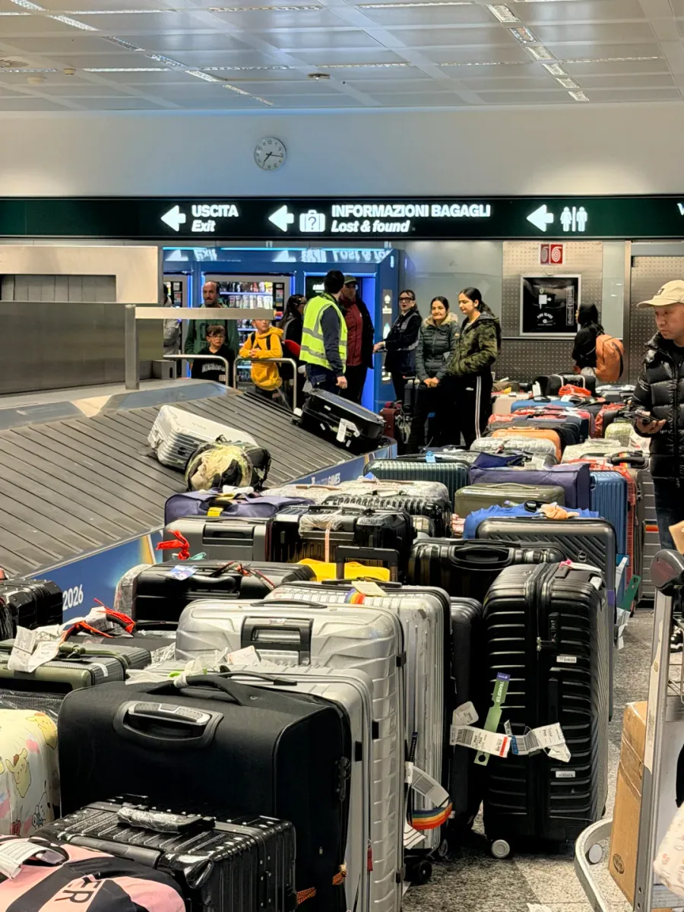

Мілан-Мальпенса (MXP) — міжнародні ворота півночі Італії та аеропорт, де приземляються прямі рейси з Китаю до Мілана. Під час першого прильоту рідко тривожить мова — зазвичай це черга, а в мережі ширяться цифри про три-чотири години на проходження.

Один приліт у лютому 2026 року свідчить про інше. Air China CA949 приземлився приблизно на 20 хвилин раніше — о **06:10**, і шлях від дверей літака до валізи в руках зайняв **65 хвилин**. Частково це була вдача; але не вся. Сидіти ближче до початку салону, швидко виходити з літака й знати, яка смуга ваша, — це рішення, ухвалені заздалегідь.

## 1. Як насправді працює черга в MXP

Зал імміграції в Мальпенсі невеликий, а стійки відкриваються й закриваються відповідно до розкладу прильотів. **З 07:00 до 09:00 — пік**, коли широкофюзеляжні літаки з Азії та з усієї Європи приземляються в одному вікні, і пасажири не з ЄС за кілька хвилин заповнюють змійкоподібні огорожі.

Далекомагістральні рейси прибувають хвилями. Літаки, що сідають між 06:00 і 07:00, відправляють пасажирів через телетрап, автобус і ескалатор, тож більшість потрапляє до залу між 06:30 і 07:30. **Якщо встигнути на початок цієї хвилі, черги майже немає**; за пів години ви опинитеся позаду свого рейсу ще й двох інших широкофюзеляжних лайнерів — ось чому пасажири одного літака можуть пройти контроль з різницею у двадцять хвилин.

Цьому прильоту пощастило з часом: двері відчинили о **06:10**, до піку. Працювали чотири стійки, черга рухалася, і штамп про в'їзд поставили приблизно через **30 хвилин**. За годину, з тими самими чотирма стійками й у кілька разів більшою кількістю людей, те саме очікування виглядало б зовсім інакше.

Ще одну змінну легко пропустити: **лютий 2026 року припав на Зимові Олімпійські ігри Мілан — Кортіна 2026**, і аеропорт явно додав персоналу, який скеровував пасажирів від виходу до залу. Мандрівник боявся три- та чотиригодинних черг, описаних у мережі; реальність була далеко не такою.

Ці повідомлення теж не вигадані — вони з пікового сезону, коли кілька рейсів прибувають одночасно. Жодна цифра не є правилом: **той самий аеропорт може відчуватися в кілька разів повільнішим залежно від години**, тож розраховуйте час від свого фактичного прильоту.

## 2. Від дверей літака до прикордонного контролю

По суті, маршрут один: ідіть за зеленими покажчиками **USCITA EXIT** і піднімайтеся ескалатором до залу імміграції. Не відхиляйтеся за стрілками Transfer — вони для пасажирів трансферу — і не зупиняйтеся шукати Wi-Fi. Кожна хвилина там коштує кількох місць у черзі.

Скільки ви зекономите, залежить від місця. Вихід із широкофюзеляжного літака — це вже черга: передній салон іде першим, задній чекає, часто загалом п'ятнадцять-двадцять хвилин. **Місце попереду скорочує це очікування вдвічі**; якщо не пощастило, йдіть швидко, а не зупиняйтеся біля телетрапа. Цей рейс стояв на віддаленій стоянці й потребував автобуса, тож пасажири вийшли лише о **06:30** — і перші з них уже стояли в черзі, коли прибули решта.

Дві деталі: зал імміграції на рівень вище, а ескалатор рухається в одному напрямку, тож піднімайтеся за USCITA EXIT; і не зупиняйтеся біля туалету чи фонтанчика з водою, бо коли потік вас обійде, повернутися на своє місце вже не вийде.

## 3. Смуга All Passports

У залі читайте покажчики, перш ніж кудись ставати. Тут працюють дві системи паралельно: **ворота самостійного паспортного контролю Self service passport control** для мандрівників з ЄС і ручні стійки з написом **All passports**, або **TUTTI I PASSAPORTI** італійською. Китайський паспорт належить до другої.

На табличках багато інформації. На тій самій синій панелі ліворуч написано «Self service passport control», там є прапори ЄС і дрібний текст про ID-картки та дітей до 14 років; праворуч — «All passports», а далі смуги для екіпажів і дипломатів.

Сім'ям варто звернути увагу: смуга «Minori di 14 anni / Children under 14» призначена для дітей мандрівників із ЄС і не стосується китайських паспортів. Якщо стати в неї, доведеться повертатися в кінець черги — у пікову годину це ще пів години.

Одне твердження треба виправити. У путівниках кількарічної давності йшлося, що з китайським паспортом можна скористатися воротами самообслуговування й пройти за **15 хвилин**. Того ранку **персонал скеровував усіх пасажирів не з ЄС до ручних стійок**, а ворота стояли майже порожні. Чи приймає автомат конкретний паспорт і чи ввімкнений він того дня — це окремі питання від того, куди вас направляє персонал; на роздоріжжі слухайтеся форми, а не старого допису в блозі.

Якщо ви все ж опинилися не в тій смузі, не панікуйте: до входу в змійкоподібну огорожу ще можна перейти в іншу, але щойно ви всередині, єдиний вихід — у кінець черги.

## 4. Виміряний хронометраж на 65 хвилин

Позначки часу показують, куди поділися 65 хвилин. Прикордонний контроль забрав 35 із них; решта — автобус, ходьба й очікування валізи.

| Час | Що сталося |
| --- | --- |
| **06:10** | Літак приземлився приблизно на 20 хвилин раніше |
| **06:30** | Вийшли з автобуса й зайшли до терміналу |
| **06:35** | Приєдналися до черги All Passports |
| **07:10** | У паспорті поставили штамп, прикордонний контроль пройдено |
| **07:15** | Забрали валізу зі стрічки |

У черзі мало чим можна зайнятися, але одна звичка справді допомагає: відкрийте паспорт на сторінці з фото й тримайте напоготові, щоб ваша черга стала просто передаванням, поглядом і штампом. Сам контроль виявився простішим, ніж очікувалося. **Подали лише паспорт**; маршрут, бронювання чи страховку не просили, запитань не ставили й відбитків пальців не брали.

Відбитки пальців варто згадати окремо. Система в'їзду/виїзду ЄС (EES) повністю діє з 2026 року, і відвідувачі не з ЄС зазвичай під час першого в'їзду реєструють відбитки пальців і зображення обличчя в кіоску. Цього разу такого етапу не було, що радше пов'язано з часом і місцевими домовленостями, ніж зі зміною правил, тож тим, хто прибуває вперше, все одно варто очікувати додаткового кроку.

Перелік документів, які варто мати із собою, не змінився: зворотний маршрут, бронювання готелю, туристична страховка. Те, що цього разу їх не попросили, не означає, що не попросять наступного.

Чому черга здається завмерлою, але все одно рухається? Вузьке місце зазвичай не кабіна, а люди перед нею — хтось починає шукати щось у сумці біля віконця, сім'я підходить разом, ще хтось вагається на роздоріжжі.

## 5. Видача багажу та вихід

За прикордонним контролем — зал видачі багажу. Знайдіть свій рейс на екранах і його стрічку, потім підійдіть. Тут **працівники сказали, що багаж уже вивантажили з протилежного боку**, тож не довелося чекати запуску стрічки; якщо багажу багато, спершу знайдіть свої валізи, а вже потім шукайте візок.

Якщо валіза не з'явилася, не стійте біля стрічки: зверніться до довідкової стійки багажу (напис INFORMAZIONI BAGAGLI / Lost & found), зареєструйте звернення й візьміть номер, перш ніж зв'язуватися з авіакомпанією.

Після багажу — останній пункт: зелений коридор, якщо вам нема чого декларувати, червоний, якщо ви перевищили ліміт готівки або везете щось, що підлягає декларуванню. За межами зони прибуття **Malpensa Express** відправляється зі станції під терміналом 1 до міланських станцій Кадорна й Чентрале, а автобуси та таксі забирають пасажирів одразу зовні, усе позначено покажчиками; пізно ввечері простіше взяти таксі або заздалегідь замовлений трансфер.

Озираючись назад, роботу зробили три речі: **приліт до піку о 07:00, місце попереду, щоб вийти першим, і смуга All Passports**. Жодна не коштує додаткових грошей; потрібно лише зробити правильний вибір під час бронювання й коли відчиняться двері.

Плануйте час так само. Якщо приліт ранній і черга коротка, відведіть 30–40 хвилин від дверей до стрічки; **якщо приліт після 07:00 — півтори години**. Якщо далі потяг або пересадка, залишайте дві години запасу або більше — ви не можете контролювати тривалість імміграції, але можете контролювати запас навколо неї.

Одне застереження: кількість стійок, час очікування й реєстрація в EES залежать від розкладу та персоналу конкретного дня. Наведений хронометраж походить з одного виміряного прильоту; перевіряйте інформацію аеропорту та італійської прикордонної поліції для дня вашої подорожі.

## Пов'язані посилання

- **На цьому сайті**: [Аеропорт Мілан-Мальпенса (MXP)](/airport/MXP), [Італія (IT)](/country/IT)
- **Вікіпедія**: [Аеропорт Мілан-Мальпенса](https://en.wikipedia.org/wiki/Milan_Malpensa_Airport)
- **Baidu Baike**: [Аеропорт Мілан-Мальпенса](https://baike.baidu.com/item/%E7%B1%B3%E5%85%B0-%E9%A9%AC%E5%B0%94%E5%BD%AD%E8%90%A8%E6%9C%BA%E5%9C%BA)
