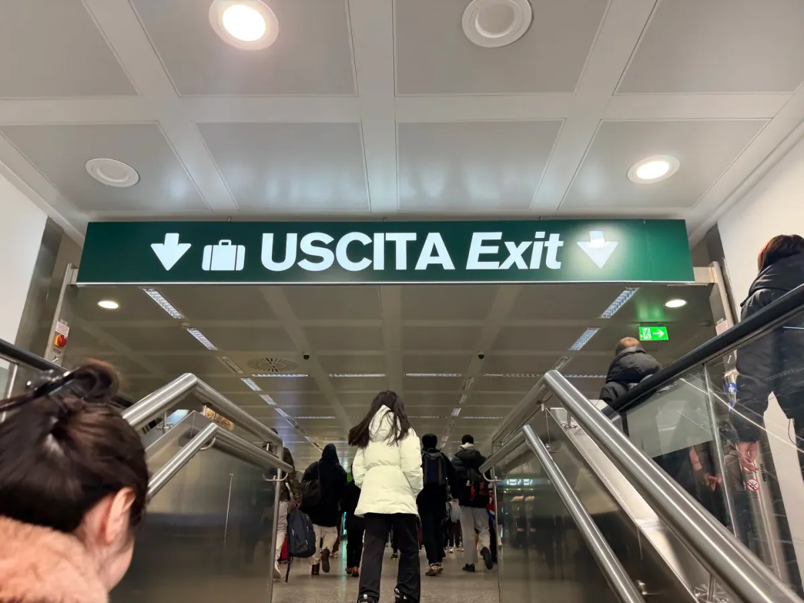

Milan Malpensa (MXP) là cửa ngõ quốc tế của miền bắc nước Ý và là sân bay mà các chuyến bay thẳng từ Trung Quốc đến Milan hạ cánh. Với người lần đầu nhập cảnh, nỗi lo hiếm khi là ngôn ngữ — mà là hàng chờ, và con số lan truyền trên mạng là ba bốn giờ để đi qua.

Một lần nhập cảnh vào tháng 2 năm 2026 cho thấy điều ngược lại. Chuyến Air China CA949 hạ cánh sớm khoảng 20 phút, lúc **06:10**, và đoạn đi bộ từ cửa máy bay đến khi cầm vali mất **65 phút**. Một phần là may mắn; không phải tất cả. Ngồi phía trước, rời máy bay nhanh và biết làn nào dành cho mình là những lựa chọn được chuẩn bị từ trước.

## 1. Hàng chờ tại MXP thực sự diễn ra thế nào

Sảnh nhập cảnh của Malpensa không lớn, và các quầy mở đóng theo thời gian biểu chuyến đến. **07:00 đến 09:00 là cao điểm**, khi máy bay thân rộng từ châu Á và khắp châu Âu hạ cánh trong cùng khung giờ và hành khách ngoài EU lấp đầy các hàng rào ziczac trong vài phút.

Các chuyến bay đường dài đến theo từng đợt. Máy bay hạ cánh trong khoảng 06:00 đến 07:00 đưa hành khách qua cầu ống, xe buýt trung chuyển và thang cuốn, nên phần lớn đến sảnh trong khoảng 06:30 đến 07:30. **Bắt được đầu đợt sóng đó thì gần như không có hàng chờ**; nửa giờ sau, bạn đứng sau chuyến của mình cộng thêm hai máy bay thân rộng nữa — đó là lý do hành khách trên cùng một máy bay có thể qua cửa cách nhau hai mươi phút.

Chuyến hạ cánh này may mắn về thời điểm: cửa mở lúc **06:10**, trước cao điểm. Bốn quầy mở, hàng chờ liên tục di chuyển, và con dấu nhập cảnh đến sau **khoảng 30 phút**. Một giờ sau, với cùng bốn quầy và số người gấp nhiều lần, cùng một khoảng chờ sẽ trông rất khác.

Còn một biến số dễ bị bỏ qua: **tháng 2 năm 2026 rơi vào thời gian diễn ra Olympic mùa đông Milan–Cortina**, và sân bay rõ ràng đã bố trí thêm nhân viên, hướng dẫn hành khách từ cổng đến sảnh. Vị khách này đã lo về những hàng chờ ba, bốn giờ được mô tả trên mạng; thực tế thì khác xa.

Những báo cáo đó cũng không phải bịa — chúng đến từ mùa cao điểm, khi nhiều chuyến bay hạ cánh cùng lúc. Không con số nào là quy luật: **cùng một sân bay có thể chậm đi gấp nhiều lần tùy theo giờ**, nên hãy tính thời gian từ giờ hạ cánh của chính bạn.

## 2. Từ cửa máy bay đến kiểm soát biên giới

Về cơ bản chỉ có một lộ trình: đi theo biển **USCITA EXIT** màu xanh lá và đi thang cuốn lên sảnh nhập cảnh. Đừng đi theo mũi tên Transfer — đó là dành cho hành khách nối chuyến — và đừng dừng lại tìm Wi-Fi. Mỗi phút dừng ở đó tốn vài vị trí trong hàng chờ.

Bạn tiết kiệm được bao nhiêu tùy vào chỗ ngồi. Rời một máy bay thân rộng bản thân nó đã là một hàng chờ: khoang trước đi trước, khoang sau chờ, thường tổng cộng mười lăm đến hai mươi phút. **Một chỗ ngồi phía trước giảm một nửa thời gian chờ đó**; nếu không, hãy bước nhanh thay vì dừng lại ở cầu ống. Chuyến này đỗ ở vị trí xa và cần xe buýt trung chuyển, nên hành khách chỉ xuống máy bay lúc **06:30** — và những người đầu tiên đã xếp hàng khi số còn lại vừa đến.

Hai chi tiết: sảnh nhập cảnh ở tầng trên một bậc và thang cuốn chạy một chiều, nên hãy đi theo USCITA EXIT lên trên; và đừng dừng lại vào nhà vệ sinh hay lấy nước, vì khi dòng người đã đi qua, bạn không thể quay lại vị trí cũ.

## 3. Làn All Passports

Trong sảnh, hãy đọc biển chỉ dẫn trước khi xếp vào bất kỳ hàng nào. Hai hệ thống chạy song song: các cổng **Self service passport control** (kiểm soát hộ chiếu tự phục vụ) cho du khách EU, và các quầy thủ công ghi **All passports**, hay **TUTTI I PASSAPORTI** trong tiếng Ý. Hộ chiếu Trung Quốc thuộc loại thứ hai.

Các biển mang rất nhiều thông tin. Trên cùng một tấm bảng xanh, phần bên trái ghi “Self service passport control” với cờ EU và dòng chữ nhỏ về thẻ căn cước và trẻ em dưới 14 tuổi; phần bên phải là “All passports”, xa hơn là làn cho phi hành đoàn và ngoại giao.

Các gia đình nên lưu ý rằng làn “Minori di 14 anni / Children under 14” dành cho con của du khách EU và không áp dụng cho hộ chiếu Trung Quốc. Xếp vào đó nghĩa là phải quay lại cuối hàng — vào giờ cao điểm, mất thêm nửa giờ.

Một khẳng định cần đính chính. Các hướng dẫn vài năm trước nói hộ chiếu Trung Quốc có thể dùng cổng tự phục vụ và qua trong **15 phút**. Vào buổi sáng này, **nhân viên hướng mọi hành khách ngoài EU sang làn thủ công** và các cổng gần như trống. Việc một cỗ máy có chấp nhận một loại hộ chiếu hay không, và việc nó có được bật trong ngày đó hay không, là những câu hỏi khác với việc nhân viên chỉ bạn đi đâu — tại ngã rẽ, hãy đi theo người mặc đồng phục, không phải bài blog cũ.

Nếu bạn lỡ vào sai làn, hãy bình tĩnh: trước khi vào hàng rào ziczac, bạn có thể bước sang; nhưng một khi đã vào trong, cách duy nhất để ra là quay lại cuối hàng.

## 4. Dòng thời gian 65 phút, được đo đạc

Các mốc thời gian cho thấy 65 phút đã trôi đi đâu. Kiểm soát biên giới chiếm 35 phút; phần còn lại là xe buýt trung chuyển, đi bộ và chờ vali.

| Thời gian | Diễn biến |
| --- | --- |
| **06:10** | Máy bay hạ cánh, sớm khoảng 20 phút |
| **06:30** | Xuống xe buýt trung chuyển, vào nhà ga |
| **06:35** | Xếp hàng All Passports |
| **07:10** | Hộ chiếu được đóng dấu, qua kiểm soát biên giới |
| **07:15** | Nhận vali từ băng tải |

Trong hàng chờ có ít việc để làm, nhưng một việc có ích: mở hộ chiếu đến trang ảnh và cầm sẵn, để đến lượt chỉ là đưa ra, liếc nhìn và đóng dấu. Việc kiểm tra đơn giản hơn dự kiến. **Chỉ hộ chiếu được xuất trình**; không ai yêu cầu lịch trình, đặt chỗ hay bảo hiểm, không hỏi câu nào và không lấy dấu vân tay.

Dấu vân tay đáng được lưu ý. Hệ thống Nhập cảnh/Xuất cảnh (EES) của EU đang vận hành đầy đủ vào năm 2026, và du khách ngoài EU thường đăng ký dấu vân tay cùng ảnh khuôn mặt tại một máy trong lần nhập cảnh đầu tiên. Lần nhập cảnh này không có bước đó, nhiều khả năng là do thời điểm và sắp xếp tại địa phương hơn là thay đổi quy định, nên người lần đầu vẫn nên lường trước bước thêm này.

Giấy tờ nên mang theo không thay đổi: lịch trình về, đặt phòng khách sạn, bảo hiểm du lịch. Việc lần này không bị hỏi không có nghĩa lần sau sẽ không bị hỏi.

Tại sao một hàng chờ trông như đứng yên mà vẫn nhích dần? Nút thắt thường không phải buồng kiểm soát mà là những người phía trước nó — có người bắt đầu lục túi tại quầy, một gia đình cùng bước lên, người khác do dự ở ngã rẽ.

## 5. Nhận hành lý và rời sân bay

Qua kiểm soát biên giới là sảnh hành lý. Tìm chuyến bay của bạn trên màn hình và băng tải tương ứng, rồi đi tới. Ở đây **nhân viên nói rằng vali đã được dỡ sang phía đối diện**, giúp bạn khỏi chờ băng tải khởi động; nếu có nhiều hành lý, hãy xác định vali của mình trước khi đi tìm xe đẩy.

Nếu một chiếc vali không xuất hiện, đừng đứng ở băng tải: hãy đến quầy hỏi hành lý (biển INFORMAZIONI BAGAGLI / Lost & found), đăng ký và lấy mã tham chiếu trước khi liên hệ hãng hàng không.

Sau hành lý là trạm kiểm tra cuối cùng: làn xanh nếu bạn không có gì để khai báo, làn đỏ nếu bạn vượt hạn mức tiền mặt hoặc mang thứ gì phải khai báo. Bên ngoài khu đến, **Malpensa Express** khởi hành từ ga dưới Nhà ga 1 đến các ga Cadorna và Centrale của Milan, còn xe buýt và taxi đón ngay bên ngoài, đều có biển chỉ dẫn; vào đêm muộn, taxi hoặc dịch vụ trung chuyển đặt trước đơn giản hơn.

Nhìn lại, ba việc đã tạo nên kết quả: **hạ cánh trước cao điểm 07:00, ngồi phía trước để xuống máy bay trước, và chọn làn All Passports**. Không việc nào tốn thêm tiền; chúng chỉ cần lựa chọn đúng khi đặt vé và khi cửa máy bay mở.

Hãy dự trù thời gian theo cách tương tự. Hạ cánh sớm với hàng chờ ngắn, dành 30 đến 40 phút từ cửa máy bay đến băng tải; **hạ cánh sau 07:00, dành một tiếng rưỡi**. Nếu sau đó có tàu hoặc chuyến nối, hãy để dự trù hai giờ trở lên — bạn không kiểm soát được thời gian nhập cảnh kéo dài bao lâu, nhưng bạn kiểm soát được khoảng đệm quanh nó.

Một lưu ý: số quầy, thời gian chờ và việc đăng ký EES thay đổi theo lịch bay và nhân sự trong ngày. Dòng thời gian ở đây đến từ một lần nhập cảnh được đo đạc; hãy kiểm tra sân bay và cảnh sát biên giới Ý cho ngày bạn đi.

## Liên kết liên quan

- **Trên trang này**: [Sân bay Milan Malpensa (MXP)](/airport/MXP), [Ý (IT)](/country/IT)
- **Wikipedia**: [Milan Malpensa Airport](https://en.wikipedia.org/wiki/Milan_Malpensa_Airport)
- **Baidu Baike**: [Milan Malpensa Airport](https://baike.baidu.com/item/%E7%B1%B3%E5%85%B0-%E9%A9%AC%E5%B0%94%E5%BD%AD%E8%90%A8%E6%9C%BA%E5%9C%BA)
