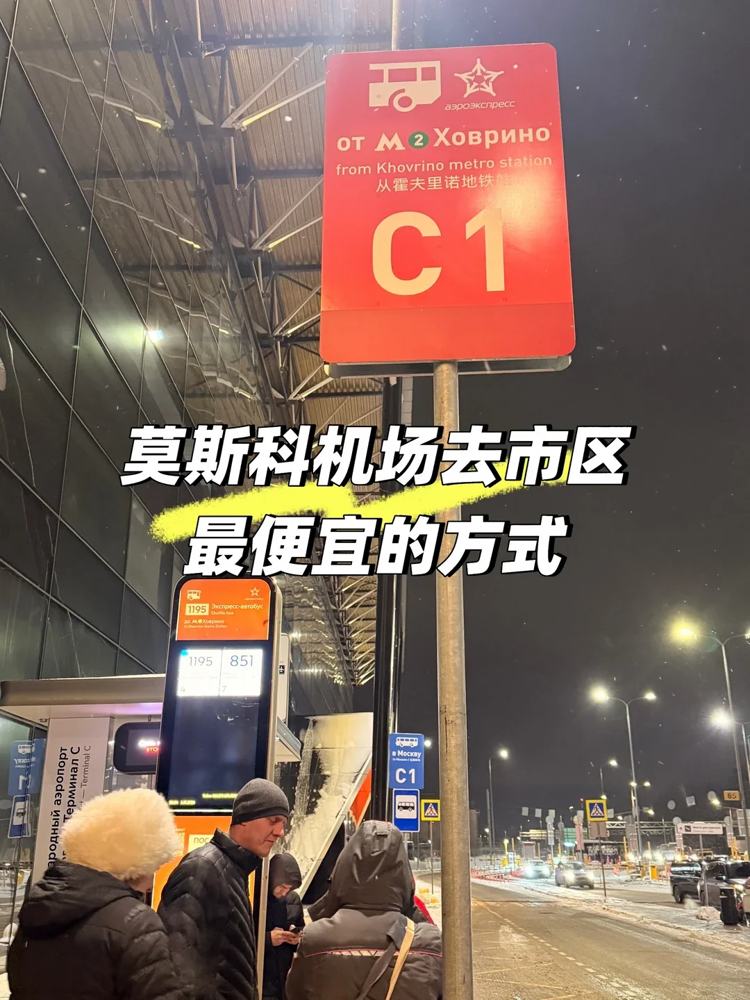
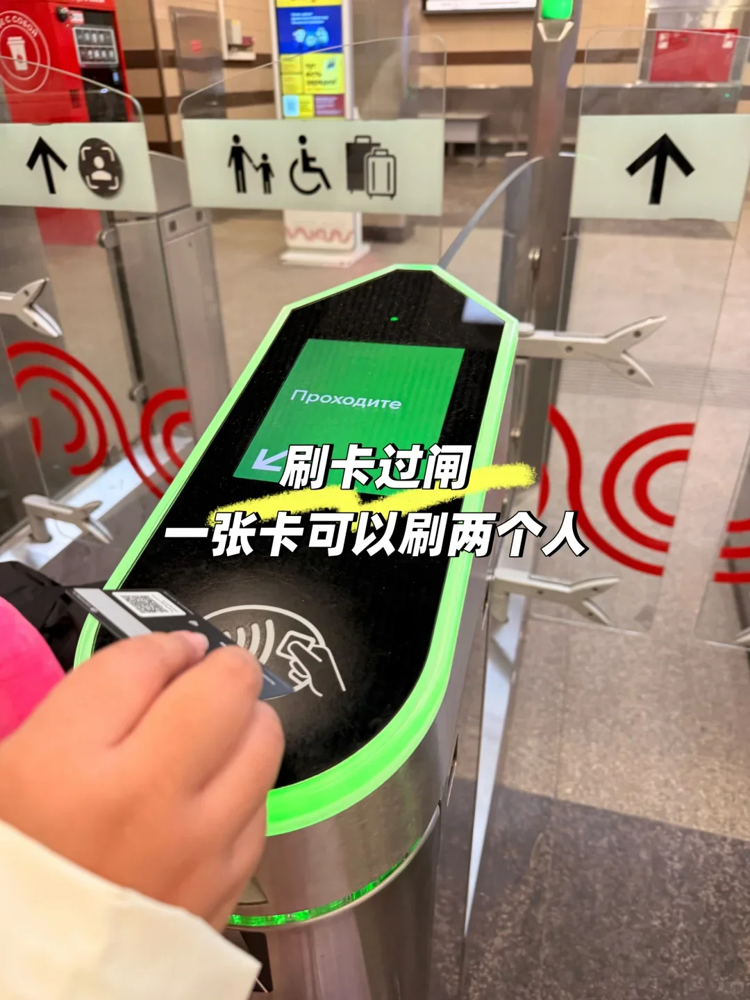

¿No te apetece gastarte varios cientos en un taxi del aeropuerto al centro? **El autobús 1195 más la línea 2 del metro** es hoy la combinación más barata: **un billete de 450 rublos + una tarifa de metro de unos 79–90 rublos**, y estás en el centro en aproximadamente una hora.

## La ruta completa

### 1. Pasa inmigración, recoge las maletas y encuentra la salida correcta

Cuando hayas pasado aduanas con el equipaje, sal por la puerta **junto al mostrador de YooMoney**. Esta salida está un poco apartada, así que procura no dirigirte hacia otra terminal.

### 2. Gira a la derecha fuera y estarás en la parada

Gira a la **derecha** al salir y ahí está la parada del autobús del aeropuerto, el andén número **C1**, con “от Мс Ховрино” en el cartel, que significa “desde la estación de metro Khovrino”.

### 3. Compra el billete al revisor

Un **revisor** uniformado en el andén se acercará a venderte un billete: **450 rublos por persona**, y puedes **pagar con tarjeta o en efectivo**.

> **No se aceptan billetes grandes**: los revisores a menudo no pueden cambiar billetes de 1.000 y 5.000 rublos, así que consigue cambio pequeño antes.

### 4. Sube al autobús 1195 hasta la terminal

El **autobús rojo 1195** va directo al final de la línea, y **la terminal es la estación de metro de la línea 2**, así que no hay que preocuparse por en qué parada bajar.

### 5. Al metro: todo el equipaje pasa por el escáner

En la terminal, sigue a la multitud hasta la estación de metro. **Cada pieza de equipaje pasa por el escáner de seguridad**, y las maletas grandes hay que subirlas a la cinta.

### 6. Pasa el torno: una tarjeta cubre a dos personas

Los tornos del metro aceptan tarjetas (una tarjeta Troika o un billete sencillo). **Una tarjeta puede pasarse dos veces seguidas**: deja pasar a la primera persona y vuelve a pasarla para tu acompañante.

## Costes

| Concepto | Precio |
| --- | --- |
| Autobús 1195 del aeropuerto | 450 rublos por persona |
| Metro, ida | unos 79 rublos (el autor no está seguro; un sencillo en efectivo suele costar 90 rublos: compruébalo en la máquina) |
| **Total** | **unos 530–540 rublos por persona** |

## Consejos prácticos

- **La navegación se vuelve loca en este tramo**: mientras el autobús avanza, la posición del móvil salta constantemente. No entres en pánico: **bájate con la mayoría**, porque la terminal es la estación de metro.
- Este autobús en realidad **no es especialmente barato** (450 rublos se acerca al precio de un autocar exprés al aeropuerto), pero es mucho más barato que un taxi y **apenas le afecta el tráfico**.
- Con mucho equipaje, ten en cuenta el levantamiento en la bodega del autobús y en el escáner del metro.
- Compra el billete de metro o recarga la tarjeta Troika **cuando llegues a la estación de metro**: no hace falta hacer cola en el aeropuerto.
