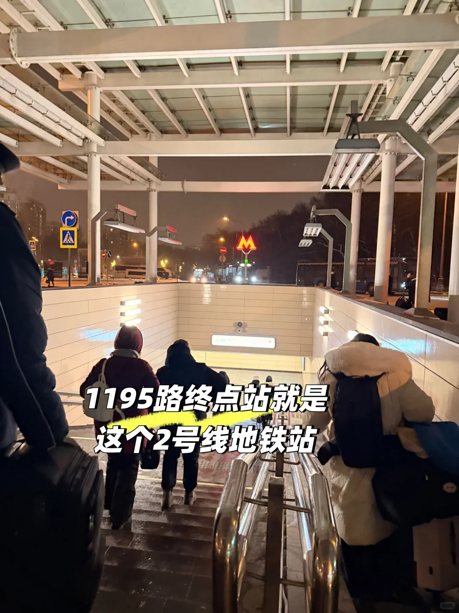

हवाई अड्डे से शहर तक टैक्सी पर कुछ सौ खर्च करने का मन नहीं? **हवाई अड्डा बस 1195 के साथ मेट्रो लाइन 2** फ़िलहाल सबसे सस्ता संयोजन है: **450 रूबल का टिकट + मेट्रो का करीब 79–90 रूबल किराया**, और आप लगभग एक घंटे में शहर के केंद्र में पहुँच जाते हैं।

## पूरा रास्ता

### 1. इमिग्रेशन निकलें, बैग लें, सही निकास ढूँढ़ें

सामान के साथ सीमा शुल्क से निकलने के बाद **YooMoney काउंटर के बगल वाले** निकास से बाहर जाएँ। यह निकास थोड़ा अलग-थलग है, इसलिए ध्यान रखें कि कहीं दूसरे टर्मिनल की ओर न निकल जाएँ।

### 2. बाहर दाईं ओर मुड़ें, और आप स्टॉप पर हैं

बाहर आकर **दाईं** ओर मुड़ें और वहाँ हवाई अड्डा बस स्टॉप है, स्टैंड नंबर **C1**, जिसके संकेत पर “от Мс Ховрино” लिखा है — यानी “खोवरिनो मेट्रो स्टेशन से”।

### 3. कंडक्टर से अपना टिकट खरीदें

प्लेटफ़ॉर्म पर वर्दी पहने **कंडक्टर** आपके पास आकर टिकट बेचेंगे: **प्रति व्यक्ति 450 रूबल**, और आप **कार्ड या नकद** में भुगतान कर सकते हैं।

> **बड़े नोट स्वीकार नहीं किए जाते** — कंडक्टरों के पास अक्सर 1,000 और 5,000 रूबल के नोट का छुट्टा नहीं होता, इसलिए पहले से कुछ छोटे नोट रख लें।

### 4. बस 1195 से सीधे टर्मिनस तक जाएँ

**लाल बस 1195** सीधे लाइन के अंत तक जाती है, और **टर्मिनस ही लाइन 2 का मेट्रो स्टेशन है**, इसलिए यह चिंता नहीं कि किस स्टॉप पर उतरना है।

### 5. मेट्रो में: सारा सामान स्कैनर से गुज़रेगा

टर्मिनस पर भीड़ के साथ मेट्रो स्टेशन में जाएँ। **सामान का हर टुकड़ा सुरक्षा स्कैनर से गुज़रता है**, और बड़े सूटकेस बेल्ट पर उठाकर रखने पड़ते हैं।

### 6. गेट पर कार्ड टैप करें — एक कार्ड दो लोगों के लिए

मेट्रो के गेट कार्ड स्वीकार करते हैं (Troika कार्ड या एकल टिकट)। **एक कार्ड लगातार दो बार टैप किया जा सकता है**: पहले व्यक्ति को निकलने दें, फिर अपने साथी के लिए दोबारा टैप करें।

## खर्च

| मद | कीमत |
| --- | --- |
| हवाई अड्डा बस 1195 | प्रति व्यक्ति 450 रूबल |
| मेट्रो, एक तरफ़ | करीब 79 रूबल (लेखक निश्चित नहीं है; नकद एकल टिकट आम तौर पर 90 रूबल — टिकट मशीन पर देख लें) |
| **कुल** | **प्रति व्यक्ति करीब 530–540 रूबल** |

## व्यावहारिक सुझाव

- **इस हिस्से में नेविगेशन गड़बड़ा जाता है**: बस चलते समय आपके फ़ोन की लोकेशन लगातार उछलती है। घबराएँ नहीं — **बहुमत के साथ ही उतरें**, क्योंकि टर्मिनस ही मेट्रो स्टेशन है।
- यह बस असल में **खास सस्ती नहीं है** (450 रूबल हवाई अड्डा एक्सप्रेस कोच के किराए के क़रीब है), लेकिन टैक्सी से कहीं सस्ती है और **ट्रैफ़िक का असर लगभग नहीं पड़ता**।
- ज़्यादा सामान हो तो बस के सामान-खाने और मेट्रो स्कैनर पर सामान उठाना ध्यान में रखें।
- अपना मेट्रो टिकट **मेट्रो स्टेशन पहुँचकर** खरीदें या Troika कार्ड रीचार्ज करें — हवाई अड्डे पर कतार में लगने की ज़रूरत नहीं।
