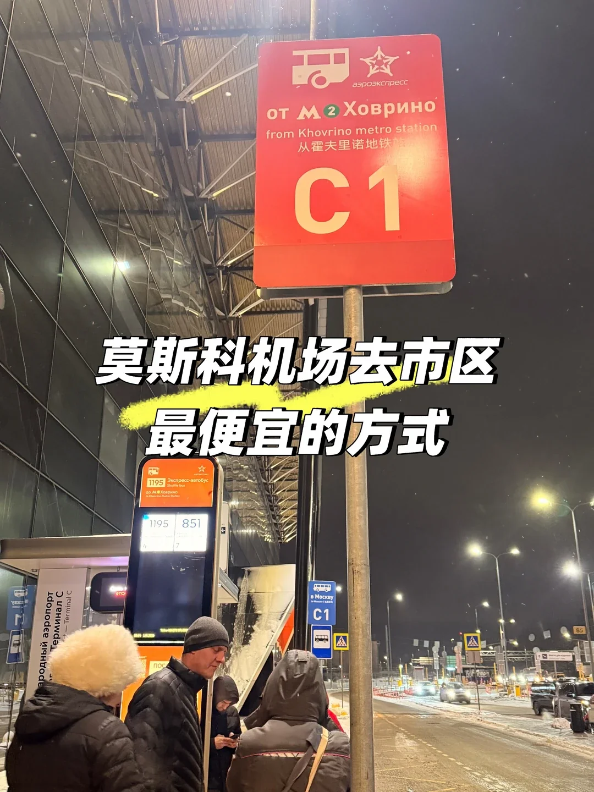
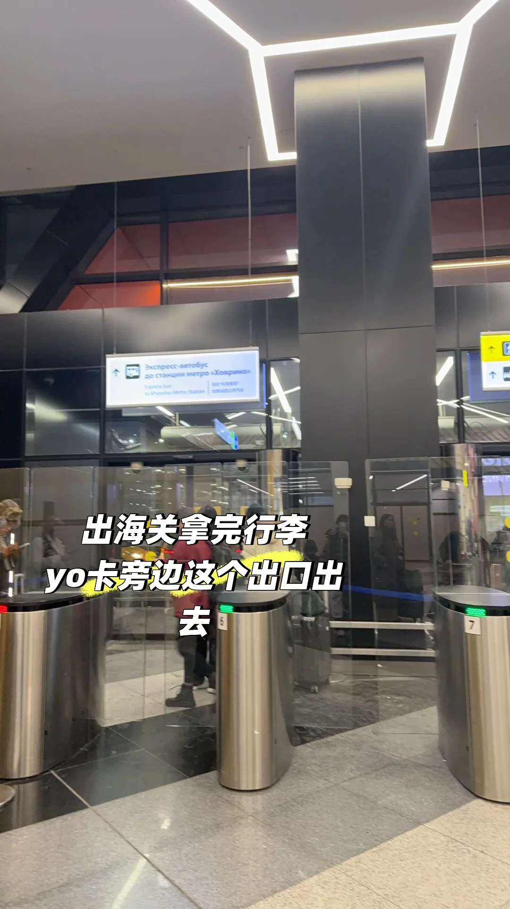
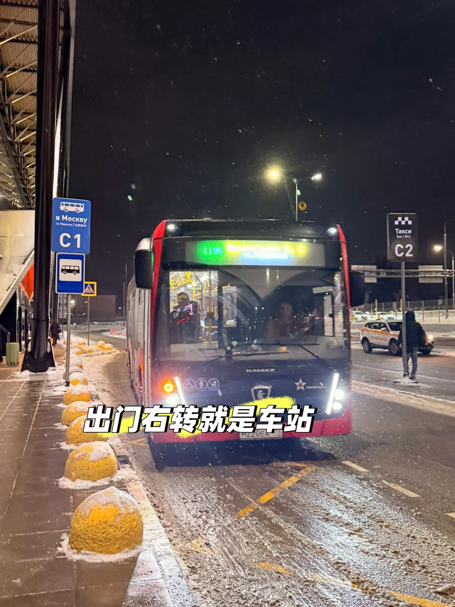
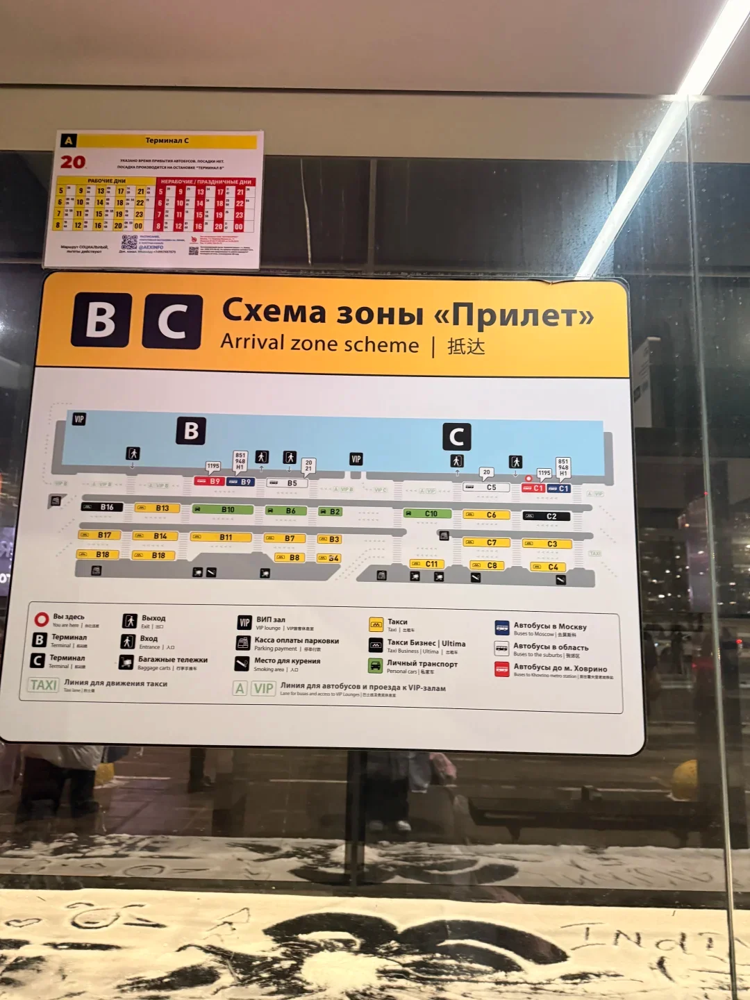
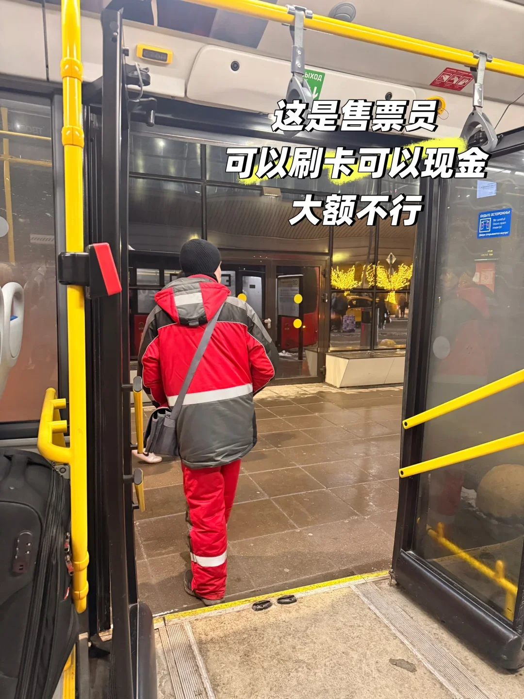
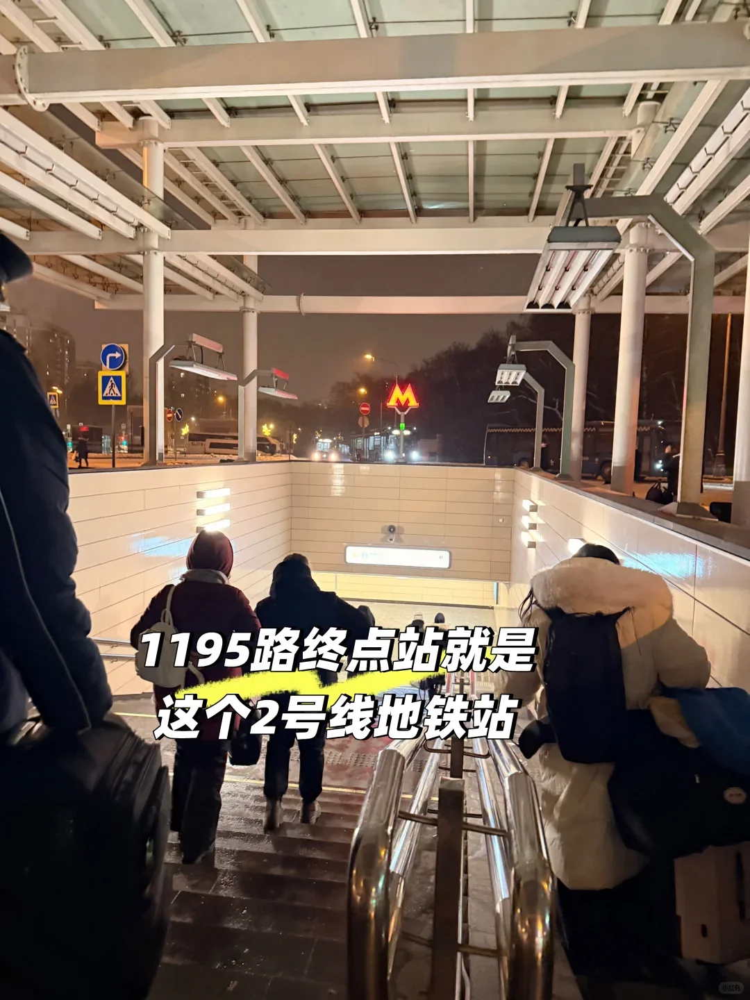
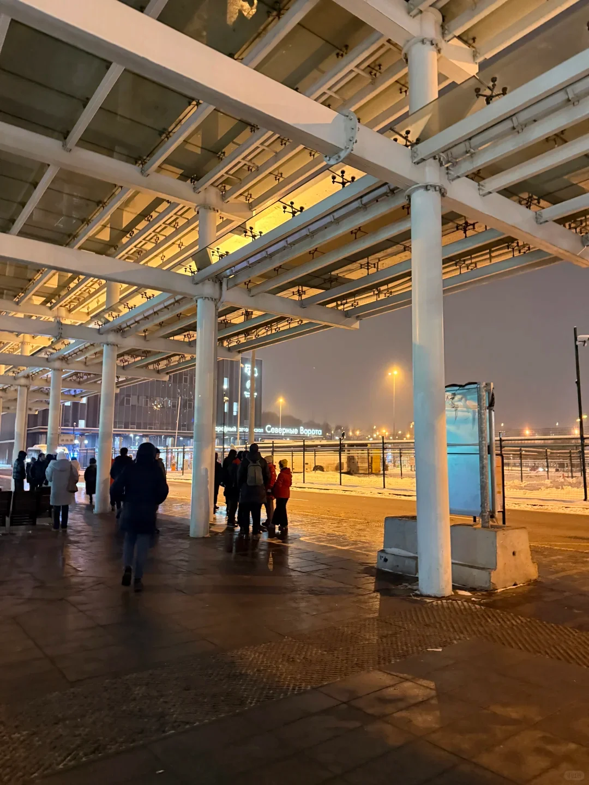
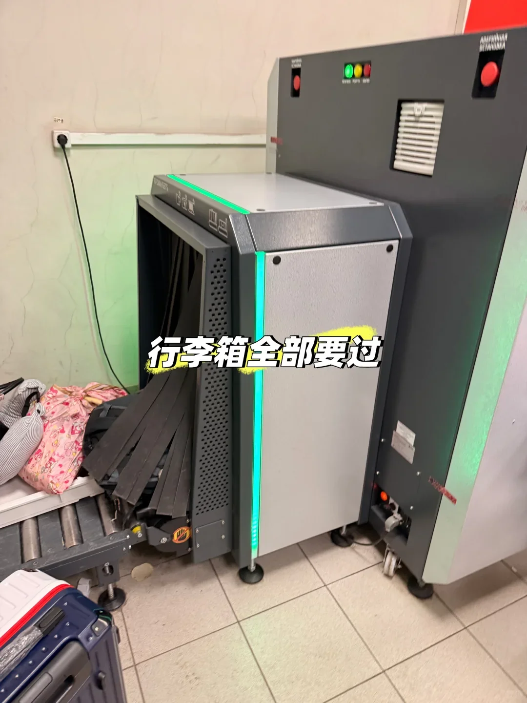
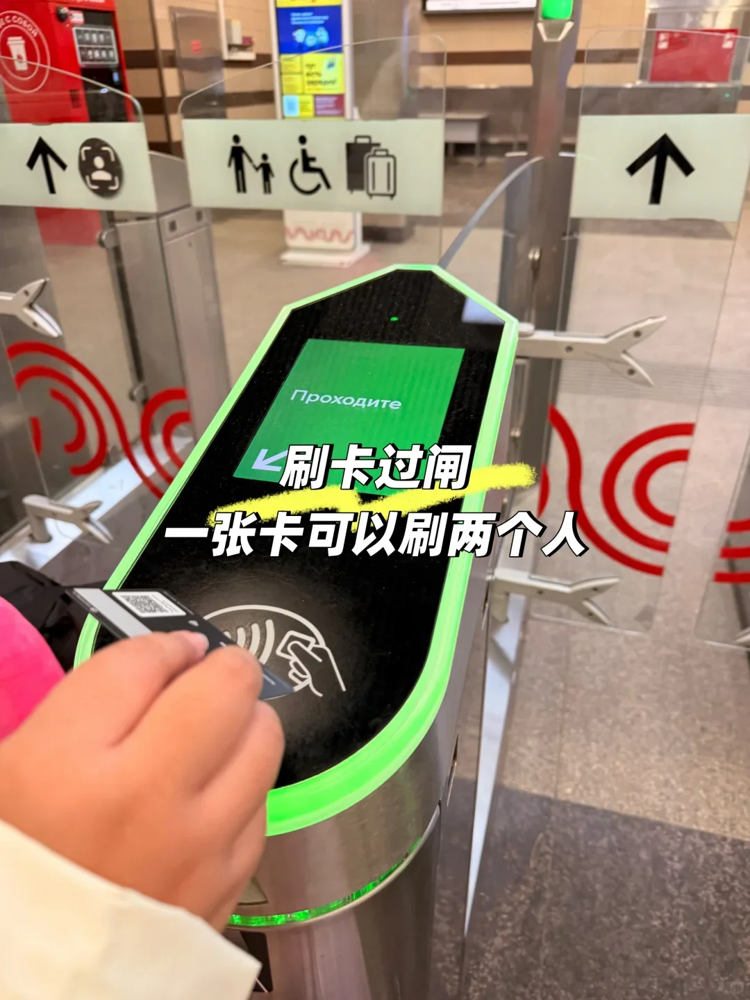
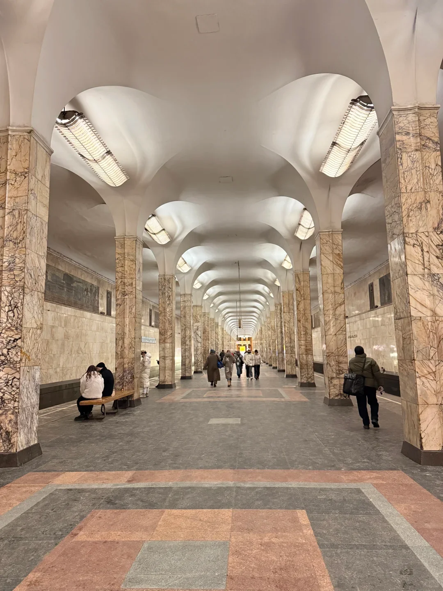

공항에서 시내로 택시 타느라 수백 루블을 쓰고 싶지 않다면, **1195번 공항버스와 2호선 지하철** 조합이 지금 가장 저렴합니다. **450루블 표 + 약 79~90루블 지하철 요금**이면 한 시간 남짓에 시내에 도착합니다.

## 전체 경로

### 1. 입국 심사와 수하물 수취 후, 맞는 출구 찾기

세관을 통과하고 짐을 찾은 뒤 **YooMoney 카운터 옆** 출구로 나가세요. 다소 외진 출구라 다른 터미널 방향으로 잘못 가지 않도록 주의해야 합니다.

### 2. 나가서 오른쪽으로 돌면 바로 정류장

나가서 **오른쪽**으로 돌면 바로 공항버스 정류장이고 정류장 번호는 **C1**입니다. 안내판에는 「от Мс Ховрино」라고 적혀 있는데, '호브리노 지하철역에서'라는 뜻입니다.

### 3. 안내원에게 표 사기

정류장에서 제복을 입은 **안내원**이 다가와 표를 팝니다. **1인 450루블**이고 **카드도 되고 현금도 됩니다**.

> **고액권은 안 됩니다** — 1,000루블, 5,000루블 지폐는 잔돈이 없어 받지 못하는 경우가 많으니 미리 잔돈을 준비하세요.

### 4. 1195번을 타고 종점까지

**빨간 1195번 버스**가 종점까지 직행하며 **종점이 바로 2호선 지하철역**이라 어디서 내려야 할지 고민할 필요가 없습니다.

### 5. 지하철역 진입: 수하물은 보안 검색대 통과

종점에 도착하면 사람들을 따라 지하철역으로 들어가세요. **모든 수하물은 보안 검색대를 통과**해야 하고, 큰 캐리어는 들어 올려야 합니다.

### 6. 개찰구 통과, 카드 한 장으로 두 명

개찰구는 카드(Troika 카드 또는 편도권)를 지원합니다. **카드 한 장으로 연달아 두 사람이 통과**할 수 있습니다. 먼저 한 사람을 들여보내고, 같은 카드로 한 번 더 태그해 동행자를 통과시키면 됩니다.

## 비용

| 항목 | 가격 |
| --- | --- |
| 1195번 공항버스 | 1인 450루블 |
| 지하철 편도 | 약 79루블 (작성자도 확실치 않음, 현금 편도는 보통 90루블 — 발매기 표시 기준) |
| **합계** | **1인 약 530~540루블** |

## 실용 팁

- **이 구간에서는 내비게이션이 제멋대로 튑니다**: 버스가 달리는 동안 휴대폰 위치가 계속 튀는데, 당황하지 말고 **대부분의 사람들을 따라 내리면** 됩니다. 종점이 지하철역이니까요.
- 이 버스는 사실 **그렇게까지 싸지는 않습니다** (450루블은 공항 리무진 요금에 가깝습니다). 그래도 택시보다 훨씬 저렴하고 **정체의 영향을 크게 받지 않습니다**.
- 짐이 많다면 버스 수하물 칸과 지하철 검색대에서 짐을 들어 올리는 수고를 감안하세요.
- 지하철 표는 지하철역에 도착해서 사거나 Troika 카드를 충전하세요. **공항에서 줄 설 필요가 없습니다**.
