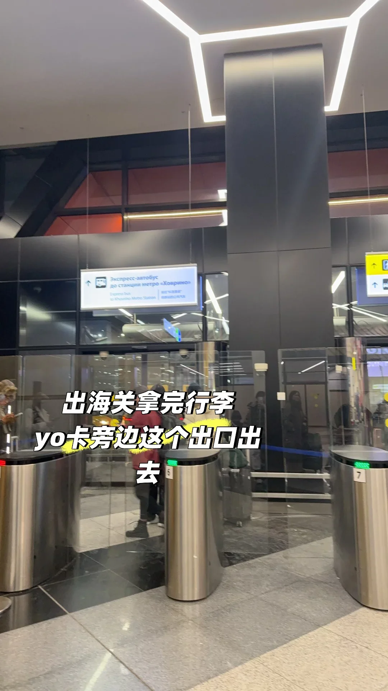

Geen zin om een paar honderd te betalen voor een taxi van de luchthaven naar de stad? **Luchthavenbus 1195 plus metrolijn 2** is op dit moment de goedkoopste combinatie: **een kaartje van 450 roebel + een metrokaartje van ongeveer 79–90 roebel**, en je bent in ongeveer een uur in het centrum.

## De hele route

### 1. Door de immigratie, bagage ophalen, de juiste uitgang vinden

Ben je met je bagage door de douane, verlaat de hal dan via de uitgang **naast het YooMoney-loket**. Deze uitgang ligt wat afgelegen, dus let op dat je niet richting een andere terminal loopt.

### 2. Buiten rechtsaf en je staat bij de halte

Sla **rechtsaf** als je buiten komt en daar is de luchthavenbushalte, perron **C1**, met "от Мс Ховрино" op het bord — dat betekent "vanaf metrostation Chovrino".

### 3. Koop je kaartje bij de conducteur

Een **conducteur** in uniform komt op het perron naar je toe en verkoopt je een kaartje: **450 roebel per persoon**, en je kunt **met de kaart of contant betalen**.

> **Grote biljetten worden niet geaccepteerd** — conducteurs kunnen vaak geen biljetten van 1.000 en 5.000 roebel wisselen, dus zorg vooraf voor wat kleingeld.

### 4. Rijd met bus 1195 helemaal naar het eindpunt

De **rode bus 1195** rijdt rechtstreeks naar het einde van de lijn, en **het eindpunt is het metrostation van lijn 2**, dus je hoeft je geen zorgen te maken bij welke halte je moet uitstappen.

### 5. De metro in: alle bagage gaat door de scanner

Volg bij het eindpunt de menigte het metrostation in. **Elk stuk bagage gaat door de veiligheidsscanner**, en grote koffers moeten op de band worden getild.

### 6. Tik in bij de poortjes — één kaart voor twee personen

De metropoortjes accepteren kaarten (een Troika-kaart of een enkel kaartje). **Je kunt een kaart twee keer achter elkaar gebruiken**: laat de eerste persoon door en tik dan opnieuw voor je metgezel.

## Kosten

| Post | Prijs |
| --- | --- |
| Luchthavenbus 1195 | 450 roebel per persoon |
| Metro, enkele reis | ongeveer 79 roebel (de auteur is er niet zeker van; een enkel kaartje contant kost meestal 90 roebel — controleer de kaartautomaat) |
| **Totaal** | **ongeveer 530–540 roebel per persoon** |

## Praktische tips

- **Navigatie slaat op dit traject op hol**: terwijl de bus rijdt, springt de positie op je telefoon voortdurend heen en weer. Raak niet in paniek — **stap gewoon met de meerderheid uit**, want het eindpunt is het metrostation.
- Deze bus is eigenlijk **niet bijzonder goedkoop** (450 roebel ligt dicht bij de prijs van een luchthavenexpres), maar hij is veel goedkoper dan een taxi en **nauwelijks gevoelig voor verkeer**.
- Met veel bagage moet je rekening houden met het tillen bij het bagagecompartiment van de bus en bij de scanner van de metro.
- Koop je metrokaartje of waardeer je Troika-kaart op **wanneer je bij het metrostation bent** — je hoeft niet op de luchthaven in de rij te staan.
