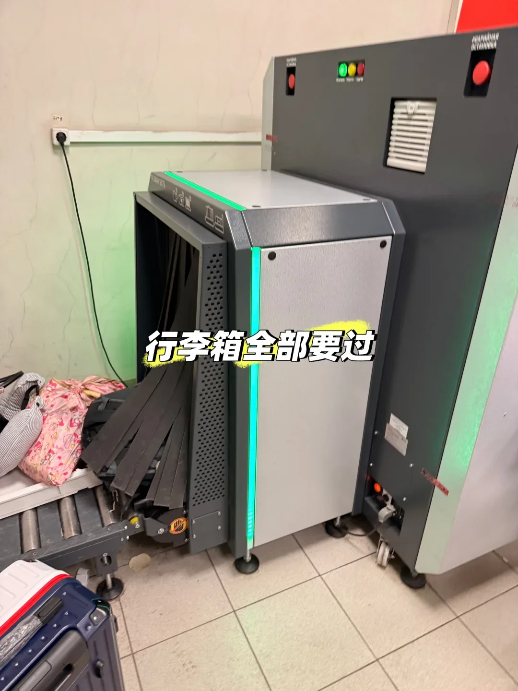
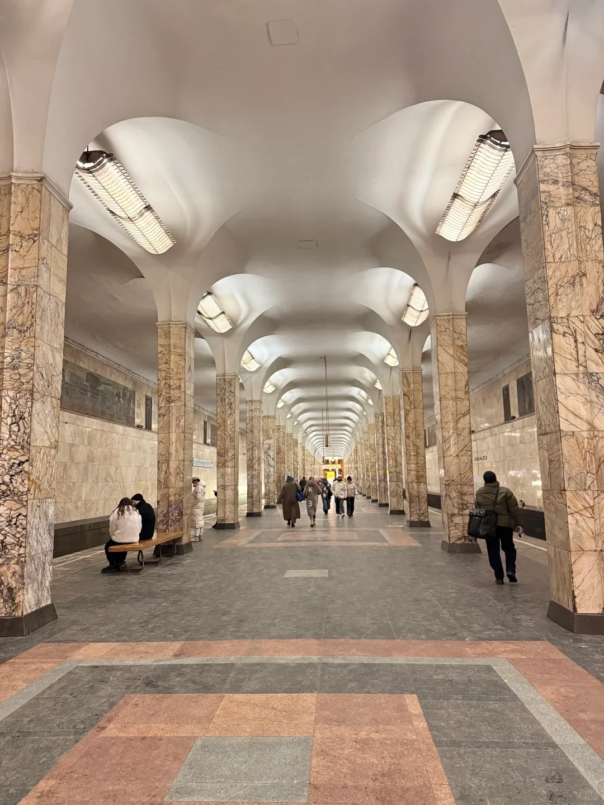

Nu aveți chef să cheltuiți câteva sute pe un taxi de la aeroport până în oraș? **Autobuzul de aeroport 1195 plus linia 2 de metrou** este în prezent cea mai ieftină combinație: **un bilet de 450 de ruble + o călătorie cu metroul de aproximativ 79–90 de ruble**, iar în circa o oră sunteți în centrul orașului.

## Întregul traseu

### 1. Treceți de imigrare, ridicați-vă bagajele, găsiți ieșirea potrivită

Odată ce ați trecut de vamă cu bagajele, ieșiți pe ușa **de lângă ghișeul YooMoney**. Această ieșire este oarecum ferită de flux, așa că aveți grijă să nu porniți spre alt terminal.

### 2. Faceți la dreapta afară și sunteți la stație

Faceți la **dreapta** când ieșiți și acolo este stația autobuzului de aeroport, standul numărul **C1**, cu „от Мс Ховрино" pe indicator — adică „de la stația de metrou Khovrino".

### 3. Cumpărați biletul de la controlor

Un **controlor** în uniformă, pe peron, va veni și vă va vinde un bilet: **450 de ruble de persoană**, iar puteți **plăti cu cardul sau în numerar**.

> **Bancnotele mari nu sunt acceptate** — controlorii adesea nu pot da rest la bancnote de 1.000 și 5.000 de ruble, așa că pregătiți-vă mărunțiș dinainte.

### 4. Mergeți cu autobuzul 1195 până la capătul de linie

**Autobuzul roșu 1195** merge direct până la capătul liniei, iar **capătul de linie este stația de metrou de pe linia 2**, așa că nu trebuie să vă faceți griji la ce stație să coborâți.

### 5. În metrou: toate bagajele trec prin scanner

La capătul de linie, urmați mulțimea în stația de metrou. **Fiecare bagaj trece prin scannerul de securitate**, iar valizele mari trebuie ridicate pe bandă.

### 6. Validați la porți — un card acoperă două persoane

Porțile de metrou acceptă carduri (un card Troika sau un bilet simplu). **Un card poate fi validat de două ori la rând**: lăsați prima persoană să treacă, apoi validați din nou pentru însoțitor.

## Costuri

| Element | Preț |
| --- | --- |
| Autobuzul de aeroport 1195 | 450 de ruble de persoană |
| Metroul, o călătorie | aproximativ 79 de ruble (autorul nu este sigur; un bilet simplu în numerar costă de obicei 90 de ruble — verificați automatul) |
| **Total** | **aproximativ 530–540 de ruble de persoană** |

## Sfaturi practice

- **Navigația o ia razna pe acest tronson**: cât timp autobuzul merge, poziția telefonului sare constant. Nu vă panicați — **coborâți pur și simplu cu majoritatea**, pentru că capătul de linie este stația de metrou.
- Acest autobuz **nu este de fapt deosebit de ieftin** (450 de ruble este aproape de tariful unui autocar expres de aeroport), dar este mult mai ieftin decât un taxi și **aproape neafectat de trafic**.
- Cu mult bagaj, țineți cont de ridicarea bagajelor la cala autobuzului și la scannerul de la metrou.
- Cumpărați biletul de metrou sau încărcați-vă cardul Troika **odată ce ajungeți în stația de metrou** — nu este nevoie să stați la coadă în aeroport.
