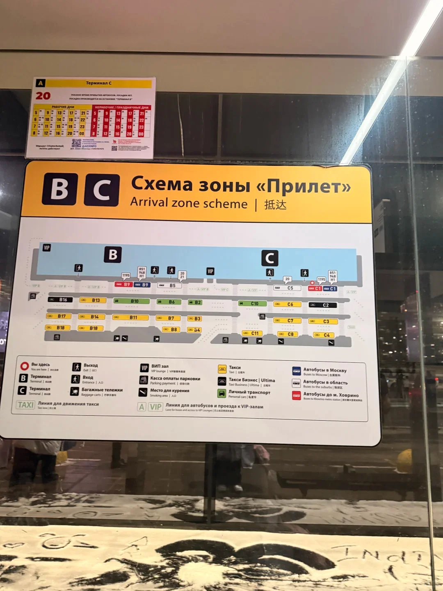
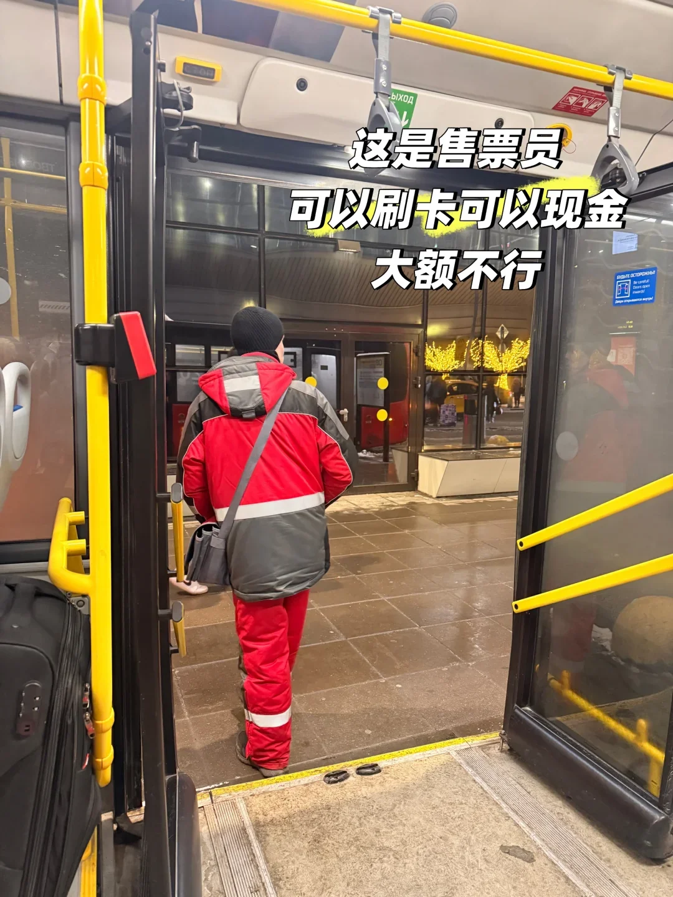
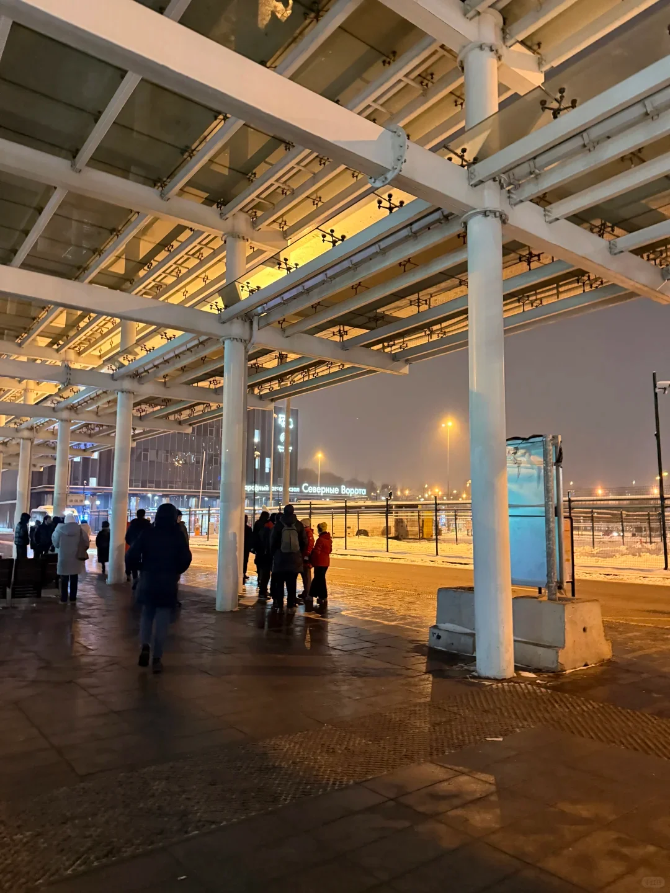

Inte sugen på att lägga några hundra på en taxi från flygplatsen in till staden? **Flygbuss 1195 plus tunnelbanans linje 2** är för närvarande den billigaste kombinationen: **en biljett för 450 rubel + en tunnelbaneresa på cirka 79–90 rubel**, och du är i centrala staden på ungefär en timme.

## Hela vägen

### 1. Klara invandringen, hämta bagaget, hitta rätt utgång

När du har gått igenom tullen med bagaget går du ut genom utgången **bredvid YooMoney-disken**. Den här utgången ligger lite avsides, så se till att inte gå i väg mot en annan terminal.

### 2. Sväng höger utomhus så är du vid hållplatsen

Sväng **höger** när du kommer ut, så finns flygbusshållplatsen där, hållplatsnummer **C1**, med "от Мс Ховрино" på skylten – det vill säga "från tunnelbanestationen Khovrino".

### 3. Köp biljetten av konduktören

En uniformerad **konduktör** på plattformen kommer fram och säljer en biljett till dig: **450 rubel per person**, och du kan **betala med kort eller kontanter**.

> **Stora sedlar accepteras inte** – konduktörerna kan ofta inte växla 1 000- och 5 000-rubelsedlar, så se till att ha mindre sedlar i förväg.

### 4. Åk buss 1195 hela vägen till slutstationen

**Den röda bussen 1195** går direkt till slutstationen, och **slutstationen är tunnelbanestationen på linje 2**, så du behöver inte oroa dig för vilken hållplats du ska gå av vid.

### 5. In i tunnelbanan: allt bagage går genom skannern

Vid slutstationen följer du folkmassan in i tunnelbanestationen. **Varje bagage genomgår säkerhetsskannern**, och stora resväskor måste lyftas upp på bandet.

### 6. Blippa in vid spärrarna – ett kort räcker för två personer

Tunnelbanans spärrar tar kort (ett Troika-kort eller en enkelbiljett). **Ett kort kan blippas två gånger i rad**: släpp igenom den första personen och blippa sedan igen för ditt sällskap.

## Kostnader

| Post | Pris |
| --- | --- |
| Flygbuss 1195 | 450 rubel per person |
| Tunnelbana, enkel resa | cirka 79 rubel (författaren är inte säker; en enkelbiljett med kontanter kostar vanligtvis 90 rubel – kontrollera biljettautomaten) |
| **Totalt** | **cirka 530–540 rubel per person** |

## Praktiska tips

- **Navigationen spårar ur på den här sträckan**: medan bussen kör hoppar telefonens position runt hela tiden. Få inte panik – **gå bara av med majoriteten**, eftersom slutstationen är tunnelbanestationen.
- Den här bussen är faktiskt **inte särskilt billig** (450 rubel ligger nära priset för flygplatsens expressbuss), men den är mycket billigare än en taxi och **påverkas knappt av trafiken**.
- Med mycket bagage bör du tänka på lyften vid bussens bagageutrymme och vid tunnelbanans skanner.
- Köp din tunnelbanebiljett eller ladda på ditt Troika-kort **först när du kommer till tunnelbanestationen** – det finns ingen anledning att köa på flygplatsen.
