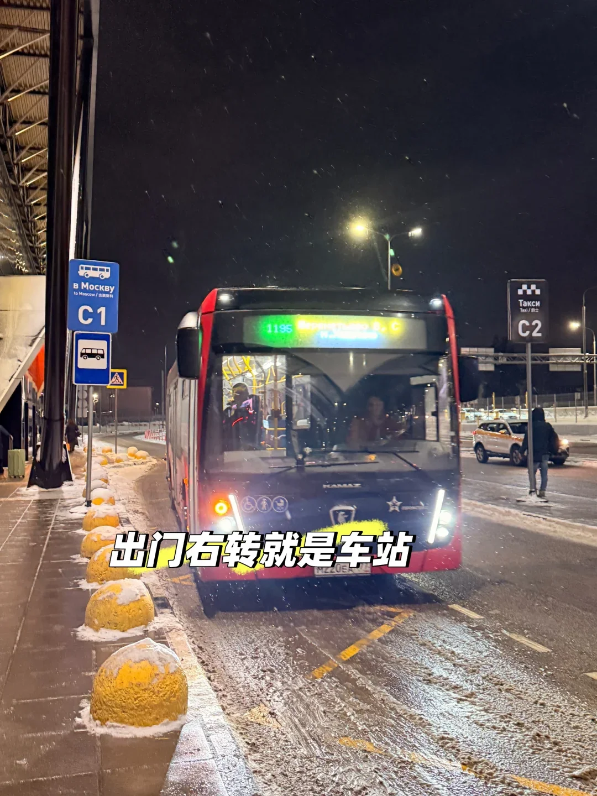

Havalimanından şehre taksiye birkaç yüz harcamak istemiyor musunuz? **1195 numaralı havalimanı otobüsü artı 2. metro hattı** şu anda en ucuz kombinasyon: **450 rublelik bilet + yaklaşık 79–90 ruble metro ücreti** ve yaklaşık bir saat içinde şehir merkezindesiniz.

## Tüm güzergâh

### 1. Pasaport kontrolünden geçin, bagajınızı alın, doğru çıkışı bulun

Bagajınızla gümrükten geçtikten sonra **YooMoney gişesinin yanındaki** çıkıştan çıkın. Bu çıkış biraz kenarda, o yüzden başka bir terminale yönelmemeye dikkat edin.

### 2. Dışarıda sağa dönün, duraktasınız

Dışarı çıkınca **sağa** dönün ve havalimanı otobüs durağı orada: **C1** numaralı peron, tabelada “от Мс Ховрино” yazıyor — “Khovrino metro istasyonundan” anlamına geliyor.

### 3. Biletinizi kondüktörden alın

Peronda üniformalı bir **kondüktör** yanınıza gelip bilet satacak: **kişi başı 450 ruble** ve **kartla veya nakit** ödeyebilirsiniz.

> **Büyük banknotlar kabul edilmiyor** — kondüktörler genellikle 1.000 ve 5.000 rublelik banknotların üstesinden gelemez, o yüzden önceden biraz bozuk paranız olsun.

### 4. 1195 numaralı otobüsle son durağa kadar gidin

**Kırmızı 1195 numaralı otobüs** doğrudan hattın sonuna gidiyor ve **son durak 2. metro hattı istasyonu**, yani hangi durakta ineceğinizi dert etmenize gerek yok.

### 5. Metroya girin: tüm bagajlar tarayıcıdan geçiyor

Son durakta kalabalığı izleyerek metro istasyonuna girin. **Her bagaj güvenlik tarayıcısından geçiyor** ve büyük valizlerin banta kaldırılması gerekiyor.

### 6. Turnikelerde okutun — bir kart iki kişiyi kapsıyor

Metro turnikeleri kart kabul ediyor (Troika kartı veya tek bilet). **Bir kart arka arkaya iki kez okutulabilir**: ilk kişiyi geçirin, sonra yanınızdaki için tekrar okutun.

## Maliyetler

| Kalem | Fiyat |
| --- | --- |
| Havalimanı otobüsü 1195 | Kişi başı 450 ruble |
| Metro, tek yön | Yaklaşık 79 ruble (yazar emin değil; nakit tek bilet genellikle 90 ruble — bilet makinesini kontrol edin) |
| **Toplam** | **Kişi başı yaklaşık 530–540 ruble** |

## Pratik ipuçları

- **Navigasyon bu kesimde sapıtıyor**: otobüs hareket ederken telefonunuzun konumu sürekli atlıyor. Panik yapmayın — **çoğunlukla birlikte inin**, çünkü son durak metro istasyonu.
- Bu otobüs aslında **özellikle ucuz değil** (450 ruble havalimanı ekspres otobüs fiyatlarına yakın), ama taksiden çok daha ucuz ve **trafikten neredeyse etkilenmiyor**.
- Çok bagajınız varsa otobüsün bagaj bölümünde ve metro tarayıcısında kaldırma işini düşünün.
- Metro biletinizi alın veya Troika kartınızı **metro istasyonuna vardığınızda** yükleyin — havalimanında kuyruğa girmenize gerek yok.
