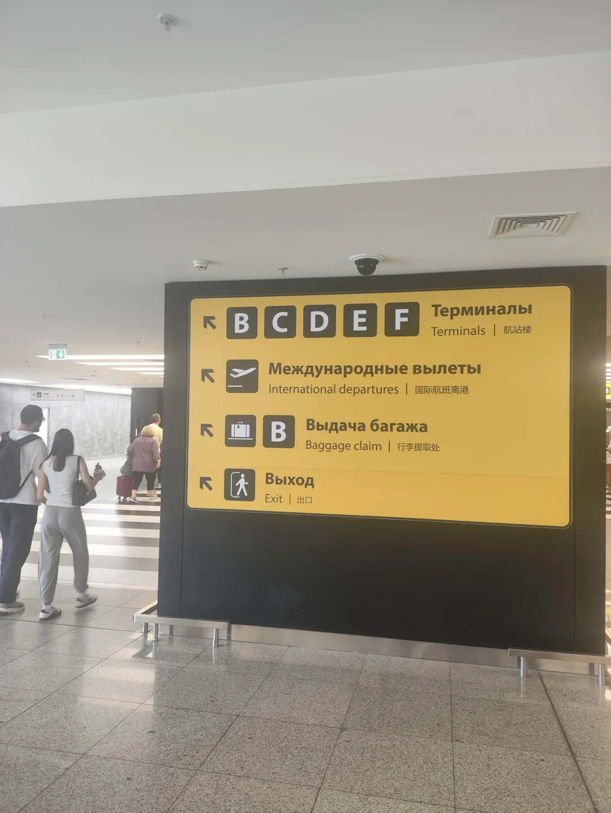
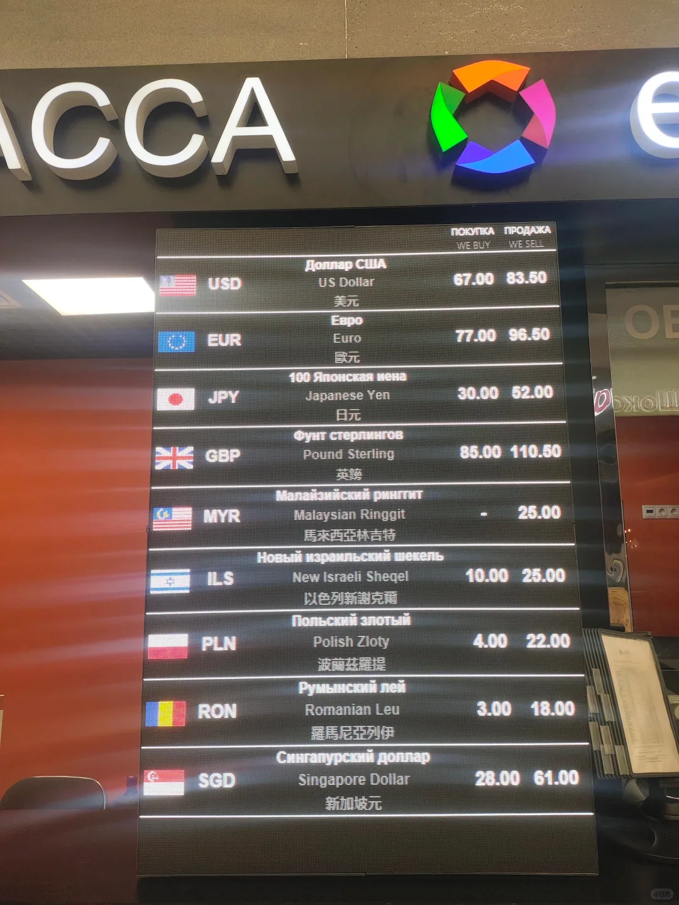

SVO-তে রুবলে টাকা বদলানোর সময় দুটি সিদ্ধান্ত — **কোন কাউন্টার আর কতটা** — ঠিক করে দেয় আপনি চুপচাপ কয়েক ডজন এমনকি শতাধিক ইউয়ান অকারণে হারাবেন কি না।

## সেরা রেট: Сбер (সবারব্যাংক)

টার্মিনাল B-তে এই **Сбер (সবারব্যাংক)** শাখাটি খুঁজুন: **বিমানবন্দরে এর রেটই সেরা**, প্রায় **১ CNY = ১১.x রুবল**।

## যে কাউন্টার এড়াবেন

বিমানবন্দরের অন্য বিনিময় কেন্দ্রগুলো স্পষ্টতই খারাপ, মাত্র প্রায় **১ CNY = ১০ রুবল** — Сбер-এর চেয়ে ১০%-এরও বেশি কম।

> টাকা বদলানোর আগে রেট বোর্ডের দুই কলাম, “ক্রয়” ও “বিক্রয়”, দেখুন এবং **শুধু যে দিকটি আপনি সত্যিই ব্যবহার করবেন সেটাই তুলনা করুন**। বড় বিজ্ঞাপনি হরফে বিভ্রান্ত হবেন না।

## কতটা বদলাবেন: ভাড়ার সমান

**বিমানবন্দরে বেশি বদলাবেন না** — **প্রায় ৫০০ CNY** শহরের কেন্দ্রে যাওয়ার পরিবহন খরচ কভার করে।

শহরে পৌঁছে বড় অঙ্ক বদলান:

- **VTB ব্যাংকের শাখায় যান** এবং **নগদ CNY** বদলান; এতেই সেরা রেট মেলে।
- নগদ CNY নেই? **ইউনিয়নপে ডেবিট কার্ড** দিয়ে **রুশ কৃষি ব্যাংকের (Россельхозбанк)** এটিএম থেকে টাকা তুলুন।
- ষষ্ঠ ছবিতে “হাতুড়ি” লোগোযুক্ত হলুদ এটিএমটিও (লেখক এটিকে “হাতুড়ি ব্যাংক” বলেন) **কাজ করে**, শুধু রেট কিছুটা খারাপ।

## অন্য ব্যাংকগুলো কেন কাজ করে না

নিষেধাজ্ঞার কারণে রাশিয়ার বেশিরভাগ ব্যাংক **ইউনিয়নপে, ভিসা বা মাস্টারকার্ড নিতে পারে না**। তাই রাশিয়ায় সত্যিই নগদ দেওয়া মেশিনের সংখ্যা প্রত্যাশার চেয়ে কম — **যেটি কাজ করে পেলে কোথায় ছিল মনে রাখুন**; নগদ ফুরানোর অপেক্ষায় থেকে খোঁজা শুরু করবেন না।

## সারসংক্ষেপ

| স্থান | পদ্ধতি | রেট / পরামর্শ |
| --- | --- | --- |
| SVO বিমানবন্দর | Сбер (সবারব্যাংক) | প্রায় ১ CNY ≈ ১১.x রুবল, বিমানবন্দরে সেরা |
| SVO বিমানবন্দর | অন্য বিনিময় কাউন্টার | প্রায় ১ CNY ≈ ১০ রুবল, **এড়িয়ে চলুন** |
| শহরের কেন্দ্র | VTB ব্যাংক শাখা (নগদ CNY) | সেরা রেট |
| শহরের কেন্দ্র | রুশ কৃষি ব্যাংক / “হাতুড়ি” এটিএম (ইউনিয়নপে) | বিকল্প হিসেবে ঠিক আছে, রেট সামান্য খারাপ |

**প্রস্তাবিত পরিমাণ**: বিমানবন্দরে প্রায় ৫০০ CNY সমপরিমাণ, বাকিটা শহরে পৌঁছে।
