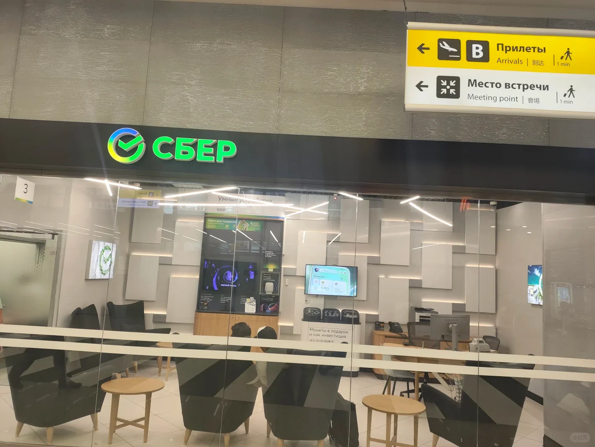
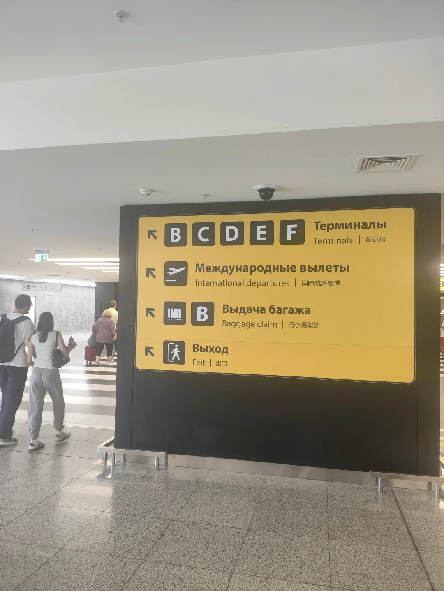
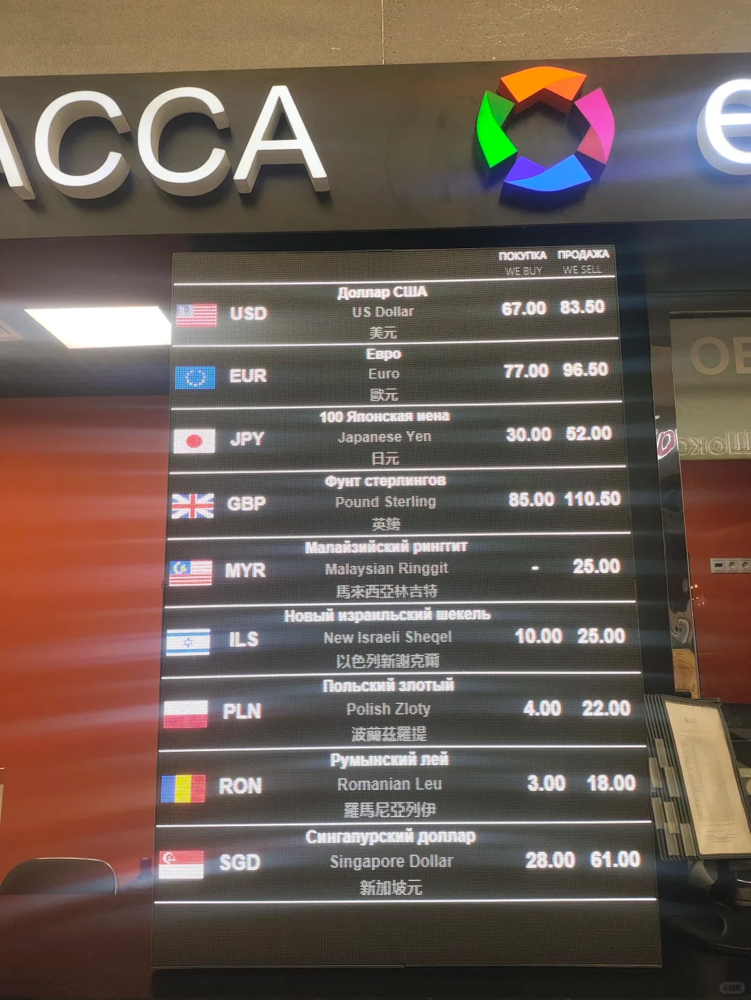
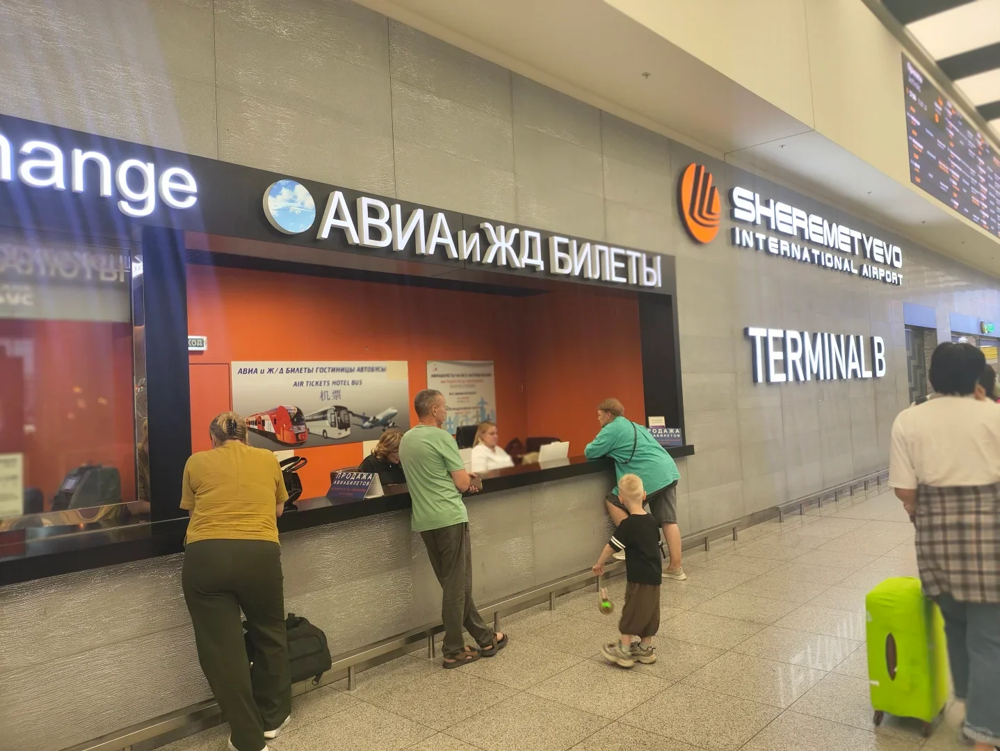
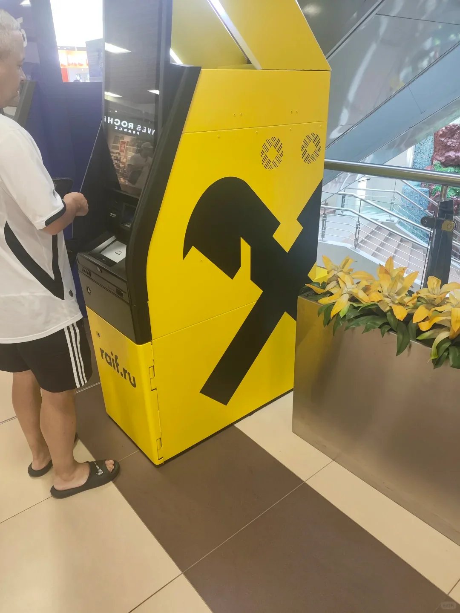

Wer am Flughafen SVO Rubel tauscht, entscheidet mit zwei Fragen — **welche Wechselstube und wie viel** — darüber, ob er am Ende ohne Not einige Dutzend bis über hundert Yuan verliert.

## Bester Kurs: Сбер (Sberbank)

Im Terminal B findet man diese **Сбер-Filiale (Sberbank)**: **Sie hat den besten Kurs am Flughafen**, etwa **1 CNY = 11,x Rubel**.

## Diese Wechselstuben sollte man meiden

Die übrigen Geldwechselstellen am Flughafen sind deutlich schlechter, nur etwa **1 CNY = 10 Rubel** — über 10 % schlechter als bei Сбер.

> Vor dem Wechseln einen Blick auf die beiden Spalten des Aushangs werfen, „Ankauf“ und „Verkauf“, und **nur die Richtung vergleichen, die man tatsächlich braucht** — und sich nicht von der großen Werbeschrift täuschen lassen.

## Wie viel tauschen: das Fahrgeld reicht

**Am Flughafen nicht zu viel tauschen** — **rund 500 CNY** reichen für den Transport ins Stadtzentrum.

Größere Beträge erst in der Innenstadt tauschen:

- **Eine Filiale der VTB Bank aufsuchen** und **Bargeld in Renminbi** tauschen, das ist der beste Kurs.
- Kein Bargeld in Renminbi? Mit einer **UnionPay-Debitkarte** am Geldautomaten der **Russischen Agrar Bank (Россельхозбанк)** abheben.
- Der gelbe Geldautomat mit dem „Hammer“-Logo auf dem sechsten Bild (der Autor nennt ihn „Hammer-Bank“) **funktioniert ebenfalls**, nur der Kurs ist etwas schlechter.

## Warum andere Banken nicht funktionieren

Wegen der Sanktionen **akzeptieren die meisten russischen Banken weder UnionPay noch Visa oder Mastercard**. In Russland gibt es deshalb weniger Automaten, die Bargeld ausgeben, als man denkt — **wer einen funktionierenden findet, sollte sich den Standort merken** und nicht erst suchen, wenn das Bargeld schon aufgebraucht ist.

## Fazit

| Ort | Weg | Kurs / Empfehlung |
| --- | --- | --- |
| Flughafen SVO | Сбер (Sberbank) | ca. 1 CNY ≈ 11,x Rubel, der beste am Flughafen |
| Flughafen SVO | Andere Wechselstuben | ca. 1 CNY ≈ 10 Rubel, **meiden** |
| Innenstadt | Filiale der VTB Bank (Bargeld in Renminbi) | bester Kurs |
| Innenstadt | Russische Agrar Bank / „Hammer“-Geldautomat (UnionPay) | als Notlösung okay, etwas schlechterer Kurs |

**Empfehlung zur Tauschmenge**: am Flughafen rund 500 CNY Gegenwert, den Rest in der Innenstadt.
