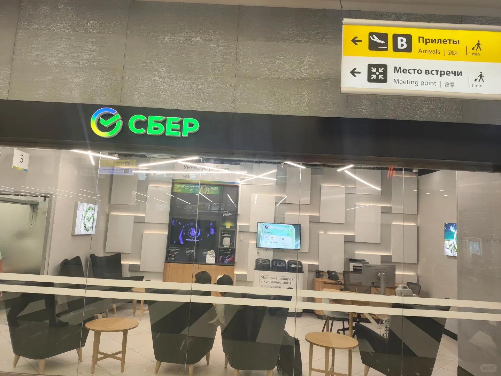

Cuando cambias dinero a rublos en SVO, dos decisiones —**qué mostrador y cuánto**— determinan si pierdes en silencio decenas o incluso un centenar largo de yuanes sin motivo.

## El mejor tipo de cambio: Сбер (Sberbank)

En la Terminal B, busca esta sucursal de **Сбер (Sberbank)**: **su tipo de cambio es el mejor del aeropuerto**, alrededor de **1 CNY = 11,x rublos**.

## Mostradores que hay que evitar

Los demás puntos de cambio de divisas del aeropuerto son claramente peores, solo unos **1 CNY = 10 rublos**: más de un 10 % por debajo de Сбер.

> Antes de cambiar dinero, mira las dos columnas del panel de tipos, “compra” y “venta”, y **compara solo la dirección que vas a usar de verdad**. No te dejes engañar por el gran tamaño de la publicidad.

## Cuánto cambiar: lo justo para el trayecto

**No cambies demasiado en el aeropuerto**: **unos 500 CNY** cubren el transporte hasta el centro.

Cambia sumas mayores una vez en la ciudad:

- **Ve a una sucursal de VTB Bank** y cambia **efectivo en CNY**; eso da el mejor tipo de cambio.
- ¿No tienes efectivo en CNY? Usa una **tarjeta de débito UnionPay** para retirar en un cajero del **Banco Agrícola Ruso (Россельхозбанк)**.
- El cajero amarillo con el logotipo del “martillo” de la sexta foto (el autor lo llama el “banco del martillo”) **también funciona**, solo que el tipo es un poco peor.

## Por qué otros bancos no sirven

Por las sanciones, la mayoría de los bancos rusos **no aceptan UnionPay, Visa ni Mastercard**. Así que el número de máquinas que de verdad te darán efectivo en Rusia es menor de lo que esperarías: **cuando encuentres una que funcione, recuerda dónde está**; no esperes a quedarte sin efectivo para empezar a buscar.

## Resumen

| Lugar | Método | Tipo / consejo |
| --- | --- | --- |
| Aeropuerto SVO | Сбер (Sberbank) | Unos 1 CNY ≈ 11,x rublos, el mejor del aeropuerto |
| Aeropuerto SVO | Otros mostradores de cambio | Unos 1 CNY ≈ 10 rublos, **evítalos** |
| Centro de la ciudad | Sucursal de VTB Bank (efectivo en CNY) | El mejor tipo |
| Centro de la ciudad | Banco Agrícola Ruso / cajero del “martillo” (UnionPay) | Bien como respaldo, tipo algo peor |

**Cantidad sugerida**: unos 500 CNY equivalentes en el aeropuerto, el resto una vez en la ciudad.
