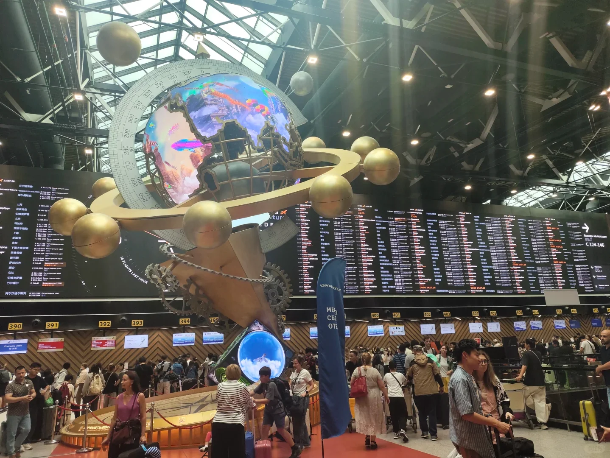

Когда вы меняете деньги на рубли в SVO, два решения — **какая касса и сколько** — определяют, потеряете ли вы незаметно десятки или даже сотню-другую юаней впустую.

## Лучший курс: Сбер

В терминале B найдите отделение **Сбер** (Sberbank): **у него лучший курс в аэропорту**, около **1 CNY = 11,x рубля**.

## Кассы, которых стоит избегать

Остальные обменные пункты в аэропорту явно хуже — только около **1 CNY = 10 рублей**, более чем на 10% ниже Сбера.

> Прежде чем менять деньги, посмотрите на две колонки табло курсов — «покупка» и «продажа» — и **сравнивайте только то направление, которым реально будете пользоваться**. Не дайте себя обмануть крупным рекламным шрифтом.

## Сколько менять: хватит на проезд

**Не меняйте слишком много в аэропорту** — **около 500 CNY** хватает на транспорт до центра.

Крупные суммы меняйте уже в городе:

- **Идите в отделение ВТБ** и меняйте **наличные юани**; это даёт лучший курс.
- Нет наличных юаней? Снимайте **дебетовой картой UnionPay** в банкомате **Россельхозбанка**.
- Жёлтый банкомат с логотипом «молот» на шестом фото (автор называет его «банк-молот») **тоже работает**, только курс немного хуже.

## Почему другие банки не подходят

Из-за санкций большинство российских банков **не принимают UnionPay, Visa или Mastercard**. Поэтому банкоматов, которые действительно выдадут вам наличные в России, меньше, чем ожидаешь, — **когда найдёте работающую, запомните, где она**; не ждите, пока наличные закончатся, чтобы начать искать.

## Итог

| Место | Способ | Курс / совет |
| --- | --- | --- |
| Аэропорт SVO | Сбер (Sberbank) | Около 1 CNY ≈ 11,x рубля, лучший в аэропорту |
| Аэропорт SVO | Другие обменные пункты | Около 1 CNY ≈ 10 рублей, **избегайте** |
| Центр города | Отделение ВТБ (наличные юани) | Лучший курс |
| Центр города | Россельхозбанк / банкомат «молот» (UnionPay) | Хорош как запасной вариант, курс немного хуже |

**Рекомендуемая сумма**: около 500 CNY эквивалента в аэропорту, остальное — уже в городе.
