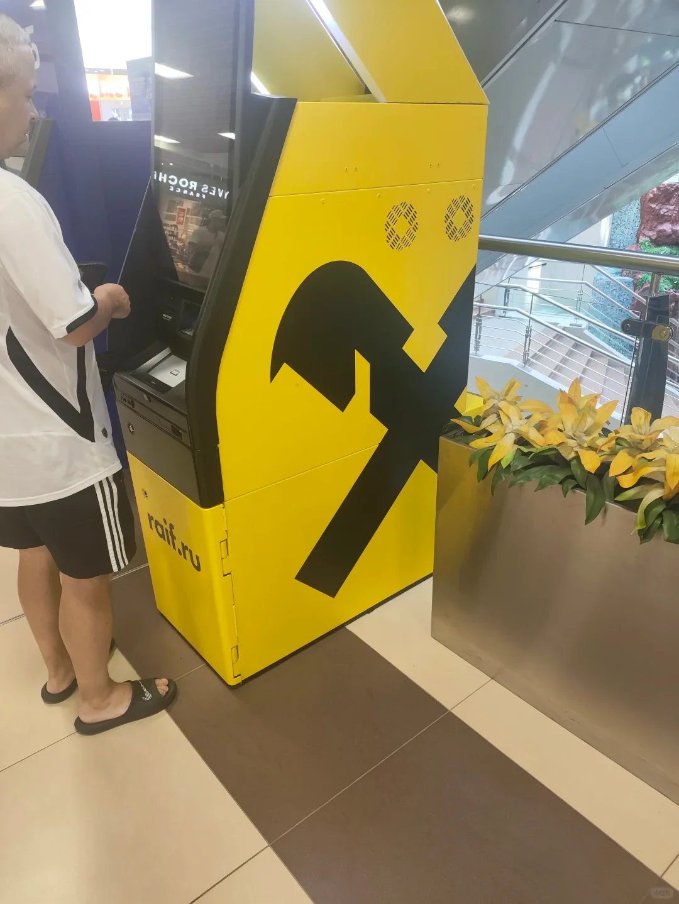

เมื่อคุณแลกเงินเป็นรูเบิลที่ SVO การตัดสินใจสองอย่าง — **เคาน์เตอร์ไหนและจำนวนเท่าไร** — เป็นตัวกำหนดว่าคุณจะสูญเสียเงินหลายสิบหรือแม้แต่ร้อยกว่าหยวนไปเปล่า ๆ หรือไม่

## เรตดีที่สุด: Сбер (Sberbank)

ที่อาคารผู้โดยสาร B ให้หาสาขา **Сбер (Sberbank)** นี้: **เรตของที่นี่ดีที่สุดในสนามบิน** ประมาณ **1 หยวน = 11.x รูเบิล**

## เคาน์เตอร์ที่ควรเลี่ยง

จุดแลกเปลี่ยนเงินอื่น ๆ ในสนามบินแย่กว่าอย่างชัดเจน เพียงประมาณ **1 หยวน = 10 รูเบิล** — ต่ำกว่า Sber มากกว่า 10%

> ก่อนแลกเงิน ให้ดูสองคอลัมน์บนป้ายเรต «buy» และ «sell» และ **เปรียบเทียบเฉพาะทิศทางที่คุณจะใช้จริง** อย่าหลงไปตามตัวเลขโฆษณาตัวใหญ่

## ควรแลกเท่าไร: พอสำหรับค่าเดินทาง

**อย่าแลกเงินที่สนามบินมากเกินไป** — **ประมาณ 500 หยวน** เพียงพอสำหรับการเดินทางเข้าสู่ใจกลางเมือง

แลกจำนวนมากเมื่ออยู่ในเมืองแล้ว:

- **ไปที่สาขาธนาคาร VTB** และแลก **เงินหยวนสด** ซึ่งให้เรตดีที่สุด
- ไม่มีเงินหยวนสด? ใช้ **บัตรเดบิต UnionPay** กดเงินที่ตู้ ATM ของ **ธนาคารเกษตรแห่งรัสเซีย (Россельхозбанк)**
- ตู้ ATM สีเหลืองที่มีโลโก้ «ค้อน» ในภาพที่หก (ผู้เขียนเรียกมันว่า «ธนาคารค้อน») **ใช้ได้เช่นกัน** เพียงเรตแย่กว่าเล็กน้อย

## ทำไมธนาคารอื่นใช้ไม่ได้

เพราะมาตรการคว่ำบาตร ธนาคารรัสเซียส่วนใหญ่ **ไม่รับ UnionPay, Visa หรือ Mastercard** จำนวนเครื่องที่ให้เงินสดแก่คุณได้จริงในรัสเซียจึงน้อยกว่าที่คาด — **เมื่อเจอเครื่องที่ใช้ได้ ให้จำตำแหน่งไว้** อย่ารอจนเงินสดหมดแล้วค่อยเริ่มหา

## สรุป

| สถานที่ | วิธี | เรต / คำแนะนำ |
| --- | --- | --- |
| สนามบิน SVO | Сбер (Sberbank) | ประมาณ 1 หยวน ≈ 11.x รูเบิล ดีที่สุดในสนามบิน |
| สนามบิน SVO | เคาน์เตอร์แลกเงินอื่น | ประมาณ 1 หยวน ≈ 10 รูเบิล **เลี่ยง** |
| ใจกลางเมือง | สาขาธนาคาร VTB (เงินหยวนสด) | เรตดีที่สุด |
| ใจกลางเมือง | ธนาคารเกษตรแห่งรัสเซีย / ตู้ ATM «ค้อน» (UnionPay) | ใช้เป็นตัวสำรองได้ เรตแย่กว่าเล็กน้อย |

**จำนวนที่แนะนำ**: ประมาณ 500 หยวนที่สนามบิน ที่เหลือเมื่ออยู่ในเมือง
