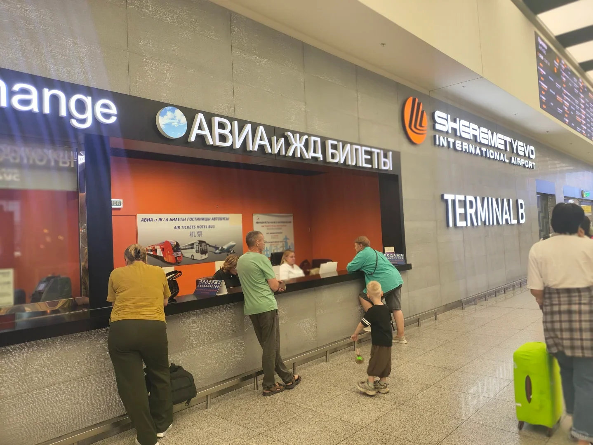

Khi đổi tiền sang rúp tại SVO, hai quyết định — **quầy nào và đổi bao nhiêu** — quyết định việc bạn có âm thầm mất vài chục, thậm chí hơn trăm tệ một cách vô ích hay không.

## Giá tốt nhất: Сбер (Sberbank)

Tại Nhà ga B, hãy tìm chi nhánh **Сбер (Sberbank)** này: **giá của chi nhánh là tốt nhất trong sân bay**, khoảng **1 CNY = 11,x rúp**.

## Những quầy nên tránh

Các điểm đổi ngoại tệ khác trong sân bay kém rõ rệt, chỉ khoảng **1 CNY = 10 rúp** — thấp hơn Сбер hơn 10%.

> Trước khi đổi tiền, hãy nhìn hai cột trên bảng giá, “mua” và “bán”, và **chỉ so sánh theo chiều bạn thực sự sẽ dùng**. Đừng để bị đánh lừa bởi cỡ chữ quảng cáo lớn.

## Nên đổi bao nhiêu: đủ cho giá vé

**Đừng đổi quá nhiều ở sân bay** — **khoảng 500 CNY** là đủ cho việc đi vào trung tâm thành phố.

Hãy đổi số tiền lớn hơn khi đã vào thành phố:

- **Đến chi nhánh Ngân hàng VTB** và đổi **tiền mặt CNY**; cách này cho giá tốt nhất.
- Không có tiền mặt CNY? Dùng **thẻ ghi nợ UnionPay** để rút tại ATM của **Ngân hàng Nông nghiệp Nga (Россельхозбанк)**.
- Chiếc ATM màu vàng có logo “búa” ở ảnh thứ sáu (tác giả gọi là “ngân hàng búa”) **cũng dùng được**, chỉ là giá kém hơn một chút.

## Tại sao các ngân hàng khác không dùng được

Vì lệnh trừng phạt, phần lớn ngân hàng Nga **không nhận UnionPay, Visa hoặc Mastercard**. Vì vậy số máy thực sự đưa được tiền mặt cho bạn ở Nga ít hơn bạn tưởng — **khi tìm được một máy hoạt động, hãy nhớ vị trí của nó**; đừng đợi đến khi hết tiền mặt mới bắt đầu tìm.

## Tóm tắt

| Nơi | Cách thức | Giá / lời khuyên |
| --- | --- | --- |
| Sân bay SVO | Сбер (Sberbank) | Khoảng 1 CNY ≈ 11,x rúp, tốt nhất trong sân bay |
| Sân bay SVO | Các quầy đổi tiền khác | Khoảng 1 CNY ≈ 10 rúp, **nên tránh** |
| Trung tâm thành phố | Chi nhánh Ngân hàng VTB (tiền mặt CNY) | Giá tốt nhất |
| Trung tâm thành phố | Ngân hàng Nông nghiệp Nga / ATM “búa” (UnionPay) | Ổn làm phương án dự phòng, giá kém hơn một chút |

**Số tiền đề xuất**: khoảng 500 CNY quy đổi tại sân bay, phần còn lại để khi đã vào thành phố.
