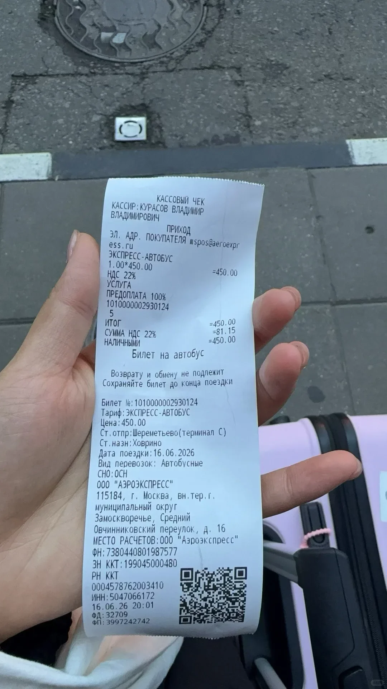

Z letiště Šeremetěvo (SVO) do centra města je **kyvadlový autobus 1195 s přestupem na metro linku 2** nejsnazší cestou: **zhruba hodina od začátku do konce** za přibližně 540 rublů.

## Proč jet autobusem 1195

Letištní autobusová zastávka obsluhuje linky 851 i 1195. **Linka 1195 je „Экспресс-автобус / Shuttle bus“, která jezdí bez zastávek ke stanici metra Chovrino (до М Ховрино / to Khovrino Metro Station)** – severní konečné linky 2 – a odjíždí z nástupiště C1.

## Trasa krok za krokem

### 1. Projděte celní kontrolou a vyzvedněte zavazadla

Po celní kontrole nejdřív zamířte k zavazadlovému pásu. **Kolem 17. hodiny je špička příletů**, kdy je fronta nejdelší, takže pokud spěcháte, tomuto oknu se vyhněte.

### 2. Zahněte doprava a najděte východ

Se zavazadly v ruce **zahněte doprava** a podle cedulí „Выход / Exit“ vyjděte z příletové haly.

### 3. Najděte autobusové nástupiště C1

Venku jděte k **autobusovým nástupištím** a hledejte sloupek označený **C1**. Zastávková cedule ukazuje odpočet do dalšího odjezdu linky 1195.

### 4. Kupte si jízdenku u průvodčí v červeno-šedé uniformě

Jízdenky prodává **průvodčí v červeno-šedé uniformě** na nástupišti, kupte je tedy přímo u ní: **450 rublů na osobu, hotovost přijímá**.

### 5. Nastupte: červená 1195

**Červená 1195** je letištní kyvadlový autobus; ve voze je police na velká zavazadla a obrazovka zobrazující trasu a zastávky.

### 6. Vystupte v Chovrinu

Poslední zastávka je **stanice metra Chovrino (Ховрино)**; po vystoupení jděte prostě s davem.

### 7. Kupte si jízdenku na metro a jeďte linkou 2

Ve stanici jsou automaty na jízdenky, **jedna jízda stojí 90 rublů**; k dispozici jsou i jízdenky na 1, 3 a 30 dní. Automaty přijímají **pětisetrublové bankovky**.

Po průchodu turnikety následujte cedule k **lince 2** dolů; linka 2 je **tmavě zelená** Zamoskvorecká linka.

### 8. Jeďte do centra

Linka 2 vede z Chovrina na jih přes Běloruskou, Majakovskou, Tverskou a další centrální stanice. Cílem autora při této cestě byla **Novokuzněckaja**, s odchodem východem 1.

> **Pečlivě sledujte názvy stanic**: autor přejel svou zastávku a ztratil čas. Vzdálenosti mezi stanicemi na lince 2 jsou krátké, ale hlášení jsou v ruštině, proto sledujte svou aktuální polohu v telefonu.

Ze stanice vyjdete přímo do centra města.

## Cena a čas

| Položka | Cena | Čas |
| --- | --- | --- |
| Kyvadlový autobus 1195 | 450 rublů na osobu | asi 20–30 minut do Chovrina |
| Metro, jedna jízda | 90 rublů | asi 35 minut do centra |
| **Celkem** | **asi 540 rublů** | **asi 1 hodina** |

## Praktické tipy

- **Zavazadla můžete nechat v autobuse**, nemusíte velký kufr držet na klíně.
- **Mějte připravenou pětisetrublovou bankovku**: hodí se na jízdné v hotovosti na autobusovém nástupišti i v automatech na jízdenky metra a je praktičtější než velká bankovka.
- V metru se prodávají **denní jízdenky**; pokud toho dne pojedete několikrát, jednodenní jízdenka vyjde levněji.
- Taxi nebo aplikace pro přivolání jízdy je samozřejmě rychlejší, ale stojí několikanásobně víc a **ve špičce uvízne v zácpě na cestě do města**.
