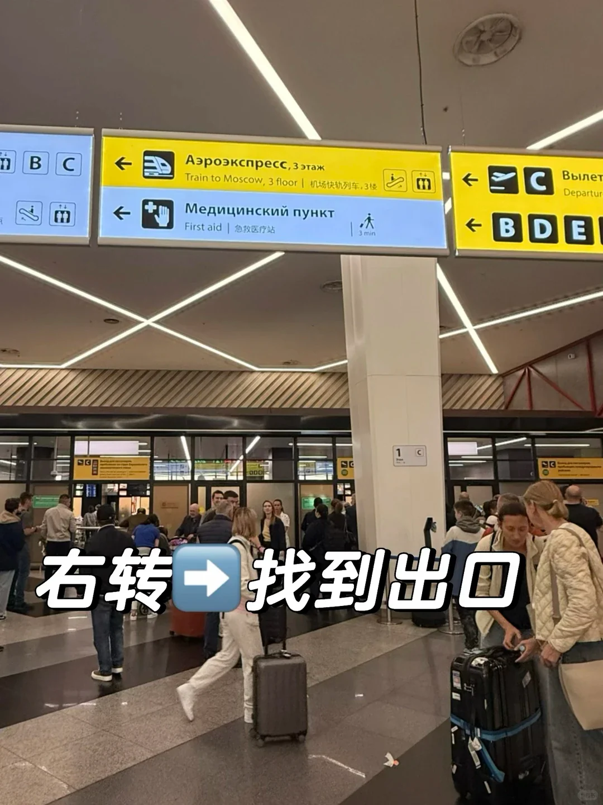
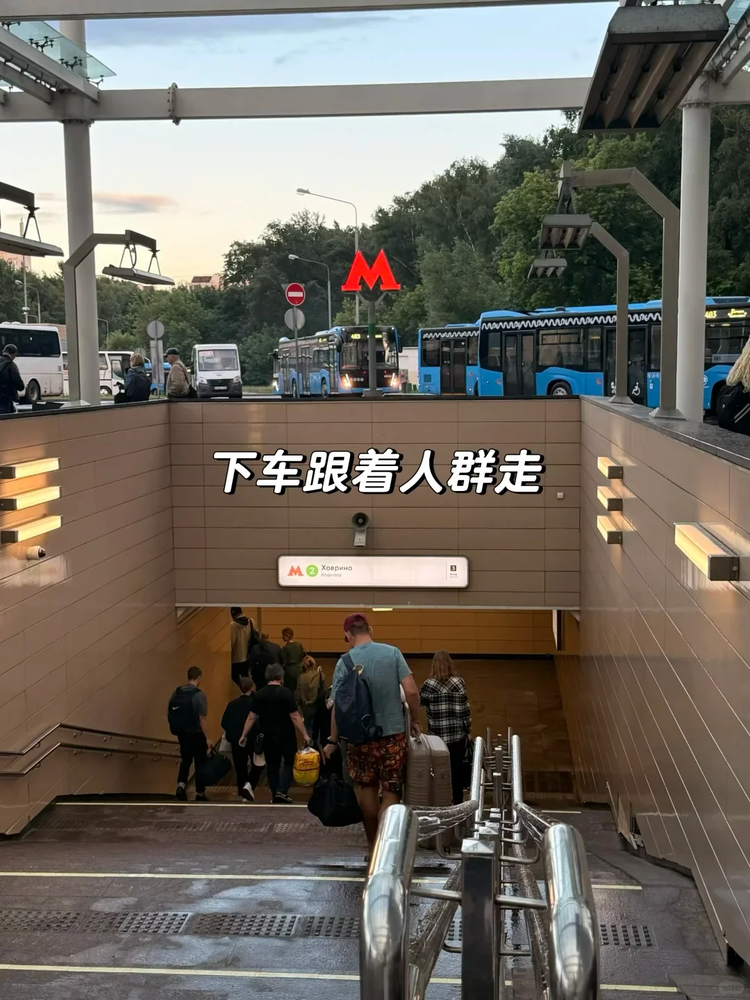
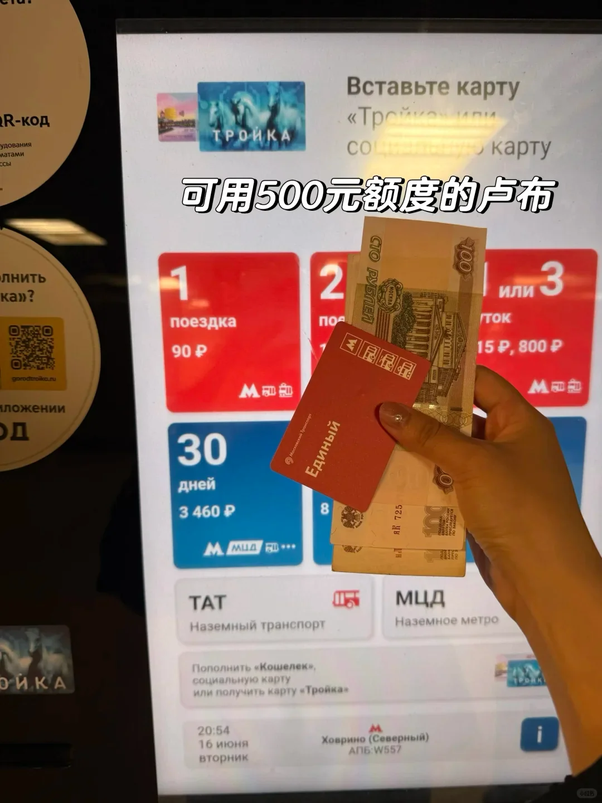

Del aeropuerto Sheremetyevo (SVO) al centro, **el autobús lanzadera 1195 con un transbordo a la línea 2 del metro** es la forma más fácil de entrar: **aproximadamente una hora de punta a punta**, por unos 540 rublos.

## Por qué tomar el autobús 1195

La parada de autobús del aeropuerto sirve a la ruta 851 y a la ruta 1195. **La ruta 1195 es el “Экспресс-автобус / Shuttle bus”, que va sin paradas hasta la estación de metro Khovrino (до М Ховрино / to Khovrino Metro Station)**, la terminal norte de la línea 2, y sale del andén C1.

## La ruta paso a paso

### 1. Pasa aduanas y recoge las maletas

Tras aduanas, dirígete primero a la cinta de equipajes. **Alrededor de las 17:00 es la punta de llegadas**, cuando la cola es más larga, así que evita esa franja si tienes prisa.

### 2. Gira a la derecha y encuentra la salida

Con las maletas en la mano, **gira a la derecha** y sigue los carteles “Выход / Exit” para salir de la sala de llegadas.

### 3. Encuentra el andén C1

Una vez fuera, camina hacia los **andenes de autobús** y busca el pilar marcado **C1**. El cartel de la parada muestra una cuenta atrás hasta la siguiente salida de la ruta 1195.

### 4. Compra el billete al revisor de rojo y gris

El **revisor con uniforme rojo y gris** en el andén vende los billetes, así que cómpralo directamente a ella: **450 rublos por persona, se acepta efectivo**.

### 5. Sube: el 1195 rojo

**El 1195 rojo** es la lanzadera del aeropuerto; a bordo hay un portaequipajes para el equipaje grande y una pantalla que muestra la ruta y las paradas.

### 6. Bájate en Khovrino

La última parada es la **estación de metro Khovrino (Ховрино)**; una vez abajo, sigue a la multitud.

### 7. Compra un billete de metro y toma la línea 2

Hay máquinas de billetes dentro de la estación, **90 rublos por un viaje sencillo**; también hay abonos de 1 día, 3 días y 30 días. Las máquinas aceptan **billetes de 500 rublos**.

Una vez pasados los tornos, sigue las señales hacia la **línea 2** bajando; la línea 2 es la Zamoskvoretskaya, de color **verde oscuro**.

### 8. Entra en el centro

La línea 2 va hacia el sur desde Khovrino pasando por Belorusskaya, Mayakovskaya, Tverskaya y otras estaciones céntricas. El destino del autor en este viaje era **Novokuznetskaya**, saliendo por la salida 1.

> **Vigila los nombres de las estaciones**: el autor se pasó de parada y perdió tiempo. Los tramos entre estaciones de la línea 2 son cortos, pero los anuncios son en ruso, así que sigue tu posición en vivo en el móvil.

Sales de la estación directamente al centro de la ciudad.

## Coste y tiempo

| Concepto | Coste | Tiempo |
| --- | --- | --- |
| Lanzadera 1195 del aeropuerto | 450 rublos por persona | unos 20–30 minutos a Khovrino |
| Metro, viaje sencillo | 90 rublos | unos 35 minutos al centro |
| **Total** | **unos 540 rublos** | **aproximadamente 1 hora** |

## Consejos prácticos

- **Puedes dejar el equipaje en el autobús**, así que no hace falta sujetar una maleta grande en el regazo.
- **Ten preparado un billete de 500 rublos**: sirve para la tarifa en efectivo en el andén del autobús y en las máquinas de billetes del metro, y es más cómodo que un billete grande.
- El metro vende **abonos de día**; si vas a montar varias veces ese día, un abono de 1 día sale más barato.
- Un taxi o una aplicación son desde luego más rápidos, pero cuestan varias veces más y **se atascan en el tráfico a la entrada de la ciudad en hora punta**.
