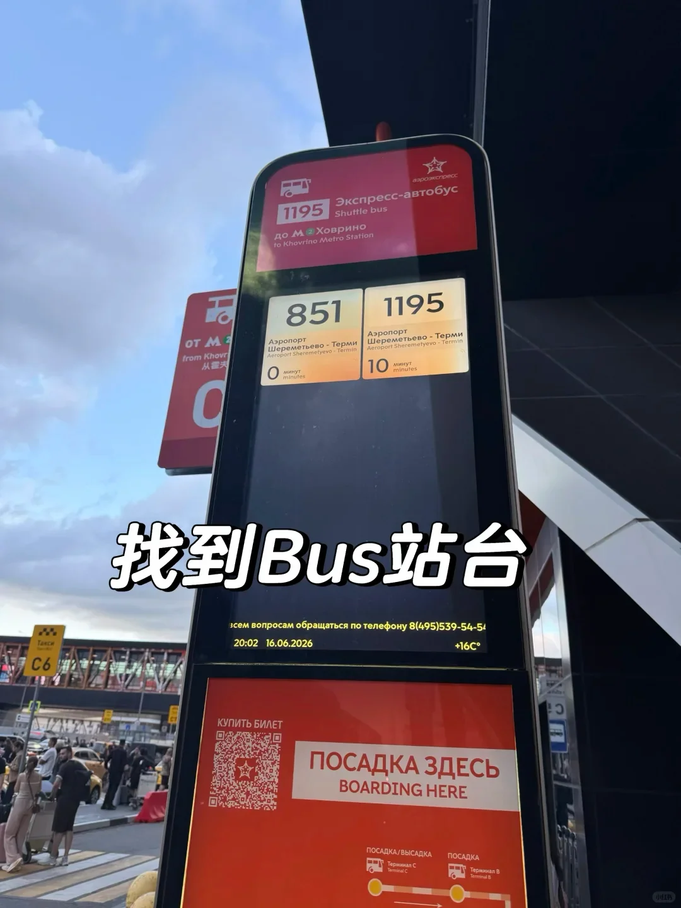

シェレメーチエヴォ空港（SVO）から市中心部へは、**シャトルバス1195番＋地下鉄2号線乗り継ぎ**が最も簡単です。**ドア・トゥ・ドアで約1時間**、約540ルーブルです。

## なぜバス1195番なのか

空港バス停留所には851番と1195番の両方が発着します。**1195番は「Экспресс-автобус / Shuttle bus」で、ホヴリノ地下鉄駅（до М Ховрино / to Khovrino Metro Station）までノンストップ**、2号線の北端の駅です。C1乗り場から出ます。

## ルートを順に

### 1. 税関を抜けて荷物を受け取る

税関の後はまず手荷物ベルトへ。**午後5時ごろが到着のピーク**で列が最も長くなるため、急いでいるならその時間帯を避けましょう。

### 2. 右へ曲がって出口を探す

荷物を手に、**右へ曲がり**、「Выход / Exit」の案内に従って到着ホールを出ます。

### 3. バスC1乗り場を見つける

外に出たら**バス乗り場**へ歩き、**C1**と書かれた柱を探します。停留所の標識には1195番の次発までのカウントダウンが表示されています。

### 4. 赤と灰色の係員からきっぷを買う

ホームにいる**赤と灰色の制服の係員**がきっぷを売っているので、直接購入します。**1人450ルーブル、現金可**。

### 5. 乗車：赤い1195番

**赤い1195番**が空港シャトルです。車内には大型荷物用のラックと、路線と停留所を示す画面があります。

### 6. ホヴリノで降りる

終点は**ホヴリノ（Ховрино）地下鉄駅**です。降りたら人の流れに従うだけです。

### 7. 地下鉄のきっぷを買って2号線へ

駅構内に券売機があり、**片道90ルーブル**です。1日券、3日券、30日券もあります。券売機は**500ルーブル札**に対応しています。

改札を抜けたら、**2号線**の案内に従って下へ。2号線は**濃緑色**のザモスクヴォレーツカヤ線です。

### 8. 市中心部へ

2号線はホヴリノから南へ、ベラルースカヤ、マヤコフスカヤ、トヴェルスカヤなどの中心駅を通ります。今回の目的地は**ノヴォクズネツカヤ**で、1番出口から出ました。

> **駅名をよく見てください**：筆者は降りる駅を乗り過ごして時間を失いました。2号線は駅間が短いものの、アナウンスはロシア語なので、スマートフォンで現在位置を確認しておきましょう。

駅を出るとそのまま市中心部です。

## 費用と時間

| 項目 | 費用 | 時間 |
| --- | --- | --- |
| 1195番空港シャトル | 1人450ルーブル | ホヴリノまで約20〜30分 |
| 地下鉄、片道 | 90ルーブル | 中心部まで約35分 |
| **合計** | **約540ルーブル** | **約1時間** |

## 実用のヒント

- **荷物はバスに置いたままで大丈夫**。大きなスーツケースを膝に抱える必要はありません。
- **500ルーブル札を用意しておく**：バス乗り場の現金運賃でも地下鉄の券売機でも使え、高額紙幣より便利です。
- 地下鉄では**1日券**も売っています。その日に何度も乗るなら1日券のほうが安くなります。
- タクシーや配車アプリはもちろん速いですが、数倍の費用がかかり、**ピーク時の市内への道は渋滞に巻き込まれます**。
