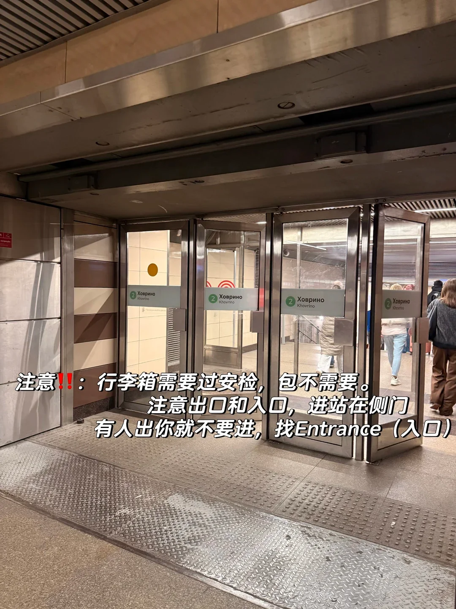
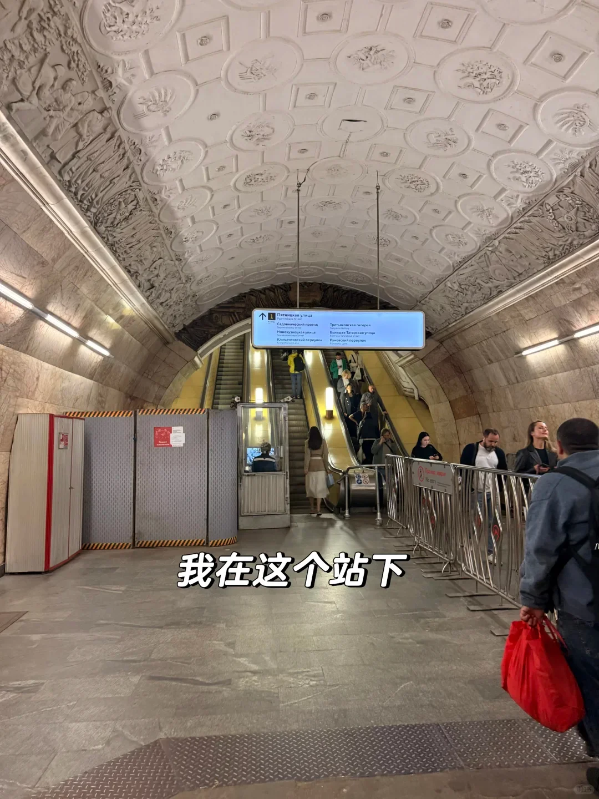

Van luchthaven Sjeremetjevo (SVO) naar het centrum is **shuttlebus 1195 met een overstap op metrolijn 2** de gemakkelijkste route: **ongeveer een uur van begin tot eind**, voor zo'n 540 roebel.

## Waarom bus 1195

De luchthavenbushalte bedient zowel route 851 als route 1195. **Route 1195 is de "Экспресс-автобус / Shuttle bus", die non-stop naar metrostation Chovrino rijdt (до М Ховрино / to Khovrino Metro Station)** — het noordelijke eindpunt van lijn 2 — en vertrekt van perron C1.

## De route stap voor stap

### 1. Door de douane en je bagage ophalen

Ga na de douane eerst naar de bagagecarrousel. **Rond 17:00 is het drukst voor aankomsten**, wanneer de rij het langst is, dus vermijd dat tijdvak als je haast hebt.

### 2. Rechtsaf en de uitgang zoeken

Met je bagage in de hand sla je **rechtsaf** en volg je de borden "Выход / Exit" de aankomsthal uit.

### 3. Busperron C1 vinden

Loop buiten richting de **busperrons** en zoek de pilaar met de aanduiding **C1**. Op het haltebord staat een aftelling tot het volgende vertrek van route 1195.

### 4. Koop je kaartje bij de begeleidster in rood en grijs

De **begeleidster in het rood-grijze uniform** op het perron verkoopt de kaartjes, dus koop ze direct bij haar: **450 roebel per persoon, contant mogelijk**.

### 5. Instappen: de rode 1195

**De rode 1195** is de luchthavenshuttle; aan boord is er een rek voor grote bagage en een scherm dat de route en de haltes toont.

### 6. Uitstappen bij Chovrino

De laatste halte is **metrostation Chovrino (Ховрино)**; als je uitstapt, volg je gewoon de menigte.

### 7. Een metrokaartje kopen en lijn 2 nemen

In het station staan kaartautomaten, **90 roebel voor een enkele rit**; er zijn ook passe-partouts voor 1, 3 en 30 dagen. De automaten nemen **biljetten van 500 roebel** aan.

Eenmaal door de poortjes volg je de borden voor **lijn 2** naar beneden; lijn 2 is de **donkergroene** Zamoskvoretskaja-lijn.

### 8. De stad in rijden

Lijn 2 loopt zuidwaarts van Chovrino via Beloroesskaja, Majakovskaja, Tverskaja en andere centrale stations. De bestemming van de auteur deze reis was **Novokoeznetskaja**, waar hij via uitgang 1 naar buiten ging.

> **Let goed op de stationsnamen**: de auteur reed voorbij zijn halte en verloor tijd. De afstanden tussen de stations op lijn 2 zijn kort, maar de omroep is in het Russisch, dus houd je live positie op je telefoon in de gaten.

Je komt het station uit en staat direct in het centrum.

## Kosten en tijd

| Post | Kosten | Tijd |
| --- | --- | --- |
| Luchthavenshuttle route 1195 | 450 roebel per persoon | ongeveer 20–30 minuten naar Chovrino |
| Metro, enkele rit | 90 roebel | ongeveer 35 minuten naar het centrum |
| **Totaal** | **ongeveer 540 roebel** | **ongeveer 1 uur** |

## Praktische tips

- **Je kunt je bagage in de bus laten**, dus je hoeft geen grote koffer op je schoot te houden.
- **Houd een biljet van 500 roebel klaar**: dat werkt voor de contante ritprijs bij het busperron en bij de metrokaartautomaten, en het is handiger dan een groot biljet.
- De metro verkoopt **dagkaarten**; als je die dag meerdere ritten maakt, is een 1-dagspas voordeliger.
- Een taxi of een ridehailing-app is natuurlijk sneller, maar kost een veelvoud en **staat op piekmomenten in de file richting de stad**.
