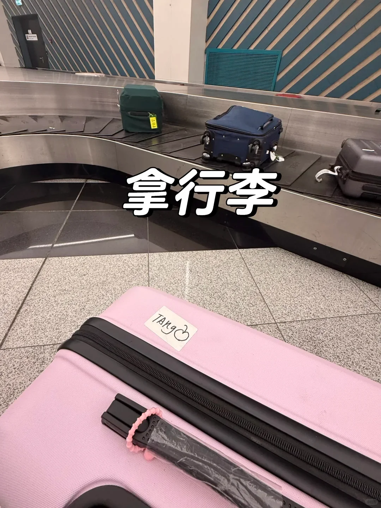

Z lotniska Szeremietiewo (SVO) do centrum miasta **autobus 1195 z przesiadką na linię 2 metra** to najprostszy sposób: **około godziny od początku do końca**, za około 540 rubli.

## Dlaczego warto wybrać autobus 1195

Przystanek autobusu lotniskowego obsługuje zarówno trasę 851, jak i 1195. **Trasa 1195 to „Экспресс-автобус / Shuttle bus”, jadący bez przystanków do stacji metra Chowrino (до М Ховрино)** — północnej pętli linii 2 — i odjeżdża ze stanowiska C1.

## Trasa krok po kroku

### 1. Przejdź odprawę celną i odbierz bagaże

Po odprawie celnej najpierw idź do taśmy bagażowej. **Szczyt przylotów przypada około 17:00**, gdy kolejka jest najdłuższa, więc jeśli się spieszysz, unikaj tego okna.

### 2. Skręć w prawo i znajdź wyjście

Z bagażem w ręku **skręć w prawo** i idź za znakami „Выход / Exit” do wyjścia z hali przylotów.

### 3. Znajdź stanowisko autobusowe C1

Na zewnątrz idź w stronę **stanowisk autobusowych** i szukaj filaru oznaczonego **C1**. Na znaku przystanku odliczany jest czas do najbliższego odjazdu trasy 1195.

### 4. Kup bilet u bileterki w czerwono-szarym mundurze

Bilety sprzedaje **bileterka w czerwono-szarym mundurze** stojąca na stanowisku, więc kupuj prosto u niej: **450 rubli za osobę, gotówka akceptowana**.

### 5. Wsiadaj: czerwony 1195

**Czerwony 1195** to autobus lotniskowy; na pokładzie jest półka na duży bagaż oraz ekran pokazujący trasę i przystanki.

### 6. Wysiądź na Chowrinie

Ostatni przystanek to **stacja metra Chowrino (Ховрино)**; po wyjściu po prostu idź za tłumem.

### 7. Kup bilet na metro i wsiądź w linię 2

W stacji są automaty biletowe, **90 rubli za przejazd jednorazowy**; dostępne są też bilety na 1 dzień, 3 dni i 30 dni. Automaty przyjmują **banknoty 500 rubli**.

Po przejściu przez bramki idź za znakami **linii 2** w dół; linia 2 to **ciemnozielona** linia Zamoskworiecka.

### 8. Jedź do centrum miasta

Linia 2 biegnie na południe od Chowrina przez stacje Biełorusskaja, Majakowskaja, Twierskaja i inne w centrum. Celem autora w tej podróży była stacja **Nowokuznieckaja**, z wyjściem numer 1.

> **Uważnie śledź nazwy stacji**: autor przejechał swój przystanek i stracił przez to czas. Odstępy między stacjami na linii 2 są krótkie, ale komunikaty są po rosyjsku, więc pilnuj bieżącej pozycji w telefonie.

Ze stacji wychodzisz prosto w centrum miasta.

## Koszt i czas

| Pozycja | Koszt | Czas |
| --- | --- | --- |
| Autobus lotniskowy, trasa 1195 | 450 rubli za osobę | około 20–30 minut do Chowrina |
| Metro, przejazd jednorazowy | 90 rubli | około 35 minut do centrum |
| **Razem** | **około 540 rubli** | **około 1 godziny** |

## Praktyczne wskazówki

- **Bagaż możesz zostawić w autobusie**, więc nie musisz trzymać dużej walizki na kolanach.
- **Miej przygotowany banknot 500 rubli**: pasuje do opłaty gotówką na stanowisku autobusowym i w automatach biletowych metra, a jest poręczniejszy niż duży nominał.
- Metro sprzedaje **bilety dzienne**; jeśli tego dnia będziesz jeździć kilka razy, bilet 1-dniowy wychodzi taniej.
- Taksówka lub aplikacja przewozowa jest oczywiście szybsza, ale kosztuje kilkakrotnie więcej i **grzęźnie w korkach w drodze do miasta w godzinach szczytu**.
