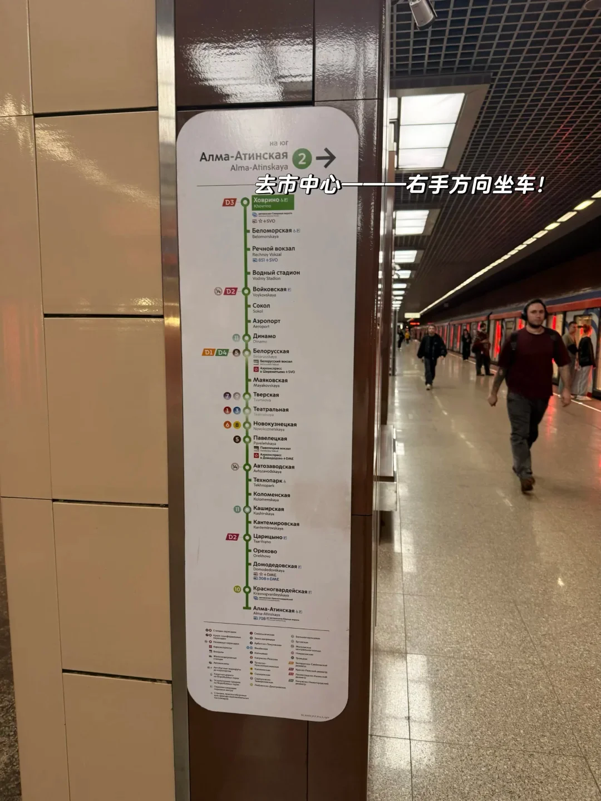

Do Aeroporto Sheremetyevo (SVO) ao centro, **o ônibus shuttle 1195 com troca para a Linha 2 do metrô** é a forma mais fácil de entrar: **cerca de uma hora de ponta a ponta**, por volta de 540 rublos.

## Por que pegar o ônibus 1195

A parada do ônibus aeroportuário atende tanto a rota 851 quanto a rota 1195. **A rota 1195 é o “Экспресс-автобус / Shuttle bus”, que vai sem paradas até a estação de metrô Khovrino (до М Ховрино / to Khovrino Metro Station)** — o terminal norte da Linha 2 — e parte da plataforma C1.

## A rota passo a passo

### 1. Passe pela alfândega e pegue suas malas

Depois da alfândega, vá primeiro à esteira de bagagem. **Por volta das 17h é o pico de chegadas**, quando a fila é mais longa, então evite essa janela se estiver com pressa.

### 2. Vire à direita e encontre a saída

Com as malas em mãos, **vire à direita** e siga as placas “Выход / Exit” para fora do saguão de chegadas.

### 3. Encontre a plataforma de ônibus C1

Lá fora, caminhe em direção às **plataformas de ônibus** e procure o pilar marcado **C1**. A placa da parada mostra uma contagem regressiva para a próxima partida da rota 1195.

### 4. Compre sua passagem com o fiscal de vermelho e cinza

O **fiscal de uniforme vermelho e cinza** na plataforma vende as passagens, então compre diretamente com ele: **450 rublos por pessoa, dinheiro aceito**.

### 5. Embarque: o 1195 vermelho

**O 1195 vermelho** é o shuttle do aeroporto; a bordo há um bagageiro para malas grandes e uma tela mostrando a rota e as paradas.

### 6. Desça em Khovrino

A última parada é a **estação de metrô Khovrino (Ховрино)**; ao descer, basta seguir a multidão.

### 7. Compre uma passagem de metrô e pegue a Linha 2

Há máquinas de bilhetes dentro da estação, **90 rublos por uma viagem avulsa**; também estão disponíveis passes de 1, 3 e 30 dias. As máquinas aceitam **notas de 500 rublos**.

Depois das catracas, siga as placas para a **Linha 2** no andar de baixo; a Linha 2 é a linha Zamoskvoretskaya, **verde-escura**.

### 8. Siga até o centro

A Linha 2 vai para o sul desde Khovrino, passando por Belorusskaya, Mayakovskaya, Tverskaya e outras estações centrais. O destino do autor nesta viagem era **Novokuznetskaya**, saindo pela saída 1.

> **Fique de olho nos nomes das estações**: o autor passou da própria parada e perdeu tempo. Os intervalos entre as estações da Linha 2 são curtos, mas os anúncios são em russo, então acompanhe sua posição ao vivo no celular.

Você sai da estação direto no centro da cidade.

## Custo e tempo

| Item | Custo | Tempo |
| --- | --- | --- |
| Shuttle aeroportuário da rota 1195 | 450 rublos por pessoa | cerca de 20–30 minutos até Khovrino |
| Metrô, viagem avulsa | 90 rublos | cerca de 35 minutos até o centro |
| **Total** | **cerca de 540 rublos** | **cerca de 1 hora** |

## Dicas práticas

- **Você pode deixar a bagagem no ônibus**, então não precisa segurar uma mala grande no colo.
- **Tenha uma nota de 500 rublos à mão**: ela serve para a tarifa em dinheiro na plataforma do ônibus e nas máquinas de bilhetes do metrô, e é mais prática que uma nota grande.
- O metrô vende **passes diários**; se você for andar várias vezes no mesmo dia, um passe de 1 dia sai mais barato.
- Um táxi ou aplicativo de transporte é claro mais rápido, mas custa várias vezes mais e **fica preso no trânsito na entrada da cidade nos horários de pico**.
