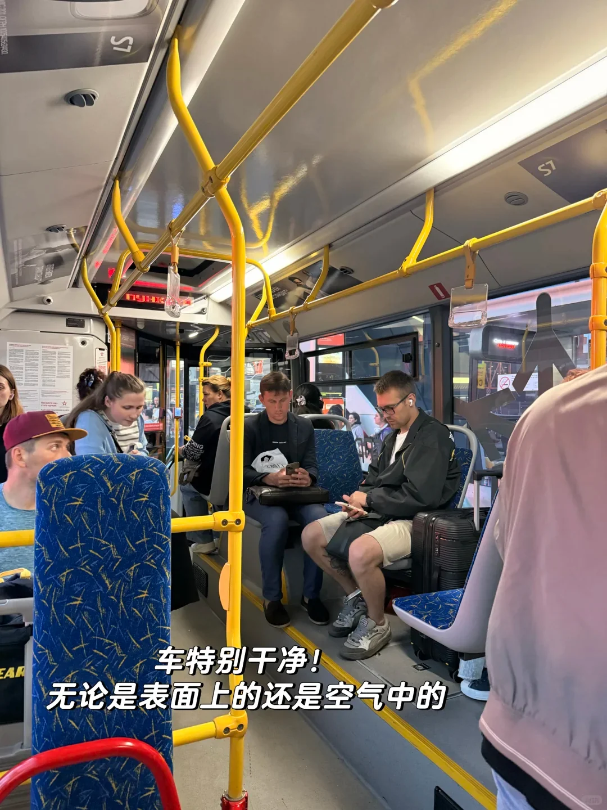

De la Aeroportul Șeremetievo (SVO) până în centrul orașului, **autobuzul navetă 1195 cu schimbarea pe linia 2 de metrou** este cea mai simplă variantă: **circa o oră din capăt în capăt**, pentru aproximativ 540 de ruble.

## De ce autobuzul 1195

Stația autobuzului de aeroport deservește atât ruta 851, cât și ruta 1195. **Ruta 1195 este „Экспресс-автобус / Shuttle bus", care merge fără opriri până la stația de metrou Khovrino (до М Ховрино / to Khovrino Metro Station)** — capătul nordic al liniei 2 — și pleacă de la peronul C1.

## Traseul pas cu pas

### 1. Treceți de vamă și ridicați-vă bagajele

După vamă, mergeți mai întâi la banda de bagaje. **În jurul orei 17:00 este vârful sosirilor**, când coada este cea mai lungă, așa că evitați acea fereastră dacă vă grăbiți.

### 2. Faceți la dreapta și găsiți ieșirea

Cu bagajele în mână, **faceți la dreapta** și urmați semnele „Выход / Exit" afară din sala de sosiri.

### 3. Găsiți peronul C1

Odată ieșit afară, mergeți spre **peroanele de autobuz** și căutați stâlpul marcat **C1**. Indicatorul stației arată o numărătoare inversă până la următoarea plecare a rutei 1195.

### 4. Cumpărați biletul de la controlorul în roșu și cenușiu

**Controlorul în uniforma roșu-cenușiu** de pe peron vinde biletele, așa că cumpărați direct de la ea: **450 de ruble de persoană, numerar acceptat**.

### 5. Îmbarcarea: autobuzul roșu 1195

**Autobuzul roșu 1195** este naveta de aeroport; la bord există un raft pentru bagaje mari și un ecran care arată ruta și stațiile.

### 6. Coborâți la Khovrino

Ultima stație este **stația de metrou Khovrino (Ховрино)**; odată coborât, urmați pur și simplu mulțimea.

### 7. Cumpărați biletul de metrou și luați linia 2

În stație există automate de bilete, **90 de ruble pentru o călătorie**; sunt disponibile și abonamente de 1 zi, 3 zile și 30 de zile. Automatele acceptă **bancnote de 500 de ruble**.

Odată trecut de porți, urmați semnele pentru **linia 2** în jos; linia 2 este linia Zamoskvoretskaya, **verde închis**.

### 8. Drumul în centrul orașului

Linia 2 merge spre sud de la Khovrino prin Belorusskaya, Mayakovskaya, Tverskaya și alte stații centrale. Destinația autorului în această călătorie a fost **Novokuznetskaya**, cu coborâre la ieșirea 1.

> **Urmăriți cu atenție numele stațiilor**: autorul a trecut de stația sa și a pierdut timp. Distanțele dintre stațiile liniei 2 sunt scurte, dar anunțurile sunt în rusă, așa că urmăriți-vă poziția în timp real pe telefon.

Ieșiți din stație direct în centrul orașului.

## Cost și timp

| Element | Cost | Timp |
| --- | --- | --- |
| Naveta de aeroport ruta 1195 | 450 de ruble de persoană | circa 20–30 de minute până la Khovrino |
| Metroul, o călătorie | 90 de ruble | circa 35 de minute până în centru |
| **Total** | **aproximativ 540 de ruble** | **aproximativ 1 oră** |

## Sfaturi practice

- **Puteți lăsa bagajele în autobuz**, așa că nu este nevoie să țineți o valiză mare în poală.
- **Pregătiți o bancnotă de 500 de ruble**: merge pentru tariful în numerar la peronul autobuzului și la automatele de bilete de metrou și este mai practică decât o bancnotă mare.
- Metroul vinde **abonamente pe zile**; dacă veți face mai multe călătorii în acea zi, un abonament de 1 zi iese mai ieftin.
- Un taxi sau o aplicație de transport partajat este desigur mai rapid, dar costă de câteva ori mai mult și **rămâne în trafic la intrarea în oraș la orele de vârf**.
