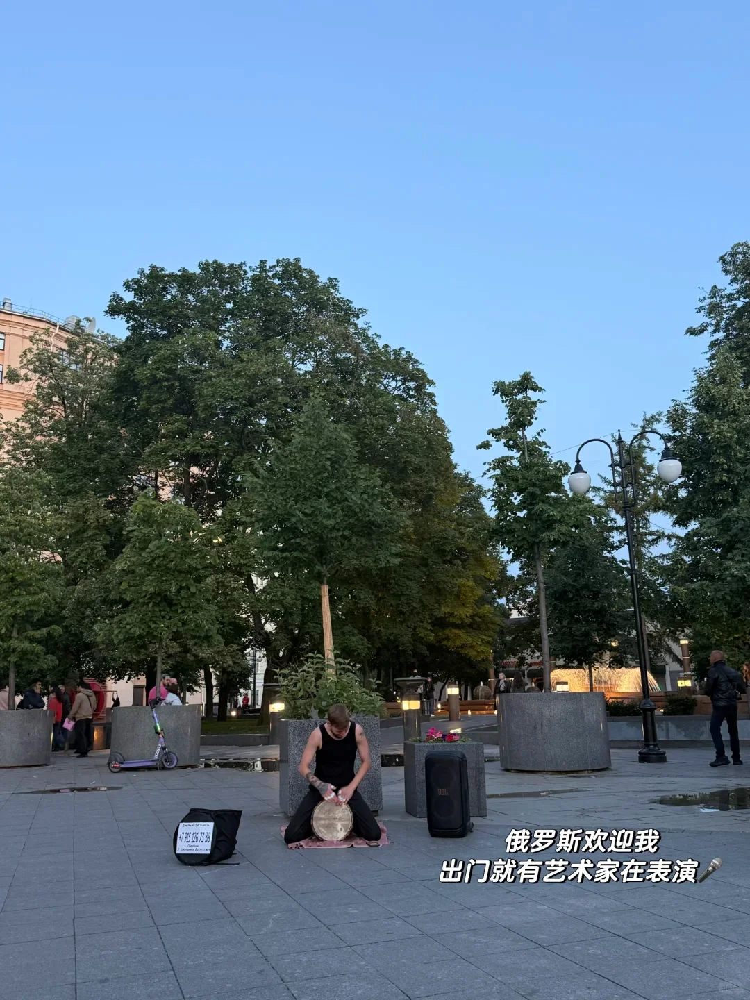

Из аэропорта Шереметьево (SVO) в центр Москвы **шаттл 1195 с пересадкой на линию 2 метро** — самый простой путь: **около часа от начала до конца**, примерно за 540 рублей.

## Почему стоит выбрать автобус 1195

Остановка аэропортовых автобусов обслуживает и маршрут 851, и маршрут 1195. **Маршрут 1195 — это «Экспресс-автобус / Shuttle bus», который идёт без остановок до станции метро Ховрино (до М Ховрино / to Khovrino Metro Station)** — северной конечной линии 2, — и отправляется от платформы C1.

## Маршрут по шагам

### 1. Пройдите таможню и получите багаж

После таможни сначала идите к багажной карусели. **Около 17:00 — пик прилётов**, когда очередь самая длинная, поэтому избегайте этого окна, если спешите.

### 2. Поверните направо и найдите выход

С багажом в руках **поверните направо** и идите по указателям «Выход / Exit» из зала прилёта.

### 3. Найдите автобусную платформу C1

Выйдя на улицу, идите к **автобусным платформам** и ищите столб с отметкой **C1**. На указателе остановки — обратный отсчёт до следующего отправления маршрута 1195.

### 4. Купите билет у сотрудника в красно-серой форме

**Сотрудник в красно-серой форме** на платформе продаёт билеты, поэтому покупайте прямо у него: **450 рублей с человека, наличные принимаются**.

### 5. Садитесь: красный 1195

**Красный 1195** — аэропортовый шаттл; в салоне есть полка для крупного багажа и экран со схемой маршрута и остановок.

### 6. Выходите на Ховрино

Последняя остановка — **станция метро Ховрино**; выйдя, просто идите за толпой.

### 7. Купите билет на метро и садитесь на линию 2

Внутри станции есть автоматы, **90 рублей за разовую поездку**; также доступны проездные на 1, 3 и 30 дней. Автоматы принимают **купюры 500 рублей**.

Пройдя турникеты, идите по указателям на **линию 2** вниз; линия 2 — **тёмно-зелёная** Замоскворецкая линия.

### 8. Доезжайте до центра

Линия 2 идёт на юг от Ховрино через Белорусскую, Маяковскую, Тверскую и другие центральные станции. В этой поездке автор направлялся на **Новокузнецкую**, выходя через выход 1.

> **Внимательно следите за названиями станций**: автор проехал свою остановку и потерял время. Промежутки между станциями на линии 2 короткие, но объявления на русском, поэтому следите за своим положением на телефоне.

Вы выходите со станции прямо в центр города.

## Стоимость и время

| Пункт | Стоимость | Время |
| --- | --- | --- |
| Аэропортовый шаттл 1195 | 450 рублей с человека | около 20–30 минут до Ховрино |
| Метро, разовая поездка | 90 рублей | около 35 минут до центра |
| **Итого** | **около 540 рублей** | **около 1 часа** |

## Практические советы

- **Багаж можно оставить в автобусе**, так что большой чемодан не придётся держать на коленях.
- **Держите наготове купюру 500 рублей**: она подходит для оплаты наличными на автобусной платформе и в автоматах метро, и она удобнее крупной купюры.
- В метро продаются **проездные на день**; если в этот день вы будете ездить несколько раз, проездной на 1 день выйдет дешевле.
- Такси или приложение райдшеринга, конечно, быстрее, но стоят в несколько раз дороже и **застревают в пробках на пути в центр в часы пик**.
