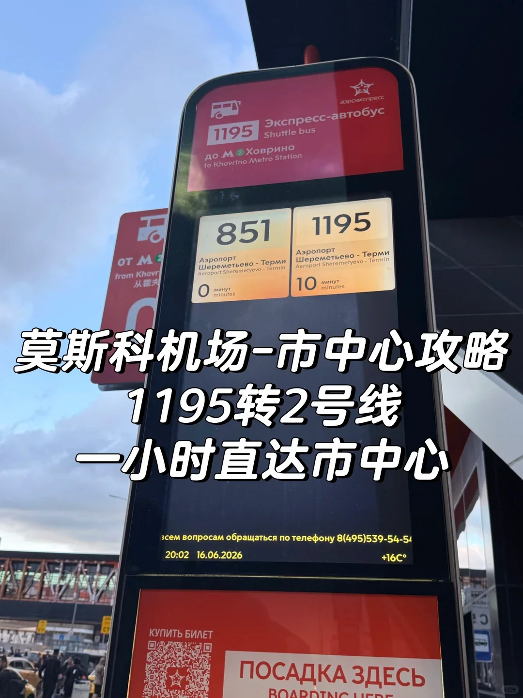

Från Sjeremetjevo flygplats (SVO) till centrala staden är **transferbuss 1195 med byte till tunnelbanans linje 2** det enklaste sättet in: **ungefär en timme från dörr till dörr**, för runt 540 rubel.

## Varför ta buss 1195

Flygbusshållplatsen trafikeras av både linje 851 och linje 1195. **Linje 1195 är "Экспресс-автобус / Shuttle bus", som går utan stopp till tunnelbanestationen Khovrino (до М Ховрино / to Khovrino Metro Station)** – linje 2:s norra ändstation – och den avgår från plattform C1.

## Vägen steg för steg

### 1. Gå igenom tullen och hämta ditt bagage

Efter tullen går du först till bagagebandet. **Runt klockan 17 är det ankomsttopp**, då kön är längst, så undvik det fönstret om du har bråttom.

### 2. Sväng höger och hitta utgången

Med väskorna i hand, **sväng höger** och följ skyltarna "Выход / Exit" ut ur ankomsthallen.

### 3. Hitta bussplattform C1

När du är utomhus, gå mot **bussplattformarna** och leta efter pelaren märkt **C1**. Hållplatskylten visar en nedräkning till nästa avgång för linje 1195.

### 4. Köp biljetten av kontrollanten i rött och grått

**Kontrollanten i den rödgrå uniformen** på plattformen säljer biljetterna, så köp direkt av henne: **450 rubel per person, kontanter accepteras**.

### 5. Gå ombord: den röda 1195

**Den röda 1195** är flygplatsens transferbuss; ombord finns en hylla för stort bagage och en skärm som visar rutten och hållplatserna.

### 6. Gå av vid Khovrino

Sista hållplatsen är **tunnelbanestationen Khovrino (Ховрино)**; när du har gått av är det bara att följa folkmassan.

### 7. Köp en tunnelbanebiljett och ta linje 2

Det finns biljettautomater inne på stationen, **90 rubel för en enkel resa**; 1-dagars-, 3-dagars- och 30-dagarskort finns också. Automaterna tar **500-rubelsedlar**.

När du har gått genom spärrarna följer du skyltarna för **linje 2** nedåt; linje 2 är den **mörkgröna** Zamoskvoretskaja-linjen.

### 8. Åk in till centrala staden

Linje 2 går söderut från Khovrino genom Belorusskaja, Majakovskaja, Tverskaja och andra centrala stationer. Författarens destination den här resan var **Novokuznetskaja**, och hen lämnade stationen genom utgång 1.

> **Håll noga koll på stationsnamnen**: författaren åkte förbi sin hållplats och förlorade tid. Avstånden mellan stationerna på linje 2 är korta, men utropen är på ryska, så håll ett öga på din aktuella position i telefonen.

Du kommer ut från stationen rakt in i centrala staden.

## Kostnad och tid

| Post | Kostnad | Tid |
| --- | --- | --- |
| Flygbuss linje 1195 | 450 rubel per person | cirka 20–30 minuter till Khovrino |
| Tunnelbana, enkel resa | 90 rubel | cirka 35 minuter till centrum |
| **Totalt** | **cirka 540 rubel** | **cirka 1 timme** |

## Praktiska tips

- **Du kan lämna bagaget på bussen**, så du behöver inte hålla en stor väska i knät.
- **Ha en 500-rubelsedel redo**: den fungerar för kontantbiljetten vid bussplattformen och i tunnelbanans biljettautomater, och den är smidigare än en stor sedel.
- Tunnelbanan säljer **dagskort**; om du ska åka flera gånger samma dag blir ett 1-dagarskort billigare.
- En taxi eller en app för beställning av skjuts är förstås snabbare, men den kostar flera gånger så mycket och **fastnar i trafiken på väg in till staden vid rusningstid**.
