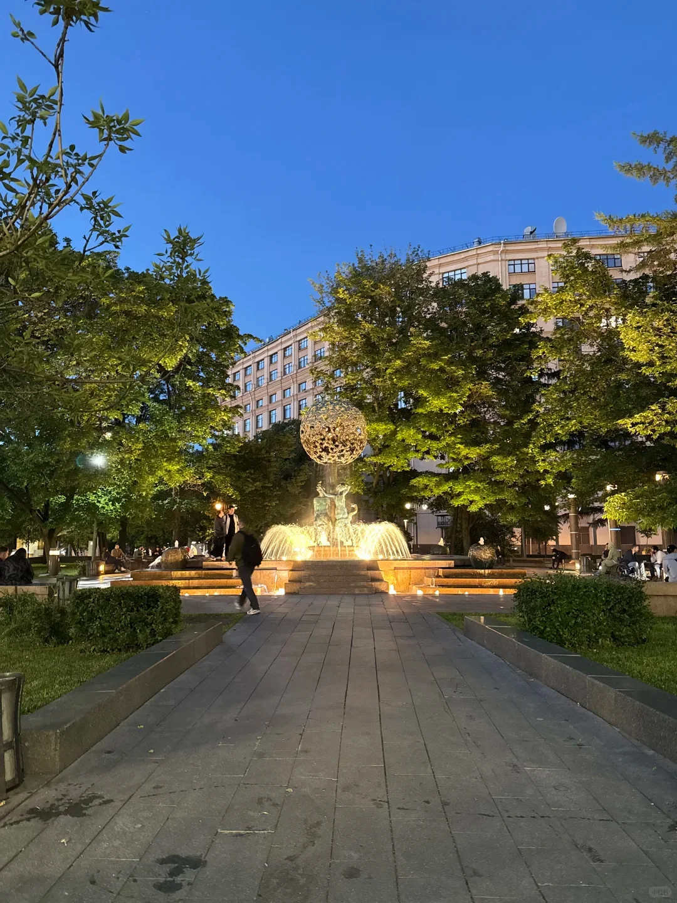

จากสนามบินเชเรเมเยโว (SVO) เข้าศูนย์กลางเมือง **รถรับส่ง 1195 แล้วเปลี่ยนเป็นรถไฟใต้ดินสาย 2** เป็นวิธีที่ง่ายที่สุด: **ประมาณหนึ่งชั่วโมงจากต้นทางถึงปลายทาง** ในราคาประมาณ 540 รูเบิล

## ทำไมต้องนั่งรถบัส 1195

ป้ายรถบัสสนามบินให้บริการทั้งสาย 851 และสาย 1195 **สาย 1195 เป็น «Экспресс-автобус / Shuttle bus» ที่วิ่งตรงไม่จอดถึงสถานีรถไฟใต้ดินคอฟรีโน (до М Ховрино / to Khovrino Metro Station)** ซึ่งเป็นสถานีปลายทางด้านเหนือของสาย 2 และออกจากชานชาลา C1

## เส้นทางทีละขั้นตอน

### 1. ผ่านศุลกากรและรับกระเป๋า

หลังศุลกากร ให้มุ่งไปที่สายพานรับกระเป๋าก่อน **ประมาณ 17:00 เป็นช่วงพีคของขาเข้า** ซึ่งคิวยาวที่สุด ดังนั้นเลี่ยงช่วงนั้นหากคุณรีบ

### 2. เลี้ยวขวาและหาทางออก

เมื่อได้กระเป๋าแล้ว **เลี้ยวขวา** และตามป้าย «Выход / Exit» ออกจากโถงขาเข้า

### 3. หาชานชาลารถบัส C1

เมื่อออกไปข้างนอก ให้เดินไปทาง **ชานชาลารถบัส** และมองหาเสาที่มีป้าย **C1** ป้ายจอดแสดงเวลานับถอยหลังถึงเที่ยวถัดไปของสาย 1195

### 4. ซื้อตั๋วจากพนักงานในชุดแดง-เทา

**พนักงานในเครื่องแบบแดง-เทา**บนชานชาลาขายตั๋ว ให้ซื้อจากเธอโดยตรง: **450 รูเบิลต่อคน รับเงินสด**

### 5. ขึ้นรถ: สาย 1195 สีแดง

**รถ 1195 สีแดง** คือรถรับส่งสนามบิน บนรถมีชั้นวางสำหรับกระเป๋าใบใหญ่และจอแสดงเส้นทางและป้ายจอด

### 6. ลงที่คอฟรีโน

ป้ายสุดท้ายคือ **สถานีรถไฟใต้ดินคอฟรีโน (Ховрино)** เมื่อลงแล้วก็ตามฝูงชนไปได้เลย

### 7. ซื้อตั๋วรถไฟใต้ดินและขึ้นสาย 2

มีเครื่องขายตั๋วในสถานี **90 รูเบิลต่อเที่ยว** และมีตั๋ว 1 วัน 3 วัน และ 30 วันด้วย เครื่องรับ **ธนบัตร 500 รูเบิล**

เมื่อผ่านประตูแล้ว ให้ตามป้าย **สาย 2** ลงไปชั้นล่าง สาย 2 คือสายซาโมสควอเรตสกายา **สีเขียวเข้ม**

### 8. นั่งเข้าสู่ใจกลางเมือง

สาย 2 วิ่งลงใต้จากคอฟรีโนผ่านเบโลรุสสกายา มายาคอฟสกายา ตเวอร์สกายา และสถานีใจกลางอื่น ๆ จุดหมายของผู้เขียนในทริปนี้คือ **โนโวกุซเนตสกายา** โดยออกทางออก 1

> **จับตาชื่อสถานีให้ดี**: ผู้เขียนนั่งเลยป้ายและเสียเวลา ช่วงห่างระหว่างสถานีบนสาย 2 สั้น แต่ประกาศเป็นภาษารัสเซีย ดังนั้นคอยดูตำแหน่งสดบนโทรศัพท์

เมื่อออกจากสถานีคุณจะเข้าสู่ใจกลางเมืองทันที

## ค่าใช้จ่ายและเวลา

| รายการ | ค่าใช้จ่าย | เวลา |
| --- | --- | --- |
| รถรับส่งสนามบินสาย 1195 | 450 รูเบิลต่อคน | ประมาณ 20–30 นาทีถึงคอฟรีโน |
| รถไฟใต้ดิน เที่ยวเดียว | 90 รูเบิล | ประมาณ 35 นาทีถึงใจกลางเมือง |
| **รวม** | **ประมาณ 540 รูเบิล** | **ประมาณ 1 ชั่วโมง** |

## เคล็ดลับที่เป็นประโยชน์

- **ฝากกระเป๋าไว้บนรถได้** จึงไม่ต้องถือกระเป๋าใบใหญ่ไว้บนตัก
- **เตรียมธนบัตร 500 รูเบิลไว้**: ใช้จ่ายค่าโดยสารเงินสดที่ชานชาลารถบัสและที่เครื่องขายตั๋วรถไฟใต้ดิน สะดวกกว่าธนบัตรใบใหญ่
- รถไฟใต้ดินขาย **ตั๋วรายวัน** หากคุณจะเดินทางหลายเที่ยวในวันนั้น ตั๋ว 1 วันคุ้มกว่า
- แท็กซี่หรือแอปเรียกรถเร็วกว่าแน่นอน แต่มีราคาแพงกว่าหลายเท่าและ **ติดการจราจรขาเข้าเมืองในช่วงพีค**
