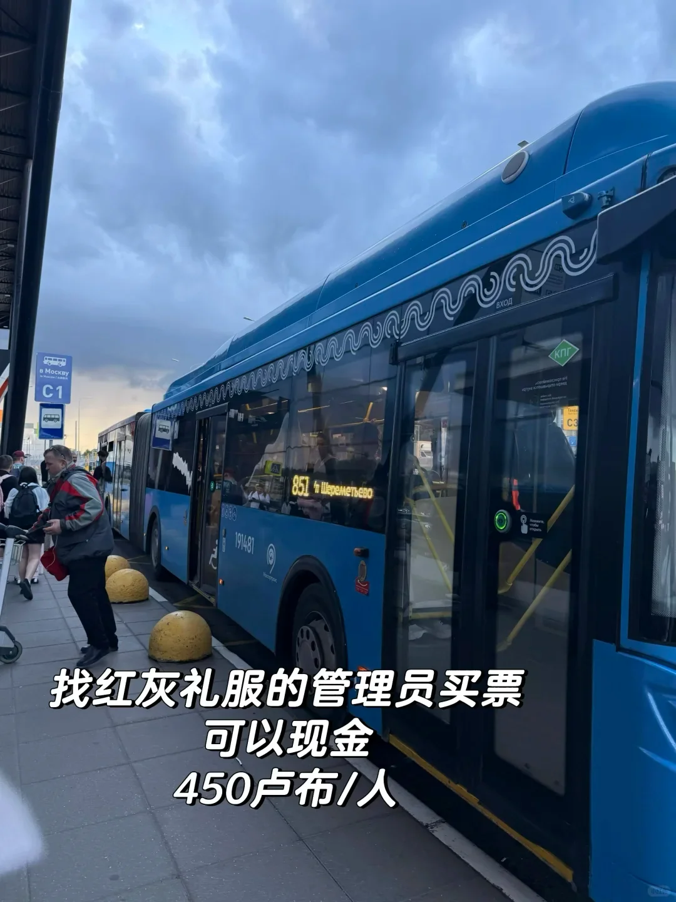
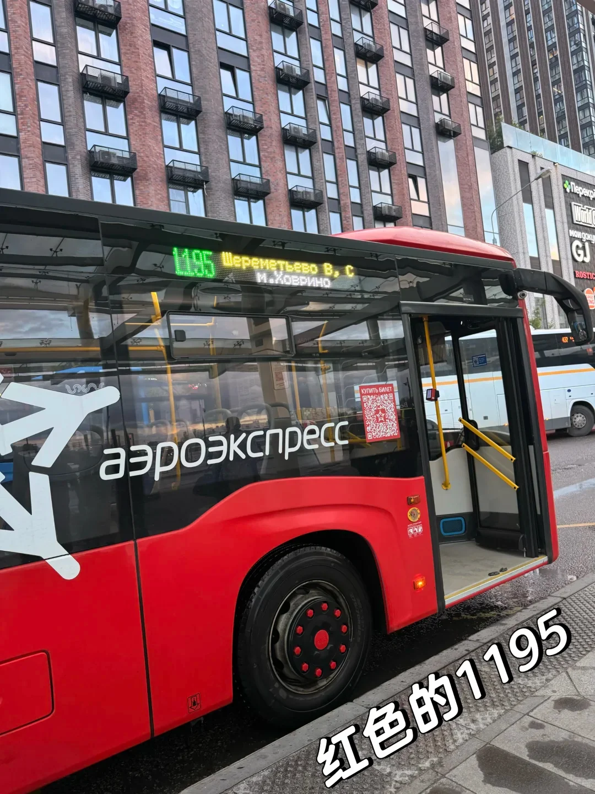
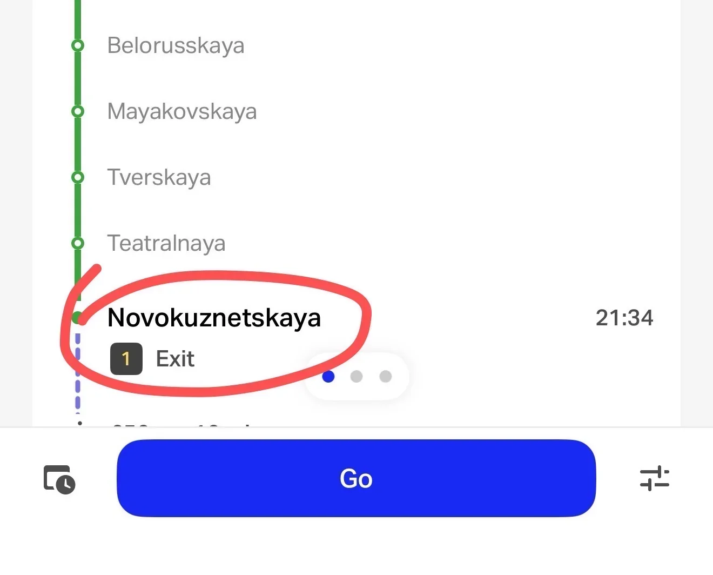
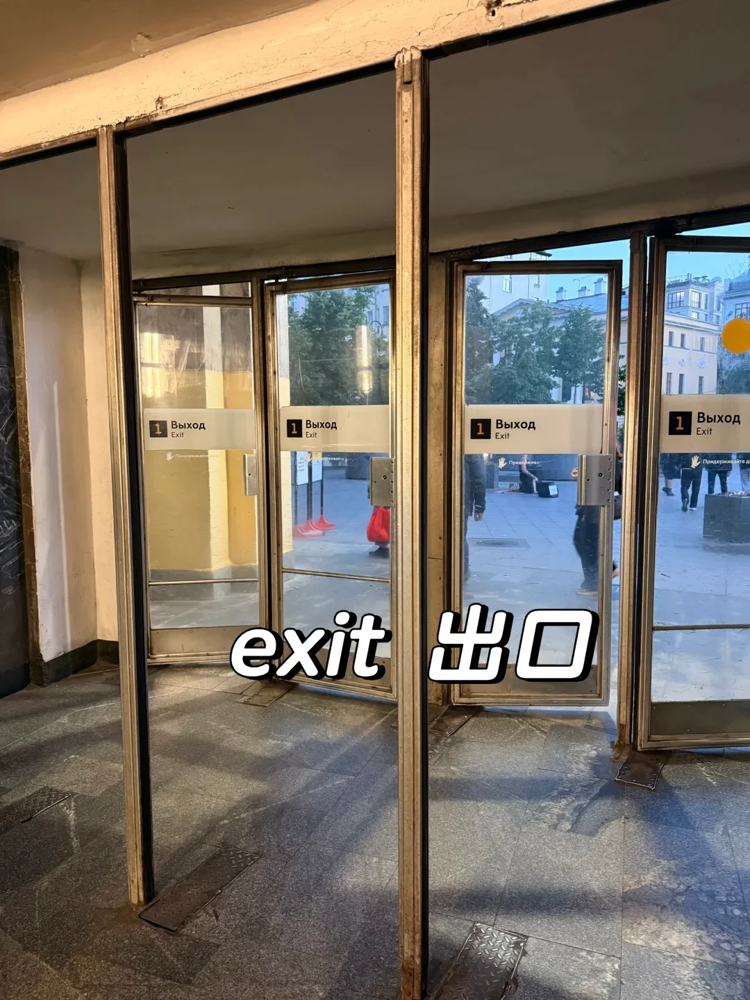

Şeremetyevo Havalimanı'ndan (SVO) şehir merkezine **1195 numaralı servis otobüsü ve 2. metro hattına aktarma** en kolay yol: **kapıdan kapıya yaklaşık bir saat**, yaklaşık 540 ruble.

## Neden 1195 numaralı otobüs

Havalimanı otobüs durağı hem 851 hem de 1195 numaralı hatta hizmet veriyor. **1195 numaralı hat “Экспресс-автобус / Shuttle bus”**, Khovrino metro istasyonuna (до М Ховрино / Khovrino Metro İstasyonu'na) ara vermeden gidiyor — 2. hattın kuzey son durağı — ve C1 peronundan kalkıyor.

## Güzergâh adım adım

### 1. Gümrükten geçin ve bagajınızı alın

Gümrükten sonra önce bagaj bandına gidin. **Saat 17.00 civarı varışların zirvesi**, kuyruk en uzun o zaman; aceleniz varsa o saatten kaçının.

### 2. Sağa dönün ve çıkışı bulun

Bagajınızla **sağa dönün** ve “Выход / Exit” tabelalarını izleyerek varış salonundan çıkın.

### 3. C1 otobüs peronunu bulun

Dışarı çıkınca **otobüs peronlarına** doğru yürüyün ve **C1** yazan sütunu arayın. Durak tabelası 1195 numaralı hattın bir sonraki kalkışına geri sayım gösteriyor.

### 4. Biletinizi kırmızı-gri üniformalı görevliden alın

Perondaki **kırmızı-gri üniformalı görevli** biletleri satıyor, doğrudan ondan alın: **kişi başı 450 ruble, nakit kabul ediliyor**.

### 5. Binin: kırmızı 1195

**Kırmızı 1195** havalimanı servis otobüsü; araçta büyük bagajlar için raf ve güzergâh ile durakları gösteren bir ekran var.

### 6. Khovrino'da inin

Son durak **Khovrino (Ховрино) metro istasyonu**; indikten sonra kalabalığı izleyin.

### 7. Metro bileti alın ve 2. hatta binin

İstasyon içinde bilet makineleri var, **tek biniş 90 ruble**; 1 günlük, 3 günlük ve 30 günlük kartlar da mevcut. Makineler **500 rublelik banknot** kabul ediyor.

Turnikelerden geçtikten sonra aşağıdaki **2. hat** tabelalarını izleyin; 2. hat **koyu yeşil** Zamoskvoretskaya hattı.

### 8. Şehir merkezine gidin

İkinci hat Khovrino'dan güneye, Belorusskaya, Mayakovskaya, Tverskaya ve diğer merkez istasyonlarından geçiyor. Yazarın bu yolculuktaki hedefi **Novokuznetskaya** idi ve 1 numaralı çıkıştan çıktı.

> **İstasyon adlarını dikkatle izleyin**: yazar durağını kaçırdı ve zaman kaybetti. 2. hatta istasyonlar arası kısa, ama anonslar Rusça, o yüzden telefonunuzdan canlı konumunuzu takip edin.

İstasyondan çıktığınızda doğrudan şehir merkezindesiniz.

## Maliyet ve süre

| Kalem | Maliyet | Süre |
| --- | --- | --- |
| 1195 numaralı havalimanı servis otobüsü | Kişi başı 450 ruble | Khovrino'ya yaklaşık 20–30 dakika |
| Metro, tek biniş | 90 ruble | Merkeze yaklaşık 35 dakika |
| **Toplam** | **yaklaşık 540 ruble** | **yaklaşık 1 saat** |

## Pratik ipuçları

- **Bagajınızı otobüste bırakabilirsiniz**, büyük valizi kucağınızda tutmanıza gerek yok.
- **500 rublelik bir banknot hazır olsun**: otobüs peronundaki nakit ücret ve metro bilet makineleri için geçerli, büyük banknottan daha kullanışlı.
- Metro **günlük kart** satıyor; o gün birkaç kez binecekseniz 1 günlük kart daha ucuza geliyor.
- Taksi veya yolculuk paylaşım uygulaması elbette daha hızlı, ama birkaç kat pahalı ve **şehre girişte yoğun saatlerde trafikte kalıyor**.
