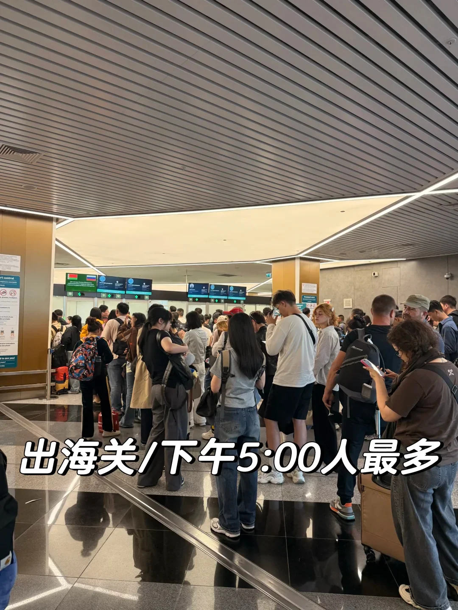

Từ Sân bay Sheremetyevo (SVO) vào trung tâm thành phố, **xe buýt trung chuyển 1195 rồi đổi sang tàu điện ngầm tuyến 2** là cách vào thành phố dễ nhất: **khoảng một giờ từ đầu đến cuối**, với khoảng 540 rúp.

## Vì sao nên đi xe buýt 1195

Điểm dừng xe buýt sân bay phục vụ cả tuyến 851 và tuyến 1195. **Tuyến 1195 là “Экспресс-автобус / Shuttle bus”, chạy không dừng đến ga tàu điện ngầm Khovrino (до М Ховрино / to Khovrino Metro Station)** — ga cuối phía bắc của tuyến 2 — và khởi hành từ bến C1.

## Lộ trình từng bước

### 1. Qua hải quan và nhận hành lý

Sau hải quan, hãy đến băng tải hành lý trước. **Khoảng 5 giờ chiều là cao điểm hành khách đến**, khi hàng chờ dài nhất, nên tránh khung giờ đó nếu bạn đang vội.

### 2. Rẽ phải và tìm lối ra

Với hành lý trong tay, hãy **rẽ phải** và đi theo biển “Выход / Exit” ra khỏi sảnh đến.

### 3. Tìm bến xe buýt C1

Ra ngoài, hãy đi về phía **các bến xe buýt** và tìm cột ghi **C1**. Biển điểm dừng hiển thị đếm ngược đến chuyến tiếp theo của tuyến 1195.

### 4. Mua vé từ nhân viên điều hành mặc đồ đỏ xám

**Nhân viên điều hành mặc đồng phục đỏ xám** trên bến bán vé, nên hãy mua trực tiếp từ cô ấy: **450 rúp mỗi người, nhận tiền mặt**.

### 5. Lên xe: chiếc 1195 màu đỏ

**Chiếc 1195 màu đỏ** là xe buýt sân bay; trên xe có giá để hành lý lớn và màn hình hiển thị lộ trình cùng các điểm dừng.

### 6. Xuống tại Khovrino

Bến cuối là **ga tàu điện ngầm Khovrino (Ховрино)**; xuống xe rồi cứ đi theo đám đông.

### 7. Mua vé tàu điện ngầm và đi tuyến 2

Có máy bán vé bên trong ga, **90 rúp cho một lượt**; vé 1 ngày, 3 ngày và 30 ngày cũng có. Máy nhận **tiền giấy 500 rúp**.

Qua cổng soát vé, hãy đi theo biển chỉ dẫn **tuyến 2** xuống dưới; tuyến 2 là tuyến Zamoskvoretskaya **màu xanh lá đậm**.

### 8. Đi vào trung tâm thành phố

Tuyến 2 chạy về phía nam từ Khovrino qua Belorusskaya, Mayakovskaya, Tverskaya và các ga trung tâm khác. Điểm đến của tác giả trong chuyến này là **Novokuznetskaya**, ra bằng lối 1.

> **Theo dõi tên ga thật kỹ**: tác giả đã đi quá bến và mất thời gian. Khoảng cách giữa các ga trên tuyến 2 ngắn, nhưng thông báo bằng tiếng Nga, nên hãy để mắt đến vị trí trực tiếp trên điện thoại.

Bạn ra khỏi ga là đã ở ngay trung tâm thành phố.

## Chi phí và thời gian

| Hạng mục | Chi phí | Thời gian |
| --- | --- | --- |
| Xe buýt sân bay tuyến 1195 | 450 rúp mỗi người | khoảng 20–30 phút đến Khovrino |
| Tàu điện ngầm, một lượt | 90 rúp | khoảng 35 phút đến trung tâm |
| **Tổng** | **khoảng 540 rúp** | **khoảng 1 giờ** |

## Mẹo thực tế

- **Bạn có thể để hành lý trên xe buýt**, nên không cần ôm vali lớn trên đùi.
- **Hãy chuẩn bị sẵn tờ 500 rúp**: tờ này dùng được cho vé tiền mặt tại bến xe buýt và tại máy bán vé tàu điện ngầm, tiện hơn tiền mệnh giá lớn.
- Tàu điện ngầm bán **vé ngày**; nếu trong ngày bạn đi lại nhiều lần, vé 1 ngày sẽ rẻ hơn.
- Taxi hoặc ứng dụng gọi xe tất nhiên nhanh hơn, nhưng tốn gấp nhiều lần và **bị kẹt xe trên đường vào trung tâm vào giờ cao điểm**.
