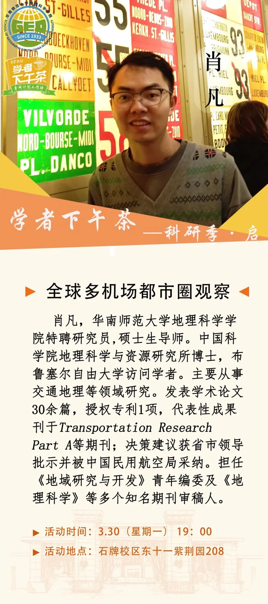

Dne 26. března zveřejnila Geografická fakulta Jihočínské normální univerzity oznámení o dalším díle cyklu „odpolední čaj vědců“: 30. března měl výzkumný pracovník fakulty Xiao Fan promluvit o „pozorování světových metropolitních regionů s více letišti“. Impulsem byla nová letiště plánovaná pro Kanton a Nan-tchung, a to v kontextu úsilí patnáctého pětiletého plánu o moderní komplexní dopravní systém.

Přednáška na akademické půdě, ale rozhodně ne akademická otázka: jaký má být vztah dvou nebo tří velkých letišť, která metropolitní region už má? Má se každé z nich rozšiřovat a honit stejné linky, nebo si rozdělit role tak, jak to dělají Londýn, New York a Tokio? Shrnutí dochází k závěru, že jedno letiště už rostoucí poptávku neunese a koordinace více letišť je nevyhnutelná; tvrdý oříšek je vyhnout se homogenní konkurenci v jádrovém regionu, jakým je Velká zátoka.

## Proč velké metropolitní oblasti stavějí druhá a třetí letiště

Poptávka po letecké dopravě a metropolitní oblast se chovají jako linka metra a její město: lidé i průmysl linku následují a jakmile se u ní shromáždí, linka už nestačí. Letiště se rozšiřují obtížněji: ranveje a terminály zabírají rozsáhlé pozemky, hluk se nese deset kilometrů a vzdušný prostor je ještě vzácnější. Když se ranveje, terminály a sloty blíží svým limitům, musí přebytečná poptávka na druhé letiště.

Většina velkých metropolitních regionů se touto cestou vydala. Londýn má Heathrow, Gatwick, Stansted a další letiště; New York JFK, Newark a LaGuardii; Tokio Hanedu a Naritu; Paříž Charlese de Gaulla, Orly a Beauvais; Šanghaj Pudong a Chung-čchiao; Peking vstoupil do éry dvou letišť, když v roce 2019 otevřel Ta-sing.

Patnáctý pětiletý plán řadí moderní komplexní dopravní systém mezi své priority. Pro Kanton a Nan-tchung je nové letiště zároveň projektem kapacity i prostorovou strategií: může posunout letecké služby novým směrem a založit pás letištního průmyslu. Kapacita je ta snadná část; funkcí je ta obtížná — to, čím je druhé letiště pro první, rozhoduje o tom, zda bude fungovat.

## Čtyři způsoby, jak si rozdělit role

Nepřítelem systému více letišť není konkurence, ale homogenita. Pokud každé letiště honí stejné dálkové linky a transferové cestující, výsledkem jsou duplikované investice a vzájemné podbízení. Vyspělé trhy si role dělí čtyřmi způsoby.

Mezinárodní versus vnitrostátní: Haneda tíhne k vnitrostátní a krátké přepravě, Narita k dálkové; Pudong k dálkové mezinárodní, Chung-čchiao k vnitrostátní a obchodní. Osobní versus nákladní: Hongkong dlouho vede ve světovém žebříčku nákladní dopravy, Šen-čen nese velký podíl nákladu, Macao obsluhuje regionální a nízkonákladovou přepravu. Plný servis versus nízkonákladovost: Heathrow je dálkovým uzlem s plným servisem, Stansted a Luton jsou nízkonákladové, London City se věnuje obchodní klientele; Charles de Gaulle je mezinárodním uzlem, Beauvais nízkonákladovým letištěm. Uzel versus doplněk: JFK přebírá dálkovou mezinárodní dopravu, Newark míchá mezinárodní a vnitrostátní, LaGuardia je vnitrostátní obchodní letiště.

Tato rozdělení nevznikla v kanceláři. Vyvinula se ze základen aerolinek, slotů, pozemní dopravy, přepravních práv a volby cestujících; vlády mohou připravit podmínky, ale nemohou trhu nařídit, které letiště kam létá.

## Velká zátoka: tři velká letiště a problém homogenity

Zpět k Velké zátoce: Hongkong, Kanton a Šen-čen spolu s Macaem a Ču-chají leží do 200 km od sebe. Každý jádrový uzel má své domovské dopravce a zázemí: Hongkong obsluhuje mezinárodní transfery a přepravu s vysokou hodnotou, kantonské letiště Paj-jün je komplexní branou jižní Číny, šenčenské letiště Pao-an čerpá z průmyslu na východním břehu Perlové řeky.

Jejich ambice se silně překrývají. Dálkové mezinárodní linky jsou společnou prioritou, náklad společnou růstovou oblastí, transferoví cestující společnou kořistí. Pokud chce být každé letiště „mezinárodním leteckým uzlem“, zdroje se rozředí: dálkové linky, které nikdo nedokáže naplnit, nákladní zařízení postavená dvakrát. Shrnutí přednášky to označuje za potřebu „vyhnout se homogenní konkurenci a dosáhnout diferencovaného postavení“.

Veřejné dokumenty ukazují, že plány letištních klastrů pro Velkou zátoku problém dlouho znají; „diferencované postavení“ je opakující se formulace. Realizace je ale těžší: vzdušný prostor je třeba koordinovat, pozemní spojení propojit, celní režimy sladit, dotace na linky držet na uzdě. Plánované nové letiště v Kantonu je další proměnnou. Očekává se, že uleví Paj-jünu; pokud bude létat stejné linky a honit stejné cestující, dividendu z kapacity pohltí vnitřní konkurence.

## Mezinárodní zkušenost: jak si pět metropolitních oblastí dělí práci

| Metropolitní oblast | Hlavní letiště | Rozdělení rolí |
| --- | --- | --- |
| Londýn | Heathrow (LHR), Gatwick (LGW), Stansted (STN), Luton (LTN), London City (LCY) | Heathrow je dálkovým uzlem s plným servisem; Gatwick přebírá rekreační a dálkovou přepravu; Stansted a Luton jsou nízkonákladové; London City se věnuje obchodní klientele |
| New York | JFK, Newark (EWR), LaGuardia (LGA) | JFK pro dálkovou mezinárodní přepravu; Newark míchá mezinárodní a vnitrostátní; LaGuardia pro vnitrostátní obchodní přepravu |
| Tokio | Haneda (HND), Narita (NRT) | Haneda tíhne k vnitrostátní a krátké mezinárodní přepravě; Narita k dálkové a nízkonákladové |
| Paříž | Charles de Gaulle (CDG), Orly (ORY), Beauvais (BVA) | Charles de Gaulle je mezinárodním uzlem; Orly obsluhuje vnitrostátní a frankofonní trhy; Beauvais je nízkonákladové |
| Šanghaj | Pudong (PVG), Chung-čchiao (SHA) | Pudong pro dálkovou mezinárodní přepravu a náklad; Chung-čchiao pro vnitrostátní a obchodní přepravu |

Z toho plynou tři lekce. Za prvé, druhé letiště je především nástrojem kapacity: o třetí ranveji Heathrow se mluví desítky let, aniž by vznikla, a růst místo toho šel do Gatwicku a Stanstedu. Za druhé, role se vyvíjejí na trhu; plánování může vést, ale nemůže nahradit aerolinky a cestující. Za třetí, pozemní doprava rozhoduje o tom, zda druhé letiště obstojí v konkurenci: pokud cesta z centra města trvá déle než let, je to „jiné letiště“, ne součást „stejného systému“.

## Co se mohou Kanton, Nan-tchung a patnáctý pětiletý plán naučit

Nové letiště v Nan-tchungu je vymezeno jako součást šanghajského mezinárodního leteckého uzlu, často nazývaného šanghajské „třetí letiště“. Jeho smyslem není jen ulevit Pudongu, ale nést letecké služby severně od Jang-c'-ťiang a vytvořit se Šanghají dělbu práce napříč řekou. Veřejné informace naznačují, že železniční spojení začleňuje Nan-tchung do šanghajského hodinového okruhu — což je předpoklad pro zapojení do šanghajského letištního systému.

V případě Kantonu nejde o další terminál, ale o tři odpovědi: komu slouží, kam létá a jak si dělí práci s Paj-jünem. Pokud převezme vnitrostátní, regionální a nízkonákladovou přepravu a dálkovou mezinárodní přepravu nechá Paj-jünu, obě letiště se doplňují; pokud chce být také mezinárodním uzlem, potřebuje jasnější rozdělení linek a silnější pozemní spojení, jinak se stane letištěm, které se snaží dělat všechno.

Pro patnáctý pětiletý plán ukazují Kanton a Nan-tchung stejnou lekci: nejprve vymezit funkci a potom kapacitu, nejprve propojit pozemní dopravu a potom linkovou síť, nejprve vybudovat koordinaci mezi městy a potom se hádat o to, kdo dělá mezinárodní, vnitrostátní a nákladní přepravu. Metropolitní region s více letišti není soutěží v počtu letišť, ale testem koordinace vzdušného prostoru, půdy, slotů a průmyslového uspořádání.

Přednáška doporučuje tři knihy: Geographical Review (sv. 9), Hospodářská geografie severovýchodní Číny a Ekonomie umístění.

„Odpolední čaj vědců“ spíš než odpověď přinese lepší otázku: když jsou druhé a třetí letiště na plánovací mapě, je město připraveno dát jim odlišné role?

## Související odkazy

- **Na tomto webu**: [Kanton Paj-jün (CAN)](/airport/CAN), [Šanghaj Pudong (PVG)](/airport/PVG), [Heathrow (LHR)](/airport/LHR), [JFK](/airport/JFK), [Haneda (HND)](/airport/HND), [Čína (CN)](/country/CN), [Spojené království (GB)](/country/GB)
- **Wikipedia**: [Delta Perlové řeky](https://en.wikipedia.org/wiki/Pearl_River_Delta), [Metropolitní oblast](https://en.wikipedia.org/wiki/Metropolitan_area)
- **Baidu Baike**: [Velká zátoka (粤港澳大湾区)](https://baike.baidu.com/item/%E7%B2%A4%E6%B8%AF%E6%BE%B3%E5%A4%A7%E6%B9%BE%E5%8C%BA)

Zdroj obrázků: Geografická fakulta Jihočínské normální univerzity. Podrobnosti přednášky jsou uvedeny tak, jak je zveřejnili organizátoři; informace o plánování a linkách ověřte v oznámeních vlády a provozovatelů letišť.
