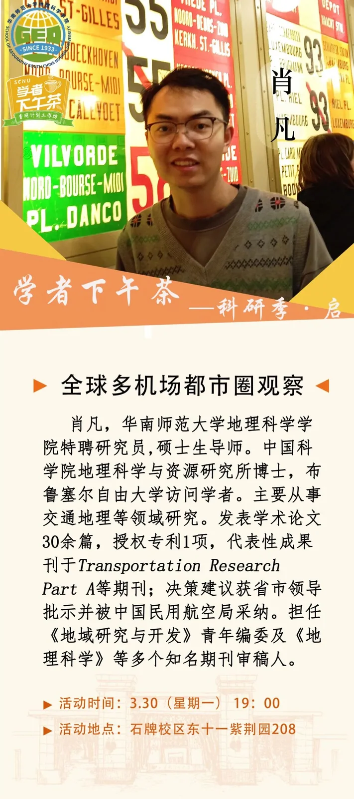

Am 26. März veröffentlichte die Fakultät für Geographie der South China Normal University eine Ankündigung für ihren nächsten „Scholars' Afternoon Tea“: Am 30. März würde Xiao Fan, Forschungsstipendiat der Fakultät, über „die Beobachtung globaler Multi-Airport-Stadtregionen“ sprechen. Der Aufhänger waren die neuen Flughäfen, die für Guangzhou und Nantong geplant sind, vor dem Hintergrund des 15. Fünfjahresplans, der ein modernes integriertes Verkehrssystem vorantreibt.

Ein Campusvortrag, aber keine Campusfrage: Wenn eine Metropolregion bereits zwei oder drei große Flughäfen hat, wie sollte ihr Verhältnis sein? Soll jeder expandieren und dieselben Strecken jagen, oder sollten die Rollen so aufgeteilt werden wie in London, New York und Tokio? Das Urteil der Zusammenfassung lautet, dass ein einzelner Flughafen die wachsende Nachfrage nicht mehr tragen kann und eine Multi-Airport-Koordination unvermeidlich ist; der schwierige Teil ist, homogene Konkurrenz in einer Kernregion wie der Greater Bay Area zu vermeiden.

## Warum große Metropolregionen zweite und dritte Flughäfen bauen

Luftfahrtnachfrage und eine Metropolregion verhalten sich wie eine U-Bahn-Linie und ihre Stadt: Menschen und Industrie folgen der Linie, und sobald sie sich sammeln, reicht die Linie nicht mehr. Flughäfen sind schwerer zu erweitern: Startbahnen und Terminals brauchen große Landflächen, Lärm reicht zehn Kilometer weit, und Luftraum ist noch knapper. Wenn Startbahnen, Terminals und Slots an ihre Grenzen stoßen, muss zusätzliche Nachfrage zu einem zweiten Flughafen.

Die meisten großen Metropolregionen sind diesen Weg gegangen. London hat Heathrow, Gatwick, Stansted und weitere; New York hat JFK, Newark und LaGuardia; Tokio hat Haneda und Narita; Paris hat Charles de Gaulle, Orly und Beauvais; Shanghai hat Pudong und Hongqiao; Peking trat 2019 mit der Eröffnung von Daxing in eine Zwei-Flughafen-Ära ein.

Der 15. Fünfjahresplan zählt ein modernes integriertes Verkehrssystem zu seinen Prioritäten. Für Guangzhou und Nantong ist ein neuer Flughafen sowohl ein Kapazitätsprojekt als auch eine Raumstrategie: Er kann Luftfahrtdienstleistungen in eine neue Richtung lenken und einen Flughafen-Industriegürtel anstoßen. Kapazität ist der leichte Teil; Funktion ist der schwere – was der zweite Flughafen für den ersten ist, entscheidet darüber, ob er funktioniert.

## Vier Wege, die Rollen aufzuteilen

Der Feind eines Multi-Airport-Systems ist nicht Konkurrenz, sondern Homogenität. Wenn jeder Flughafen dieselben Langstrecken und dieselben Umsteigepassagiere jagt, sind die Folgen doppelte Investitionen und gegenseitige Unterbietung. Reife Märkte teilen die Rollen auf vier Arten auf.

International versus national: Haneda neigt zu Inland und Nahverkehr, Narita zur Langstrecke; Pudong neigt zur internationalen Langstrecke, Hongqiao zu Inland und Geschäftsverkehr. Passagiere versus Fracht: Hongkong liegt bei der Fracht seit Langem weltweit an erster Stelle, Shenzhen trägt einen großen Teil der Fracht, Macau bedient regionalen und Billigverkehr. Full Service versus Billig: Heathrow ist das Full-Service-Langstreckendrehkreuz, Stansted und Luton sind Billigflug, London City bedient Geschäftsverkehr; Charles de Gaulle ist das internationale Drehkreuz, Beauvais der Billigflughafen. Drehkreuz versus Ergänzung: JFK übernimmt die internationale Langstrecke, Newark mischt international und national, LaGuardia ist nationaler Geschäftsverkehr.

Diese Aufteilungen wurden nicht in einem Büro gezeichnet. Sie entwickelten sich aus Airline-Basen, Slots, Bodentransport, Verkehrsrechten und Passagierwahl; Regierungen können die Bedingungen vorbereiten, aber dem Markt nicht vorschreiben, welcher Flughafen wohin fliegt.

## Die Greater Bay Area: drei große Flughäfen und ein Homogenitätsproblem

Zurück zur Greater Bay Area: Hongkong, Guangzhou und Shenzhen sowie Macau und Zhuhai liegen innerhalb von 200 km. Jedes Kern-Drehkreuz hat seine Basiscarrier und sein Hinterland: Hongkong bedient internationale Umsteigeverbindungen und hochwertigen Verkehr, Guangzhou Baiyun ist das umfassende Tor Südchinas, Shenzhen Bao'an schöpft aus der Industrie am Ostufer des Perlflusses.

Ihre Ambitionen überschneiden sich stark. Internationale Langstrecken sind eine gemeinsame Priorität, Fracht ein gemeinsames Wachstumsfeld, Umsteigepassagiere ein gemeinsamer Preis. Wenn jeder Flughafen ein „internationales Luftfahrtdrehkreuz“ sein will, dünnen die Ressourcen aus: Langstrecken, die niemand füllen kann, Frachtanlagen, die zweimal gebaut werden. Die Zusammenfassung des Vortrags benennt dies als die Notwendigkeit, „homogene Konkurrenz zu vermeiden und eine differenzierte Positionierung zu erreichen“.

Öffentliche Dokumente zeigen, dass Flughafencluster-Pläne für die Greater Bay Area das Problem seit Langem kennen; „differenzierte Positionierung“ ist eine wiederkehrende Formel. Die Umsetzung ist schwieriger: Luftraum muss koordiniert, Bodenverbindungen verknüpft, Zollregelungen abgestimmt und Streckensubventionen begrenzt werden. Guangzhous geplanter neuer Flughafen ist die nächste Variable. Er soll den Druck auf Baiyun lindern; wenn er dieselben Strecken fliegt und dieselben Passagiere jagt, wird die Kapazitätsdividende durch interne Konkurrenz aufgebraucht.

## Internationale Erfahrung: Wie fünf Metropolregionen die Arbeit teilen

| Metropolregion | Hauptflughäfen | Aufteilung der Rollen |
| --- | --- | --- |
| London | Heathrow (LHR), Gatwick (LGW), Stansted (STN), Luton (LTN), London City (LCY) | Heathrow ist das Full-Service-Langstreckendrehkreuz; Gatwick übernimmt Freizeit- und Langstreckenverkehr; Stansted und Luton sind Billigflug; London City bedient Geschäftsverkehr |
| New York | JFK, Newark (EWR), LaGuardia (LGA) | JFK für die internationale Langstrecke; Newark mischt international und national; LaGuardia für nationalen Geschäftsverkehr |
| Tokio | Haneda (HND), Narita (NRT) | Haneda neigt zu Inland und internationalem Nahverkehr; Narita zu Langstrecke und Billigflug |
| Paris | Charles de Gaulle (CDG), Orly (ORY), Beauvais (BVA) | Charles de Gaulle ist das internationale Drehkreuz; Orly bedient Inlands- und frankophone Märkte; Beauvais ist Billigflug |
| Shanghai | Pudong (PVG), Hongqiao (SHA) | Pudong für internationale Langstrecke und Fracht; Hongqiao für Inland und Geschäftsverkehr |

Drei Lehren folgen. Erstens ist ein zweiter Flughafen vor allem ein Kapazitätswerkzeug: Über Heathrows dritte Startbahn wurde jahrzehntelang diskutiert, ohne dass sie gebaut wurde, und das Wachstum ging stattdessen nach Gatwick und Stansted. Zweitens entwickeln sich Rollen im Markt; Planung kann führen, aber Airlines und Passagiere nicht ersetzen. Drittens entscheidet der Bodentransport darüber, ob ein zweiter Flughafen konkurriert: Wenn die Fahrt aus dem Stadtzentrum länger dauert als der Flug, ist er „ein anderer Flughafen“, nicht Teil „desselben Systems“.

## Was Guangzhou, Nantong und der 15. Fünfjahresplan lernen können

Nantongs neuer Flughafen ist als Teil von Shanghais internationalem Luftfahrtdrehkreuz positioniert und wird oft als Shanghais „dritter Flughafen“ bezeichnet. Seine Bedeutung liegt nicht nur darin, Pudong zu entlasten, sondern Luftfahrtdienstleistungen nördlich des Jangtse zu tragen und eine flussübergreifende Arbeitsteilung mit Shanghai zu schaffen. Öffentliche Informationen deuten darauf hin, dass Bahnverbindungen Nantong in Shanghais Ein-Stunden-Radius bringen – die Voraussetzung, um Teil von Shanghais Flughafensystem zu werden.

Für Guangzhou ist die Frage nicht ein weiteres Terminal, sondern drei Antworten: wem es dient, wohin es fliegt und wie es die Arbeit mit Baiyun teilt. Wenn es nationalen, regionalen und Billigverkehr übernimmt und die internationale Langstrecke Baiyun überlässt, ergänzen sich die beiden; wenn es auch ein internationales Drehkreuz sein will, braucht es eine klarere Streckenaufteilung und stärkere Bodenverbindungen, sonst wird es ein Flughafen, der alles versucht.

Für den 15. Fünfjahresplan weisen Guangzhou und Nantong auf dieselbe Lehre hin: die Funktion vor der Kapazität definieren, den Bodentransport vor dem Streckennetz anbinden, städteübergreifende Koordination aufbauen, bevor man darüber streitet, wer international, national und Fracht übernimmt. Eine Multi-Airport-Stadtregion ist kein Wettstreit in Flughafenzahlen, sondern ein Test der Koordination von Luftraum, Land, Slots und Industriestruktur.

Der Vortrag empfiehlt drei Bücher: Geographical Review (Bd. 9), Economic Geography of Northeast China und The Economics of Location.

Der „Scholars' Afternoon Tea“ wird eher eine bessere Frage hervorbringen als eine Antwort: Wenn der zweite und dritte Flughafen auf der Planungskarte stehen, ist die Stadt bereit, ihnen unterschiedliche Rollen zu geben?

## Weiterführende Links

- **Auf dieser Website**: [Guangzhou Baiyun (CAN)](/airport/CAN), [Shanghai Pudong (PVG)](/airport/PVG), [Heathrow (LHR)](/airport/LHR), [JFK](/airport/JFK), [Haneda (HND)](/airport/HND), [China (CN)](/country/CN), [Vereinigtes Königreich (GB)](/country/GB)
- **Wikipedia**: [Perlflussdelta](https://en.wikipedia.org/wiki/Pearl_River_Delta), [Metropolregion](https://en.wikipedia.org/wiki/Metropolitan_area)
- **Baidu Baike**: [Greater Bay Area (粤港澳大湾区)](https://baike.baidu.com/item/%E7%B2%A4%E6%B8%AF%E6%BE%B3%E5%A4%A7%E6%B9%BE%E5%8C%BA)

Bildquelle: Fakultät für Geographie, South China Normal University. Die Angaben zum Vortrag entsprechen der Veröffentlichung der Veranstalter; prüfen Sie für Planungs- und Streckeninformationen die Ankündigungen der Regierung und der Flughafenbetreiber.
