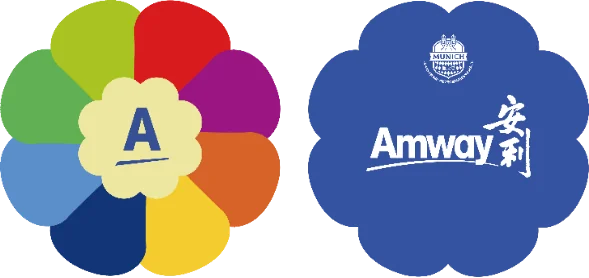
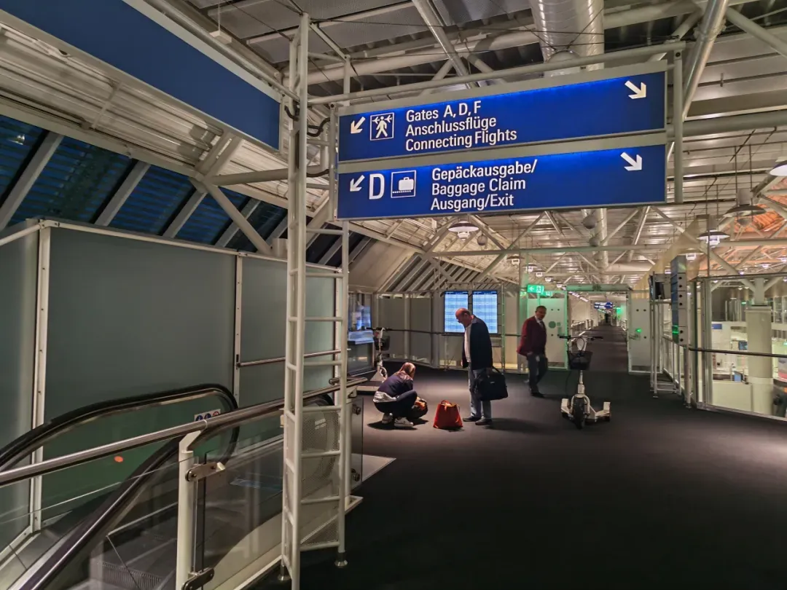
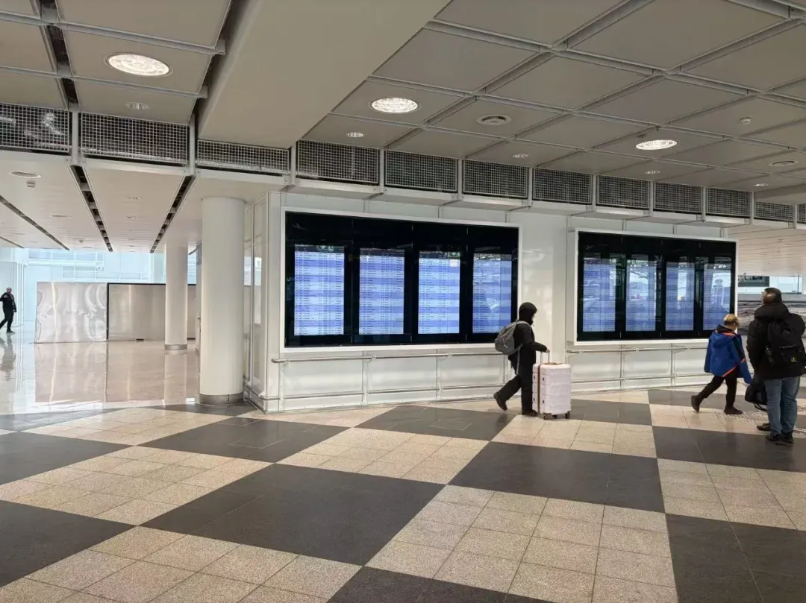

সবাই যাতে জার্মানিতে প্রবেশের প্রক্রিয়া সুষ্ঠুভাবে পার হতে পারেন, সে জন্য জার্মানিতে আগমন ও মিউনিখ বিমানবন্দর থেকে ছাড় পাওয়া সম্পর্কে যা জানা দরকার তা এখানে দেওয়া হলো। আগেই স্মরণিকা পড়ে নিন এবং প্রক্রিয়াটি জেনে রাখুন, যাতে যাত্রা শান্তভাবে শুরু হয়।

## ওড়ার আগে

অবতরণের সময় প্রয়োজনীয় সবকিছু চেকড লাগেজে নয়, কেবিন ব্যাগে রাখুন:

- **নথিপত্র:** পাসপোর্ট (ছয় মাসের বৈধতা থাকার পরামর্শ দেওয়া হয়), শেঞ্জেন ভিসা, ফিরতি ফ্লাইটের ভ্রমণসূচি।
- **আবাসন:** হোটেল বুকিংয়ের নিশ্চিতকরণ — সীমান্ত কর্মকর্তারা এটি দেখতে চাইতে পারেন।
- **ভ্রমণের উদ্দেশ্য:** সেমিনারের আমন্ত্রণপত্র বা প্রোগ্রাম, কেন আপনি প্রবেশ করছেন তা ব্যাখ্যা করার জন্য।
- **পরিশোধ:** অল্প ইউরো নগদ এবং বিদেশে কাজ করে এমন একটি কার্ড। বিমানবন্দর ও শহরে কার্ড গ্রহণ করা হয়, তবে কিছু নগদ থাকলে বেশি নিরাপদ।
- **ওষুধ:** আপনার নিয়মিত ওষুধ, প্রেসক্রিপশন ও তার ইংরেজি অনুবাদসহ, কেবিন ব্যাগে।

## EES এন্ট্রি/এক্সিট ব্যবস্থা

ইইউ এখন **এন্ট্রি/এক্সিট সিস্টেম (EES)** চালু করেছে: স্বল্প সময়ের জন্য শেঞ্জেন অঞ্চলে আসা অ-ইইউ পাসপোর্টধারী ভ্রমণকারীদের — পর্যটন, ব্যবসা ইত্যাদি — পুনরায় প্রবেশের সময় (তিন বছরের মধ্যে) তাদের তথ্য বিদ্যমান রেকর্ডের সঙ্গে মিলিয়ে দেখা হয়, যা পরীক্ষা ছোট করে।

বিমান থেকে নামার পর আপনার দল ও সাইনবোর্ড অনুসরণ করে শুল্ক পর্যন্ত যান, EES স্ব-পরিষেবা নিবন্ধন সম্পন্ন করুন, তারপর সীমান্ত নিয়ন্ত্রণ পার হন। EES মেশিনে:

### ধাপ ১: ভাষা নির্বাচন করুন

“中文简体” (সরলীকৃত চীনা) নির্বাচন করুন।

### ধাপ ২: পাসপোর্ট স্ক্যান করুন

নির্দেশনা অনুযায়ী পাসপোর্ট স্ক্যানিং এলাকায় রাখুন।

### ধাপ ৩: বায়োমেট্রিক তথ্য নিন

**মুখের ছবি:** মেশিন আপনাকে আপনার মুখের একটি স্পষ্ট ছবি তুলতে নির্দেশ দেবে। পুরো মুখ দেখান এবং টুপি, চশমা বা মুখ ঢাকতে পারে এমন কিছু খুলে ফেলুন, যাতে ছবিটি শনাক্তকরণের শর্ত পূরণ করে।

**আঙুলের ছাপ:** সাধারণত চারটি আঙুলের ছাপ নেওয়া হয়। স্ক্রিন অনুসরণ করে প্রতিটি আঙুল নির্ধারিত স্থানে রাখুন।

### কর্মকর্তার চূড়ান্ত পরীক্ষা

সীমান্ত কর্মকর্তা আপনার পরিচয় ও ভ্রমণের উদ্দেশ্য নিশ্চিত করতে কয়েকটি প্রশ্ন করতে পারেন। সাধারণ প্রশ্নগুলো হলো: **ভ্রমণের উদ্দেশ্য, ফিরতি টিকিট ও হোটেল বুকিং**।

## দল গ্রহণের সাইন

কর্মীরা আগমনকারী দলগুলোকে হাতে ধরা “美花” সাইন নিয়ে স্বাগত জানান — আপনি বেরিয়ে এলে সেই সাইনধারী ব্যক্তিকে খুঁজুন।

## টার্মিনাল ১ আগমনের প্রক্রিয়া

1. অবতরণের পর করিডোর অনুসরণ করে টার্মিনালে যান।

2. সাইনবোর্ড অনুসরণ করুন।

3. “Gates A-D” সাইনগুলো পেরিয়ে এগিয়ে যান।

4. এসকেলেটরে নিচে যান, EES স্ব-পরিষেবা নিবন্ধন করুন এবং শুল্ক ছাড় করুন।

5. কনভেয়ার বেল্টে আপনার লাগেজের জন্য অপেক্ষা করুন।

6. ব্যাগ হাতে নিয়ে “Goods to declare / Nothing to declare” সাইন অনুসরণ করুন এবং উপযুক্ত চ্যানেল দিয়ে বেরিয়ে যান।

**T1 মিলনস্থল:** এক্সিট B-এর বড় পর্দা (যারা নিজেরা ফ্লাইটের ব্যবস্থা করেছেন তাদের জন্য)।

## টার্মিনাল ২ আগমনের প্রক্রিয়া

### ক্ষেত্র ১: আপনার শাটল ট্রেন প্রয়োজন

বাম দিকের নীল সাইন ইইউ ও সুইস নাগরিক এবং দীর্ঘমেয়াদি ভিসাধারীদের চ্যানেল চিহ্নিত করে; ডান দিকের কমলা সাইন অ-ইইউ পাসপোর্টের চ্যানেল।

1. বিমান থেকে নামার পর প্রথমে ডান দিকে EES স্ব-পরিষেবা নিবন্ধন করুন।

2. তারপর চূড়ান্ত পরিচয় পরীক্ষার জন্য কর্মীযুক্ত কাউন্টারে সারি দিন — নথির ফোল্ডার প্রস্তুত রাখুন।

3. পার হওয়ার পর শাটল ট্রেনের দিকে যান এবং Gates JKL থেকে Gates GH পর্যন্ত চলুন।

4. ট্রেন থেকে নামার পর উপরে লাগেজ ক্লেইমের সাইন অনুসরণ করুন।

5. ক্লেইমে আপনার চেকড লাগেজ সংগ্রহ করুন।

**T2 মিলনস্থল:** এক্সিটের ডান দিকে স্টারবাকস (যারা নিজেরা ফ্লাইটের ব্যবস্থা করেছেন তাদের জন্য)।

### ক্ষেত্র ২: শাটল ট্রেন প্রয়োজন নেই

বিমান থেকে সোজা সাইন অনুসরণ করে বেরিয়ে আসুন, সিঁড়ি দিয়ে নিচে শুল্কে যান, EES স্ব-পরিষেবা নিবন্ধন করুন এবং সীমান্ত নিয়ন্ত্রণ পার হন। পার হওয়ার পর বাম দিকে কাঁচের দরজা দিয়ে লাগেজ ক্লেইমে যান।

**T2 মিলনস্থল:** এক্সিটের ডান দিকে স্টারবাকস (যারা নিজেরা ফ্লাইটের ব্যবস্থা করেছেন তাদের জন্য)।

> আপনি যদি নিজে আন্তর্জাতিক ফ্লাইটের ব্যবস্থা করেন এবং আপনার ফ্লাইটের তথ্য বা শাটল পরিষেবা নিবন্ধন না করেন, তবে নিজেই সেমিনার হোটেলে পৌঁছান। শাটল তথ্য ও হোটেলে যাওয়ার গণপরিবহনের জন্য “安利带你看世界” অফিসিয়াল অ্যাকাউন্ট দেখুন।

## জার্মানিতে প্রবেশ: যা অবশ্যই জানা দরকার

### নিষিদ্ধ পণ্য

- **মাংস ও মাংসজাত পণ্য:** দুগ্ধ ও মাংসসংক্রান্ত পণ্য বিদেশ থেকে ইইউতে আনা যাবে না।
- **উদ্ভিদ ও উদ্ভিদজাত পণ্য:** বীজ, সবজি, ফল ও মাটি আনা নিষিদ্ধ।
- **অস্ত্র ও বিস্ফোরক:** বন্দুক, গোলাবারুদ, বিস্ফোরক ও অন্যান্য বিপজ্জনক অস্ত্র, যার মধ্যে আগ্নেয়াস্ত্রের যন্ত্রাংশ ও নকল অস্ত্রও আছে, আমদানি নিষিদ্ধ।
- **মাদক ও নিয়ন্ত্রিত পদার্থ:** অবৈধ মাদক, নেশাজাতীয় দ্রব্য ও সংশ্লিষ্ট সরঞ্জাম নিষিদ্ধ।
- **নকল পণ্য:** জাল বা নকল পণ্য, যেমন নকল ব্র্যান্ডের ব্যাগ, শুল্ক কর্তৃপক্ষ পরীক্ষা করতে ও জরিমানা করতে পারে।
- **সুরক্ষিত প্রজাতির পণ্য:** বিলুপ্তপ্রায় প্রজাতি সুরক্ষার আওতাভুক্ত পণ্য, যেমন হাতির দাঁত ও পশমের পণ্য, আমদানি নিষিদ্ধ।
- **অশ্লীল উপাদান:** জার্মানিতে যেকোনো রূপে অশ্লীল উপাদান আমদানি নিষিদ্ধ।

### ঘোষণা করতে হবে এমন পণ্য

| শ্রেণি | ছাড় ও শর্ত |
| --- | --- |
| নগদ | €১০,০০০ বা তার বেশি (বা সমমূল্য) শুল্কে ঘোষণা করতে হবে |
| তামাক | ২০ বছর বা তার বেশি বয়সী ভ্রমণকারীরা ২০০টি সিগারেট (বা সমপরিমাণ অন্য তামাক) শুল্কমুক্তভাবে আনতে পারেন |
| মদ | ২০ বছর বা তার বেশি বয়সী ভ্রমণকারীরা ১ লিটার স্পিরিট বা ২ লিটার অন্য মদ্যপানীয় শুল্কমুক্তভাবে আনতে পারেন |
| কফি ও চা | ৫০০ গ্রাম কফি বা ২০০ গ্রাম কফি নির্যাস শুল্কমুক্ত |
| সুগন্ধি ও পারফিউম | ৫০ গ্রাম এসেন্স ও ০.২৫ লিটার পারফিউম শুল্কমুক্ত |
| ব্যক্তিগত ওষুধ | ভ্রমণের জন্য প্রয়োজনীয় পরিমাণ, প্রেসক্রিপশন ও অনুবাদসহ; সাধারণত তিন মাসের বেশি নয় |

> উপরের তালিকার বাইরে, ইইউর বাইরে থেকে বিমানে আসা ভ্রমণকারীরা €৪৩০ মূল্যের অন্য পণ্য শুল্কমুক্তভাবে আনতে পারেন; ১৫ বছরের কম বয়সী ভ্রমণকারীদের জন্য সীমা €১৫০। এর বেশি হলে লাল চ্যানেল দিয়ে যেতে হবে এবং প্রয়োজন অনুযায়ী শুল্ক দিতে হবে।

আমরা আশা করি এটি সবাইকে জার্মান প্রবেশের নিয়ম সম্পর্কে স্পষ্ট ধারণা দিতে এবং বিমানবন্দর সুষ্ঠুভাবে পার হতে সাহায্য করবে — মিউনিখে দেখা হবে।

## সম্পর্কিত লিঙ্ক

- **এই সাইটে**: [মিউনিখ বিমানবন্দর (MUC)](/airport/MUC), [জার্মানি (DE)](/country/DE)
- **উইকিপিডিয়া**: [মিউনিখ বিমানবন্দর](https://en.wikipedia.org/wiki/Munich_Airport)
- **বাইদু বাইকে**: [মিউনিখ বিমানবন্দর](https://baike.baidu.com/item/%E6%85%95%E5%B0%BC%E9%BB%91%E6%9C%BA%E5%9C%BA)
- **শুল্ক**: [জার্মান শুল্ক (Zoll)](https://www.zoll.de/EN/Home/home_node.html)
- **আরও নিবন্ধ**: [মিউনিখ বিমানবন্দর ট্রান্সফার নির্দেশিকা](/blog/munich-airport-guide), [মিউনিখ বিমানবন্দর শাটল বাস ও শহর পরিবহন](/blog/munich-airport-shuttle-bus-guide)

চিত্রের সূত্র: মূল নিবন্ধের ছবিগুলো, “安利带你看世界” উইচ্যাট অ্যাকাউন্ট থেকে। আগমনের পথ, ছাড় ও ঘোষণার নিয়মাবলি নির্দেশিকা সংকলনের সময় যেভাবে লিপিবদ্ধ ছিল সেভাবেই দেওয়া হয়েছে এবং পরিবর্তিত হতে পারে; ভ্রমণের দিন জার্মান শুল্ক (Zoll) ও মিউনিখ বিমানবন্দরের ওয়েবসাইট দেখুন।
