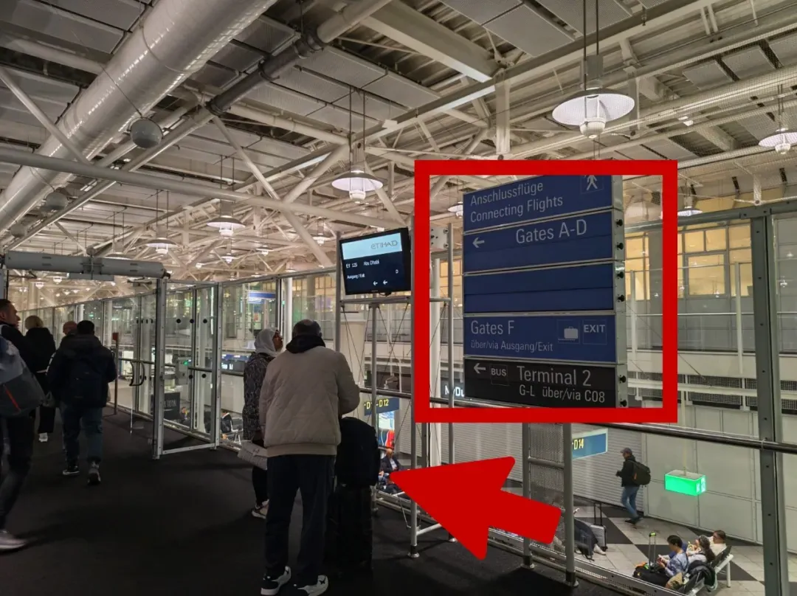
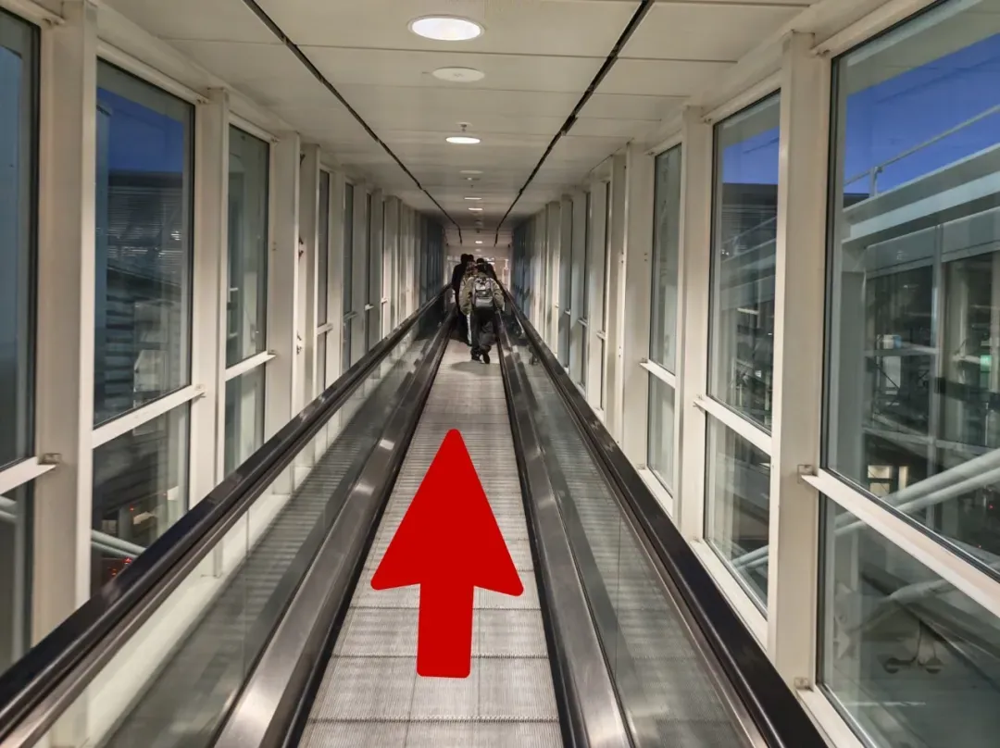

जर्मनी में प्रवेश और म्यूनिख हवाई अड्डे पर आगमन की औपचारिकताएँ सुचारु रूप से पूरी करने में सबकी मदद के लिए, यहाँ वह जानकारी है जो आपको जर्मनी पहुँचने और म्यूनिख हवाई अड्डे से गुज़रने के बारे में जाननी चाहिए। याद दिलाने वाली बातें पहले पढ़ लें और प्रक्रिया समझ लें, ताकि यात्रा शांति से शुरू हो।

## उड़ान से पहले

उतरने पर ज़रूरत की हर चीज़ अपने केबिन बैग में रखें, चेक किए गए सामान में नहीं:

- **दस्तावेज़:** पासपोर्ट (छह महीने की वैधता की सलाह), शेंगेन वीज़ा, वापसी उड़ान का यात्रा विवरण।
- **आवास:** होटल बुकिंग की पुष्टि — सीमा अधिकारी इसे देखने के लिए कह सकते हैं।
- **यात्रा का उद्देश्य:** सेमिनार का निमंत्रण या कार्यक्रम-विवरण, ताकि आप बता सकें कि आप क्यों प्रवेश कर रहे हैं।
- **भुगतान:** थोड़ी यूरो नकदी और विदेश में चलने वाला कार्ड। हवाई अड्डे और शहर में कार्ड स्वीकार किए जाते हैं, लेकिन थोड़ी नकदी रखना अधिक सुरक्षित है।
- **दवा:** अपनी नियमित दवा पर्चे और अंग्रेज़ी अनुवाद के साथ केबिन बैग में।

## EES प्रवेश/निकास प्रणाली

यूरोपीय संघ ने अब **प्रवेश/निकास प्रणाली (EES)** लागू कर दी है: शेंगेन क्षेत्र में अल्पकालिक यात्रा — पर्यटन, व्यवसाय आदि — के लिए जाने वाले गैर-यूरोपीय संघ पासपोर्ट धारक यात्रियों का डेटा, दोबारा प्रवेश पर (तीन वर्ष के भीतर) मौजूदा रिकॉर्ड से मिलाया जाता है, जिससे जाँच कम समय लेती है।

विमान से उतरने के बाद अपने समूह और संकेतों का सीमा शुल्क तक पालन करें, EES स्वयं-सेवा पंजीकरण करें, फिर सीमा नियंत्रण से गुज़रें। EES मशीन पर:

### चरण 1: भाषा चुनें

“中文简体” (सरलीकृत चीनी) चुनें।

### चरण 2: अपना पासपोर्ट स्कैन करें

संकेत के अनुसार पासपोर्ट को स्कैनिंग क्षेत्र में रखें।

### चरण 3: अपने बायोमेट्रिक्स कैप्चर करें

**चेहरे की छवि:** मशीन आपके चेहरे की स्पष्ट तस्वीर लेने का संकेत देती है। अपना पूरा चेहरा दिखाएँ और टोपी, चश्मा या ऐसी कोई भी चीज़ हटाएँ जो उसे ढक सके, ताकि तस्वीर पहचान की आवश्यकताओं को पूरा करे।

**फ़िंगरप्रिंट:** आमतौर पर चार उँगलियों के फ़िंगरप्रिंट लिए जाते हैं। स्क्रीन का पालन करें और हर उँगली को निर्धारित क्षेत्र में रखें।

### अधिकारी द्वारा अंतिम जाँच

सीमा अधिकारी आपकी पहचान और यात्रा के उद्देश्य की पुष्टि के लिए कुछ सवाल पूछ सकते हैं। सामान्य सवालों में शामिल हैं: **यात्रा का उद्देश्य, वापसी टिकट और होटल बुकिंग**।

## पिक-अप साइन

कर्मचारी आने वाले समूहों से हाथ में पकड़े “美花” संकेत के साथ मिलते हैं — आप बाहर आने के बाद उसे पकड़े हुए व्यक्ति को देखें।

## टर्मिनल 1 आगमन प्रवाह

1. उतरने के बाद टर्मिनल तक गलियारे का पालन करें।

2. संकेतों का पालन करें।

3. “Gates A-D” संकेतों को पार करते हुए आगे बढ़ें।

4. एस्केलेटर से नीचे जाएँ, EES स्वयं-सेवा पंजीकरण करें और सीमा शुल्क से गुज़रें।

5. सामान कैरोसेल पर अपने सामान की प्रतीक्षा करें।

6. सामान हाथ में लेकर “Goods to declare / Nothing to declare” संकेतों का पालन करें और उपयुक्त चैनल से बाहर निकलें।

**T1 मिलन स्थल:** निकास B पर बड़ी स्क्रीन (उन लोगों के लिए जिन्होंने अपनी उड़ानें स्वयं व्यवस्थित की हैं)।

## टर्मिनल 2 आगमन प्रवाह

### स्थिति 1: आपको शटल ट्रेन चाहिए

बाईं ओर का नीला संकेत यूरोपीय संघ और स्विस नागरिकों तथा दीर्घकालिक वीज़ा धारकों के चैनल को दर्शाता है; दाईं ओर का नारंगी संकेत गैर-यूरोपीय संघ पासपोर्ट का चैनल है।

1. विमान से उतरने के बाद पहले दाईं ओर EES स्वयं-सेवा पंजीकरण करें।

2. फिर अंतिम पहचान जाँच के लिए कर्मचारी वाले काउंटर पर कतार लगाएँ — अपना दस्तावेज़ फ़ोल्डर तैयार रखें।

3. बाहर आने के बाद शटल ट्रेन की ओर बढ़ें और गेट JKL से गेट GH तक जाएँ।

4. ट्रेन से उतरने के बाद सामान क्लेम के संकेतों का पालन करते हुए ऊपर जाएँ।

5. क्लेम पर अपना चेक किया हुआ सामान लें।

**T2 मिलन स्थल:** निकास के दाईं ओर स्टारबक्स (उन लोगों के लिए जिन्होंने अपनी उड़ानें स्वयं व्यवस्थित की हैं)।

### स्थिति 2: शटल ट्रेन की ज़रूरत नहीं

संकेतों का पालन करते हुए विमान से सीधे बाहर जाएँ, सीढ़ियों से नीचे सीमा शुल्क तक जाएँ, EES स्वयं-सेवा पंजीकरण करें और सीमा नियंत्रण से गुज़रें। बाहर आने के बाद बाईं ओर मुड़कर काँच के दरवाज़ों से सामान क्लेम की ओर जाएँ।

**T2 मिलन स्थल:** निकास के दाईं ओर स्टारबक्स (उन लोगों के लिए जिन्होंने अपनी उड़ानें स्वयं व्यवस्थित की हैं)।

> अगर आपने अपनी अंतरराष्ट्रीय उड़ान स्वयं व्यवस्थित की है और अपनी उड़ान की जानकारी या शटल सेवा पंजीकृत नहीं कराई है, तो सेमिनार होटल तक स्वयं पहुँचें। शटल की जानकारी और होटल तक सार्वजनिक परिवहन के लिए “安利带你看世界” के आधिकारिक खाते को देखें।

## जर्मनी में प्रवेश: जो आपको जानना चाहिए

### निषिद्ध वस्तुएँ

- **मांस और मांस उत्पाद:** विदेश से यूरोपीय संघ में डेयरी और मांस से जुड़े उत्पाद नहीं लाए जा सकते।
- **पौधे और पादप उत्पाद:** बीज, सब्ज़ियाँ, फल और मिट्टी का प्रवेश निषिद्ध है।
- **हथियार और विस्फोटक:** बंदूकें, गोला-बारूद, विस्फोटक और अन्य खतरनाक हथियार, जिनमें आग्नेयास्त्रों के हिस्से और नकली हथियार शामिल हैं, आयात पर प्रतिबंध है।
- **नशीले पदार्थ और नियंत्रित पदार्थ:** अवैध नशीले पदार्थ, मादक द्रव्य और उनके सहायक सामान निषिद्ध हैं।
- **नकली सामान:** चोरी के या नकली उत्पाद, जैसे नकली ब्रांडेड बैग, सीमा शुल्क द्वारा जाँचे जा सकते हैं और उन पर दंड लगाया जा सकता है।
- **संरक्षित प्रजातियों के उत्पाद:** लुप्तप्राय प्रजातियों की सुरक्षा के दायरे में आने वाली वस्तुएँ, जैसे हाथीदांत और फ़र उत्पाद, आयात पर प्रतिबंधित हैं।
- **अश्लील सामग्री:** जर्मनी में किसी भी रूप में अश्लील सामग्री का आयात निषिद्ध है।

### घोषित करने योग्य वस्तुएँ

| श्रेणी | छूट और आवश्यकताएँ |
| --- | --- |
| नकदी | €10,000 या अधिक (या समकक्ष) सीमा शुल्क को घोषित करना अनिवार्य है |
| तंबाकू | 20 वर्ष या अधिक आयु के यात्री 200 सिगरेट (या अन्य तंबाकू की समकक्ष मात्रा) शुल्क-मुक्त ला सकते हैं |
| शराब | 20 वर्ष या अधिक आयु के यात्री 1 लीटर स्पिरिट या 2 लीटर अन्य मादक पेय शुल्क-मुक्त ला सकते हैं |
| कॉफ़ी और चाय | 500 ग्राम कॉफ़ी या 200 ग्राम कॉफ़ी अर्क शुल्क-मुक्त |
| सुगंध और परफ़्यूम | 50 ग्राम एसेंस और 0.25 लीटर परफ़्यूम शुल्क-मुक्त |
| व्यक्तिगत दवाएँ | यात्रा के लिए ज़रूरत की दवा, पर्चे और अनुवाद के साथ; सामान्यतः तीन महीने से अधिक की मात्रा नहीं |

> ऊपर की तालिका से आगे, यूरोपीय संघ के बाहर से हवाई मार्ग से आने वाले यात्री €430 तक मूल्य का अन्य सामान शुल्क-मुक्त ला सकते हैं; 15 वर्ष से कम आयु के यात्रियों के लिए सीमा €150 है। इससे अधिक का सामान लाल चैनल से जाना चाहिए और आवश्यकतानुसार शुल्क देना होगा।

हम आशा करते हैं कि इससे सबको जर्मन प्रवेश नियमों की स्पष्ट तस्वीर मिलेगी और वे हवाई अड्डे से सुचारु रूप से गुज़र सकेंगे — म्यूनिख में मिलते हैं।

## संबंधित लिंक

- **इस साइट पर**: [म्यूनिख हवाई अड्डा (MUC)](/airport/MUC), [जर्मनी (DE)](/country/DE)
- **विकिपीडिया**: [म्यूनिख हवाई अड्डा](https://en.wikipedia.org/wiki/Munich_Airport)
- **बैदू बैकी**: [म्यूनिख हवाई अड्डा](https://baike.baidu.com/item/%E6%85%95%E5%B0%BC%E9%BB%91%E6%9C%BA%E5%9C%BA)
- **सीमा शुल्क**: [जर्मन सीमा शुल्क (Zoll)](https://www.zoll.de/EN/Home/home_node.html)
- **अधिक लेख**: [म्यूनिख हवाई अड्डा ट्रांसफ़र गाइड](/blog/munich-airport-guide), [म्यूनिख हवाई अड्डा शटल बस और शहर परिवहन](/blog/munich-airport-shuttle-bus-guide)

चित्र स्रोत: मूल लेख की तस्वीरें, “安利带你看世界” वीचैट खाते से। आगमन मार्ग, छूट और घोषणा नियम गाइड तैयार करते समय दर्ज जानकारी के अनुसार हैं और बदल सकते हैं; यात्रा के दिन जर्मन सीमा शुल्क (Zoll) और म्यूनिख हवाई अड्डे की वेबसाइट देखें।
