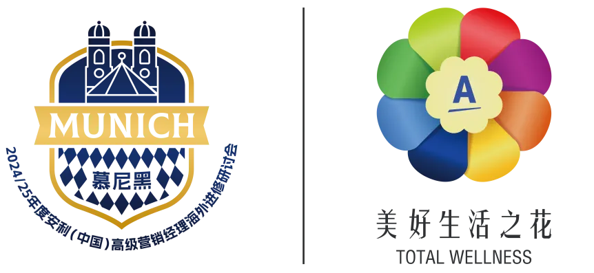

Untuk membantu semua orang melalui proses masuk ke Jerman dengan lancar, berikut yang perlu Anda ketahui tentang tiba di Jerman dan melewati Bandara Munich. Bacalah pengingatnya lebih awal dan kenali alurnya, agar perjalanan dimulai dengan tenang.

## Sebelum terbang

Simpan semua kebutuhan Anda saat mendarat di tas kabin, bukan bagasi tercatat:

- **Dokumen:** paspor (disarankan berlaku enam bulan), visa Schengen, rencana perjalanan penerbangan pulang.
- **Akomodasi:** konfirmasi pemesanan hotel — petugas perbatasan mungkin meminta melihatnya.
- **Tujuan kunjungan:** undangan atau program seminar, untuk menjelaskan mengapa Anda masuk.
- **Pembayaran:** sedikit uang tunai euro plus kartu yang berfungsi di luar negeri. Kartu diterima di bandara dan di kota, tetapi sedikit uang tunai lebih aman.
- **Obat-obatan:** obat rutin Anda dengan resep dan terjemahan bahasa Inggris, di tas kabin.

## Sistem masuk/keluar EES

UE kini telah menerapkan **Entry/Exit System (EES)**: bagi pelancong dengan paspor non-UE yang mengunjungi kawasan Schengen untuk kunjungan singkat — wisata, bisnis, dan sebagainya — data mereka dicocokkan dengan catatan yang ada saat masuk kembali (dalam tiga tahun), yang memperpendek pemeriksaan.

Setelah meninggalkan pesawat, ikuti kelompok Anda dan rambu sepanjang jalan ke bea cukai, lakukan registrasi mandiri EES, lalu lewati kontrol perbatasan. Di mesin EES:

### Langkah 1: pilih bahasa

Pilih “中文简体” (Tionghoa Sederhana).

### Langkah 2: pindai paspor

Letakkan paspor di area pemindaian sesuai petunjuk.

### Langkah 3: ambil biometrik

**Gambar wajah:** mesin meminta Anda mengambil foto wajah yang jelas. Tampilkan seluruh wajah dan lepaskan topi, kacamata, atau apa pun yang dapat menutupinya, agar foto memenuhi persyaratan pengenalan.

**Sidik jari:** biasanya empat jari diambil. Ikuti saja layar dan letakkan setiap jari di area yang ditentukan.

### Pemeriksaan akhir oleh petugas

Petugas perbatasan mungkin mengajukan beberapa pertanyaan untuk mengonfirmasi identitas dan tujuan kunjungan Anda. Yang umum mencakup: **tujuan perjalanan, tiket pulang, dan pemesanan hotel**.

## Tanda penjemputan

Staf menyambut kelompok yang tiba dengan tanda “美花” genggam — setelah Anda melewati pemeriksaan, cari orang yang memegangnya.

## Alur kedatangan Terminal 1

1. Setelah mendarat, ikuti koridor ke terminal.

2. Ikuti rambu.

3. Terus berjalan melewati tanda “Gates A-D”.

4. Naik eskalator turun, lakukan registrasi mandiri EES, dan lewati bea cukai.

5. Tunggu bagasi Anda di ban berjalan.

6. Dengan bagasi di tangan, ikuti tanda “Goods to declare / Nothing to declare” dan keluar melalui jalur yang sesuai.

**Titik temu T1:** layar besar di pintu keluar B (bagi mereka yang mengatur penerbangannya sendiri).

## Alur kedatangan Terminal 2

### Kasus 1: Anda memerlukan kereta shuttle

Tanda biru di kiri menandai jalur untuk warga UE dan Swiss serta pemegang visa jangka panjang; tanda oranye di kanan adalah jalur untuk paspor non-UE.

1. Setelah meninggalkan pesawat, lakukan registrasi mandiri EES di sebelah kanan terlebih dahulu.

2. Lalu antre di loket berpetugas untuk pemeriksaan identitas akhir — siapkan folder dokumen Anda.

3. Setelah lewat, menuju kereta shuttle dan naik dari Gates JKL ke Gates GH.

4. Setelah kereta, ikuti tanda pengambilan bagasi di lantai atas.

5. Ambil bagasi tercatat Anda di pengambilan bagasi.

**Titik temu T2:** Starbucks di kanan pintu keluar (bagi mereka yang mengatur penerbangannya sendiri).

### Kasus 2: tidak perlu kereta shuttle

Berjalanlah langsung keluar dari pesawat mengikuti rambu, turun tangga ke bea cukai, lakukan registrasi mandiri EES dan lewati kontrol perbatasan. Setelah lewat, belok kiri melewati pintu kaca ke pengambilan bagasi.

**Titik temu T2:** Starbucks di kanan pintu keluar (bagi mereka yang mengatur penerbangannya sendiri).

> Jika Anda mengatur penerbangan internasional sendiri dan belum mendaftarkan detail penerbangan atau layanan shuttle, pergilah sendiri ke hotel seminar. Untuk informasi shuttle dan transportasi umum ke hotel, lihat akun resmi “安利带你看世界”.

## Masuk Jerman: yang wajib Anda ketahui

### Barang terlarang

- **Daging dan produk daging:** produk susu dan terkait daging tidak boleh dibawa masuk ke UE dari luar negeri.
- **Tanaman dan produk tanaman:** biji, sayuran, buah, dan tanah dilarang masuk.
- **Senjata dan bahan peledak:** senjata api, amunisi, bahan peledak, dan senjata berbahaya lainnya, termasuk komponen senjata api dan senjata tiruan, dilarang diimpor.
- **Narkoba dan zat terkendali:** narkoba ilegal, narkotika, dan peralatannya dilarang.
- **Barang palsu:** barang bajakan atau palsu, seperti tas bermerek palsu, dapat diperiksa dan dikenai sanksi oleh bea cukai.
- **Produk spesies dilindungi:** barang yang tercakup perlindungan spesies terancam, seperti gading dan produk bulu, dilarang diimpor.
- **Materi pornografi:** mengimpor pornografi dalam bentuk apa pun dilarang di Jerman.

### Barang yang wajib dideklarasikan

| Kategori | Batas dan persyaratan |
| --- | --- |
| Uang tunai | €10.000 atau lebih (atau setara) harus dideklarasikan ke bea cukai |
| Tembakau | Pelancong berusia 20 tahun atau lebih boleh membawa 200 batang rokok (atau jumlah setara tembakau lain) bebas bea |
| Alkohol | Pelancong berusia 20 tahun atau lebih boleh membawa 1 liter minuman keras atau 2 liter minuman beralkohol lain bebas bea |
| Kopi dan teh | 500 g kopi atau 200 g ekstrak kopi bebas bea |
| Wewangian dan parfum | 50 g esens dan 0,25 liter parfum bebas bea |
| Obat pribadi | Yang Anda butuhkan untuk perjalanan, dengan resep dan terjemahan; umumnya tidak lebih dari persediaan tiga bulan |

> Di luar tabel di atas, pelancong yang tiba dengan pesawat dari luar UE boleh membawa barang lain senilai hingga €430 bebas bea; batasnya €150 untuk pelancong di bawah 15 tahun. Apa pun di atas itu harus melalui jalur merah, dengan bea dibayar sesuai ketentuan.

Kami harap ini membantu semua orang mendapatkan gambaran jelas tentang aturan masuk Jerman dan melewati bandara dengan lancar — sampai jumpa di Munich.

## Tautan terkait

- **Di situs ini**: [Bandara Munich (MUC)](/airport/MUC), [Jerman (DE)](/country/DE)
- **Wikipedia**: [Bandara Munich](https://en.wikipedia.org/wiki/Munich_Airport)
- **Baidu Baike**: [Bandara Munich](https://baike.baidu.com/item/%E6%85%95%E5%B0%BC%E9%BB%91%E6%9C%BA%E5%9C%BA)
- **Bea cukai**: [Bea Cukai Jerman (Zoll)](https://www.zoll.de/EN/Home/home_node.html)
- **Artikel lainnya**: [Panduan transfer Bandara Munich](/blog/munich-airport-guide), [Bus shuttle dan transportasi kota Bandara Munich](/blog/munich-airport-shuttle-bus-guide)

Sumber gambar: gambar artikel asli, dari akun WeChat “安利带你看世界”. Rute kedatangan, batas bebas bea, dan aturan deklarasi sesuai yang tercatat saat panduan disusun dan dapat berubah; periksa situs Bea Cukai Jerman (Zoll) dan Bandara Munich pada hari perjalanan.
