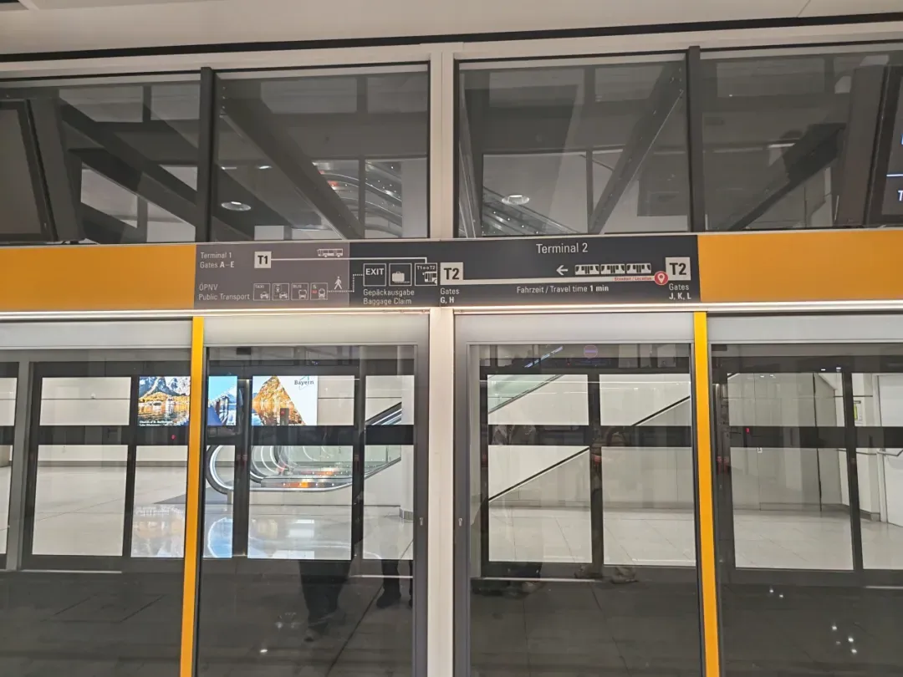

Aby wszystkim ułatwić sprawne przejście niemieckiej odprawy granicznej, oto, co trzeba wiedzieć o przylocie do Niemiec i odprawie na lotnisku w Monachium. Przeczytaj przypomnienia zawczasu i poznaj przebieg odprawy, aby podróż zaczęła się spokojnie.

## Przed lotem

Wszystko, czego potrzebujesz po wylądowaniu, trzymaj w bagażu podręcznym, nie w bagażu rejestrowanym:

- **Dokumenty:** paszport (zalecana ważność sześciu miesięcy), wiza Schengen, itinerarz lotu powrotnego.
- **Zakwaterowanie:** potwierdzenie rezerwacji hotelu — funkcjonariusze graniczni mogą chcieć je zobaczyć.
- **Cel wizyty:** zaproszenie na seminarium lub program, aby wyjaśnić, dlaczego wjeżdżasz.
- **Płatność:** trochę gotówki w euro plus karta działająca za granicą. Karty są akceptowane na lotnisku i w mieście, ale trochę gotówki jest bezpieczniejsze.
- **Leki:** przyjmowane regularnie leki z receptą i tłumaczeniem na angielski, w bagażu podręcznym.

## System wjazdu i wyjazdu EES

UE wprowadziła już **system wjazdu i wyjazdu (EES)**: podróżni z paszportami spoza UE odwiedzający strefę Schengen w ramach krótkich pobytów — turystycznych, biznesowych i tym podobnych — mają przy ponownym wjeździe (w ciągu trzech lat) porównywane dane z istniejącymi zapisami, co skraca kontrolę.

Po wyjściu z samolotu podążaj za swoją grupą i znakami aż do odprawy celnej, wykonaj samoobsługową rejestrację EES, a następnie przejdź kontrolę graniczną. Przy automacie EES:

### Krok 1: wybierz język

Wybierz „中文简体” (uproszczony chiński).

### Krok 2: zeskanuj paszport

Umieść paszport w obszarze skanowania zgodnie z instrukcjami.

### Krok 3: zarejestruj dane biometryczne

**Obraz twarzy:** automat prosi o zrobienie wyraźnego zdjęcia twarzy. Pokaż całą twarz i zdejmij czapkę, okulary lub cokolwiek innego, co mogłoby ją zasłonić, aby zdjęcie spełniało wymogi rozpoznawania.

**Odcisk palców:** zwykle rejestruje się cztery palce. Wystarczy postępować zgodnie z ekranem i umieszczać każdy palec w wyznaczonym miejscu.

### Ostateczna kontrola funkcjonariusza

Funkcjonariusz straży granicznej może zadać kilka pytań, aby potwierdzić twoją tożsamość i cel wizyty. Typowe pytania dotyczą: **celu podróży, biletu powrotnego i rezerwacji hotelu**.

## Znak odbioru grupy

Personel wita przybywające grupy ręcznym znakiem „美花” — po przejściu odprawy rozejrzyj się za osobą, która go trzyma.

## Przebieg przylotu w terminalu 1

1. Po wylądowaniu podążaj korytarzem do terminala.

2. Podążaj za znakami.

3. Idź dalej, mijając znaki „Gates A-D”.

4. Zjedź schodami ruchomymi w dół, wykonaj samoobsługową rejestrację EES i przejdź odprawę celną.

5. Poczekaj na bagaż przy taśmie.

6. Z bagażem w ręku podążaj za znakami „Goods to declare / Nothing to declare” i wyjdź odpowiednim kanałem.

**Punkt spotkań T1:** duży ekran przy wyjściu B (dla osób, które samodzielnie zorganizowały przelot).

## Przebieg przylotu w terminalu 2

### Przypadek 1: potrzebny pociąg wahadłowy

Niebieski znak po lewej oznacza kanał dla obywateli UE i Szwajcarii oraz posiadaczy wiz długoterminowych; pomarańczowy znak po prawej to kanał dla paszportów spoza UE.

1. Po wyjściu z samolotu najpierw wykonaj samoobsługową rejestrację EES po prawej stronie.

2. Następnie ustaw się w kolejce do stanowiska obsługiwanego przez funkcjonariusza na ostateczną kontrolę tożsamości — miej przygotowaną teczkę z dokumentami.

3. Po przejściu udaj się do pociągu wahadłowego i przejedź z bramek JKL do bramek GH.

4. Po przejeździe pociągiem podążaj za znakami odbioru bagażu prowadzącymi na piętro wyżej.

5. Odbierz bagaż rejestrowany przy taśmie.

**Punkt spotkań T2:** Starbucks po prawej stronie wyjścia (dla osób, które samodzielnie zorganizowały przelot).

### Przypadek 2: pociąg wahadłowy nie jest potrzebny

Wyjdź prosto z samolotu, podążając za znakami, zejdź schodami do odprawy celnej, wykonaj samoobsługową rejestrację EES i przejdź kontrolę graniczną. Po przejściu skręć w lewo przez szklane drzwi do odbioru bagażu.

**Punkt spotkań T2:** Starbucks po prawej stronie wyjścia (dla osób, które samodzielnie zorganizowały przelot).

> Jeśli samodzielnie zorganizowałeś przelot międzynarodowy i nie zarejestrowałeś danych lotu ani usługi wahadłowej, udaj się do hotelu seminarium na własną rękę. Informacje o transporcie wahadłowym i komunikacji publicznej do hotelu znajdziesz na oficjalnym koncie „安利带你看世界”.

## Wjazd do Niemiec: co trzeba wiedzieć

### Przedmioty zabronione

- **Mięso i produkty mięsne:** produkty mleczne i mięsne nie mogą być przywożone do UE z zagranicy.
- **Rośliny i produkty roślinne:** nasiona, warzywa, owoce i gleba są objęte zakazem wwozu.
- **Broń i materiały wybuchowe:** broń palna, amunicja, materiały wybuchowe i inna niebezpieczna broń, w tym części broni palnej i broń imitacyjna, są objęte zakazem przywozu.
- **Narkotyki i substancje kontrolowane:** nielegalne narkotyki, środki odurzające i akcesoria są zabronione.
- **Towary podrobione:** pirackie lub podrobione artykuły, takie jak fałszywe markowe torby, mogą zostać skontrolowane i ukarane przez celników.
- **Produkty z gatunków chronionych:** przedmioty objęte ochroną gatunków zagrożonych wyginięciem, takie jak wyroby z kości słoniowej i futra, są objęte zakazem przywozu.
- **Materiały pornograficzne:** przywóz pornografii w jakiejkolwiek formie jest w Niemczech zabroniony.

### Rzeczy do zgłoszenia

| Kategoria | Limit i wymagania |
| --- | --- |
| Gotówka | 10 000 EUR lub więcej (lub równowartość) należy zgłosić do cel |
| Tytoń | Podróżni w wieku 20 lat lub starsi mogą przywieźć bezcłowo 200 papierosów (lub równoważną ilość innych wyrobów tytoniowych) |
| Alkohol | Podróżni w wieku 20 lat lub starsi mogą przywieźć bezcłowo 1 litr napojów spirytusowych lub 2 litry innych napojów alkoholowych |
| Kawa i herbata | Bezcłowo 500 g kawy lub 200 g ekstraktu kawowego |
| Zapachy i perfumy | Bezcłowo 50 g esencji i 0,25 litra perfum |
| Leki osobiste | Ilość potrzebna na podróż, z receptą i tłumaczeniem; zazwyczaj nie więcej niż zapas na trzy miesiące |

> Poza powyższą tabelą podróżni przybywający samolotem spoza UE mogą przywieźć bezcłowo inne towary o wartości do 430 EUR; limit wynosi 150 EUR dla podróżnych poniżej 15. roku życia. Wszystko powyżej tego limitu powinno przejść przez czerwony kanał, z uiszczeniem cła zgodnie z wymogami.

Mamy nadzieję, że pomoże to wszystkim jasno poznać niemieckie przepisy wjazdowe i sprawnie przejść przez lotnisko — do zobaczenia w Monachium.

## Powiązane linki

- **Na tej stronie**: [Lotnisko w Monachium (MUC)](/airport/MUC), [Niemcy (DE)](/country/DE)
- **Wikipedia**: [Lotnisko w Monachium](https://en.wikipedia.org/wiki/Munich_Airport)
- **Baidu Baike**: [Lotnisko w Monachium](https://baike.baidu.com/item/%E6%85%95%E5%B0%BC%E9%BB%91%E6%9C%BA%E5%9C%BA)
- **Cła**: [Niemieckie cła (Zoll)](https://www.zoll.de/EN/Home/home_node.html)
- **Więcej artykułów**: [Przewodnik po przesiadce na lotnisku w Monachium](/blog/munich-airport-guide), [Autobus wahadłowy i komunikacja miejska na lotnisku w Monachium](/blog/munich-airport-shuttle-bus-guide)

Źródło zdjęć: ilustracje z oryginalnego artykułu, z konta WeChat „安利带你看世界”. Trasy przylotu, limity i przepisy dotyczące zgłoszeń są takie, jak zapisano przy tworzeniu przewodnika, i mogą się zmienić; w dniu podróży sprawdź strony niemieckich cel (Zoll) i lotniska w Monachium.
