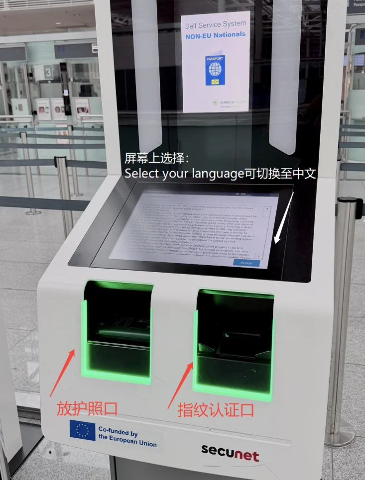
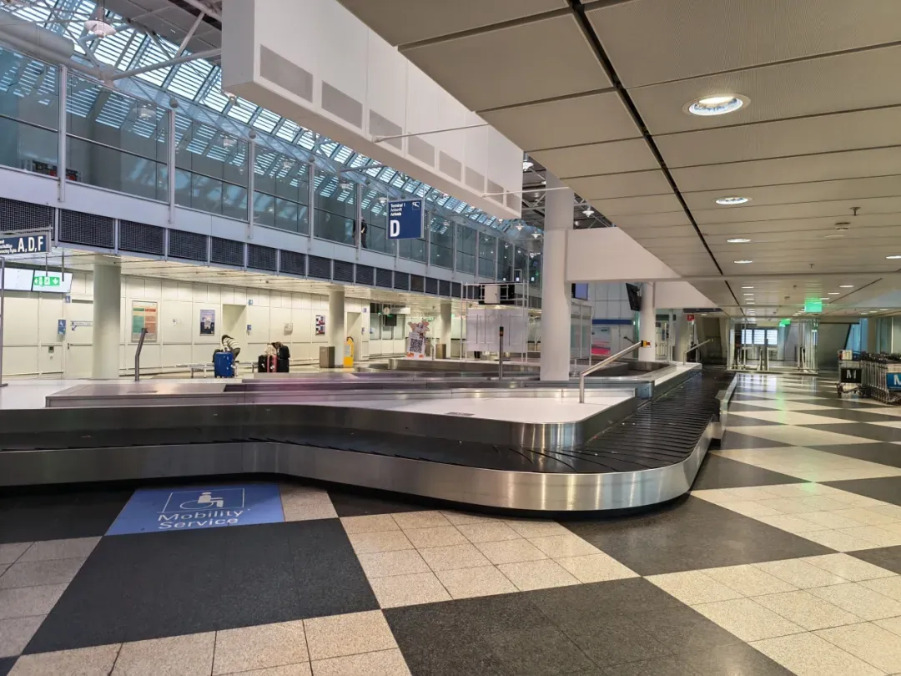
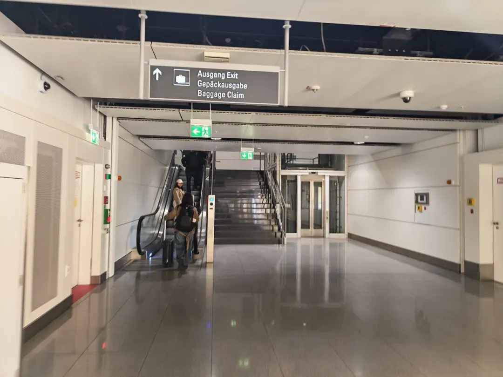

Para ajudar todos a passar pela entrada alemã sem problemas, aqui está o que você precisa saber sobre chegar à Alemanha e passar pelo Aeroporto de Munique. Leia os lembretes com antecedência e conheça o fluxo, para que a viagem comece com calma.

## Antes de voar

Mantenha tudo o que precisa ao desembarcar na bagagem de mão, não na bagagem despachada:

- **Documentos:** passaporte (recomenda-se validade de seis meses), visto Schengen, itinerário do voo de volta.
- **Hospedagem:** confirmação da reserva do hotel — os oficiais de fronteira podem pedir para vê-la.
- **Motivo da visita:** o convite ou programa do seminário, para explicar por que você está entrando.
- **Pagamento:** um pouco de dinheiro em euros e um cartão que funcione no exterior. Cartões são aceitos no aeroporto e na cidade, mas algum dinheiro é mais seguro.
- **Medicamentos:** seu remédio de uso regular com a receita e uma tradução em inglês, na bagagem de mão.

## O sistema de entrada/saída EES

A UE já implementou o **Sistema de Entrada/Saída (EES)**: viajantes com passaportes de fora da UE que visitam o espaço Schengen para estadias curtas — turismo, negócios e afins — têm seus dados comparados com registros existentes quando voltam a entrar (dentro de três anos), o que encurta a verificação.

Depois de sair da aeronave, siga seu grupo e as placas até a alfândega, faça o registro de autoatendimento no EES e então passe pelo controle de fronteira. Na máquina do EES:

### Etapa 1: escolha o idioma

Selecione “中文简体” (chinês simplificado).

### Etapa 2: leia seu passaporte

Coloque o passaporte na área de leitura conforme as instruções.

### Etapa 3: capture seus dados biométricos

**Imagem facial:** a máquina solicita uma foto nítida do seu rosto. Mostre o rosto inteiro e retire boné, óculos ou qualquer coisa que possa obscurecê-lo, para que a foto atenda aos requisitos de reconhecimento.

**Impressões digitais:** normalmente são capturados quatro dedos. Basta seguir a tela e colocar cada dedo na área designada.

### Verificação final por um oficial

O oficial de fronteira pode fazer algumas perguntas para confirmar sua identidade e o motivo da visita. As comuns abrangem: **o motivo da viagem, a passagem de volta e a reserva do hotel**.

## A placa de recepção

A equipe recebe os grupos que chegam com uma placa de mão “美花” — depois de passar, procure a pessoa que a segura.

## Fluxo de chegada do Terminal 1

1. Após o pouso, siga o corredor até o terminal.

2. Siga as placas.

3. Continue passando pelas placas “Gates A-D”.

4. Desça a escada rolante, faça o registro de autoatendimento no EES e passe pela alfândega.

5. Espere sua bagagem na esteira.

6. Com as malas em mãos, siga as placas “Goods to declare / Nothing to declare” e saia pelo canal apropriado.

**Ponto de encontro do T1:** a tela grande na saída B (para quem organizou os próprios voos).

## Fluxo de chegada do Terminal 2

### Caso 1: você precisa do trem shuttle

A placa azul à esquerda marca o canal para cidadãos da UE e da Suíça e titulares de vistos de longa duração; a placa laranja à direita é o canal para passaportes de fora da UE.

1. Depois de sair da aeronave, faça primeiro o registro de autoatendimento no EES à direita.

2. Em seguida, entre na fila do guichê com atendente para a verificação final de identidade — tenha sua pasta de documentos à mão.

3. Depois de passar, vá até o trem shuttle e viaje dos portões JKL aos portões GH.

4. Depois do trem, siga as placas de retirada de bagagem no andar de cima.

5. Retire sua bagagem despachada na esteira.

**Ponto de encontro do T2:** o Starbucks à direita da saída (para quem organizou os próprios voos).

### Caso 2: sem necessidade de trem shuttle

Saia da aeronave em linha reta seguindo as placas, desça as escadas até a alfândega, faça o registro de autoatendimento no EES e passe pelo controle de fronteira. Depois de passar, vire à esquerda e atravesse as portas de vidro até a retirada de bagagem.

**Ponto de encontro do T2:** o Starbucks à direita da saída (para quem organizou os próprios voos).

> Se você organizou seu próprio voo internacional e não registrou os dados do voo ou o serviço de shuttle, vá por conta própria até o hotel do seminário. Para informações sobre o shuttle e transporte público até o hotel, consulte a conta oficial “安利带你看世界”.

## Entrada na Alemanha: o que você precisa saber

### Itens proibidos

- **Carne e produtos cárneos:** produtos lácteos e à base de carne não podem ser trazidos do exterior para a UE.
- **Plantas e produtos vegetais:** sementes, vegetais, frutas e terra têm entrada proibida.
- **Armas e explosivos:** armas de fogo, munições, explosivos e outras armas perigosas, incluindo peças de armas de fogo e armas de imitação, têm importação proibida.
- **Drogas e substâncias controladas:** drogas ilegais, entorpecentes e utensílios relacionados são proibidos.
- **Mercadorias falsificadas:** itens pirateados ou falsificados, como bolsas de marca falsas, podem ser inspecionados e penalizados pela alfândega.
- **Produtos de espécies protegidas:** itens abrangidos pela proteção de espécies ameaçadas, como marfim e produtos de pele, têm importação proibida.
- **Material pornográfico:** a importação de pornografia de qualquer forma é proibida na Alemanha.

### Itens a declarar

| Categoria | Franquia e requisitos |
| --- | --- |
| Dinheiro | €10.000 ou mais (ou equivalente) devem ser declarados à alfândega |
| Tabaco | Viajantes com 20 anos ou mais podem trazer 200 cigarros (ou quantidade equivalente de outro tabaco) sem impostos |
| Álcool | Viajantes com 20 anos ou mais podem trazer 1 litro de destilados ou 2 litros de outras bebidas alcoólicas sem impostos |
| Café e chá | 500 g de café ou 200 g de extrato de café sem impostos |
| Fragrâncias e perfumes | 50 g de essência e 0,25 litro de perfume sem impostos |
| Medicamentos pessoais | O que você precisa para a viagem, com a receita e uma tradução; em geral, no máximo três meses de tratamento |

> Além da tabela acima, viajantes que chegam de avião de fora da UE podem trazer outros bens no valor de até €430 sem impostos; o limite é de €150 para viajantes menores de 15 anos. Qualquer coisa acima disso deve passar pelo canal vermelho, com o imposto pago conforme exigido.

Esperamos que isso ajude todos a ter uma visão clara das regras de entrada na Alemanha e a passar pelo aeroporto sem problemas — nos vemos em Munique.

## Links relacionados

- **Neste site**: [Aeroporto de Munique (MUC)](/airport/MUC), [Alemanha (DE)](/country/DE)
- **Wikipédia**: [Aeroporto de Munique](https://en.wikipedia.org/wiki/Munich_Airport)
- **Baidu Baike**: [Aeroporto de Munique](https://baike.baidu.com/item/%E6%85%95%E5%B0%BC%E9%BB%91%E6%9C%BA%E5%9C%BA)
- **Alfândega**: [Alfândega Alemã (Zoll)](https://www.zoll.de/EN/Home/home_node.html)
- **Mais artigos**: [Guia de transfer no Aeroporto de Munique](/blog/munich-airport-guide), [Ônibus shuttle e transporte urbano no Aeroporto de Munique](/blog/munich-airport-shuttle-bus-guide)

Fonte da imagem: as figuras do artigo original, da conta WeChat “安利带你看世界”. As rotas de chegada, as franquias e as regras de declaração são as registradas quando o guia foi compilado e podem mudar; consulte os sites da Alfândega Alemã (Zoll) e do Aeroporto de Munique no dia da viagem.
