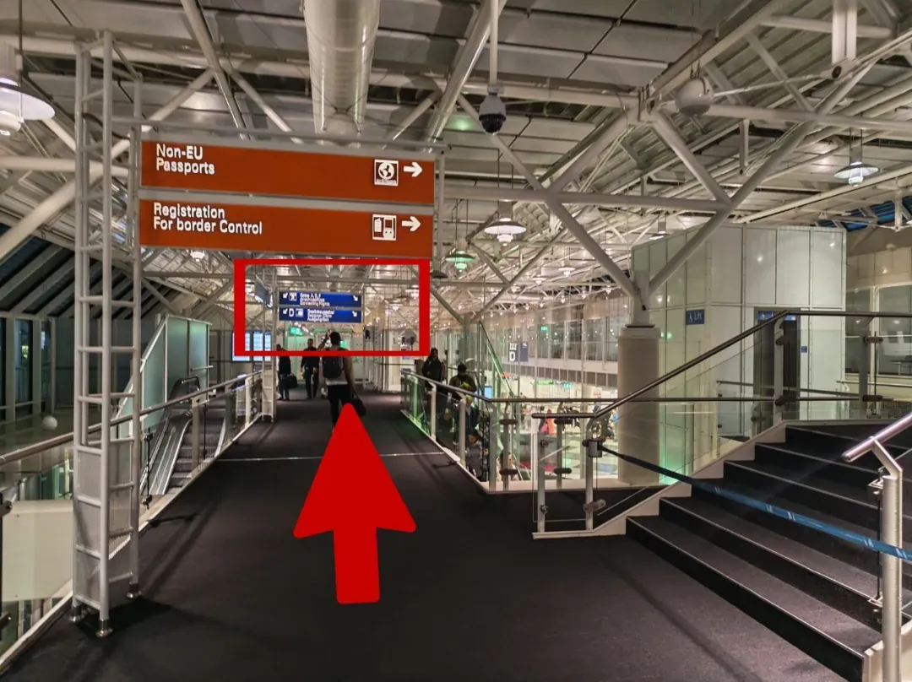

Ili kusaidia kila mtu kupita kuingia Ujerumani kwa urahisi, haya ndiyo unayohitaji kujua kuhusu kuwasili Ujerumani na kukamilisha taratibu katika Uwanja wa Ndege wa Munich. Soma makumbusho mapema na ujue mtiririko, ili safari ianze kwa utulivu.

## Kabla ya kusafiri

Weka kila kitu unachohitaji unapowasili kwenye begi lako la mkononi, si kwenye mizigo iliyochekiwa:

- **Nyaraka:** pasipoti (inashauriwa uhalali wa miezi sita), viza ya Schengen, ratiba ya ndege ya kurudi.
- **Malazi:** uthibitisho wa uhifadhi wa hoteli — maafisa wa mipaka wanaweza kuomba kuuona.
- **Madhumuni ya safari:** mwaliko au programu ya semina, kueleza kwa nini unaingia.
- **Malipo:** pesa taslimu kidogo za euro pamoja na kadi inayofanya kazi nje ya nchi. Kadi zinakubaliwa uwanja wa ndege na jijini, lakini pesa taslimu kidogo ni salama zaidi.
- **Dawa:** dawa zako za kawaida pamoja na cheti cha daktari na tafsiri ya Kiingereza, kwenye begi lako la mkononi.

## Mfumo wa kuingia na kutoka wa EES

Umoja wa Ulaya sasa umeanzisha **Mfumo wa Kuingia na Kutoka (EES)**: wasafiri wenye pasipoti zisizo za EU wanaotembelea eneo la Schengen kwa muda mfupi — utalii, biashara na kadhalika — data zao hulinganishwa na kumbukumbu zilizopo wanapoingia tena (ndani ya miaka mitatu), jambo linalofupisha ukaguzi.

Baada ya kutoka kwenye ndege, fuata kikundi chako na alama za maelekezo hadi forodha, fanya usajili wa kujihudumia wa EES, kisha pita udhibiti wa mipaka. Kwenye mashine ya EES:

### Hatua 1: chagua lugha

Chagua "中文简体" (Kichina Kilichorahisishwa).

### Hatua 2: changanua pasipoti yako

Weka pasipoti kwenye eneo la kuchanganua kama inavyoelekezwa.

### Hatua 3: nasa alama zako za kibaiolojia

**Picha ya uso:** mashine inakuelekeza kupiga picha wazi ya uso wako. Onyesha uso wako wote na vua kofia, miwani au kitu kingine chochote kinachoweza kufunika uso, ili picha ikidhi mahitaji ya utambuzi.

**Alama za vidole:** kwa kawaida vidole vinne hunaswa. Fuata tu skrini na weka kila kidole kwenye eneo lililotengwa.

### Ukaguzi wa mwisho na afisa

Afisa wa mipaka anaweza kuuliza maswali machache kuthibitisha utambulisho wako na madhumuni ya safari yako. Yanayojulikana hujumuisha: **madhumuni ya safari, tikiti ya kurudi na uhifadhi wa hoteli**.

## Bango la kukuchukua

Wafanyakazi hukutana na vikundi vinavyowasili wakiwa na bango la "美花" linaloshikiliwa kwa mkono — ukishamaliza, mtafute mtu anayeshikilia bango hilo.

## Mtiririko wa kuwasili katika Terminal 1

1. Baada ya kutua, fuata ukanda hadi jengo la abiria.

2. Fuata alama za maelekezo.

3. Endelea mbele kupita alama za "Gates A-D".

4. Shuka kwa escalator, fanya usajili wa kujihudumia wa EES na kamilisha forodha.

5. Subiri mizigo yako kwenye mzunguko wa mizigo.

6. Ukiwa na mizigo yako mkononi, fuata alama za "Goods to declare / Nothing to declare" na toka kupitia njia inayofaa.

**Mahali pa kukutana T1:** skrini kubwa kwenye lango la kutoka B (kwa wale waliopanga safari zao wenyewe).

## Mtiririko wa kuwasili katika Terminal 2

### Kesi 1: unahitaji treni ya kuhamisha abiria

Alama ya bluu upande wa kushoto inaashiria njia ya raia wa EU na Uswisi na wenye viza za muda mrefu; alama ya machungwa upande wa kulia ni njia ya pasipoti zisizo za EU.

1. Baada ya kutoka kwenye ndege, fanya kwanza usajili wa kujihudumia wa EES upande wa kulia.

2. Kisha panga foleni kwenye dirisha lenye afisa kwa ukaguzi wa mwisho wa utambulisho — kuwa tayari na folda yako ya nyaraka.

3. Ukishamaliza, elekea treni ya kuhamisha abiria na safiri kutoka Gates JKL hadi Gates GH.

4. Baada ya treni, fuata alama za kuchukua mizigo kwenda juu.

5. Chukua mizigo yako iliyochekiwa kwenye eneo la kuchukua mizigo.

**Mahali pa kukutana T2:** Starbucks upande wa kulia wa lango la kutoka (kwa wale waliopanga safari zao wenyewe).

### Kesi 2: hakuna haja ya treni ya kuhamisha abiria

Toka moja kwa moja kutoka kwenye ndege ukifuata alama, shuka ngazi hadi forodha, fanya usajili wa kujihudumia wa EES na pite udhibiti wa mipaka. Ukishamaliza, geuka kushoto kupitia milango ya kioo hadi eneo la kuchukua mizigo.

**Mahali pa kukutana T2:** Starbucks upande wa kulia wa lango la kutoka (kwa wale waliopanga safari zao wenyewe).

> Ikiwa ulipanga ndege yako ya kimataifa mwenyewe na hukusajili maelezo ya ndege yako au huduma ya kuhamisha abiria, elekea hoteli ya semina kwa njia yako mwenyewe. Kwa taarifa za huduma ya kuhamisha abiria na usafiri wa umma hadi hoteli, angalia akaunti rasmi ya "安利带你看世界".

## Kuingia Ujerumani: unachopaswa kujua

### Vitu vilivyokatazwa

- **Nyama na bidhaa za nyama:** bidhaa za maziwa na zinazohusiana na nyama haziwezi kuletwa EU kutoka nje ya nchi.
- **Mimea na bidhaa za mimea:** mbegu, mboga, matunda na udongo ni marufuku kuingizwa.
- **Silaha na vilipuzi:** bunduki, risasi, vilipuzi na silaha nyingine hatari, ikiwa ni pamoja na sehemu za bunduki na silaha za kuiga, ni marufuku kuagizwa.
- **Dawa za kulevya na dutu zinazodhibitiwa:** dawa haramu, dawa za kulevya na vifaa vinavyohusiana ni marufuku.
- **Bidhaa ghushi:** bidhaa za uharamia au ghushi, kama vile mifuko ya chapa bandia, zinaweza kukaguliwa na forodha na kuadhibiwa.
- **Bidhaa kutoka spishi zinazolindwa:** vitu vinavyohusishwa na ulinzi wa spishi zilizo hatarini kutoweka, kama vile pembe za ndovu na bidhaa za manyoya, ni marufuku kuagizwa.
- **Nyenzo za ponografia:** kuagiza ponografia kwa namna yoyote ni marufuku nchini Ujerumani.

### Vitu vya kutangaza

| Aina | Kiasi kinachoruhusiwa na mahitaji |
| --- | --- |
| Pesa taslimu | €10,000 au zaidi (au sawa nayo) lazima itangazwe kwa forodha |
| Tumbaku | Wasafiri wenye umri wa miaka 20 au zaidi wanaweza kuleta sigara 200 (au kiasi sawa cha tumbaku nyingine) bila ushuru |
| Pombe | Wasafiri wenye umri wa miaka 20 au zaidi wanaweza kuleta lita 1 ya pombe kali au lita 2 za vinywaji vingine vyenye kileo bila ushuru |
| Kahawa na chai | Gramu 500 za kahawa au gramu 200 za dondoo la kahawa bila ushuru |
| Kiini cha manukato na marashi | Gramu 50 za kiini cha manukato na lita 0.25 za marashi bila ushuru |
| Dawa za kibinafsi | Unachohitaji kwa safari, pamoja na cheti cha daktari na tafsiri; kwa ujumla si zaidi ya ugavi wa miezi mitatu |

> Zaidi ya jedwali lililo juu, wasafiri wanaowasili kwa ndege kutoka nje ya EU wanaweza kuleta bidhaa nyingine zenye thamani ya hadi €430 bila ushuru; kikomo ni €150 kwa wasafiri wenye umri chini ya miaka 15. Kitu chochote zaidi ya hapo kinapaswa kupitia njia nyekundu, na ushuru ukilipwa kama inavyotakiwa.

Tunatumaini hii itasaidia kila mtu kupata picha wazi ya kanuni za kuingia Ujerumani na kupita uwanja wa ndege kwa urahisi — tutaonana Munich.

## Viungo vinavyohusiana

- **Kwenye tovuti hii**: [Uwanja wa Ndege wa Munich (MUC)](/airport/MUC), [Ujerumani (DE)](/country/DE)
- **Wikipedia**: [Uwanja wa Ndege wa Munich](https://en.wikipedia.org/wiki/Munich_Airport)
- **Baidu Baike**: [Uwanja wa Ndege wa Munich](https://baike.baidu.com/item/%E6%85%95%E5%B0%BC%E9%BB%91%E6%9C%BA%E5%9C%BA)
- **Forodha**: [Forodha ya Ujerumani (Zoll)](https://www.zoll.de/EN/Home/home_node.html)
- **Makala zaidi**: [Mwongozo wa uhamishaji Uwanja wa Ndege wa Munich](/blog/munich-airport-guide), [Basi la kuhamisha abiria na usafiri wa jiji la Uwanja wa Ndege wa Munich](/blog/munich-airport-shuttle-bus-guide)

Chanzo cha picha: takwimu za makala ya awali, kutoka akaunti ya WeChat "安利带你看世界". Njia za kuwasili, viwango vinavyoruhusiwa na kanuni za kutangaza ni kama zilivyorekodiwa wakati mwongozo ulipotayarishwa na zinaweza kubadilika; angalia tovuti za Forodha ya Ujerumani (Zoll) na Uwanja wa Ndege wa Munich siku ya safari.
