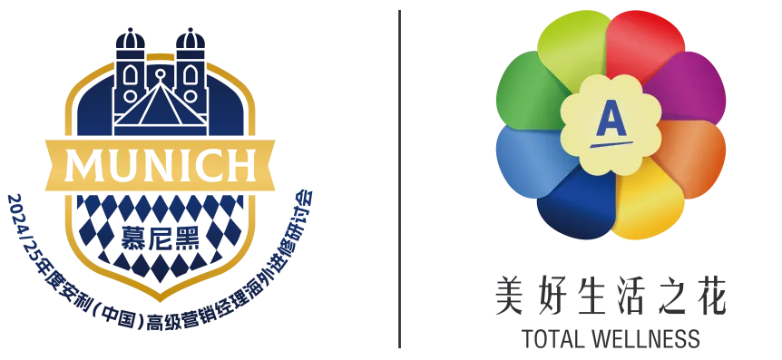

為方便各位順利辦理德國入境手續，特整理德國入境須知及機場通關指南。建議提前仔細閱讀出行提醒、熟悉入境流程，安心開啟慕尼黑之行。

## 出發前準備

落地後要用的東西，最好都放在隨身行李裡，不要託運：

- **證件**：護照（有效期建議 6 個月以上）、申根簽證、往返機票行程單。
- **住宿**：酒店預訂確認單（邊檢可能要求出示）。
- **行程**：研討會邀請函或日程，說明入境目的。
- **支付**：少量歐元現金 + 可境外使用的信用卡，機場與市區都能刷卡，但備點零錢更穩妥。
- **藥品**：個人常用藥連同處方及英文翻譯件放在隨身包內。

## EES 出入境資訊系統

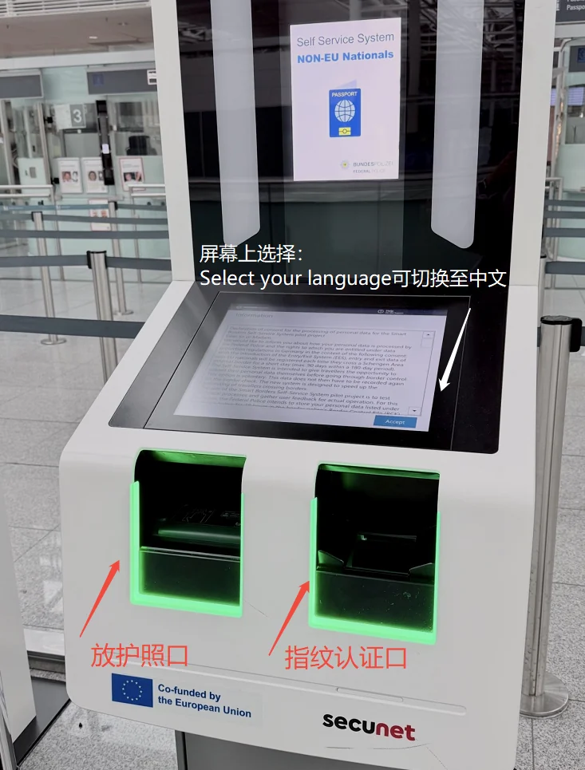

歐盟已正式啟動**「出入境資訊系統」（Entry/Exit System，EES）**：所有持非歐盟護照、以旅遊、商務等目的短期訪問申根區的旅客，再次入境時（三年內）系統可比對既有資料，縮短查驗時間。

出機艙後跟隨團隊沿指示一路直行，抵達海關，進行 EES 自助登記後經邊檢入境。見到 EES 自助機器時，按以下步驟操作：

### 第一步：選擇語言

選擇「中文簡體」。

### 第二步：掃描護照

按螢幕提示將護照放入掃描區。

### 第三步：生物資訊採集

**面部影像採集**：按機器提示拍攝一張清晰的面部照片，注意露出完整面部，摘下帽子、眼鏡等可能遮擋面部的物品，確保照片符合識別要求。

**指紋資訊採集**：通常情況下採集 4 個手指的指紋，只需按照螢幕指示，將相應手指放置在指定區域。

### 邊檢人員最終稽核

邊檢人員可能根據實際情況詢問相關問題，以進一步確認身份和入境目的等資訊。常見提問包括：**出行目的、返程機票、酒店訂單**。

## 接機牌標識

美花手舉牌為現場接機牌標識。

## T1 航廈抵達入境流程

1. 飛機落地後沿通道前往航廈。

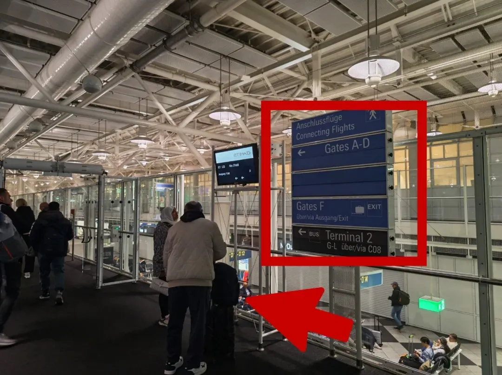

2. 按指引前行。

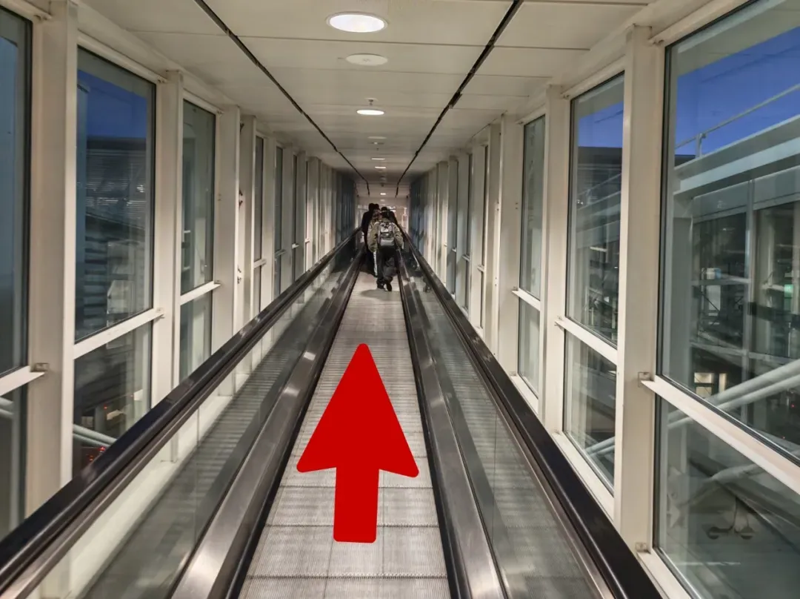

3. 根據指示牌「Gates A-D」繼續向前。

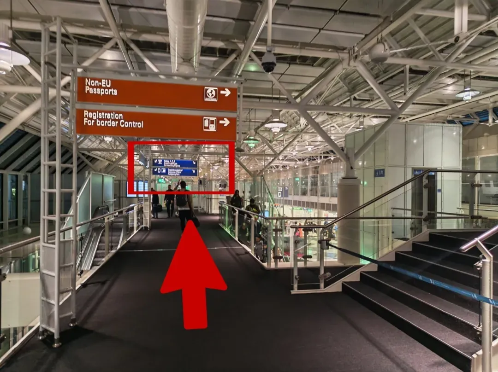

4. 沿電梯下樓，進行 EES 自助登記，過海關。

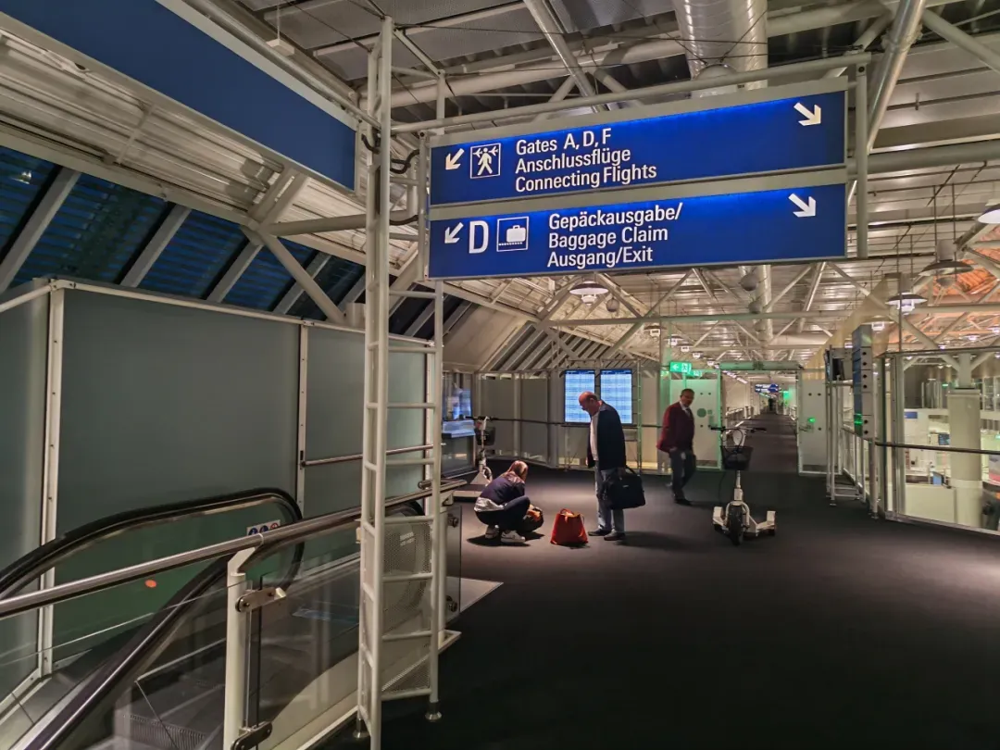

5. 在行李轉盤處等待領取行李。

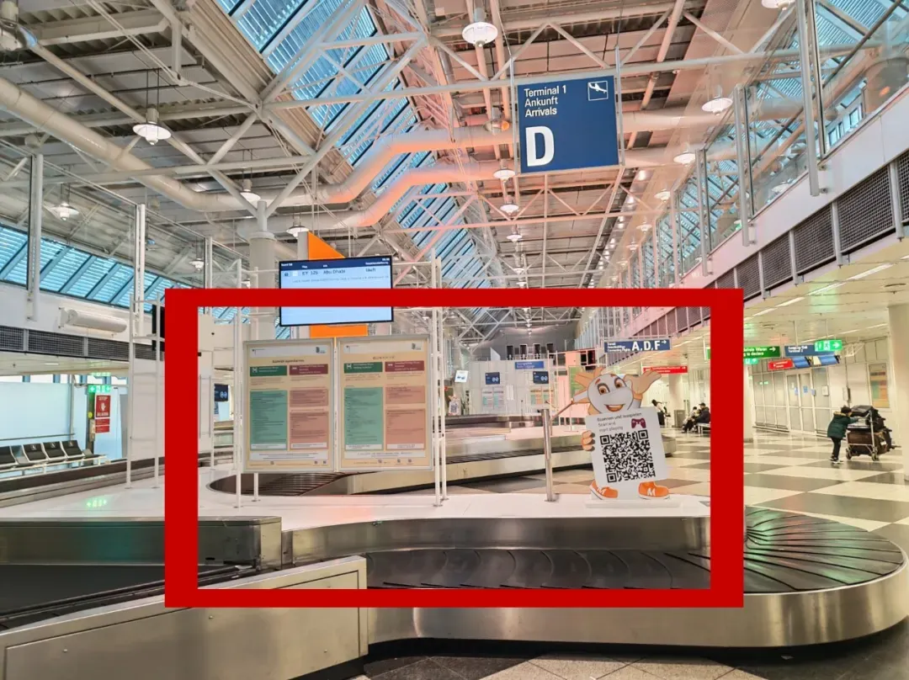

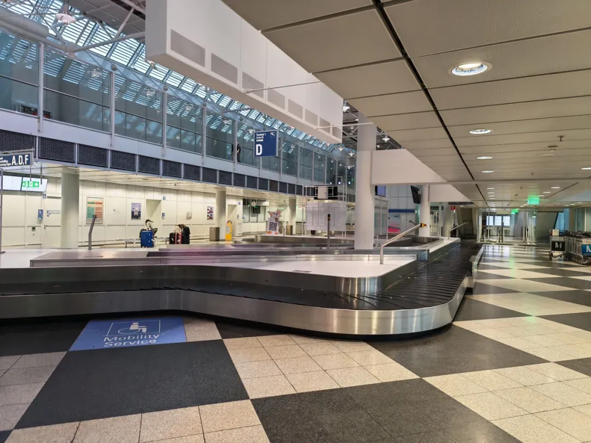

6. 取到行李後，按「Goods to declare／Nothing to declare」的指示，走有／無申報通道入境。

**T1 集合點**：B 出口大屏（自行安排航班的集合點）。

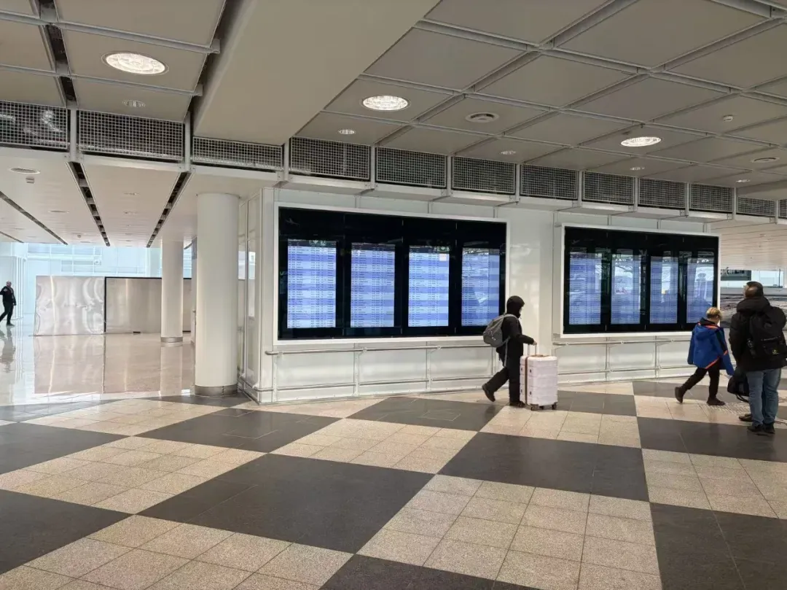

## T2 航廈抵達入境流程

### 情況一：需乘坐小火車

下圖左邊藍色標識為歐盟、瑞士等地區公民或長期簽證持有者通道，右邊橘色標識為非歐盟護照通道。

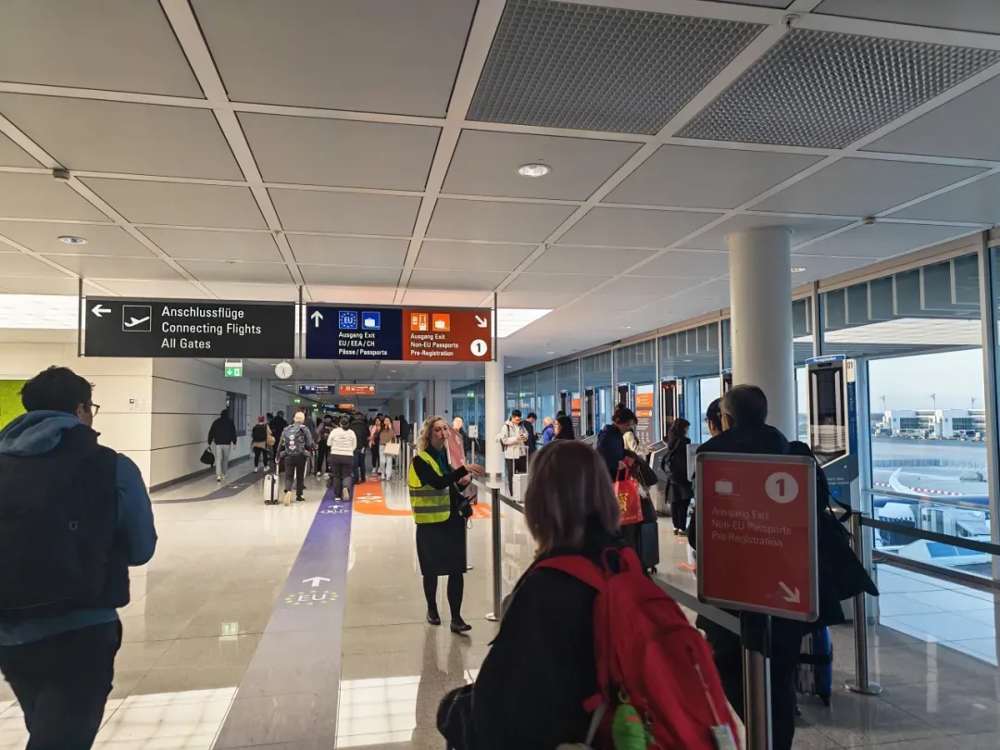

1. 下飛機後先在右側進行 EES 自助登記。

2. 隨後在人工櫃檯排隊進行最終身份確認，此時請拿好您的檔案資料包備查。

3. 查驗通過後來到小火車乘車點，從 Gates JKL 乘坐至 Gates GH。

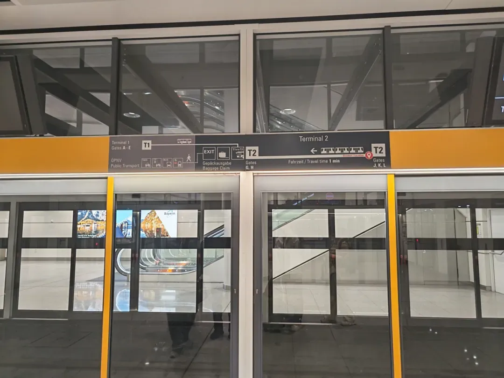

4. 乘坐完小火車後，跟隨行李提取標識上樓。

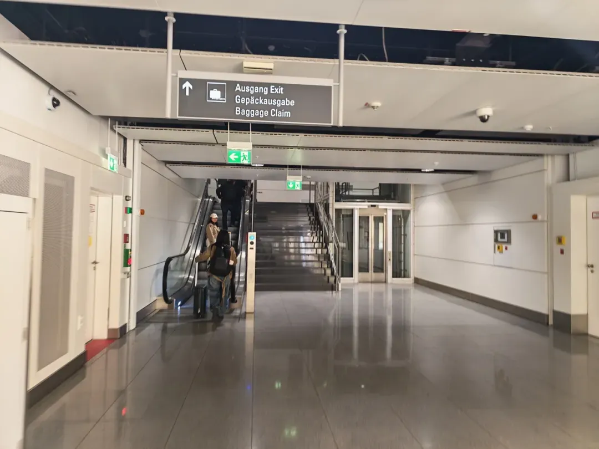

5. 在行李提取處領取您的託運行李。

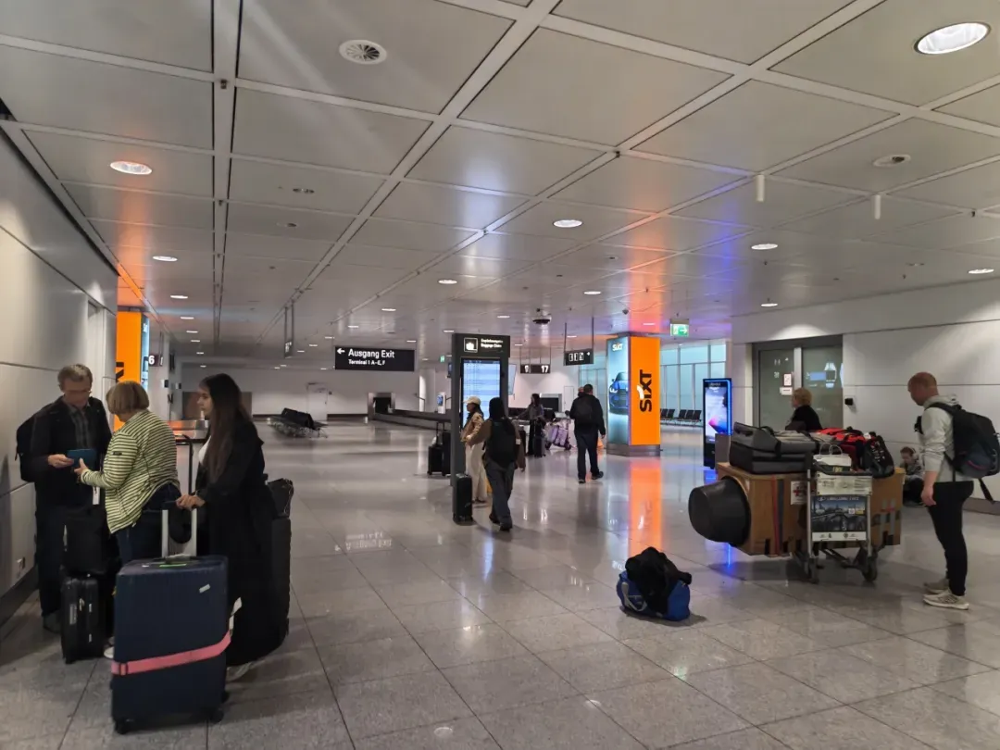

**T2 集合點**：出口右手星巴克（自行安排航班的集合點）。

### 情況二：無需乘坐小火車

出機艙後沿指示一路直行，下樓梯後抵達海關，EES 自助登記後經邊檢入境；入境後左轉通過玻璃門，前往行李提取處。

**T2 集合點**：出口右手星巴克（自行安排航班的集合點）。

> 如您的國際航班為自行安排，且未登記航班資訊和班車服務，請自行安排交通工具前往研討會酒店。班車資訊及前往酒店住宿的公共交通方式，請關注「安利帶你看世界」微信公眾號相關推文。

## 德國出入境須知

### 禁止攜帶的物品

- **肉類及其製品**：奶製品和肉類相關製品禁止從國內攜入歐盟國家。
- **植物及其相關產品**：包括植物種子、蔬菜、水果以及土壤，禁止攜帶入境。
- **武器及爆炸物**：槍支、彈藥、爆炸物以及其他危險武器，包括槍支零件和仿製武器，均禁止進口。
- **毒品及管制藥品**：禁止攜帶非法藥物、麻醉品及其吸食工具。
- **侵權及仿冒商品**：攜帶盜版、仿冒的名牌包包等商品可能被海關查驗並處罰。
- **瀕危動植物製品**：受珍稀物種保護的物品，如象牙、毛皮製品等，禁止進口。
- **色情物品**：任何形式的色情物品進口在德國都是禁止的。

### 需要申報的物品

| 品類 | 免稅額度與要求 |
| --- | --- |
| 現金 | 攜帶等值 1 萬歐元或以上的現金，必須向海關申報 |
| 菸草製品 | 20 歲以上旅客可免稅攜帶 200 支香菸（或其他相當數量的菸草製品） |
| 酒類飲品 | 20 歲以上旅客可免稅攜帶 1 升烈酒或 2 升其他酒精飲品 |
| 咖啡及茶葉 | 可免稅攜帶 500 克咖啡或 200 克咖啡萃取物 |
| 香精及香水 | 可免稅攜帶 50 克香精和 0.25 升香水 |
| 個人藥品 | 旅行期間自用所需，須攜帶處方及翻譯件，一般不超過 3 個月用量 |

> 除上表品類外，乘飛機從非歐盟國家入境時，還可免稅攜帶價值不超過 430 歐元的其他物品；15 歲以下旅客的限額為 150 歐元。超出部分請主動走申報通道，或按規定補稅。

希望以上資訊能幫助大家輕鬆掌握德國的入境規定，順利通關，慕尼黑見。

## 相關連結

- **本站頁面**：[慕尼黑機場（MUC）](/tw/airport/MUC)、[德國（DE）](/tw/country/DE)
- **維基百科**：[慕尼黑機場](https://zh.wikipedia.org/wiki/%E6%85%95%E5%B0%BC%E9%BB%91%E6%9C%BA%E5%9C%BA)
- **海關官網**：[德國聯邦海關總署 Zoll](https://www.zoll.de/EN/Home/home_node.html)
- **相關文章**：[慕尼黑機場轉機全攻略](/tw/blog/munich-airport-guide)、[慕尼黑機場接機班車與市區交通](/tw/blog/munich-airport-shuttle-bus-guide)

圖片來源：原文配圖，來自「安利帶你看世界」微信公眾號。文中通關動線、免稅額度與申報規定為整理時資料，可能隨政策調整，出行前請以德國聯邦海關總署與慕尼黑機場官網當日資訊為準。
