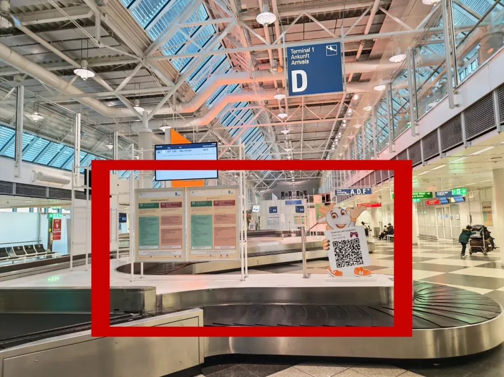
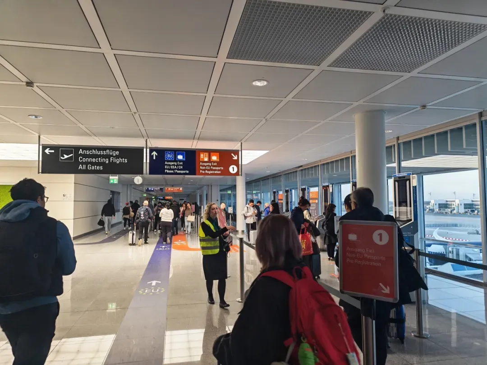

Щоб німецький в'їзд минув гладко, ось що потрібно знати про прибуття до Німеччини та проходження аеропорту Мюнхена. Прочитайте нагадування заздалегідь і вивчіть послідовність дій, щоб подорож почалася спокійно.

## Перед польотом

Тримайте все потрібне після приземлення в ручній поклажі, а не в зареєстрованому багажі:

- **Документи:** паспорт (рекомендовано термін дії шість місяців), шенгенська віза, маршрут зворотного рейсу.
- **Проживання:** підтвердження бронювання готелю — прикордонники можуть попросити його показати.
- **Мета візиту:** запрошення на семінар або програма, щоб пояснити причину в'їзду.
- **Оплата:** трохи готівки в євро плюс картка, що працює за кордоном. Картки приймають в аеропорту й у місті, але трохи готівки надійніше.
- **Ліки:** ваші постійні ліки з рецептом і перекладом англійською у ручній поклажі.

## Система в'їзду/виїзду EES

ЄС запровадив **систему в'їзду/виїзду (EES)**: дані мандрівників із паспортами країн не-ЄС, які відвідують Шенгенську зону з коротким перебуванням — туризм, бізнес тощо — звіряють з наявними записами під час повторного в'їзду (протягом трьох років), що скорочує перевірку.

Після виходу з літака йдіть за своєю групою та вказівниками аж до митниці, пройдіть самостійну реєстрацію в EES, а потім прикордонний контроль. Біля автомата EES:

### Крок 1: виберіть мову

Виберіть «中文简体» (спрощена китайська).

### Крок 2: відскануйте паспорт

Покладіть паспорт у зону сканування, як підказує система.

### Крок 3: зніміть біометричні дані

**Зображення обличчя:** автомат пропонує зробити чіткий знімок обличчя. Покажіть обличчя повністю й зніміть капелюх, окуляри чи будь-що інше, що може його затуляти, щоб фото відповідало вимогам розпізнавання.

**Відбитки пальців:** зазвичай сканують чотири пальці. Просто йдіть за екраном і кладіть кожен палець у позначену зону.

### Остаточна перевірка офіцером

Прикордонний офіцер може поставити кілька запитань, щоб підтвердити вашу особу та мету візиту. Зазвичай запитують про **мету подорожі, зворотний квиток і бронювання готелю**.

## Табличка для зустрічі

Працівники зустрічають групи, що прибувають, із ручною табличкою «美花» — коли пройдете, шукайте людину з нею.

## Схема прибуття в терміналі 1

1. Після приземлення йдіть коридором до термінала.

2. Ідіть за вказівниками.

3. Продовжуйте йти повз вказівники «Gates A-D».

4. Спустіться ескалатором, пройдіть самостійну реєстрацію в EES і митний контроль.

5. Зачекайте на багаж біля стрічки.

6. Із багажем у руках ідіть за вказівниками «Goods to declare / Nothing to declare» і виходьте відповідним коридором.

**Місце зустрічі в T1:** великий екран біля виходу B (для тих, хто самостійно організував переліт).

## Схема прибуття в терміналі 2

### Випадок 1: вам потрібен шатл-потяг

Синій вказівник ліворуч позначає коридор для громадян ЄС і Швейцарії та власників довгострокових віз; помаранчевий праворуч — коридор для паспортів країн не-ЄС.

1. Після виходу з літака спершу пройдіть самостійну реєстрацію в EES праворуч.

2. Потім станьте в чергу до стійки з офіцером для остаточної перевірки особи — тримайте теку з документами напоготові.

3. Коли пройдете, прямуйте до шатл-потяга та проїдьте від Gates JKL до Gates GH.

4. Після потяга йдіть за вказівниками видачі багажу нагору.

5. Заберіть зареєстрований багаж у зоні видачі.

**Місце зустрічі в T2:** Starbucks праворуч від виходу (для тих, хто самостійно організував переліт).

### Випадок 2: шатл-потяг не потрібен

Вийшовши з літака, ідіть прямо за вказівниками, спустіться сходами до митниці, пройдіть самостійну реєстрацію в EES і прикордонний контроль. Коли пройдете, поверніть ліворуч через скляні двері до видачі багажу.

**Місце зустрічі в T2:** Starbucks праворуч від виходу (для тих, хто самостійно організував переліт).

> Якщо ви самостійно організували міжнародний переліт і не зареєстрували дані рейсу чи шатл-сервіс, дістаньтеся до готелю семінару самостійно. Про шатл і громадський транспорт до готелю дивіться в офіційному акаунті «安利带你看世界».

## В'їзд до Німеччини: що потрібно знати

### Заборонені предмети

- **М'ясо та м'ясні продукти:** молочні та м'ясні продукти не можна ввозити до ЄС з-за кордону.
- **Рослини та рослинні продукти:** насіння, овочі, фрукти й ґрунт заборонені до ввезення.
- **Зброя та вибухівка:** вогнепальна зброя, боєприпаси, вибухівка та інша небезпечна зброя, включно з частинами вогнепальної зброї й імітаціями, заборонені до ввезення.
- **Наркотики та контрольовані речовини:** заборонено незаконні наркотики, наркотичні речовини та приладдя для них.
- **Підроблені товари:** піратські та підроблені речі, наприклад фальшиві брендові сумки, можуть оглянути й за них можуть оштрафувати на митниці.
- **Продукти видів під охороною:** предмети, що підпадають під захист зникаючих видів, як-от вироби зі слонової кістки та хутра, заборонені до ввезення.
- **Порнографічні матеріали:** ввезення порнографії в будь-якій формі в Німеччині заборонене.

### Товари, які потрібно декларувати

| Категорія | Дозволена кількість і вимоги |
| --- | --- |
| Готівка | €10 000 або більше (чи еквівалент) потрібно задекларувати на митниці |
| Тютюн | Мандрівники віком 20 років і старші можуть безмитно ввозити 200 сигарет (або еквівалентну кількість іншого тютюну) |
| Алкоголь | Мандрівники віком 20 років і старші можуть безмитно ввозити 1 літр міцних напоїв або 2 літри інших алкогольних напоїв |
| Кава й чай | 500 г кави або 200 г кавового екстракту безмитно |
| Аромати й парфуми | 50 г есенції та 0,25 літра парфумів безмитно |
| Особисті ліки | Стільки, скільки потрібно на подорож, з рецептом і перекладом; зазвичай не більше ніж на три місяці |

> Крім наведеного вище, мандрівники, які прибувають літаком з-за меж ЄС, можуть безмитно ввезти інші товари вартістю до €430; для мандрівників до 15 років ліміт становить €150. Усе, що перевищує цю суму, слід провозити через червоний коридор, сплативши мито за потреби.

Сподіваємося, це допоможе всім чітко зрозуміти правила в'їзду до Німеччини й без проблем пройти аеропорт — до зустрічі в Мюнхені.

## Пов'язані посилання

- **На цьому сайті**: [Аеропорт Мюнхена (MUC)](/airport/MUC), [Німеччина (DE)](/country/DE)
- **Wikipedia**: [Аеропорт Мюнхена](https://en.wikipedia.org/wiki/Munich_Airport)
- **Baidu Baike**: [Аеропорт Мюнхена](https://baike.baidu.com/item/%E6%85%95%E5%B0%BC%E9%BB%91%E6%9C%BA%E5%9C%BA)
- **Митниця**: [Німецька митниця (Zoll)](https://www.zoll.de/EN/Home/home_node.html)
- **Більше статей**: [Гід із пересадки в аеропорту Мюнхена](/blog/munich-airport-guide), [Шатл і міський транспорт аеропорту Мюнхена](/blog/munich-airport-shuttle-bus-guide)

Джерело зображень: ілюстрації з оригінальної статті, з облікового запису WeChat «安利带你看世界». Маршрути прибуття, дозволені норми й правила декларування наведено станом на час укладання гіда, і вони можуть змінитися; перевіряйте сайти Німецької митниці (Zoll) та аеропорту Мюнхена в день подорожі.
