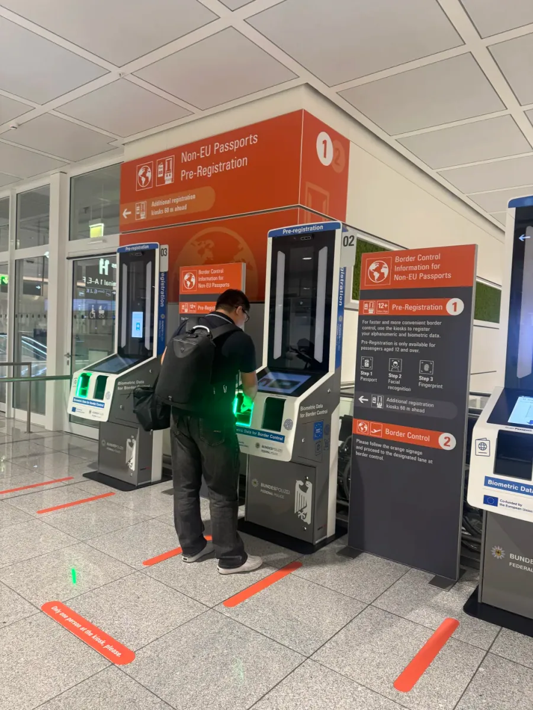

Mnichovské letiště (MUC) leží na Erdinger Moos asi 28 km severovýchodně od města. Je to druhé největší letiště v Německu a jeden z hlavních evropských uzlů Lufthansy a Star Alliance. Terminál 1 obsluhuje brány A–E a F pro většinu aerolinek mimo skupinu Lufthansa; terminál 2 obsluhuje brány G, H, J, K a L pro Lufthansu a její partnery, přičemž část této bránové oblasti je v satelitní budově, kam se jezdí krátkým autonomním vlakem.

Pro každého, kdo přilétá z Číny a pokračuje do schengenské země, je letiště v jednom ohledu snadné a v jiném záludné. Vzdálenosti jsou krátké a značení jasné, ale přestup tady není jen otázkou následování davu ven z budovy. Na stejném úseku chodby projdete bezpečnostní kontrolou, zaregistrujete údaje ve vstupním/výstupním systému EU a jste vpuštěni do Schengenu — a pořadí je opačné, než mnoho cestujících čeká.

Následující popis vychází z časného ranního přestupu v září 2026: zhruba 20 minut od dveří letadla po projití pasové kontroly. Platí jen pro jeden případ — přistání mimo Schengen a přestup do schengenské destinace, což znamená absolvovat vpuštění v Mnichově. Pokud váš navazující let opouští schengenský prostor, krok vpuštění odpadá, ale bezpečnostní kontrola i cesta k bráně jsou stejné.

## 1. Jediný předpoklad: zavazadla odbavená až do cíle

Zda přestup proběhne hladce, se z velké části rozhoduje při koupi letenky. U průběžné letenky jsou zavazadla označena až do konečné destinace a přestupní trasou nesete jen příruční zavazadlo. U samostatných letenek musíte být vpuštěni, vyzvednout kufr a znovu ho odbavit. Dvacetiminutový průchod existuje jen tehdy, pokud jsou zavazadla odbavena až do cíle.

Podívejte se na zavazadlový štítek za palubní vstupenkou: v poli destinace by měl být třímístný kód vašeho konečného města, ne MUC. Zeptejte se při odbavení — „je to odbavené až do X?“ — a pracovník přepážky vám to řekne. Samostatné letenky obvykle znamenají novou palubní vstupenku z přestupní přepážky, což je třeba započítat do času na přestup.

**Zavazadla odbavená až do cíle jsou předpokladem celé této trasy.** Bez nich raději následujte Baggage Claim: nechte se vpustit, vyzvedněte kufr, vraťte se nahoru do odletové haly a znovu se odbavte. Tato objížďka stojí hodně času, proto počítejte tři hodiny i více.

## 2. Následujte značky „Connecting flights“

Když se otevřou dveře nástupního mostu, prvním úkolem není najít bránu, ale vybrat správný směr. Následujte proud cestujících nahoru, kde tmavě modré podhledové značky rozdělují provoz: na jedné straně Ausgang/Exit a Gepäckausgabe/Baggage Claim, na druhé terminál 1 s branami A–E a F plus terminál 2 s branami G, H, J a K. Šedé značky Connecting flights visí hned za tímto rozcestím.

Klasickou chybou je uvidět Exit a vydat se tam. Jakmile projdete těmi dveřmi, jste ve veřejné hale a návrat do tranzitního prostoru znamená znovu bezpečnostní kontrolu — přestup je prakticky u konce. S zavazadly odbavenými až do cíle přestup neznamená výdej zavazadel ani východ; následujte Connecting flights a jste v pořádku.

Pokud váš navazující let míří do jiného města EU, brána bývá obvykle v **G nebo K**. Tato písmena jsou značena odděleně od A–E a F terminálu 1, proto si písmeno přečtěte, než vyrazíte; kde trasa vyžaduje vlak, přidávají značky šipku a symbol výtahu.

## 3. Předregistrace EES a bezpečnostní kontrola

Mnichov řadí bezpečnostní kontrolu před imigrační, na rozdíl od mnoha letišť: nejprve bezpečnost, potom eskalátor dolů k pasové kontrole. Před pruhy stojí několik oranžových terminálů s označením Non-EU Passports Pre-Registration — samoobslužných zařízení pro vstupní/výstupní systém EU, který se zavádí postupně od října 2025. Při prvním vstupu zaznamená snímek obličeje a čtyři otisky prstů; při pozdějších návštěvách do tří let je může místo toho porovnat.

Když jsou fronty dlouhé, nejprve se zaregistrujte a do fronty se zařaďte potom. Položte pas na čtečku vlevo a rozhraní se samo přepne do čínštiny; pořiďte snímek obličeje podle pokynů, sundejte klobouk, masku a brýle; poté přitlačte čtyři prsty pravé ruky bez palce na skener. Obrazovka vám pak sdělí, že máte použít ruční koridor (předregistrace). Registrace data pouze předem ukládá; nejde o vpuštění.

Informační tabule vedle terminálů dodává podrobnosti, které stojí za to znát: předregistrace je jen pro cestující **ve věku 12 let a více**; pokud je tato řada obsazená, další sada terminálů je o 60 m dál; červená páska na podlaze vyznačuje odstup 1,5 metru.

Při autorově časném letu byla bezpečnostní kontrola klidná a ruční koridor zavřený, takže přímé zařazení do fronty na bezpečnost bylo rychlejší. V den cesty si ověřte, která řada je nejkratší. Bezpečnostní kontrola funguje podobně jako doma, ale lidé zapomínají na dvě věci: vysypat klíče, mince a telefon do přihrádky a vyndat z tašky vše koupené v duty-free obchodě — tekutiny patří do průhledného sáčku, ne na dno kufru.

## 4. Tři otázky na pasové kontrole

Za bezpečnostní kontrolou vás eskalátor dolů přivede do pasové haly. Koridory se dělí podle pasu: na jedné straně EU, EHP a Švýcarsko, na druhé vše ostatní. To ráno bylo otevřeno dost přepážek a v každé frontě stáli dva nebo tři lidé, proto volte nejkratší řadu — délka fronty je důležitější než typ koridoru.

Policista položil tři otázky: kam jedete, jak dlouho zůstanete a co děláte. Všechny tři směřují k jedné věci — zda cesta dává smysl. V jaké zóně je vaše navazující brána, kolik nocí plánujete a v jaké roli vstupujete; pokud odpovědi odpovídají dokladům, je hotovo za méně než minutu.

Autor držel složku s doklady, ale itinerář, zpáteční letenku, rezervaci hotelu ani cestovní pojištění si nikdo nevyžádal — policista na ně ani nepohlédl. To neznamená nechat je doma: pohraničníci si mohou vyžádat zpáteční letenku a doklad o ubytování, proto je mějte v příručním zavazadle. Odpovědi by měly být krátké a v souladu s daty na papírech.

Od dveří letadla po projití pasové kontroly to trvalo asi **20 minut**. Tento údaj platí jen pro časný let; totéž letiště v poledne je jiný příběh. Počítejte s více než minimálním přestupním časem aerolinky a neberte 20 minut jako pravidlo.

## 5. Brána a automatický přepravník

Nespěchejte k bráně tryskem hned, jak projdete. Nejčastěji opomíjenou zastávkou jsou toalety, které jsou o úroveň níž nebo na vzdáleném konci bránové oblasti.

O úroveň níž je nástupiště vlaku. Mnichovský automatický přepravní systém spojuje oba terminály se satelitní budovou; nástupiště má skleněné nástupištní stěny se zářivě žlutými rámy. Displej nad dveřmi ukazuje, kam jede příští vlak: terminál 2 brány G a H, terminál 1 brány A–E a F a Gepäckausgabe pro výdej zavazadel, s odpočtem Abfahrt in 2 min.

Jízda je krátká a dveře se otevřou přímo do bránové oblasti G a K. Čekací prostor je jedna dlouhá hala s letištní plochou za okny od podlahy ke stropu; nad nástupními branami visí žluté panely a hala byla téměř prázdná.

Zbývá poslední úkol: znovu zkontrolovat bránu. Autorovi se brána změnila z **G23 na G12**, mezi nimiž je pořádný kus cesty, a bez druhého pohledu na obrazovky by člověk snadno čekal na špatném místě až do posledního volání. Zkontrolujte ji po přistání, znovu po pasové kontrole a ještě jednou, než se posadíte; aplikace letiště a informační obrazovky letů jsou synchronizované a obojí je spolehlivější než brána vytištěná na palubní vstupence.

Pokud je málo času, ověřte novou bránu, než začnete nakupovat: obchody se soustředí kolem G a H a je snadné ztratit pojem o čase.

Od začátku do konce je časný ranní přestup v Mnichově vlastně změnou dopravy: bezpečnost, registrace, vpuštění, vlak, brána. Co se pokazí, je považovat ho za opuštění letiště — ze zvyku jít za Exit nebo čekat u pásu na kufr, který nikdy nepřijede. Trasy a otevírací doba koridorů se mění podle provozu, proto v den cesty zkontrolujte web mnichovského letiště a značení.

## Související odkazy

- **Na tomto webu**: [Mnichovské letiště (MUC)](/airport/MUC), [Německo (DE)](/country/DE)
- **Wikipedia**: [Mnichovské letiště](https://en.wikipedia.org/wiki/Munich_Airport)
- **Baidu Baike**: [Mnichovské letiště](https://baike.baidu.com/item/%E6%85%95%E5%B0%BC%E9%BB%91%E6%9C%BA%E5%9C%BA)
