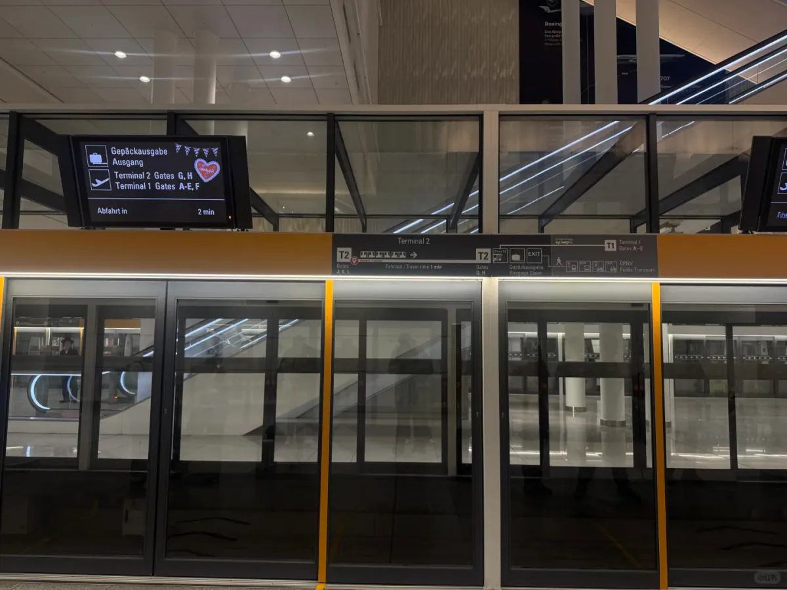

O Aeroporto de Munique (MUC) fica no Erdinger Moos, cerca de 28 km a nordeste da cidade. É o segundo maior aeroporto da Alemanha e um dos principais hubs europeus da Lufthansa e da Star Alliance. O Terminal 1 atende os portões A–E e F da maioria das companhias fora do grupo Lufthansa; o Terminal 2 atende os portões G, H, J, K e L da Lufthansa e de suas parceiras, com parte dessa área de portões no edifício satélite, alcançado por um pequeno trem sem condutor.

Para quem chega da China com uma conexão Schengen, o aeroporto é fácil em um sentido e complicado em outro. As distâncias são curtas e a sinalização é clara, mas uma conexão aqui não é apenas seguir a multidão para fora do prédio. No mesmo trecho de corredor, você passa pela segurança, registra seus dados no Sistema de Entrada/Saída da UE e é admitido no Schengen — e a ordem é o inverso do que muitos viajantes esperam.

O passo a passo abaixo vem de uma conexão no início da manhã em setembro de 2026: cerca de 20 minutos da porta da aeronave até passar pelo controle de passaporte. Ele se aplica a um único caso — pousar de fora do Schengen e conectar a um destino Schengen, o que significa ser admitido em Munique. Se o seu voo seguinte sai do espaço Schengen, a etapa de admissão desaparece, mas a segurança e a caminhada até o portão são idênticas.

## 1. A única precondição: bagagem despachada de ponta a ponta

Se uma conexão corre bem é em grande parte decidido quando você compra a passagem. Em um bilhete de ponta a ponta, suas malas são etiquetadas até o destino final e você leva apenas a bagagem de mão pelo percurso de transferência. Em bilhetes separados, você precisa ser admitido, retirar a mala e despachá-la novamente. O passo a passo de 20 minutos só existe se suas malas estiverem despachadas de ponta a ponta.

Olhe a etiqueta da bagagem atrás do seu cartão de embarque: o campo de destino deve mostrar o código de três letras da sua cidade final, não MUC. Pergunte no check-in — “esta bagagem vai despachada até X?” — e o agente responderá. Bilhetes separados geralmente significam um novo cartão de embarque em um balcão de transferência, o que precisa entrar no tempo de conexão.

**Bagagem despachada de ponta a ponta é a precondição para toda esta rota.** Sem isso, siga para Baggage Claim: seja admitido, pegue a mala, suba novamente às partidas e faça o check-in outra vez. Esse desvio custa muito tempo, então reserve três horas ou mais.

## 2. Siga as placas “Connecting flights”

Quando a porta da ponte de embarque se abre, a primeira tarefa não é encontrar seu portão, mas escolher a direção certa. Siga o fluxo para o andar de cima, onde as placas azul-escuras suspensas dividem o tráfego: Ausgang/Exit e Gepäckausgabe/Baggage Claim de um lado, portões A–E e F do Terminal 1 mais portões G, H, J e K do Terminal 2 do outro. As placas cinzas de Connecting flights ficam logo além dessa bifurcação.

O erro clássico é ver Exit e seguir por ali. Depois de atravessar aquela porta, você está no saguão público, e voltar para a área restrita significa passar pela segurança de novo — a conexão está efetivamente perdida. Com as malas despachadas de ponta a ponta, uma conexão significa sem retirada de bagagem e sem saída; siga Connecting flights e tudo dá certo.

Se o seu voo seguinte for para outra cidade da UE, o portão geralmente fica em **G ou K**. Essas letras são sinalizadas separadamente das A–E e F do Terminal 1, então leia a letra antes de caminhar; quando a rota exige o trem, as placas acrescentam uma seta e um símbolo de elevador.

## 3. Pré-registro no EES e segurança

Munique coloca a segurança antes da imigração, o oposto de muitos aeroportos: segurança primeiro, depois a escada rolante para o controle de passaporte. Na frente das filas ficam vários quiosques laranja com a inscrição Non-EU Passports Pre-Registration — os terminais de autoatendimento do Sistema de Entrada/Saída da UE, que vem sendo implantado por etapas desde outubro de 2025. Na primeira entrada, ele registra uma imagem facial e quatro impressões digitais; nas visitas seguintes dentro de três anos, pode compará-las.

Quando as filas estão longas, registre-se primeiro e entre na fila depois. Coloque o passaporte no leitor à esquerda e a interface muda para o chinês sozinha; tire uma foto facial conforme as instruções, retirando boné, máscara e óculos; depois pressione os quatro dedos da mão direita, sem o polegar, no scanner. A tela então indica que você deve usar a fila manual (pré-registro). O registro apenas armazena dados com antecedência; não é a admissão.

O quadro de avisos ao lado das máquinas acrescenta detalhes que vale conhecer: o pré-registro é apenas para passageiros **com 12 anos ou mais**; se esta fila estiver cheia, há outro conjunto de quiosques 60 m à frente; uma fita vermelha no chão marca o espaçamento de 1,5 metro.

No voo cedo do autor, a segurança estava tranquila e a fila manual estava fechada, então entrar direto na fila da segurança foi mais rápido. Confira qual fila está mais curta no dia. A segurança funciona quase como em casa, com duas coisas que as pessoas esquecem: esvaziar chaves, moedas e celular em uma bandeja e tirar da bolsa qualquer coisa comprada em uma loja duty-free — líquidos vão para o saquinho transparente, não para o fundo da mala.

## 4. Três perguntas no controle de passaporte

Depois da segurança, a escada rolante de descida leva você ao saguão de passaportes. As filas são divididas por passaporte: UE, EEE e Suíça de um lado, todo o resto do outro. Muitos guichês estavam abertos naquela manhã e cada fila tinha duas ou três pessoas, então pegue a mais curta — o tamanho da fila importa mais que o tipo de faixa.

O oficial fez três perguntas: para onde você vai, quanto tempo fica e o que faz. Todas apontam para a mesma coisa — se a viagem faz sentido. Em que zona fica o seu portão seguinte, quantas noites você planeja e em que qualidade está entrando; se as respostas correspondem à papelada, tudo termina em menos de um minuto.

O autor carregava uma pasta de documentos, mas o itinerário, a passagem de volta, a reserva do hotel e a apólice de seguro nunca foram solicitados — o oficial nem olhou para eles. Isso não significa deixá-los em casa: os oficiais de fronteira podem pedir uma passagem de volta e comprovante de hospedagem, então mantenha-os na bagagem de mão. As respostas devem ser curtas e coerentes com as datas no papel.

Da porta da aeronave até o controle de passaporte concluído levaram cerca de **20 minutos**. Esse número vale apenas para um voo cedo; o mesmo aeroporto ao meio-dia é outra história. Reserve mais que o tempo mínimo de conexão da companhia aérea em vez de tratar 20 minutos como regra.

## 5. O portão e o people mover

Não dispare para o portão no momento em que passar. A parada mais esquecida é o banheiro, que fica um nível abaixo ou no extremo da área de portões.

Mais um nível abaixo fica a plataforma do trem. O sistema de transporte sem condutor de Munique liga os dois terminais ao edifício satélite; a plataforma tem portas de tela de vidro com molduras amarelas brilhantes. O painel acima das portas mostra para onde vai o próximo trem: portões G e H do Terminal 2, portões A–E e F do Terminal 1 e Gepäckausgabe para retirada de bagagem, com uma contagem regressiva indicando Abfahrt em 2 min.

A viagem é curta, e as portas se abrem direto na área dos portões G e K. A área de espera é um longo saguão com o pátio atrás de janelas do piso ao teto; telas amarelas ficam acima dos portões de embarque, e o piso estava quase vazio.

Há uma última coisa a fazer: conferir seu portão novamente. O portão do autor mudou de **G23 para G12**, uma boa caminhada de distância, e sem uma segunda olhada nas telas teria sido fácil esperar no lugar errado até o chamado final. Verifique no pouso, de novo após o controle de passaporte e mais uma vez antes de se sentar; o aplicativo do aeroporto e as telas de informações de voo estão sincronizados, e qualquer um dos dois é melhor que o portão impresso no seu bilhete.

Se o tempo estiver curto, confirme o novo portão antes de fazer compras: as lojas se aglomeram em torno de G e H, e é fácil perder a noção do tempo.

De ponta a ponta, uma conexão no início da manhã em Munique é realmente uma troca de meio de transporte: segurança, registro, admissão, trem, portão. O que dá errado é tratá-la como uma saída do aeroporto — seguir Exit por hábito ou esperar em uma esteira por uma mala que nunca viria. As rotas e os horários de abertura das faixas mudam com o tráfego, então consulte o site do Aeroporto de Munique e as placas no dia.

## Links relacionados

- **Neste site**: [Aeroporto de Munique (MUC)](/airport/MUC), [Alemanha (DE)](/country/DE)
- **Wikipédia**: [Aeroporto de Munique](https://en.wikipedia.org/wiki/Munich_Airport)
- **Baidu Baike**: [Aeroporto de Munique](https://baike.baidu.com/item/%E6%85%95%E5%B0%BC%E9%BB%91%E6%9C%BA%E5%9C%BA)
